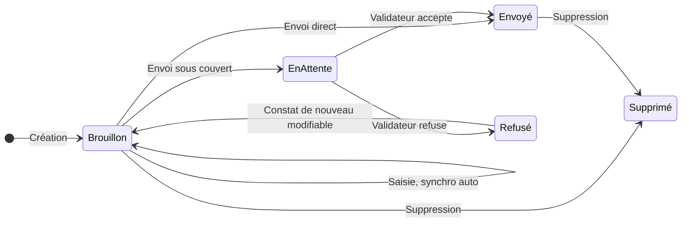
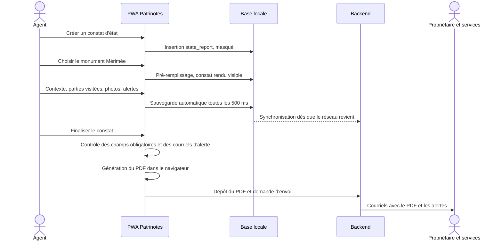

# 01 — Contexte et périmètre

Ce document présente Patrinotes du point de vue métier : à quoi sert le produit, qui l'utilise, quels documents il produit et comment les agents s'en servent sur le terrain. Il fixe aussi le périmètre du présent Dossier d'Architecture Technique (DAT).

Il s'adresse à tous les lecteurs du DAT : équipes de la DSI du ministère de la Culture qui reprennent l'hébergement, nouveaux développeurs, personnes chargées de l'homologation de sécurité, et interlocuteurs non techniques.

> Sources : interface de l'application (routes et textes du dossier [`packages/frontend/src`](../packages/frontend/src)), pages légales intégrées, [README](../README.md), [MAP_PLAN.md](../MAP_PLAN.md) et tests de bout en bout du dossier [`tests/`](../tests). Les points déduits et non vérifiés sont signalés par « à confirmer ».

---

## 1. Le produit en une phrase

**Patrinotes** (« Les outils du patrimoine en mobilité ») est une application web installable (PWA) qui permet aux agents du patrimoine de rédiger **sur le terrain, même sans réseau**, deux types de documents. Ces documents sont ensuite mis en page en PDF et envoyés par courriel :

- des **constats d'état** (CE) de monuments historiques ;
- des **comptes-rendus** (CR) de rendez-vous avec des porteurs de projet.

L'application est éditée par la **Direction générale des patrimoines et de l'architecture (DGPA)** du ministère de la Culture, d'après les [CGU](../packages/frontend/src/routes/cgu.tsx) et la [politique de confidentialité](../packages/frontend/src/routes/politique-confidentialite.tsx).

## 2. Contexte beta.gouv.fr et historique

- Patrinotes est une **startup d'État** du programme beta.gouv.fr. Le pied de page renvoie vers le code source public `github.com/betagouv/patrinotes` ([Layout.tsx](../packages/frontend/src/features/Layout.tsx#L132)), sous **licence Etalab 2.0**. La mesure d'audience passe par l'instance Matomo de beta.gouv.fr (`stats.beta.gouv.fr`, site 123, [main.tsx](../packages/frontend/src/main.tsx#L132-L136)).
- Le produit s'appelait **« Compte-rendu VIF »** (ancien nom du produit, sans sigle particulier). Il ne couvrait alors que les comptes-rendus des UDAP, puis a été étendu aux constats d'état et renommé Patrinotes. Plusieurs traces de cet historique restent dans le code :
  - le bandeau de la page d'inscription : « Compte-rendu VIF est désormais intégré à Patrinotes ! Retrouvez vos documents en créant un nouveau compte, avec le même courriel » ([inscription.tsx](../packages/frontend/src/routes/inscription.tsx#L9-L19)) ;
  - le préfixe `crvif` des noms de base locale (`crvif-sync.db`, `crvif-attachments`) et des clés `localStorage` (`crvif/version`…) ;
  - les domaines `compte-rendu-vif.beta.gouv.fr` / `.incubateur.net` encore autorisés par le serveur de prévisualisation ([vite.config.ts](../packages/frontend/vite.config.ts#L73-L82)) ;
  - le mini-site [`crvif-redirection/`](../crvif-redirection) : une page et un *service worker* qui désinscrivent l'ancien *service worker* et redirigent vers `https://app.patrinotes.beta.gouv.fr`.
- La page publique [/stats](../packages/frontend/src/routes/stats.lazy.tsx) présente l'impact visé :
  - environ **46 000 immeubles** classés ou inscrits sont suivis par les agents du contrôle scientifique et technique des DRAC (CRMH et UDAP) ;
  - en 2024, moins de 2 % des monuments ont fait l'objet d'une fiche de visite ou d'un état sanitaire dans AgrÉgée (181 états sanitaires pour un objectif de 8 000 par an) ;
  - l'objectif est un déploiement sur tout le territoire « d'ici le courant de l'année 2027 ». La page mesure le taux d'utilisateurs par rapport à **1 102 agents** (constante écrite en dur dans le code).

## 3. Les utilisateurs

### 3.1 Profils

Seuls des **agents publics habilités** peuvent utiliser l'application (CGU, article 3 et article 4 « Création de compte »). Chaque compte doit être validé par l'équipe (liste blanche d'adresses ; voir § 6). Au moment de l'inscription, l'agent choisit sa **fonction** dans cette liste ([compte.tsx](../packages/frontend/src/routes/compte.tsx#L243-L250)) :

| Fonction proposée | Rôle métier (synthèse) |
| --- | --- |
| Agent en charge du CST | Contrôle scientifique et technique des monuments historiques |
| Conservateur | Conservateur des monuments historiques (CRMH) |
| Architecte des bâtiments de France (ABF) | Agent des UDAP : avis sur les travaux en espaces protégés, conseil aux porteurs de projet |
| Ingénieur des services culturels | Ingénieur en DRAC ou UDAP |
| Conservateur des antiquités et objets d'art (CAOA) | Suivi des objets mobiliers protégés |
| Technicien | Technicien des services patrimoniaux |
| Autre… | Saisie libre |

### 3.2 Services

Chaque utilisateur est rattaché à **un seul service** à la fois (table `service`). Le libellé de l'onglet « service » dépend du nom du service ([useServiceType.tsx](../packages/frontend/src/features/useServiceType.tsx)) :

- **UDAP** : Unité départementale de l'architecture et du patrimoine (anciennement SDAP/STAP), à l'échelle d'un département ;
- **CRMH** : Conservation régionale des monuments historiques, au sein d'une DRAC ;
- **DRAC** : Direction régionale des affaires culturelles ;
- tout autre nom est affiché sous le libellé générique « Service ».

> Règle cachée : ce type est **déduit d'une sous-chaîne du nom** du service (`includes("crmh")`, puis `"drac"`, puis `"udap"`). Renommer un service peut donc changer les libellés de l'interface.

Un compte créé sans service reçoit la valeur spéciale `service_id = "no-service"`. Une fenêtre bloquante « Sélectionnez votre service » s'affiche alors à chaque chargement, tant qu'aucun service n'est choisi ([UdapSelection.tsx](../packages/frontend/src/features/UdapSelection.tsx#L11-L21)).

### 3.3 Destinataires externes (non utilisateurs)

L'application envoie des documents à des personnes qui **n'ont pas de compte** :

- **porteurs de projet** (« demandeurs ») et **services instructeurs** (mairies, communautés de communes…), destinataires des CR ;
- **propriétaires** de monuments et leurs **représentants**, destinataires des CE ;
- **services partenaires**, destinataires des *alertes* d'un constat : CRMH, CAOA, UDAP, SRA, DREAL, OFB, Mairie ;
- **validateur** : une personne désignée par l'agent qui accepte ou refuse l'envoi d'un constat, par un lien public sans compte (`/constat-validation/$token`).

## 4. Les documents produits

### 4.1 Le compte-rendu (CR)

Le CR rend compte d'un **rendez-vous** entre un agent (typiquement un ABF en UDAP) et un **demandeur** qui prépare une demande d'autorisation de travaux. D'après la page /stats, « ce n'est pas une pratique obligatoire réglementaire mais cela permet d'éviter les quiproquos et le rallongement du traitement des dossiers ».

Contenu ([InfoForm.tsx](../packages/frontend/src/features/InfoForm.tsx), [NotesForm.tsx](../packages/frontend/src/features/NotesForm.tsx)) :

| Onglet | Rubrique | Champs |
| --- | --- | --- |
| **RDV** | Le rendez-vous | Rédigé par (soi-même ou un collègue qui a donné délégation), nom et courriel du demandeur, date et heure, personnes présentes |
| | Le projet | Description (avec dictée vocale), adresse (auto-complétion via la Base Adresse Nationale), code postal, commune, référence cadastrale (saisie ou sélection sur carte), service instructeur, type d'espace (puces) |
| **Bilan** | Décision & suite à donner | Décision (une puce), commentaire (dictée), photos annotables |
| | Contacts utiles / Bonnes pratiques | Puces à choix multiple dont les textes viennent des **clauses** nationales ou départementales |

Le titre du CR se saisit dans le bandeau. Une fois créé, le CR est mis en page (éditeur de texte riche), prévisualisé en PDF puis envoyé par courriel.

### 4.2 Le constat d'état (CE)

Le constat d'état est une fiche de **veille sanitaire** d'un **immeuble protégé au titre des monuments historiques**. Il s'appuie sur les notices **Mérimée** (immeubles) et **Palissy** (objets mobiliers) de la plateforme POP. Ces données sont synchronisées sur l'appareil pour les **départements de l'agent** uniquement.

Les étapes suivent le sommaire latéral ([StateReportSummary.tsx](../packages/frontend/src/features/state-report/StateReportSummary.tsx)) :

1. **Le monument historique — Informations** : recherche du monument (recherche floue, ou sélection sur une carte avec géolocalisation). Les champs sont pré-remplis depuis Mérimée : nature de l'édifice, adresse, commune, commune historique, cadastre, période de construction, nature de la protection, parties protégées, description. La page affiche aussi la liste des objets mobiliers conservés et les **constats antérieurs** sur le même monument. Un monument absent de la base peut être saisi librement (valeur spéciale `reference_pop = "CUSTOM"`).
2. **Contexte de la visite** : nature (complète ou partielle), détails, date, rédacteur, personnes présentes, propriétaire et représentant avec leurs courriels.
3. **Constat détaillé** : une fiche par **partie visitée**, avec état, dégradation, préconisations, commentaires, photos et localisation sur carte. Huit parties sont proposées par défaut, plus des parties libres (« Autre… »).
4. **Constat général** : état général (*Bon / Moyen / Mauvais / Péril*), taux et vitesse de dégradation (version 2) ou proportion (version 1), commentaire, plan de l'édifice, vues générales, préconisations (*Études, Travaux d'entretien, de réparation, de restauration, Mesures d'urgence*), chacune avec un commentaire.
5. **Alertes** (panneau latéral) : signalements thématiques envoyés aux services compétents, par exemple « Édifice en péril » vers la CRMH ou « Objets et mobiliers » vers la CAOA et la CRMH.
6. **Finalisation** : contrôle des champs obligatoires, prévisualisation du PDF, envoi aux destinataires, avec en option un **envoi « sous couvert »** d'un validateur.

Huit parties visitées sont proposées par défaut ([`packages/pdf`](../packages/pdf/src/state-report/state-report.general.tsx#L112-L121)) : Fondations, sols, sous-sols · Maçonnerie, structure · Parements, enduits · Couverture, charpente · Menuiserie, métallerie, vitraux · Cloisonnement, revêtements, décors, objets, mobiliers · Équipements, sécurité, accessibilité · Environnements, abords, voirie et réseaux.

Sept types d'alerte existent, chacun avec ses services destinataires obligatoires ([stateReport.tsx](../packages/pdf/src/stateReport.tsx#L465-L473)) :

| Alerte | Service(s) destinataire(s) obligatoire(s) |
| --- | --- |
| Édifice en péril | CRMH |
| Abords de l'édifice | UDAP |
| Objets et mobiliers | CAOA, CRMH |
| Archéologie | SRA |
| Site classé ou inscrit | DREAL |
| Biodiversité | OFB |
| Sécurité | Mairie |

Les adresses des services sont **préremplies** depuis la page « Mon service » (rubrique « Alertes visites Monuments Historiques »). L'agent peut les corriger alerte par alerte.

> Règle cachée : il n'existe pas de champ « courriel Mairie » dans la fiche du service. Pour une alerte « Sécurité », l'adresse obligatoire est donc **toujours vide au départ**. L'agent doit la saisir, sinon la finalisation est bloquée.

### 4.3 Cycle de vie et statuts

Libellés affichés (badges de [StateReportListItem.tsx](../packages/frontend/src/features/state-report/StateReportListItem.tsx#L153-L160)) : « Brouillon », « En attente de validation », « Envoyé », « Refusé ». Le CR n'a que deux statuts, « Brouillon » et « Envoyé ».

> Règles cachées :
> - Un CE est **en lecture seule** dès qu'un PDF a été produit (`attachment_id` non nul), **sauf** si le validateur l'a refusé (`validation_status = "declined"`). Seul le **créateur** peut le modifier ([utils.ts](../packages/frontend/src/features/state-report/utils.ts#L145-L173)).
> - Un CR peut être modifié par son créateur, par la personne indiquée comme rédacteur, ou par tout collègue qui a reçu une **délégation** du créateur ([useCanEditReport.tsx](../packages/frontend/src/hooks/useCanEditReport.tsx)).
> - La « suppression » est une **suppression logique** (`disabled = 1`), alors que la fenêtre de confirmation annonce une action « irréversible ».
> - Un nouveau CE est créé **masqué** (`disabled = 1`). Il n'apparaît dans les listes qu'une fois un monument choisi. Un constat abandonné avant ce choix reste invisible dans la base.

## 5. Parcours utilisateurs

### 5.1 Parcours principal : rédiger et envoyer un constat d'état

L'envoi nécessite une **connexion réseau** (URL de dépôt signée, appel API). Toute la saisie fonctionne hors ligne.

### 5.2 Parcours : compte-rendu de rendez-vous

1. Accueil → « Créer un compte-rendu ».
2. Onglet **RDV** puis onglet **Bilan** (bouton « Rédiger le bilan »).
3. « Créer le CR » ouvre la **prévisualisation**. L'agent peut « Modifier » la mise en page dans un éditeur riche ; cette mise en page est conservée tant que le formulaire n'est pas modifié.
4. « Continuer » ouvre l'écran des destinataires, prérempli avec les destinataires par défaut de l'agent, le courriel du service instructeur et celui du demandeur. « Envoyer » génère le PDF et l'envoie.

### 5.3 Parcours : validation d'un constat (validateur externe)

Dans « Mon compte », l'agent active « Envoyer les constats sous couvert de validation » et renseigne le nom, le prénom et le courriel du validateur. À l'envoi, l'interrupteur « Envoi sous-couvert » est activé par défaut. Le validateur reçoit un lien vers `/constat-validation/<jeton>`. Sans se connecter, il y consulte le PDF puis choisit « Oui, envoyer le constat » ou « Non, ne pas envoyer le constat ». Un commentaire est proposé en cas de refus. Un lien expiré renvoie le code HTTP 410 ; un lien inconnu ou déjà traité est rejeté ([constat-validation.$token.tsx](../packages/frontend/src/routes/constat-validation.$token.tsx)).

D'après les tests de bout en bout ([constat-with-alerts.spec.ts](../tests/constat-with-alerts.spec.ts)), les alertes partent **dès la première soumission** et ne sont **pas renvoyées** après un refus du validateur.

### 5.4 Autres parcours

| Parcours | Écran | Remarques |
| --- | --- | --- |
| Inscription, connexion, mot de passe oublié | `/inscription`, `/connexion`, `/reset-password` | Inscription réservée aux courriels de la liste blanche (test `auth-errors.spec.ts`) |
| Paramètres personnels | `/compte` | Profil, destinataires en copie par défaut, délégation d'édition des CR, validation des constats, export ZIP des CE et CR sur une période, changement de service |
| Paramètres du service | `/service` | En-têtes du PDF (bloc Marianne, DRAC, service), téléphone et courriel, services instructeurs, clauses départementales, courriels des alertes MH, rapport d'activité |
| Aide | menu « Aide » | Guides et FAQ (site `patrinotes.beta.gouv.fr`), « Réinitialiser les données locales », contact `contact@patrinotes.beta.gouv.fr` |
| Administration | `/admin` | Gestion de la liste blanche et des utilisateurs, avec export. L'accès est vérifié côté serveur (`/api/admin/me`, refus HTTP 403) |
| Statistiques | `/stats` | Indicateurs publics, plus des indicateurs détaillés pour les administrateurs |

> Point d'attention pour l'homologation : **tout membre d'un service** peut modifier les paramètres du service depuis `/service` (en-têtes PDF, courriels des alertes, clauses, services instructeurs). L'interface ne vérifie aucun rôle. La vérification éventuelle côté serveur est décrite dans le document backend (à confirmer).

## 6. Fonctionnalités transverses

- **Hors ligne d'abord** : base SQLite dans le navigateur synchronisée par PowerSync. Les lectures et écritures sont locales, puis synchronisées. Voir [03 — Frontend](03-frontend-pwa.md).
- **Photos** : prise de vue directe (caméra arrière) ou galerie, compression locale (1 Mo, 1 920 px), **annotation au doigt** (dessin en couleurs) et légende.
- **Dictée vocale** : bouton « Dicter » sur les champs longs, via l'API de reconnaissance vocale du navigateur, en français.
- **Cartes** : localisation du monument, sélection de parcelles cadastrales, plan de situation automatique au 1/5 000, localisation des désordres par partie visitée.
- **Partage au sein du service** : l'onglet « UDAP / CRMH / Service » de l'accueil montre les documents de tout le service ; « Mes documents » montre ceux de l'agent.
- **Délégation** : un agent autorise des collègues à créer, modifier et supprimer ses CR. Cela ne concerne pas les CE.
- **Clauses** : textes types (décision, contacts utiles, bonnes pratiques, type d'espace). Ils sont nationaux (`service_id = "ALL"`) ou propres au service ; une clause du service **remplace** la clause nationale de même clé et même intitulé.
- **Liste blanche** : seuls les courriels préalablement autorisés peuvent créer un compte (modération *a priori* prévue par les CGU).

## 7. Pages légales et accessibilité

Les pages légales sont **intégrées au code** de l'application (pas de CMS). Le pied de page y renvoie ([Layout.tsx](../packages/frontend/src/features/Layout.tsx#L104-L136)).

| Page | Fichier | Contenu notable |
| --- | --- | --- |
| Accessibilité | [accessibilite.lazy.tsx](../packages/frontend/src/routes/accessibilite.lazy.tsx) (copie Markdown : [accessibility.md](../packages/frontend/src/routes/accessibility.md)) | **« Non conforme »** au RGAA 4 faute d'audit. Conçue avec le DSFR. Déclaration établie le 17/02/2026, mise à jour le 16/09/2026. Contact et voies de recours (Défenseur des droits) |
| Mentions légales | [mentions-legales.tsx](../packages/frontend/src/routes/mentions-legales.tsx) | Éditeur : ministère de la Culture, 182 rue Saint-Honoré, Paris. Directrice de la publication : la ministre de la Culture (nom écrit en dur). **Hébergeur déclaré : OVH (Roubaix)** |
| Politique de confidentialité | [politique-confidentialite.tsx](../packages/frontend/src/routes/politique-confidentialite.tsx) | Responsable de traitement : DGPA. Base légale : mission d'intérêt public (RGPD 6-1 e), arrêté du 25 août 2025. Durées de conservation : compte et CR 2 ans après la dernière connexion, contact 6 mois, traces 1 an (LCEN). Sous-traitants déclarés : **OVH** (hébergement) et **Brevo** (lettre d'information). Matomo en mode exempté |
| CGU | [cgu.tsx](../packages/frontend/src/routes/cgu.tsx) | Mise à jour du 01/02/2026. Comptes validés par l'équipe. Rappel : ne pas saisir de données sensibles dans les champs libres ; l'agent informe les personnes dont il saisit les données (propriétaires, demandeurs) |

> Écarts à traiter avant transfert ou homologation (constatés dans le code) :
> - L'hébergeur et les sous-traitants déclarés (OVH, Brevo) **ne correspondent pas** aux services réellement appelés. Le code fait appel à Sentry (suivi d'erreurs, si `VITE_SENTRY_DSN` est défini), à Scaleway (stockage objet S3 et SMTP), à Matomo (`stats.beta.gouv.fr`), à la reconnaissance vocale du navigateur (sous Chrome, l'audio est traité par les serveurs de Google, à confirmer), aux tuiles cartographiques **OpenFreeMap** (tiers non étatique), IGN Géoplateforme, `openmaptiles.geo.data.gouv.fr` et à l'API Adresse. L'hébergement actuel est un VPS privé sous Coolify. Ces pages devront être mises à jour lors du transfert.
> - La page « Mentions légales », rubrique Accessibilité, renvoie vers la déclaration d'accessibilité de **Collectif Objets** (copie d'un autre produit).
> - Le nom de la directrice de la publication est écrit en dur et doit être tenu à jour.

## 8. Périmètre du présent DAT

**Dans le périmètre :**

- le monorepo `patrinotes` : `packages/frontend` (PWA), `packages/backend` (API Node/Fastify, génération et envoi des PDF), `packages/pdf` (gabarits partagés) ;
- la synchronisation PowerSync ([`powersync/`](../powersync)), la base PostgreSQL et ses migrations ([`db/`](../db)), l'authentification Keycloak ;
- les dépendances externes appelées (stockage objet, SMTP, données data.gouv.fr et POP, cartographie, Sentry, Matomo) ;
- le déploiement actuel (VPS + Coolify, [Dockerfile](../Dockerfile), [docker-compose.yaml](../docker-compose.yaml)) et les besoins pour le transfert vers l'infrastructure du ministère ;
- les éléments utiles à l'homologation de sécurité (données personnelles, flux, comptes, journalisation).

**Hors périmètre :**

- le site vitrine et la FAQ `patrinotes.beta.gouv.fr` (guides d'utilisation), qui sont un autre site ;
- les applications métier du ministère avec lesquelles Patrinotes ne s'interface pas directement, par exemple AgrÉgée (citée dans /stats) ;
- le contenu éditorial des clauses nationales et des données POP.

## 9. Glossaire

| Terme | Définition |
| --- | --- |
| **ABF** | Architecte des bâtiments de France, agent d'UDAP qui donne des avis sur les travaux en espaces protégés |
| **AgrÉgée** | Application ministérielle de suivi sanitaire des monuments historiques (citée dans /stats) |
| **Alerte** | Signalement thématique joint à un constat (péril, abords, objets, archéologie, site, biodiversité, sécurité) et envoyé aux services compétents |
| **Bilan quinquennal** | Bilan sanitaire d'un édifice tous les cinq ans ; un constat peut être déclaré « à prendre en compte » |
| **CAOA** | Conservateur des antiquités et objets d'art (suivi des objets mobiliers protégés) |
| **CE** | Constat d'état |
| **Clause** | Texte type réutilisable dans les CR (décision, contacts utiles, bonnes pratiques, type d'espace), national (`ALL`) ou départemental |
| **Constat d'état** | Fiche de visite décrivant l'état sanitaire d'un monument historique, partie par partie, avec préconisations |
| **Compte-rendu (CR)** | Document qui résume un rendez-vous avec un porteur de projet : décision, suites à donner, contacts, bonnes pratiques |
| **CRMH** | Conservation régionale des monuments historiques (service de la DRAC) |
| **CST** | Contrôle scientifique et technique de l'État sur les monuments historiques |
| **Délégation** | Autorisation donnée par un agent à un collègue de créer, modifier et supprimer ses CR |
| **Demandeur** | Personne reçue en rendez-vous pour un projet de travaux (destinataire du CR) |
| **DGPA** | Direction générale des patrimoines et de l'architecture, éditrice et responsable de traitement |
| **DRAC** | Direction régionale des affaires culturelles |
| **DREAL** | Direction régionale de l'environnement, de l'aménagement et du logement (sites classés et inscrits) |
| **DSFR** | Système de design de l'État |
| **Envoi sous couvert** | Envoi d'un constat soumis à l'accord préalable d'un validateur |
| **Mérimée / Palissy** | Bases nationales des immeubles (Mérimée) et des objets mobiliers (Palissy) protégés, publiées sur POP |
| **MH** | Monument historique (immeuble classé ou inscrit) |
| **OFB** | Office français de la biodiversité |
| **Partie visitée** | Sous-ensemble de l'édifice évalué dans le constat détaillé (couverture, maçonnerie…) |
| **Plan de situation** | Image satellite au 1/5 000 centrée sur le monument, générée automatiquement pour le PDF |
| **POP** | Plateforme ouverte du patrimoine (`pop.culture.gouv.fr`) |
| **Préconisation** | Mesure recommandée : études, travaux d'entretien, de réparation, de restauration, mesures d'urgence |
| **Service instructeur** | Service qui instruit les autorisations d'urbanisme (mairie, intercommunalité) ; destinataire possible du CR |
| **SRA** | Service régional de l'archéologie |
| **UDAP** | Unité départementale de l'architecture et du patrimoine |
| **Validateur** | Personne, sans compte, qui accepte ou refuse l'envoi d'un constat |
| **CR VIF** | « Compte-rendu VIF », ancien nom du produit |
