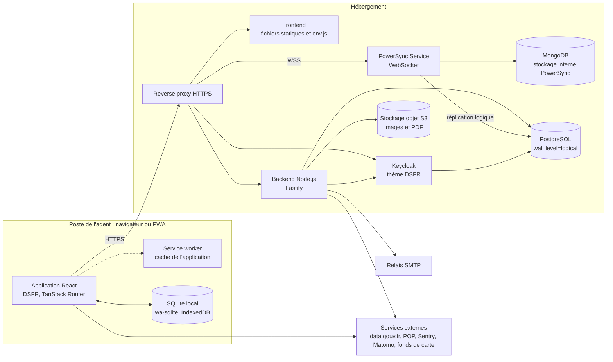
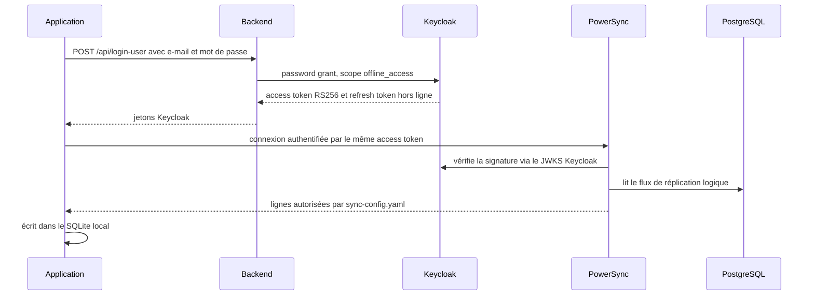
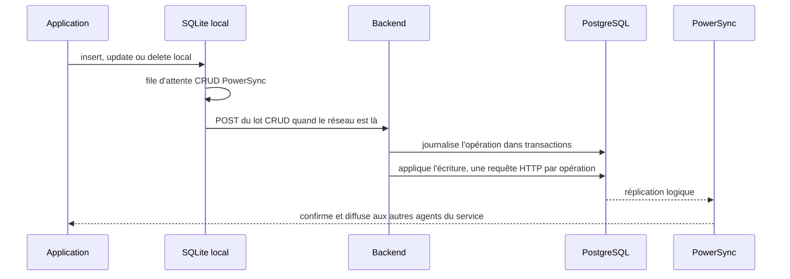

# 02 — Architecture générale

Ce document donne la vue d'ensemble de Patrinotes : les composants, leurs responsabilités, les flux entre eux et les grands choix d'architecture. Chaque composant est détaillé dans un document dédié (voir le [sommaire](README.md)).

## 1. Principes structurants

| Principe | Mise en œuvre | Conséquence |
| --- | --- | --- |
| **Hors ligne d'abord** (*offline-first*) | Le navigateur garde une base SQLite locale (wa-sqlite) synchronisée par **PowerSync**. L'agent peut créer et modifier des comptes-rendus et des constats d'état sur le terrain, sans réseau. | Le serveur n'est pas interrogé à chaque écran. Les écritures sont mises en file puis rejouées vers le backend dès que le réseau revient. Voir [08 — Synchronisation](08-synchronisation-hors-ligne.md). |
| **Application web progressive (PWA)** | Front React + Vite, *service worker* qui met en cache l'application. Installable sur mobile et tablette. | La gestion des versions (vieux *chunks* JS, `env.js`) demande un soin particulier. Voir [03 — Frontend](03-frontend-pwa.md). |
| **Lecture par synchronisation, écriture par API** | Les lectures passent par le flux PowerSync (WebSocket). Les écritures passent par un `POST` vers le backend, qui les applique dans PostgreSQL. | PostgreSQL reste la **seule source de vérité**. PowerSync n'écrit jamais dans la base. |
| **Monorepo TypeScript** | pnpm workspace : `backend`, `frontend`, `pdf` (code partagé). | Les gabarits PDF sont les mêmes côté navigateur (aperçu) et côté serveur (génération). |
| **Contrat d'API typé** | Fastify + TypeBox, OpenAPI généré, client typé généré (`typed-openapi`). | Toute modification d'une route doit être suivie de `pnpm client:generate`. |
| **Socle « État »** | Système de design de l'État (DSFR, `@codegouvfr/react-dsfr`), thème Keycloak DSFR. | Respect de la charte de l'État et du RGAA. |

## 2. Vue des composants

| Composant | Technologie | Rôle | Détail |
| --- | --- | --- | --- |
| Frontend | React 18, Vite, TanStack Router, PowerSync Web, DSFR, TipTap, MapLibre, Konva, react-pdf | Interface, base locale, aperçu des PDF, annotation des photos, cartes | [03](03-frontend-pwa.md) |
| Backend | Node.js 20, Fastify 4, TypeBox, Kysely, Drizzle (migrations), Nodemailer, AWS SDK S3 | Intermédiaire d'authentification vers Keycloak, application des écritures, URL pré-signées S3, envoi des e-mails, liens courts, validation des constats, statistiques, import des données patrimoniales, administration. `@react-pdf/renderer` et `canvas` sont encore installés mais ne servent plus. | [04](04-backend-api.md) |
| Package `pdf` | @react-pdf/renderer, react-pdf-html | Gabarits PDF partagés (compte-rendu, constat d'état) | [09](09-documents-pdf-cartes-emails.md) |
| PostgreSQL 17 | Réplication logique, publication `powersync` | Source de vérité métier, plus la base Keycloak | [06](06-modele-de-donnees.md) |
| PowerSync Service | `journeyapps/powersync-service`, mode `unified` | Diffusion en temps réel des données aux clients, selon des règles d'accès (*sync streams*) | [08](08-synchronisation-hors-ligne.md) |
| MongoDB 7 | *Replica set* `rs0` | Stockage interne de PowerSync (*buckets*). Peut être reconstruit. | [08](08-synchronisation-hors-ligne.md) |
| Keycloak 26 | OIDC, thème DSFR (`keycloak-theme.jar`) | Gestion des comptes et des mots de passe | [05](05-authentification-securite.md) |
| Stockage objet | Scaleway Object Storage en production, MinIO en développement | Photos, pièces jointes, PDF | [07](07-donnees-externes-et-stockage.md) |
| SMTP | Scaleway Transactional Email en production, Mailpit en développement. | Envoi des liens vers les comptes-rendus et constats, des alertes et des demandes de validation | [09](09-documents-pdf-cartes-emails.md) |

## 3. Flux principaux

### 3.1 Lecture : synchronisation descendante

> Le backend **ne signe aucun jeton**. Tous les jetons sont émis par Keycloak. Le même *access token* sert pour le backend (en-tête `Bearer`, vérifié via JWKS) et pour PowerSync. Les variables `JWT_SECRET`, `JWT_REFRESH_SECRET`, `TOKEN_LIFETIME` et `PS_JWT_SECRET` sont des restes inutilisés, mais les deux premières restent obligatoires au démarrage. Voir [05](05-authentification-securite.md).

Les règles d'accès se trouvent dans [sync-config.yaml](../powersync/sync-config.yaml). Elles reposent sur le claim `email` du jeton. Un agent reçoit :

- les données globales : clauses nationales (`service_id = 'ALL'`), photos POP ;
- les données de **son service** : service, collègues, clauses, e-mails suggérés, comptes-rendus (`report`), constats (`state_report`) et leurs sous-objets ;
- ses données personnelles : délégations, réglages, *snapshots* PDF ;
- le patrimoine (`pop_immeubles`, `pop_objets`) **de ses départements** (`user_dept`) ;
- les pièces jointes d'un constat ou d'un compte-rendu, **seulement à l'ouverture** (flux à abonnement explicite).

### 3.2 Écriture : synchronisation montante

> **Point d'attention.** Le backend n'applique **aucun contrôle de droits ni aucune validation** sur ces écritures : seule la table `internal_user` est interdite. En cas d'erreur SQL, il répond HTTP 200 avec `success:false`, et le client abandonne l'opération, qui est alors perdue sans message. Voir [08](08-synchronisation-hors-ligne.md) et [16](16-risques-et-dette-technique.md).

### 3.3 Documents : PDF et e-mail

1. L'agent rédige le compte-rendu ou le constat, éventuellement hors ligne.
2. Le PDF est généré **uniquement dans le navigateur** avec le package `pdf`. Il n'y a plus de rendu côté serveur depuis le commit `fd87550`.
3. Le navigateur dépose le PDF **directement sur S3**, avec une URL pré-signée valable 1 h que fournit le backend. Le stockage objet doit donc être joignable depuis les postes des agents, avec une configuration CORS adaptée.
4. Le backend enregistre la pièce jointe, crée un **lien court public** `BACKEND_URL/attachment/:id/:nom`, valable 90 jours sans authentification, et envoie un e-mail par SMTP. L'e-mail contient ce lien, pas le PDF.
5. Pour un constat soumis à validation (« envoi sous-couvert »), un validateur reçoit d'abord un lien à jeton, valable 7 jours.

### 3.4 Données patrimoniales

Le backend importe les exports Mérimée (immeubles) et Palissy (objets mobiliers) de la base POP, publiés sur `ministere-culture.s3.sbg.io.cloud.ovh.net` (`merimee.csv`, `palissy.csv`). Il récupère aussi les URL des photos par *scraping* de `pop.culture.gouv.fr`. Ces données alimentent `pop_immeubles` et `pop_objets`, diffusées aux clients selon leurs départements. L'API Adresse et les fonds de carte (IGN Géoplateforme, cadastre, OpenFreeMap) sont appelés **directement par le navigateur**. L'import se lance au démarrage si `FORCE_REFETCH_POP` est vrai, ou par le script `pnpm backend import-pop`. Voir [07](07-donnees-externes-et-stockage.md).

## 4. Organisation du dépôt

| Chemin | Contenu |
| --- | --- |
| [packages/backend](../packages/backend) | API Fastify, schéma Drizzle, services, e-mails, imports |
| [packages/frontend](../packages/frontend) | PWA React |
| [packages/pdf](../packages/pdf) | Gabarits PDF partagés |
| [db](../db) | Migrations SQL générées par Drizzle, plus `db/init` (publication PowerSync, création de la base Keycloak) |
| [powersync](../powersync) | Configuration du service et règles de synchronisation |
| [tests](../tests) | Tests de bout en bout Playwright, realm Keycloak de test |
| [scripts](../scripts) | Scripts de remise à zéro et de chargement de la base |
| [crvif-redirection](../crvif-redirection) | Page de redirection de l'ancien domaine « Compte-rendu VIF » |
| [Dockerfile](../Dockerfile), [docker-compose.yaml](../docker-compose.yaml) | Images et environnement de développement |
| [.github/workflows](../.github/workflows) | Construction des images (ghcr.io), tests e2e manuels |

Taille indicative : environ 35 000 lignes de TypeScript et TSX, hors code généré et dépendances.

## 5. Choix techniques et justifications

| Choix | Pourquoi (constaté ou déduit) | Alternatives écartées ou passées |
| --- | --- | --- |
| PowerSync | Travail sur le terrain (monuments, églises, zones blanches) : il faut un vrai mode hors ligne, avec une base locale requêtable en SQL. | ElectricSQL : des traces restent (`ELECTRIC_PORT`, `VITE_ELECTRIC_URL` dans `.env.dist`), à confirmer comme ancienne solution. |
| PostgreSQL avec réplication logique | Exigé par PowerSync pour suivre les changements. | — |
| Keycloak | Comptes locaux (inscription, mot de passe oublié) sans dépendre d'un fournisseur d'identité externe pendant la phase beta. | ProConnect ou un annuaire ministériel : à étudier pour la cible, voir [14](14-migration-vers-infra-ministere.md). |
| Gabarits PDF en React partagés | Aperçu hors ligne identique au document final. | Génération seulement côté serveur (pas d'aperçu hors ligne). |
| Stockage objet S3 | Photos et PDF volumineux, hors de la base. | — |

## 6. Environnements

| Environnement | Déclenchement | Image |
| --- | --- | --- |
| Développement local | `docker compose up -d`, puis `pnpm backend dev` et `pnpm frontend dev` | — |
| Branche `development` | `push` sur la branche | `ghcr.io/<dépôt>-development:backend` et `:frontend` |
| Branche `main` (production) | `push` sur la branche | `ghcr.io/<dépôt>-main:backend` et `:frontend` |
| Branche `compte-rendu-vif` | `push` sur la branche | `ghcr.io/<dépôt>-compte-rendu-vif:*`. Branche historique, à confirmer. |

Le déploiement actuel (VPS avec Coolify) récupère ces images. Le détail est dans [10 — Infrastructure](10-infrastructure-et-deploiement.md).
