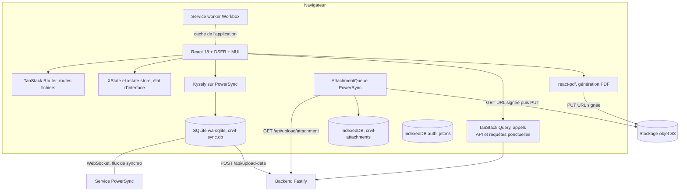
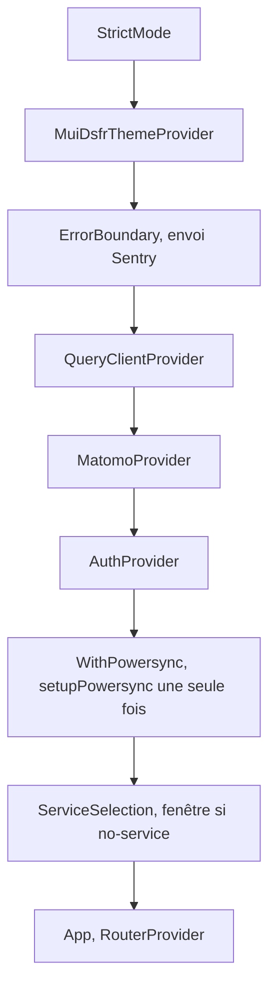
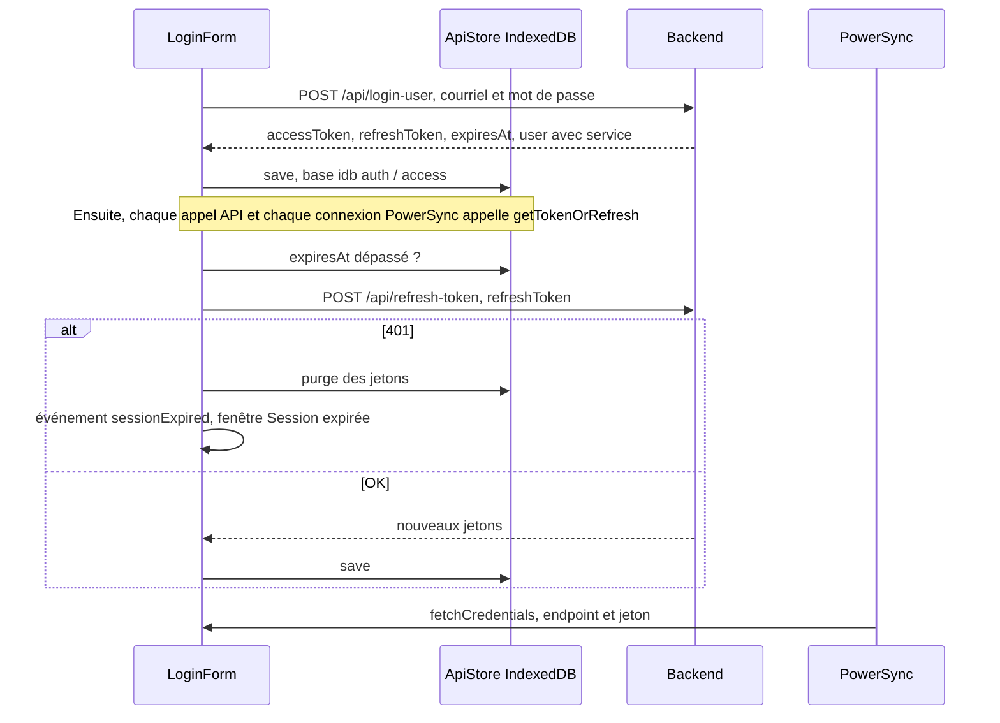
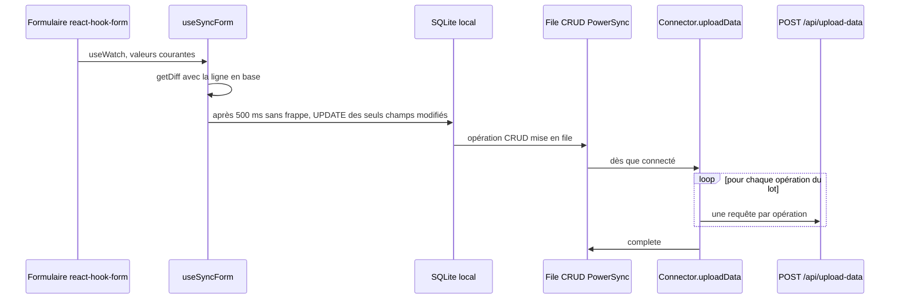
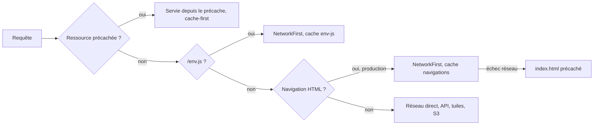

# 03 — Frontend (PWA)

Ce document décrit en détail le paquet [`packages/frontend`](../packages/frontend) : la pile technique, la structure du code, les routes, la gestion d'état, la base locale synchronisée, la stratégie PWA et *service worker*, l'injection de la configuration au démarrage, et la chaîne de traitement des photos et des PDF côté navigateur. Il recense aussi les **règles implicites** que le code applique sans les documenter ailleurs.

Pour le contexte métier (constat d'état, compte-rendu, alertes…), voir [01 — Contexte et périmètre](01-contexte-et-perimetre.md). Pour la vue d'ensemble, voir [02 — Architecture générale](02-architecture-generale.md).

---

## 1. Vue d'ensemble

Le frontend est une **application monopage (SPA) React** construite avec **Vite**, installable comme **PWA**. Elle fonctionne **hors ligne d'abord** :

- toutes les lectures et écritures métier passent par une **base SQLite locale** (wa-sqlite dans le navigateur), synchronisée par **PowerSync** ;
- les écritures locales sont mises en file puis envoyées une par une au backend (`POST /api/upload-data`), qui les applique dans PostgreSQL ;
- les fichiers (photos, PDF) passent par une **file d'attente de pièces jointes** PowerSync : stockage local dans IndexedDB, puis envoi vers S3 par URL signée ;
- les **PDF sont générés dans le navigateur** (`@react-pdf/renderer`) puis déposés sur S3 ; le backend se charge de l'envoi des courriels.



## 2. Pile technique

Versions déclarées dans [package.json](../packages/frontend/package.json). Les versions effectivement installées viennent de `pnpm-lock.yaml` lorsqu'elles sont utiles.

| Domaine | Bibliothèque | Version déclarée (installée) | Rôle |
| --- | --- | --- | --- |
| Langage | TypeScript | ^5.4 | `strict`, cible ES2022 ([tsconfig.json](../packages/frontend/tsconfig.json)) |
| UI | React / React DOM | ^18.2.0 (18.3.1) | Mode `StrictMode` |
| Build | Vite | ^5.1.6 (5.4.21) | Dev, build, preview |
| PWA | vite-plugin-pwa + Workbox 7 | ^0.20.0 (0.20.5) | Stratégie `injectManifest`, SW sur mesure |
| Routage | @tanstack/react-router + router-vite-plugin | ^1.22.2 (1.168.4) | Routes basées sur des fichiers, arbre généré `routeTree.gen.ts` |
| Données serveur | @tanstack/react-query | ^5.90.20 (5.95.2) | Mutations et requêtes ; `networkMode: "always"` |
| Base locale | @powersync/web, @powersync/common, @powersync/react, @powersync/kysely-driver | 1.37.0 / 1.50.0 (version figée) / ^1.9.1 / ^1.0.0 | SQLite synchronisé et file de pièces jointes |
| Requêtes SQL | kysely | ^0.27.4 (0.27.6) | Constructeur de requêtes typé, mêmes types que le backend |
| SQLite WASM | @journeyapps/wa-sqlite, wa-sqlite (GitHub) | ^1.3.1 (1.5.0) | Moteur SQLite dans le navigateur |
| Design system | @codegouvfr/react-dsfr | ^1.26.0 (1.32.0) | DSFR, thème MUI DSFR |
| Composants | @mui/material, @emotion, tss-react | ^5.18.0 | Mise en page (Box, Stack), Dialog, Autocomplete |
| Formulaires | react-hook-form | ^7.51.1 | Tous les formulaires |
| Machines d'état | xstate, @xstate/react, @xstate/store | ^5.19.0 (5.29.0) / ^5.0.0 / ^0.0.5 | Envoi de photos, dictée, menu, stores globaux |
| Éditeur riche | TipTap 2 (+ quelques extensions 3.x) | ^2.4.0 | Mise en page du PDF des CR |
| PDF (génération) | @react-pdf/renderer | ^4.1.5 (4.3.2) | Génération des PDF CR et CE dans le navigateur |
| PDF (affichage) | pdfjs-dist | 4.3.136 (version figée) | Visionneuse paginée |
| Cartographie | maplibre-gl | ^5.24.0 | Cartes, cadastre, plan de situation |
| Dessin | konva, react-konva | ^9.3.22 / ^18.2.10 | Annotation des photos |
| Images | browser-image-compression | ^2.0.2 | Compression dans un *web worker* |
| Recherche | fuse.js | ^7.1.0 | Recherche floue des monuments |
| Supervision | @sentry/react | ^10.63.0 | Erreurs et journaux console (production seulement) |
| Mesure d'audience | @datapunt/matomo-tracker-react | ^0.5.1 | `stats.beta.gouv.fr`, site 123 |
| Divers | idb-keyval, ofetch, zod, date-fns, jszip, uuid, bowser, pastable, react-use | — | Stockage des jetons, HTTP, validation, dates, ZIP, identifiants, détection du navigateur |

> Dette : `@react-pdf/renderer` est en **^4.1.5** dans le frontend et dans `packages/pdf`, mais en **^3.4.2** dans le backend. Le backend ne rend plus aucun PDF : sa dépendance est morte et peut être retirée (voir [09](09-documents-pdf-cartes-emails.md)). Les dépendances `npm` et `install` déclarées en `dependencies` semblent inutiles (ajouts par erreur, à confirmer).

## 3. Structure des dossiers

```text
packages/frontend/
├── index.html               # charge /env.js, /version.js puis src/main.tsx
├── vite.config.ts           # plugins React, Router, WASM, PWA ; envDir = racine du monorepo
├── scripts/
│   ├── createEnvFile.ts     # génère dist/env.js et dist/swEnv.js à partir des VITE_* (au démarrage)
│   └── setVersion.ts        # génère dist/version.js (version + horodatage hexadécimal)
├── public/                  # env.js et version.js de dev, polices Marianne, logos PDF, pdfjs, wasm
├── dsfr-chart/              # bundle vendorisé de @gouvfr/dsfr-chart (web components Vue), patché
└── src/
    ├── main.tsx             # point d'entrée : SW, reprise des chunks périmés, providers
    ├── App.tsx              # création du routeur TanStack
    ├── envVars.ts           # lecture et validation de la configuration d'exécution
    ├── api.ts / api.gen.ts  # client HTTP typé, généré depuis l'OpenAPI du backend
    ├── ApiStore.ts          # jetons et utilisateur persistés dans IndexedDB
    ├── db/                  # AppSchema (schéma local), db.ts (PowerSync, Kysely, pièces jointes), Connector
    ├── contexts/            # AuthContext
    ├── routes/              # une route par fichier (TanStack Router)
    ├── features/            # code métier par domaine
    │   ├── state-report/    # constat d'état : étapes, alertes, PDF, menu latéral
    │   ├── report/          # liste et actions des comptes-rendus
    │   ├── upload/          # photos : machines XState, compression, dessin Konva
    │   ├── map/             # MapLibre, cadastre, plan de situation, localisation
    │   ├── text-editor/     # éditeur TipTap
    │   ├── audio-record/    # dictée vocale (Web Speech API)
    │   ├── menu/            # menu, aide, clauses, partage, services
    │   ├── auth/            # connexion, inscription, session expirée
    │   └── chips/           # puces alimentées par les clauses
    ├── components/          # composants transverses (SyncForm, EmailInput, Tabs, Banner…)
    ├── hooks/               # useCanEditReport, useAppStatus, useFormWithFocus…
    └── service-worker/sw.ts # service worker Workbox sur mesure
```

L'alias d'import `#components/*` pointe vers `src/components/*` (champ `imports` du `package.json` et `paths` du `tsconfig`).

## 4. Démarrage de l'application

Ordre d'exécution dans [main.tsx](../packages/frontend/src/main.tsx) :

1. Polyfills : `structuredClone`, `Array.prototype.at` et ses équivalents pour les tableaux typés, requis par pdfjs ([polyfill.ts](../packages/frontend/src/polyfill.ts)) ; `crypto.randomUUID` ([features/polyfill.ts](../packages/frontend/src/features/polyfill.ts)). Puis `globalThis.Buffer`.
2. Initialisation de Sentry, en production et seulement si `VITE_SENTRY_DSN` est défini ([sentry.ts](../packages/frontend/src/features/sentry.ts)).
3. Enregistrement du *service worker* (`registerSW`) avec **rechargement automatique** quand une nouvelle version est disponible.
4. Installation des écouteurs qui récupèrent les *chunks* périmés (§ 9.3).
5. **Mode clair forcé** (`localStorage.scheme = "light"`), puis `startReactDsfr` et `initFonts()` (polices Marianne pour react-pdf, servies depuis `/fonts`).
6. Imbrication des providers :



> Règles cachées :
> - `AuthProvider` affiche un indicateur de chargement plein écran tant que les jetons n'ont pas été relus depuis IndexedDB (`apiStore.loaded`).
> - Au premier lancement (pas de clé `crvif/version` dans `localStorage`), `AuthProvider` **supprime l'ancienne authentification `crvif/auth`**, positionne `crvif/update-popup` et `crvif/version = "1"`, puis **recharge la page**. Il s'agit d'une migration héritée de Compte-rendu VIF ([AuthContext.tsx](../packages/frontend/src/contexts/AuthContext.tsx#L57-L65)). Vider le `localStorage` (y compris par « Réinitialiser les données locales ») provoque donc un rechargement supplémentaire.
> - `setupPowersync()` est appelé **même sans utilisateur connecté**. `fetchCredentials` lève alors « No token found » et PowerSync réessaie (à confirmer : bruit dans les journaux Sentry).

## 5. Configuration d'exécution (env.js)

### 5.1 Principe

Les variables `VITE_*` ne sont **pas figées dans le bundle en production**. Elles sont lues à l'exécution depuis `window.ENV` ([envVars.ts](../packages/frontend/src/envVars.ts)) :

| Contexte | Source des variables |
| --- | --- |
| Développement (`import.meta.env.PROD === false`) | `import.meta.env` (fichier `.env` à la **racine du monorepo**, `envDir: "../.."`) |
| Production, page | `window.ENV`, défini par `/env.js` |
| Production, *service worker* | `self.ENV` (prévu via `swEnv.js`) |

Le script [createEnvFile.ts](../packages/frontend/scripts/createEnvFile.ts) écrit au **démarrage du conteneur** (`pnpm frontend preview` lance `env:gen` puis `vite preview`) :

- `dist/env.js` → `window.ENV = { VITE_...: "..." }` ;
- `dist/swEnv.js` → `self.ENV = { ... }`.

Il reprend **toutes** les variables d'environnement préfixées `VITE_`. Le fichier `.env` racine est lu s'il existe, puis complété par l'environnement du processus.

### 5.2 Variables attendues

| Variable | Obligatoire | Utilisation |
| --- | --- | --- |
| `VITE_BACKEND_URL` | oui | Base de toutes les API ([api.ts](../packages/frontend/src/api.ts)) |
| `VITE_POWERSYNC_URL` | oui | Point d'accès WebSocket PowerSync ([Connector.ts](../packages/frontend/src/db/Connector.ts#L15)) |
| `VITE_AUTH_URL`, `VITE_AUTH_REALM`, `VITE_AUTH_CLIENT_ID` | oui pour la validation | **Aucune utilisation dans le code frontend** (la connexion passe par le backend) |
| `VITE_SENTRY_DSN` | non | Active Sentry |

> Règles cachées et pièges :
> - La validation zod est **tout ou rien** : s'il manque **une seule** variable obligatoire (y compris les trois `VITE_AUTH_*` inutilisées), `ENV` devient `{}`. `VITE_BACKEND_URL` et `VITE_POWERSYNC_URL` sont alors `undefined` et toute l'application est hors service, avec pour seul indice « Error parsing env vars » dans la console.
> - Le fichier [`.env.dist`](../.env.dist) contient encore `VITE_ELECTRIC_URL` (ancien moteur de synchronisation ElectricSQL) et **ne contient pas `VITE_POWERSYNC_URL`**.
> - Les valeurs sont injectées entre guillemets sans échappement : une valeur contenant `"` casse `env.js`.
> - `env.js` et `swEnv.js` sont **exclus du précache** (`globIgnores`). `env.js` est servi en **NetworkFirst** (cache `env-js`) : un changement de configuration est pris en compte dès que le client est en ligne, et la dernière version connue reste disponible hors ligne.
> - Le *service worker* n'importe jamais `swEnv.js` (pas d'`importScripts`). Dans le SW, `self.ENV` est donc indéfini et `ENV` vaut `{}` ; seul `isDev` y est utilisé, ce qui n'a pas d'impact pratique aujourd'hui.
> - `ApiStore.loadUrl()` mémorise `VITE_BACKEND_URL` dans IndexedDB au premier lancement, mais cette valeur n'est pas réutilisée par le client API. Changer l'URL du backend **ne nécessite donc pas** de vider IndexedDB (à confirmer).

### 5.3 Version affichée

`pnpm build` lance ensuite [setVersion.ts](../packages/frontend/scripts/setVersion.ts), qui écrit `dist/version.js` : `window.APP_VERSION = "<version package.json>.<horodatage Unix en hexadécimal>"`, par exemple `0.2.0.6712ab34`. La version s'affiche dans le pied de page. `version.js` n'est pas exclu du précache.

## 6. Routage

Le routage utilise **TanStack Router** avec des routes basées sur des fichiers : le plugin Vite génère [routeTree.gen.ts](../packages/frontend/src/routeTree.gen.ts). Les fichiers `*.lazy.tsx` sont chargés à la demande. La route racine [__root.tsx](../packages/frontend/src/routes/__root.tsx) fixe le titre de l'onglet selon le préfixe du chemin et entoure toutes les pages du `Layout` DSFR (en-tête, liens d'évitement, pied de page).

| Chemin | Fichier | Accès | Rôle |
| --- | --- | --- | --- |
| `/` | [index.tsx](../packages/frontend/src/routes/index.tsx) | connecté | Accueil : « Créer un constat d'état », « Créer un compte-rendu », onglets « Mes documents » et service, recherche |
| `/connexion` | [connexion.tsx](../packages/frontend/src/routes/connexion.tsx) | anonyme (redirige si connecté) | Connexion par courriel et mot de passe (`POST /api/login-user`) |
| `/inscription` | [inscription.tsx](../packages/frontend/src/routes/inscription.tsx) | anonyme | Création de compte (`POST /api/create-user`), liste des services (`GET /api/services`) |
| `/reset-password/` | [reset-password.index.lazy.tsx](../packages/frontend/src/routes/reset-password.index.lazy.tsx) | anonyme | Demande de lien (`POST /api/send-reset-password`) |
| `/reset-password/$link` | [reset-password.$link.tsx](../packages/frontend/src/routes/reset-password.$link.tsx) | anonyme | Nouveau mot de passe (`POST /api/reset-password`) |
| `/edit/$reportId?tab=info\|notes` | [edit.$reportId.tsx](../packages/frontend/src/routes/edit.$reportId.tsx) | connecté | Saisie d'un CR (onglets RDV et Bilan) |
| `/pdf/$reportId?mode=view\|edit\|send\|sent` | [pdf.$reportId.tsx](../packages/frontend/src/routes/pdf.$reportId.tsx) | connecté | Prévisualisation, mise en page, destinataires et envoi d'un CR |
| `/constat/$constatId?step=…&mode=view\|edit` | [constat.$constatId.tsx](../packages/frontend/src/routes/constat.$constatId.tsx) | **aucune garde `EnsureUser`** | Saisie d'un CE ; `step` ∈ `informations`, `documents`, `contexte-visite`, `constat-general`, `constat-detaille` |
| `/constat/$constatId/pdf?mode=view\|send\|sent` | [constat_.$constatId.pdf.tsx](../packages/frontend/src/routes/constat_.$constatId.pdf.tsx) | **aucune garde `EnsureUser`** | Prévisualisation, téléchargement et envoi d'un CE (le `_` du nom de fichier évite l'imbrication dans la route du constat) |
| `/constat-validation/$token` | [constat-validation.$token.tsx](../packages/frontend/src/routes/constat-validation.$token.tsx) | **public** (sans compte) | Page du validateur : PDF, accepter ou refuser |
| `/compte` | [compte.tsx](../packages/frontend/src/routes/compte.tsx) | connecté | Paramètres personnels |
| `/account` | [account.tsx](../packages/frontend/src/routes/account.tsx) | — | Redirection vers `/compte` |
| `/service` | [service.tsx](../packages/frontend/src/routes/service.tsx) | connecté | Paramètres du service |
| `/admin` | [admin.lazy.tsx](../packages/frontend/src/routes/admin.lazy.tsx) | connecté + admin (contrôle serveur `/api/admin/me`) | Liste blanche et utilisateurs |
| `/stats` | [stats.lazy.tsx](../packages/frontend/src/routes/stats.lazy.tsx) | public ; partie admin si le jeton est admin | Statistiques (graphiques dsfr-chart) |
| `/accessibilite`, `/mentions-legales`, `/politique-confidentialite`, `/cgu` | fichiers du même nom | public | Pages légales (voir [01](01-contexte-et-perimetre.md#7-pages-légales-et-accessibilité)) |

> Règles cachées :
> - Les gardes sont des **composants**, pas des `beforeLoad` : `EnsureUser` redirige vers `/connexion` si `auth.user` est nul ; `RedirectIfUser` redirige vers `?redirect=` ou `/`. Les routes de constat n'ont pas de garde explicite : sans session, la base locale est vide et la page renvoie vers `/`. La sécurité réelle repose sur les règles de synchronisation et sur le backend.
> - L'URL porte l'état d'écran (`step`, `mode`, `tab`). Une valeur invalide est silencieusement remplacée par la valeur par défaut (`validateSearch`).
> - L'étape `documents` existe dans le schéma mais n'a **aucun écran** : `ButtonsSwitch` renvoie `null` et le sommaire ne la propose pas.
> - Le titre d'onglet ne connaît que `/edit`, `/constat`, `/pdf`, `/connexion`, `/inscription`, `/account` et `/service` (pas `/compte`).
> - Le routeur fait remonter en haut de page via le sélecteur `.MuiBox-root` et restaure la position de défilement.

## 7. Authentification côté client

Le frontend **ne parle jamais directement à Keycloak**. Le backend fait office d'intermédiaire.



Points de code : [ApiStore.ts](../packages/frontend/src/ApiStore.ts), [Connector.ts](../packages/frontend/src/db/Connector.ts#L44-L98), [AuthContext.tsx](../packages/frontend/src/contexts/AuthContext.tsx), [api.ts](../packages/frontend/src/api.ts).

> Règles cachées :
> - Les jetons sont stockés dans **IndexedDB** (base `auth`, magasin `access`, clés `accessToken`, `refreshToken`, `expiresAt`, `user` en JSON). Ils sont donc lisibles par tout script exécuté sur l'origine : le risque XSS est à prendre en compte dans l'homologation.
> - Les appels concurrents se partagent **une seule promesse de rafraîchissement** (`refreshPromise`), pour ne pas faire tourner deux fois le même *refresh token*.
> - Seul un **401** sur `/api/refresh-token` déconnecte l'utilisateur. Une erreur réseau (hors ligne) laisse la session intacte : l'agent continue à travailler localement.
> - `get80PercentOfTokenLifespan` existe mais n'est plus utilisée : le rafraîchissement n'intervient qu'**après** l'expiration (`expiresAt < now`).
> - La déconnexion (`useLogout`) efface les jetons mais **ne vide pas la base SQLite locale** : les données du service restent sur l'appareil jusqu'à la prochaine connexion ou une réinitialisation (point d'attention sur un poste partagé).
> - L'utilisateur stocké (`auth.user`, avec son `service`) est une **copie figée au moment de la connexion**. `useLiveUser` et `useLiveService` la complètent avec les lignes synchronisées `user` et `service` ; `useRefreshUser` la met à jour après une modification du service.
> - La page `/stats` appelle `ofetch` directement avec le jeton (et non le client typé), et la page de validation appelle le backend sans jeton.

## 8. Données locales et synchronisation

### 8.1 Base locale PowerSync

Défini dans [db.ts](../packages/frontend/src/db/db.ts) :

- `PowerSyncDatabase`, fichier `crvif-sync.db`, schéma [AppSchema.ts](../packages/frontend/src/db/AppSchema.ts) ;
- option `useWebWorker` activée si le navigateur fournit **OPFS** (`navigator.storage.getDirectory`) et `crypto.randomUUID` ; option `enableMultiTabs` activée si `SharedWorker` existe (ce n'est **jamais** le cas sur iOS) ;
- `db` = Kysely branché sur PowerSync : les composants lisent avec `useDbQuery(db.selectFrom(...))`, des requêtes **réactives** qui se rafraîchissent à chaque modification locale ou synchronisée.

Tables locales (24) : `report`, `service`, `user`, `delegation`, `pdf_snapshot`, `service_instructeurs`, `clause_v2`, `pictures`, `transactions`, `sent_email`, `suggested_email`, `user_settings`, `pop_immeubles`, `state_report`, `visited_section`, `visited_section_attachment`, `report_attachment`, `state_report_attachment`, `state_report_sent_email`, `pop_objets`, `pop_images`, `state_report_alert`, `state_report_alert_attachment` et `attachments` (table interne de la file de pièces jointes).

> Règles cachées :
> - [AppSchema.ts](../packages/frontend/src/db/AppSchema.ts#L490-L525) contient une **vérification à la compilation** : chaque colonne d'une table partagée doit exister dans le schéma backend (`Database` de `packages/backend/src/db/db`). Ajouter une colonne côté frontend sans l'ajouter côté backend fait échouer `pnpm check`. **L'inverse n'est pas vérifié** : une nouvelle colonne backend absente d'AppSchema est simplement ignorée côté client.
> - PowerSync stocke tout en `text` ou `integer` : les booléens valent `0` ou `1`, les dates sont des chaînes ISO.
> - Certaines tables locales ne sont **alimentées par aucun flux** de [sync-config.yaml](../powersync/sync-config.yaml) : `transactions`, `state_report_sent_email`, `pop_images` (les images POP sont lues par l'API `/api/state-report/objets-images`, donc en ligne seulement). À l'inverse, `constat_validation` est synchronisée mais absente d'AppSchema, donc ignorée.
> - Toute nouvelle table synchronisée doit être ajoutée à AppSchema **et** à la publication PostgreSQL `powersync` (voir le [README](../README.md#migrations)).

### 8.2 Flux de synchronisation utilisés par le client

| Flux | Abonnement | Contenu côté client |
| --- | --- | --- |
| `global_stream` | automatique | Clauses nationales (`ALL`), `pictures` |
| `service_stream` | automatique | Service, collègues (id, nom, service), services instructeurs, clauses du service, courriels envoyés, courriels suggérés |
| `user_stream` | automatique | Délégations, `pdf_snapshot`, `user_settings` de l'utilisateur |
| `reports_stream` | automatique | Tous les CR, CE, parties visitées et alertes **du service** |
| `pop_stream` | automatique (priorité 3) | Immeubles et objets POP des **départements de l'utilisateur** (`user_dept`) |
| `report_attachments_stream` | **à la demande** (`useSyncStream` dans `/edit` et `/pdf`) | Pièces jointes d'**un** CR |
| `state_report_attachments_stream` | **à la demande** (dans `/constat` et `/constat/.../pdf`) | Pièces jointes d'**un** CE (constat, parties, alertes) |

> Règle cachée importante pour le hors ligne : les **lignes de pièces jointes** ne sont synchronisées que pour le document **ouvert pendant que l'appareil est en ligne**. Un document jamais ouvert en ligne sur un appareil n'aura pas ses photos hors ligne. Les écrans de PDF (`/pdf/...`, `/constat/.../pdf`) affichent un indicateur de chargement **tant que le flux n'est pas synchronisé** (`hasSynced`). Hors ligne, ces écrans peuvent donc rester bloqués (à confirmer sur appareil).

### 8.3 Écriture : sauvegarde automatique et envoi au serveur



Points de code : [SyncForm.tsx](../packages/frontend/src/components/SyncForm.tsx#L17-L48), [Connector.ts](../packages/frontend/src/db/Connector.ts#L22-L41).

> Règles cachées :
> - **Délai de 500 ms** puis écriture locale, avec un dernier envoi forcé au **démontage** du formulaire pour ne rien perdre en quittant la page. Le même mécanisme existe pour la fenêtre d'une partie visitée ([ConstatDetaille.tsx](../packages/frontend/src/features/state-report/steps/ConstatDetaille.tsx#L286-L316)).
> - `getDiff` ignore les valeurs non primitives (objets, tableaux) : seuls les champs scalaires sont synchronisés.
> - **Fusion des modifications distantes** ([useFormWithFocus.tsx](../packages/frontend/src/hooks/useFormWithFocus.tsx)) : quand une ligne change en base (autre appareil, collègue), chaque champ modifié est réinjecté dans le formulaire, **sauf** le champ qui a le focus et qui a déjà été modifié localement. Côté serveur, la règle est **le dernier qui écrit gagne**, sans détection de conflit (test `sync.spec.ts`).
> - `uploadData` envoie les opérations **une par une**, dans l'ordre. Il **ignore** les opérations sans données qui ne sont pas des suppressions. Une erreur sur une opération bloque le lot, que PowerSync réessaiera.
> - Les identifiants sont générés **côté client** : `report-<uuid v4>` pour les CR (le préfixe `report-` est une convention historique), uuid v4 pour les CE et les parties visitées, uuid v7 pour les pièces jointes et les délégations.
> - Un CE est créé avec `disabled = 1` et `version = 2`. Il ne devient visible (`disabled = 0`) qu'au choix d'un monument ([ImmeubleAutocomplete.tsx](../packages/frontend/src/features/ImmeubleAutocomplete.tsx#L71-L93)). Un CR est créé directement avec `disabled = 0`.
> - **Suppression = `disabled = 1`** (suppression logique), pour les CR comme pour les CE.

### 8.4 Formats sérialisés dans des colonnes texte

Plusieurs colonnes stockent des structures sous forme de **chaînes avec séparateurs**. Un séparateur saisi par l'utilisateur dans le contenu casse la relecture.

| Colonne | Format | Où | Risque |
| --- | --- | --- | --- |
| `personnes_presentes` | une personne par ligne (`\n`) | CR, CE | — |
| `preconisations` | `option[:commentaire]/option[:commentaire]` | CE, partie visitée | Un `/` ou un `:` dans un commentaire corrompt la liste ([stateReport.tsx](../packages/pdf/src/stateReport.tsx#L346-L360)) |
| `mandatory_emails` | `Service:courriel;Service:courriel` | alerte | — |
| `additional_emails`, `contacts`, `furtherInformation`, `default_emails` | valeurs séparées par `,` | alerte, CR, réglages | Une clause dont l'intitulé contient une virgule est mal relue |
| `attachment_id` (tables `*_attachment`) | identifiants séparés par `;` (lu par `watchAttachments`) | — | — |
| `reference_cadastrale` | `SECTION NUMERO;SECTION NUMERO` | CE | — |
| `coordonnees` | `lat,lng` (attention, MapLibre attend `lng,lat`) | CE, POP | Inversion possible |
| `localisation_pins`, `localisation_drawings`, `localisation_zone` | JSON | partie visitée | — |
| `nature_visite` | **en minuscules** : `complète` ou `partielle (préciser)` | CE | Voir le défaut au § 15 |

## 9. PWA et service worker

### 9.1 Configuration

[vite.config.ts](../packages/frontend/vite.config.ts) : `VitePWA` en stratégie **`injectManifest`**, *service worker* sur mesure [src/service-worker/sw.ts](../packages/frontend/src/service-worker/sw.ts), `registerType: "autoUpdate"`, activé aussi en développement.

| Élément | Valeur |
| --- | --- |
| Manifeste | `id: gouv.beta.patrinotes`, `name/short_name: Patrinotes`, `lang: fr`, `orientation: portrait`, `scope` et `start_url: /`, icônes DSFR 192 et 512 px |
| Précache | `**/*.{svg,woff2,js,wasm,css,html,png}`, taille maximale par fichier **16 Mio** (`2097152 * 8`) |
| Exclus du précache | `**/admin*.js` (chunk de la page admin), `**/env.js`, `**/swEnv.js` |
| Ressources incluses | `**/*.{svg,woff2,wasm,ttf}`, `marianne_footer.png` |

### 9.2 Stratégie de cache



- `skipWaiting()` à l'installation et `clients.claim()` à l'activation : le nouveau SW prend la main immédiatement.
- `cleanupOutdatedCaches()` supprime les précaches des versions précédentes.
- En production, les **navigations sont en NetworkFirst** : après un déploiement, l'`index.html` récent (et ses nouveaux noms de *chunks*) est servi dès que le réseau répond. Hors ligne, c'est l'`index.html` précaché qui est servi.
- Les appels API, le WebSocket PowerSync, les tuiles cartographiques et S3 **ne sont pas mis en cache** par le SW.

### 9.3 Mise à jour et reprise sur *chunk* périmé

Côté page ([main.tsx](../packages/frontend/src/main.tsx#L23-L102)) :

1. `registerSW({ onNeedRefresh: () => window.location.reload() })` : **rechargement automatique** dès qu'une nouvelle version est détectée, **sans prévenir l'utilisateur**.
2. Reprise sur *chunk* périmé : après un déploiement, une ancienne page peut demander un *chunk* haché qui n'existe plus. Le code intercepte `vite:preloadError`, ainsi que les rejets non gérés dont le message correspond à `dynamically imported module|Importing a module script failed|error loading dynamically` (cas des `import()` de react-dsfr), puis :
   - **tentative 1** : simple rechargement (`sessionStorage["chunk-reload-attempt"] = 1`) ;
   - **tentative 2** : désinscription de tous les SW, suppression de **tous** les caches, puis rechargement ;
   - **ensuite** : abandon, pour éviter une boucle de rechargement.
   Le compteur est effacé **5 secondes après l'événement `load`**.

> Pièges :
> - Le rechargement automatique peut survenir **pendant une saisie**. La sauvegarde locale (500 ms) limite la perte, mais un champ en cours de frappe peut être perdu.
> - Le chunk admin n'est pas précaché : `/admin` n'est pas disponible hors ligne, ce qui est voulu.
> - Le serveur de production (`vite preview`, § 14) doit servir `sw.js` et `index.html` **sans cache HTTP longue durée** pour que la mise à jour fonctionne. La configuration des en-têtes sur l'infrastructure cible est à vérifier.
> - L'ancien domaine Compte-rendu VIF utilise [`crvif-redirection/sw.js`](../crvif-redirection/sw.js) pour désinscrire l'ancien SW et rediriger les clients.

## 10. Gestion d'état

| Type d'état | Mécanisme | Exemples |
| --- | --- | --- |
| Données métier persistantes | SQLite PowerSync et `useDbQuery` (réactif) | Listes, formulaires CR et CE |
| Requêtes ponctuelles et mutations | TanStack Query (`networkMode: "always"` : les mutations s'exécutent même hors ligne) | Préparation des PDF, envoi, téléchargements |
| Formulaires | react-hook-form (`FormProvider`) | CR, CE, envoi d'un constat (`SendConstatForm`) |
| État d'interface global | `@xstate/store` | `searchStore` (recherche, type de document, onglet), `stateReportSideMenuStore` (panneau notes et alertes, alerte sélectionnée, erreurs) |
| Processus asynchrones | Machines XState | `attachmentUploadMachine`, `thumbnailMachine`, `speechToTextMachine`, `menuMachine` (menu, aide, clauses) |
| Préférences locales | `localStorage` | Voir ci-dessous |

Clés `localStorage` : `scheme` (forcé à `light`), `crvif/version`, `crvif/update-popup`, `crvif/no-report-alert-closed`, `patrinotes/home-document` (`compte-rendus` ou `constats`), `patrinotes/home-scope` (`my` ou `service`), `chunk-reload-attempt` (dans `sessionStorage`).

Bases IndexedDB : `crvif-sync.db` (SQLite PowerSync, sauf si OPFS est utilisé), `crvif-attachments` (fichiers), `auth` (jetons), `toSync`, `toUpload`, `uploadStatus` (anciens magasins d'images, [idb.ts](../packages/frontend/src/features/idb.ts), *a priori* hérités et inutilisés, à confirmer).

> Règle cachée : `searchStore.scope` vaut **`"all"`** par défaut, alors que les onglets de l'accueil ont pour identifiants `my` et `service`. Au premier lancement, aucun onglet ne correspond donc à la valeur courante (à confirmer visuellement). Le repli `?? "my"` ne s'applique pas, puisque `"all"` n'est pas nul.

## 11. Fonctionnalités par dossier `features/`

### 11.1 `state-report/` (constat d'état)

- [StateReportForm.tsx](../packages/frontend/src/features/state-report/StateReportForm.tsx) : formulaire global (`useFormWithFocus` + `useSyncForm` sur `state_report`), recherche du monument, menu latéral.
- [WithReferencePop.tsx](../packages/frontend/src/features/state-report/WithReferencePop.tsx) : sommaire et contenu des étapes, **toutes montées en même temps** et masquées par `display: none` ; boutons de navigation ; bouton « Finaliser le constat » et contrôle des champs obligatoires.
- `steps/` : [MonumentHistorique](../packages/frontend/src/features/state-report/steps/MonumentHistorique.tsx), [ContexteVisite](../packages/frontend/src/features/state-report/steps/ContexteVisite.tsx), [ConstatDetaille](../packages/frontend/src/features/state-report/steps/ConstatDetaille.tsx), [ConstatGeneral](../packages/frontend/src/features/state-report/steps/ConstatGeneral.tsx), fenêtres de plan de situation et de localisation.
- `alerts/` : création des alertes (adresses obligatoires préremplies depuis `service.courriel_*`), formulaires, vérification des courriels.
- `pdf/` : requêtes de préparation ([ConstatPdf.queries.tsx](../packages/frontend/src/features/state-report/pdf/ConstatPdf.queries.tsx)), affichage, envoi et confirmation.
- [planSituationAttachment.ts](../packages/frontend/src/features/state-report/planSituationAttachment.ts), [localisationAttachment.ts](../packages/frontend/src/features/state-report/localisationAttachment.ts) : images générées et rangées comme pièces jointes.

**Champs obligatoires à la finalisation** (`formValuesCheckerV1` et `V2`) :

| Version du constat | Champs obligatoires |
| --- | --- |
| 1 (anciens constats) | `nature_visite`, `date_visite`, `redacted_by`, `proprietaire`, `etat_general`, `proportion_dans_cet_etat` |
| 2 (nouveaux constats) | `nature_visite`, `date_visite`, `redacted_by`, `proprietaire`, `etat_general` |

S'y ajoutent les courriels obligatoires des **alertes « visitées »** dont l'envoi est demandé. Une alerte est « visitée » si elle a un commentaire ou une photo ; pour « Objets et mobiliers », un problème ou un objet suffit aussi ([utils.tsx du paquet pdf](../packages/pdf/src/utils.tsx#L73-L88)). Le bouton est **désactivé tant que des images sont en cours d'ajout ou de téléchargement** (« Image(s) en cours d'ajout… »).

**Version 1 / version 2** : les nouveaux constats sont en v2 (taux de dégradation de 0 à 100 % par pas de 10, vitesse *Stable / Lente / Moyenne / Rapide*, niveau de dégradation par partie *Léger / Moyen / Important / Péril*). La v1 utilise une « proportion dans cet état » de 50 à 100 %. `useStateReportVersion()` renvoie 1 si `version` est nul.

**Préparation du PDF d'un constat** ([constat_.$constatId.pdf.tsx](../packages/frontend/src/routes/constat_.$constatId.pdf.tsx)) :

1. attente du flux de pièces jointes du constat ;
2. lecture du constat, des parties visitées et des alertes, avec les fichiers relus depuis IndexedDB et transformés en URL `blob:` ;
3. **effet de bord dans la requête** : si aucun plan de situation n'existe, il est **généré et enregistré** comme pièce jointe (`ensurePlanSituationAttachment`). Hors ligne, `planSituationOffline = true` et le PDF est produit sans plan ;
4. génération du HTML **une seule fois** (`getStateReportHtmlString` du paquet `pdf`), puis du PDF ;
5. destinataires préremplis : courriel du propriétaire, du représentant et destinataires par défaut. L'envoi sous couvert est activé par défaut si l'utilisateur a configuré un validateur ;
6. envoi : `POST /api/pdf/state-report/upload-url` → `PUT` du PDF sur S3 → `POST /api/pdf/state-report` (destinataires, taille, alertes sélectionnées, `needValidation`).
Le téléchargement local appelle `POST /api/pdf/state-report/log-download` pour les statistiques.

> Règles cachées :
> - **Constats antérieurs** : un constat est rattaché aux autres par `reference_pop LIKE '%<référence>'`, en excluant les supprimés et les brouillons (`attachment_id` nul).
> - **Dupliquer un constat** copie le constat et ses parties visitées, mais **pas les photos** ni les alertes. La copie conserve `pdf_size` et les données de localisation.
> - Modifier une photo (dessin ou remplacement) crée **une nouvelle pièce jointe** (`<parent>/images/<uuidv7>.jpg`) et rend l'ancienne obsolète (`is_deprecated = 1`). Les fichiers sont **immuables**.
> - La génération manuelle du plan de situation (« Générer le plan maintenant ») est **commentée** dans l'interface. Seule la génération automatique à la prévisualisation reste active.

### 11.2 `report/` et routes `/edit`, `/pdf` (compte-rendu)

- Accueil : listes paginées de **20** éléments, triées par date de rendez-vous puis de création (CR) ou par date de création (CE) ([useDocumentQueries.tsx](../packages/frontend/src/features/useDocumentQueries.tsx)).
- « Mes documents » : CR dont l'utilisateur est **créateur ou rédacteur** ; CE dont il est **créateur** seulement.
- Recherche **insensible aux accents** par une cascade de `REPLACE` SQL (les accents usuels, `æ` et `œ`). Elle porte sur le titre, le rédacteur, le demandeur, l'adresse, la commune et le code postal (CR) ; sur le titre de l'édifice, le rédacteur, la commune, la commune historique, la référence POP et le code postal (CE). Sur mobile, la recherche ouvre une fenêtre dédiée ; elle n'est pas appliquée dans la liste.
- Statut d'un CR : **brouillon** si `pdf` et `attachment_id` sont tous deux nuls. Un clic ouvre `/edit` pour un brouillon, `/pdf` sinon.
- **Mise en page du CR** : le HTML initial est construit par `getReportHtmlString` (paquet `pdf`) à partir du CR, des clauses, du service et du service instructeur. L'utilisateur peut le modifier dans TipTap et l'enregistrer comme **`pdf_snapshot`** (une ligne par CR et par utilisateur). Le snapshot n'est réutilisé **que si le CR n'a pas changé depuis** (comparaison `getDiff` sur la copie JSON du CR) ; sinon la mise en page est régénérée (« La modification du formulaire ré-initialisera cette mise en page »).
- **Envoi d'un CR** : destinataires préremplis = destinataires par défaut (`user_settings.default_emails`, à défaut le courriel du service) + courriel du service instructeur + courriel du demandeur, sans doublon. La saisie accepte `,`, `;` ou des espaces comme séparateurs. Ensuite : `POST /api/pdf/report/upload-url` → `PUT` S3 → `POST /api/pdf/report`.

> Règles cachées :
> - **Dupliquer un CR** n'exclut pas `attachment_id` ni `pdf_size`. La copie d'un CR envoyé apparaît donc **directement « Envoyé »** (et non « Brouillon ») et propose le téléchargement de l'ancien PDF (défaut probable, à confirmer).
> - Le rédacteur d'un CR peut être soi-même ou **un collègue qui m'a donné délégation**. Le choisir renseigne aussi `redactedBy` (nom en clair).
> - La date et l'heure du rendez-vous sont enregistrées en ISO **décalé du fuseau local** (heure locale présentée comme UTC). La date de visite d'un CE est fixée à **12 h locale** pour éviter les changements de jour liés au fuseau.

### 11.3 `upload/` (photos)


- [attachmentUploadMachine.ts](../packages/frontend/src/features/upload/machines/attachmentUploadMachine.ts) gère un fichier unique (`idle → compressing → saving → inserting → idle`, ou `failed` avec relance ou abandon). [useBatchUpload.ts](../packages/frontend/src/features/upload/hooks/useBatchUpload.ts) traite plusieurs fichiers en parallèle, avec annulation et relance sans redemander le fichier. [useAttachmentImages.ts](../packages/frontend/src/features/upload/hooks/useAttachmentImages.ts) unifie les quatre tables de pièces jointes.
- **Ordre volontaire** : le fichier est écrit localement **avant** l'insertion de la ligne en base, pour que la file de pièces jointes trouve toujours un fichier déjà présent.
- [pendingUploadsStore.ts](../packages/frontend/src/features/upload/pendingUploadsStore.ts) : registre en mémoire des envois en cours, par document parent. Il bloque « Créer le CR » et « Finaliser le constat ». Un envoi **en échec reste bloquant** jusqu'à ce que l'utilisateur l'abandonne explicitement.
- **Annotation** ([KonvaDrawingCanvas.tsx](../packages/frontend/src/features/upload/KonvaDrawingCanvas.tsx)) : dessin à main levée en couleurs et épaisseurs au choix, zoom et déplacement, annulation, légende. À l'enregistrement, le tracé est **incrusté** dans une nouvelle image JPEG (qualité 0,9) à la taille d'origine : l'ancienne photo est rendue obsolète et l'opération est **irréversible**. Fermer la fenêtre (Échap, clic à l'extérieur) **enregistre** les modifications en cours.
- Suppression d'une photo : le fichier local est supprimé et la ligne passe à `is_deprecated = 1`. Le fichier S3 n'est pas supprimé : `deleteFile` de l'adaptateur distant est une fonction vide.
- Nommage des clés S3 : `<id parent>/images/<uuidv7>.jpg` ; les images de localisation utilisent `<id partie visitée>/localisation/<uuidv7>.jpg`, et ce segment de chemin sert à les **identifier**.

Paramètres de la file de pièces jointes ([db.ts](../packages/frontend/src/db/db.ts#L62-L100)) : synchronisation **toutes les 30 s**, téléchargement automatique des fichiers référencés, conservation de **100** fichiers archivés. L'observation porte sur les quatre tables `*_attachment` avec `is_deprecated = 0`. L'extension est déduite de l'identifiant, avec `jpg` par défaut.

> Pièges :
> - `getAttachmentUrl` force le type `image/png`, quel que soit le format réel.
> - La requête des photos d'un CR exclut les identifiants qui se terminent par `.pdf`. Le PDF envoyé d'un CR est donc *a priori* lui aussi rangé dans `report_attachment` et transite par la file de pièces jointes (à confirmer côté backend).

### 11.4 `map/` (cartographie)

| Fonction | Fichier | Source de données |
| --- | --- | --- |
| Fond « plan » vectoriel | [MapLibre.tsx](../packages/frontend/src/features/map/MapLibre.tsx#L14) | `tiles.openfreemap.org` (style *liberty* et polices) |
| Fond satellite | idem | IGN Géoplateforme, WMTS `ORTHOIMAGERY.ORTHOPHOTOS` |
| Parcelles cadastrales | idem | `openmaptiles.geo.data.gouv.fr/data/cadastre.json` |
| Géocodage | `geocode`, [address.tsx](../packages/frontend/src/features/address.tsx) | `api-adresse.data.gouv.fr` |
| Choix du monument sur carte | [MonumentMapModal.tsx](../packages/frontend/src/features/map/MonumentMapModal.tsx), [MonumentPickerMap.tsx](../packages/frontend/src/features/map/MonumentPickerMap.tsx) | Monuments POP locaux, regroupés en *clusters* |
| Localisation des désordres | [LocalisationMap.tsx](../packages/frontend/src/features/map/LocalisationMap.tsx) | Repères numérotés, tracés et zone, en JSON |
| Plan de situation | [planSituationSnapshot.ts](../packages/frontend/src/features/map/planSituationSnapshot.ts) | Image satellite **640 × 480 px**, échelle **1/5 000** à 96 dpi, parcelles sélectionnées, repère dessiné à la main |

> Règles cachées :
> - Centre par défaut de la carte de choix du monument : géolocalisation (délai de 8 s), sinon le dernier monument de l'utilisateur, sinon le dernier monument du service, sinon **le ministère de la Culture à Paris** (2,3376 ; 48,8637).
> - Ordre de repli des coordonnées du plan de situation : coordonnées saisies → coordonnées WGS84 de la notice POP → géocodage de l'adresse POP → géocodage de l'adresse saisie ([planSituationAttachment.ts](../packages/frontend/src/features/state-report/planSituationAttachment.ts#L16-L50)).
> - **Aucune carte ne fonctionne hors ligne** : les tuiles ne sont pas mises en cache. `PlanSituationOfflineError` est levée en l'absence de réseau.
> - [address.tsx](../packages/frontend/src/features/address.tsx) n'encode pas la requête dans l'URL, contrairement à `geocode`.

### 11.5 `text-editor/`

Éditeur TipTap ([TextEditorContext.tsx](../packages/frontend/src/features/text-editor/TextEditorContext.tsx)) : StarterKit, souligné, couleur, taille de police, images, tableaux, colonnes, liens, filet horizontal. La CSS spécifique aux constats (`stateReportExtraCss`) vient du paquet `pdf`. Il sert à la mise en page des CR. Le constat produit son HTML mais n'expose pas d'écran d'édition. [ConstatPdf.edit.tsx](../packages/frontend/src/features/state-report/pdf/ConstatPdf.edit.tsx) existe, mais la table `contentMap` de la route du constat n'a pas d'entrée `edit`. Or `validateSearch` accepte `mode=edit` : une URL `/constat/<id>/pdf?mode=edit` ferait donc planter la page (à confirmer).

### 11.6 `audio-record/` (dictée)

[SpeechRecorder.machine.tsx](../packages/frontend/src/features/audio-record/SpeechRecorder.machine.tsx) : **Web Speech API** (`SpeechRecognition` ou `webkitSpeechRecognition`), langue `fr-FR`, `continuous = false` avec **redémarrage automatique** à chaque fin de reconnaissance tant que l'utilisateur n'arrête pas, résultats intermédiaires affichés en direct. Le texte final est ajouté au champ, précédé d'une espace.

> Point d'attention (homologation) : sous Chrome, la reconnaissance vocale est réalisée **par un service distant de Google**. La dictée ne fonctionne donc pas hors ligne et transmet la voix à un tiers (à confirmer et à mentionner dans la politique de confidentialité). Sur les navigateurs sans cette API, le bouton n'est pas utilisable.

### 11.7 `menu/`, `auth/`, `chips/` et composants transverses

- **Menu** ([menuMachine.tsx](../packages/frontend/src/features/menu/menuMachine.tsx)) : états `closed`, `main`, `help`, `clauses`. L'aide propose « **Réinitialiser les données locales** » ([HelpMenu.tsx](../packages/frontend/src/features/menu/HelpMenu.tsx#L17-L29)) : `disconnectAndClear` de PowerSync, désinscription des SW, `localStorage.clear()`, suppression de **toutes** les bases IndexedDB, puis rechargement.
  > Danger : les modifications **pas encore envoyées** au serveur (file CRUD, photos pas encore téléversées) sont **perdues définitivement**, sans avertissement. La suppression des jetons déconnecte aussi l'utilisateur.
- **Puces / clauses** ([useChipOptions.tsx](../packages/frontend/src/features/chips/useChipOptions.tsx)) : clés `decision` (choix unique), `contacts-utiles`, `bonnes-pratiques`, `type-espace` (choix multiples). Une clause du service **remplace** la clause `ALL` de même `key` et même `value`. Les `\n` littéraux du texte sont convertis en `<br />`. Dans les messages d'information, `**texte**` est converti en gras (`transformBold`, inséré avec `dangerouslySetInnerHTML`).
- **Paramètres du service** ([service.tsx](../packages/frontend/src/routes/service.tsx#L105-L129)) : les intitulés d'en-tête du PDF sont découpés en lignes **selon le nombre de mots** : bloc Marianne = 1 mot / 3 mots / reste ; DRAC = 4 mots / reste ; service = 3 mots / reste. Les retours à la ligne saisis sont remplacés par des espaces.
- **Exports ZIP** (« Télécharger mes CE / CR ») : un appel `GET /api/pdf/state-report` ou `/api/pdf/report` **par document**, en base64 dans un ZIP construit dans le navigateur. Ils nécessitent le réseau ; l'interface conseille le Wi-Fi.
- **Changer de service** : `POST /api/change-service`. Les CR de l'ancien service ne sont plus visibles ; l'opération est réversible.
- **Statut de connexion** ([useAppStatus.tsx](../packages/frontend/src/hooks/useAppStatus.tsx)) : « Connecté(e) », « Sauvegarde » (envoi ou réception en cours) ou « Hors ligne », d'après l'état PowerSync et non `navigator.onLine`.

## 12. Design system (DSFR)

- `@codegouvfr/react-dsfr` : composants DSFR (Header, Footer, Tile, Badge, Alert, RadioButtons, ToggleSwitch, Range…) et **thème MUI DSFR** (`MuiDsfrThemeProvider`). La mise en page utilise MUI (`Box`, `Stack`, `Dialog`, `Autocomplete`) avec des jetons de couleur DSFR (`fr.colors.decisions…`).
- `react-dsfr update-icons` s'exécute avant `dev` et `build` (`predev`, `prebuild`). Le dossier `public/dsfr/` est **généré et ignoré par Git** ; il contient les favicons référencés par le manifeste (à confirmer : produit par `update-icons` ou par `pnpm dsfr`, `copy-dsfr-to-public`).
- La CSS DSFR est chargée depuis `node_modules` dans [index.html](../packages/frontend/index.html). Polices Marianne (`public/fonts`) pour les PDF.
- Accessibilité : liens d'évitement (Contenu, Menu, Pied de page), focus déplacé sur le contenu à chaque changement d'étape du constat, liens étirés pour la navigation au clavier dans le sommaire, astérisque rouge (`.mandatory-field::before`) sur les champs obligatoires. **Thème sombre désactivé** (mode clair forcé).
- Point d'arrêt « bureau » : `lg` du DSFR (`useIsDesktop`). Beaucoup d'écrans ont une variante mobile distincte.

### 12.1 `dsfr-chart/`

[dsfr-chart/DSFRChart.js](../packages/frontend/dsfr-chart/DSFRChart.js) (environ 860 Ko) et [DSFRChart.css](../packages/frontend/dsfr-chart/DSFRChart.css) sont un **bundle vendorisé** de `@gouvfr/dsfr-chart`. Il s'agit de *web components* écrits en Vue (`<line-chart>`, `<pie-chart>`, `<bar-chart>`, `<map-chart>`), **patchés** pour accepter un tableau `unitTooltip` par série dans les graphiques en barres ([reference-repos.md](../reference-repos.md)). Ils ne sont importés que par [StatsCharts.tsx](../packages/frontend/src/components/StatsCharts.tsx), donc par la page `/stats` chargée à la demande. Toute mise à jour doit refaire le patch à partir du dépôt amont.

## 13. Supervision et mesure d'audience

- **Sentry** : actif seulement en production et si `VITE_SENTRY_DSN` est défini. `tracesSampleRate: 1.0` (**100 % des transactions**), `enableLogs`, et **capture de la console** (`log`, `info`, `warn`, `error`). Le code journalise abondamment en console, par exemple `console.log("applying operation", payload)` dans `uploadData` et `console.log("token expired, refreshing...", { ...apiStore })`. **Des données métier, des données personnelles et des jetons d'accès peuvent donc partir vers Sentry** : point à traiter pour l'homologation (filtrage `beforeSend` ou retrait de `consoleLoggingIntegration`). L'`ErrorBoundary` racine envoie les erreurs React avec la pile des composants.
- **Matomo** : `stats.beta.gouv.fr`, `siteId` 123, suivi des liens activé par `enableLinkTracking()` à chaque rendu d'`App`. La politique de confidentialité le déclare en mode « exempté ».
- `TanStackDevtools` est monté dans l'arbre en permanence (sans effet visible en production, à confirmer).

## 14. Build, prévisualisation et déploiement

| Commande | Effet |
| --- | --- |
| `pnpm frontend dev` | `react-dsfr update-icons`, puis Vite en développement sur `127.0.0.1`, SW actif en mode module |
| `pnpm frontend build` | `update-icons`, `vite build` (cible `esnext`, workers ES avec WASM et *top-level await*), puis `setVersion` (`dist/version.js`) |
| `pnpm frontend preview` | `env:gen` (`dist/env.js`, `dist/swEnv.js` à partir des `VITE_*`), puis `vite preview --host` |
| `pnpm frontend check` / `lint` | `tsc --noEmit` / ESLint |
| `pnpm client:generate` (racine) | Régénère `openapi.json` puis [api.gen.ts](../packages/frontend/src/api.gen.ts) |

En production, l'étape `frontend` du [Dockerfile](../Dockerfile) construit l'application puis lance **`pnpm frontend preview`**. Le site est donc servi par le **serveur de prévisualisation de Vite**, que la documentation de Vite déconseille en production. Les hôtes acceptés sont limités par `preview.allowedHosts` ([vite.config.ts](../packages/frontend/vite.config.ts#L73-L82)) : `app.patrinotes.beta.gouv.fr`, `app.patrinotes.incubateur.net`, `app.compte-rendu-vif.beta.gouv.fr`, `compte-rendu-vif.incubateur.net`, `*.compte-rendu-vif.incubateur.net`, `patrinotes.incubateur.net`.

> Pour le transfert :
> - Un **nouveau nom de domaine** doit être ajouté à `allowedHosts`, sinon `vite preview` refuse les requêtes. La meilleure option est de servir `dist/` par un serveur statique (nginx…) qui génère `env.js` au démarrage.
> - Prévoir les en-têtes `Cache-Control` : pas de cache pour `index.html`, `sw.js`, `env.js`, `version.js` et `manifest.webmanifest` ; cache long pour `assets/*` (fichiers hachés).
> - Une **politique CSP** devra autoriser : le backend, le WebSocket PowerSync, le bucket S3 (PUT et GET signés), `api-adresse.data.gouv.fr`, `tiles.openfreemap.org`, `data.geopf.fr`, `openmaptiles.geo.data.gouv.fr`, `stats.beta.gouv.fr`, l'ingestion Sentry, `blob:` (images et PDF), `wasm-unsafe-eval` (wa-sqlite) et les *workers* (`worker-src blob: 'self'`). Aucune CSP n'est définie aujourd'hui côté frontend (à confirmer au niveau du proxy).
> - Le bucket S3 doit accepter le **CORS** pour les `PUT` depuis l'origine du frontend.
> - Le `Procfile` (`pnpm frontend dev`) et [scalingo.json](../scalingo.json) sont des vestiges d'un ancien hébergement Scalingo.

## 15. Comportement hors ligne : synthèse

| Fonction | Hors ligne ? | Remarque |
| --- | --- | --- |
| Ouvrir l'application déjà installée | oui | Précache SW et `index.html` en repli |
| Se connecter pour la première fois | non | Appel au backend |
| Lister, créer et modifier CR et CE | oui | Base locale, synchronisation au retour du réseau |
| Rechercher un monument | oui, si `pop_stream` a été synchronisé | Données limitées aux départements de l'utilisateur |
| Voir les photos d'un objet POP | non | `GET /api/state-report/objets-images` |
| Ajouter et annoter des photos | oui | Envoi différé par la file de pièces jointes |
| Voir les photos d'un document jamais ouvert en ligne | non | Flux de pièces jointes à la demande |
| Dictée vocale | non (Chrome) | Service distant |
| Cartes, cadastre, plan de situation, géocodage | non | Tuiles et API en ligne |
| Prévisualiser le PDF | partiellement | Le flux de pièces jointes doit avoir été synchronisé, plan de situation absent |
| Envoyer un CR ou un CE, télécharger un PDF envoyé, exports ZIP | non | URL signée et API |

## 16. Règles implicites et défauts relevés

Récapitulatif des points qui surprennent un nouvel arrivant. Les détails figurent dans les sections précédentes.

1. **Configuration tout ou rien** : une seule variable `VITE_*` obligatoire manquante, même inutilisée (`VITE_AUTH_*`), désactive toute la configuration.
2. **Bilan quinquennal jamais affiché** : `nature_visite` est enregistrée en minuscules (`"partielle (préciser)"`), alors que la question n'est affichée que si `nature === "Partielle (préciser)"`, avec une majuscule ([ContexteVisite.tsx](../packages/frontend/src/features/state-report/steps/ContexteVisite.tsx#L239-L284)). La question n'apparaît donc jamais (défaut).
3. Un **CE créé reste masqué** (`disabled = 1`) tant qu'aucun monument n'est choisi.
4. **Lecture seule d'un CE** dès qu'un PDF existe, sauf refus du validateur ; seul le créateur peut le modifier. Les CR suivent la règle créateur, rédacteur ou délégation.
5. « Supprimer » est une **suppression logique** (`disabled = 1`), malgré le message « irréversible ».
6. La **duplication d'un CR** conserve `attachment_id` : la copie paraît « Envoyée ».
7. Les **photos ne sont disponibles hors ligne** que pour les documents ouverts en ligne sur l'appareil.
8. **« Réinitialiser les données locales »** efface les modifications non synchronisées sans avertissement.
9. La **déconnexion ne vide pas** la base locale.
10. **Rechargement automatique** à chaque nouvelle version, sans confirmation.
11. Une **alerte « Sécurité »** a toujours une adresse « Mairie » vide au départ (champ absent du service).
12. Les **séparateurs dans les colonnes texte** (`/`, `:`, `,`, `;`) ne sont pas échappés (§ 8.4).
13. L'onglet de l'accueil vaut **`"all"`** par défaut alors que les onglets sont `my` et `service`.
14. **Sentry à 100 %** avec capture de la console, y compris des journaux contenant jetons et données.
15. Les **fichiers S3 ne sont jamais supprimés** par le client (`deleteFile` vide), même quand la photo est supprimée ou remplacée.
16. Les **en-têtes PDF** sont découpés en lignes selon le nombre de mots.
17. Les constantes de `/stats` sont **écrites en dur** (1 102 agents, libellés « créés en 2026 », 46 000 immeubles).
18. **Tout membre d'un service** peut modifier les paramètres du service depuis l'interface.
19. Un compte avec `service_id = "no-service"` affiche une fenêtre bloquante de choix du service.

## 17. Dette technique relevée

- **Production servie par `vite preview`** au lieu d'un serveur statique.
- Ressources *a priori* inutilisées dans `public/` : `pdfjs/` (la visionneuse importe `pdfjs-dist` directement), `wa-sqlite-async.*`, `vite.svg`, une image « Tableau de bord mon compte rendu VIF (1).png ». Également des magasins IndexedDB hérités (`toSync`, `toUpload`, `uploadStatus`) et le fichier [service-worker.d.ts](../packages/frontend/src/service-worker.d.ts) marqué « DEPRECIATED » (à confirmer avant suppression).
- Code mort ou commenté : `Layout.AppHeader` (code après le `return`), le bouton « Je donne mon avis » (Typeform), la génération manuelle du plan de situation, `get80PercentOfTokenLifespan`, l'abonnement `swEnv.js` jamais importé.
- `index.html` déclare deux jeux de favicons et deux manifestes (DSFR `node_modules` et `/manifest.webmanifest`).
- `@react-pdf/renderer` 3.x est encore déclaré dans le backend, alors que le rendu PDF se fait uniquement dans le navigateur (4.x) depuis le commit `fd87550`. C'est une dépendance morte à retirer. Voir [09](09-documents-pdf-cartes-emails.md).
- Un effet de bord (génération et écriture du plan de situation) se trouve dans une `queryFn` TanStack Query.
- Beaucoup de `@ts-ignore` et de `as any` autour des composants DSFR et MUI.
- [packages/frontend/README.md](../packages/frontend/README.md) est le README générique du modèle Vite.
- Aucun test unitaire frontend : la couverture repose sur les tests Playwright de bout en bout ([tests/](../tests)), exécutés sous Chromium uniquement. Aucun test ne cible Safari ou iOS, alors que `SharedWorker` y est absent.
