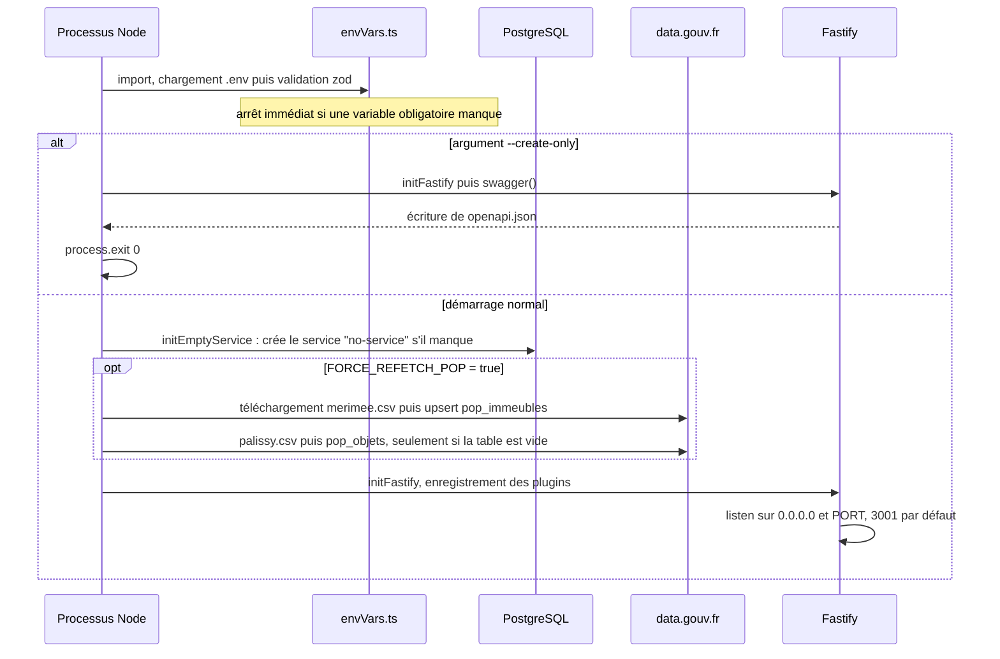
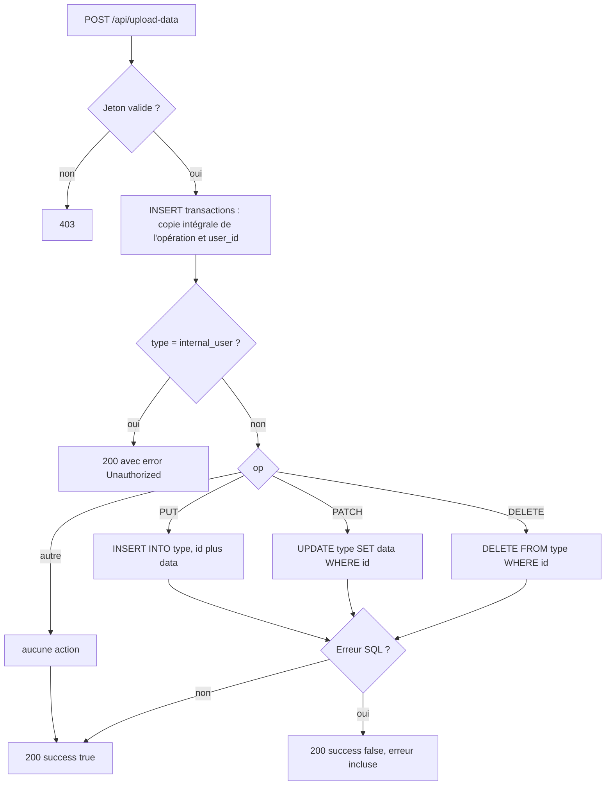
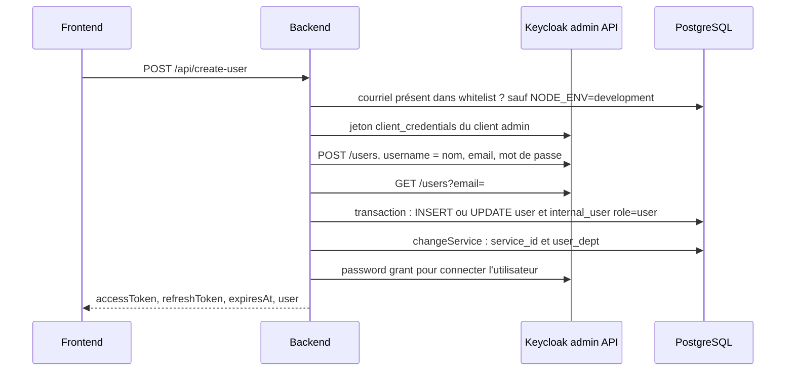
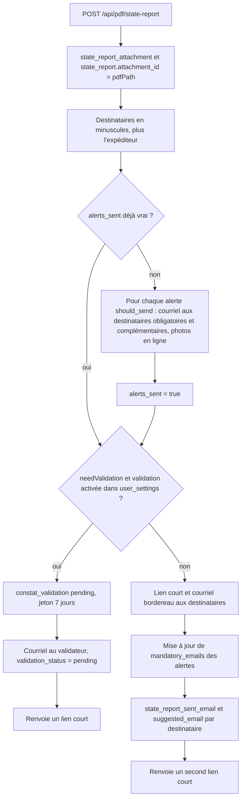
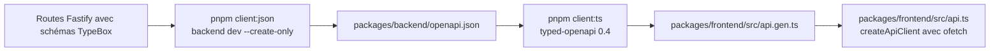

# 04 — Backend et API

Ce document décrit en détail le service backend de Patrinotes (`packages/backend`) : sa pile technique, sa séquence de démarrage, l'organisation du code, **toutes** les routes HTTP exposées, les services métier, le point d'entrée de synchronisation PowerSync (`/api/upload-data`), la gestion des erreurs et des journaux, ainsi que la chaîne de génération du client d'API typé utilisé par le frontend.

Il s'adresse aux développeurs qui reprennent le code et aux équipes d'exploitation du ministère. Les aspects d'authentification et de sécurité sont approfondis dans [05 — Authentification et sécurité](05-authentification-securite.md). Les règles sont tirées de la lecture du code ; ce qui relève de l'interprétation est signalé « à confirmer ».

> **Rôle du backend en une phrase.** Le backend est une API Node.js (Fastify) qui : relaie l'authentification vers Keycloak, applique dans PostgreSQL les écritures envoyées par les clients hors ligne, délivre des URL de dépôt et de lecture des fichiers (S3/MinIO), enregistre les PDF générés **par le navigateur** et envoie les courriels (comptes-rendus, constats d'état, alertes, validation). Il ne sert **pas** les lectures métier courantes : elles passent par PowerSync (voir [08 — Synchronisation](08-synchronisation-hors-ligne.md)).

---

## 1. Pile technique et versions

Versions effectivement résolues dans [pnpm-lock.yaml](../pnpm-lock.yaml) (les plages déclarées sont dans [package.json](../packages/backend/package.json)).

| Domaine | Bibliothèque | Version verrouillée | Usage |
| --- | --- | --- | --- |
| Serveur HTTP | `fastify` | 4.29.1 | Routeur, hooks, plugins encapsulés |
| Validation / typage | `@sinclair/typebox` + `@fastify/type-provider-typebox` | 0.32.35 / 4.1.0 | Schémas de requêtes et réponses, génération OpenAPI |
| CORS | `@fastify/cors` | 9.0.1 | `origin: "*"` |
| OpenAPI | `@fastify/swagger` | 8.15.0 | Production de `openapi.json` (aucune interface Swagger UI n'est servie) |
| Multipart | `@fastify/multipart` | 8.3.1 | Enregistré sur `/api/upload` mais **aucune route ne l'utilise** |
| Accès BDD | `kysely` + `pg` | 0.27.6 / 8.20.0 | Toutes les requêtes SQL à l'exécution |
| Schéma et migrations | `drizzle-orm` / `drizzle-kit` | 0.44.7 / 0.31.10 | Déclaration du schéma, génération des migrations SQL dans [db/](../db) ; les types Kysely sont dérivés via `Kyselify` |
| Authentification | `jsonwebtoken`, `jwks-rsa`, `ofetch` | 9.0.3 / 3.2.2 / 1.5.1 | Vérification des jetons Keycloak, appels à l'API OIDC et à l'API d'administration Keycloak |
| Stockage objet | `@aws-sdk/client-s3`, `@aws-sdk/s3-request-presigner` | 3.1017.0 | MinIO / S3 : URL présignées, lecture d'objets |
| Courriel | `nodemailer` | 6.10.1 | Envoi SMTP |
| Supervision | `@sentry/node` | 7.120.4 | Remontée d'erreurs (hors développement) |
| Variables d'env. | `dotenv`, `dotenv-expand`, `zod` | 16.6.1 / 11.0.7 / 3.25.76 | Chargement et validation au démarrage |
| Journaux | `debug` | 4.4.3 | Espace de noms `cr-vif:*` |
| Import POP | `csv-parser`, `linkedom` | 3.2.0 / 0.18.12 | Import des CSV Mérimée/Palissy et extraction des images POP |
| Build | `tsup` | 8.5.1 | Bundle ESM `dist/index.js` |
| Dév. | `vite-node`, `vitest`, `typescript` | 1.6.1 / 2.1.9 / 5.9.3 | Exécution avec rechargement à chaud, tests unitaires |
| Partagé | `@patrinotes/pdf` (workspace) | — | Fonctions communes (noms de fichiers PDF, désérialisation des alertes et préconisations) |

Dépendances déclarées mais **non utilisées** par le code lu : `@fastify/swagger-ui`, `fastify-multer`, `@aws-sdk/lib-storage`, `jose`, `postgres`, `ws`, `reflect-metadata`, `@keycloak/keycloak-admin-client` (le code appelle l'API d'administration Keycloak à la main avec `ofetch`). `@react-pdf/renderer`, `react`, `canvas` et `jsdom` sont présents mais le PDF est aujourd'hui généré **côté navigateur** puis déposé sur S3 (voir §6.4). *À confirmer : ces dépendances peuvent être retirées.*

Image d'exécution : `node:20.11-alpine` avec les bibliothèques natives de `canvas` (cairo, pango, jpeg…), voir [Dockerfile](../Dockerfile).

---

## 2. Organisation du code

```
packages/backend/
├── data/udap.json          # Ancienne liste de 96 services (id, département) — non lue par le code
├── public/                 # Logos Marianne et polices, lus à l'exécution pour les courriels
├── openapi.json            # Contrat généré (commité), source de api.gen.ts
├── drizzle.config.ts       # Configuration drizzle-kit (migrations écrites dans ../../db)
├── tsup.config.ts          # Build ESM ; react, @react-pdf, canvas en externe
├── vite.config.ts          # Pour vite-node en développement
└── src/
    ├── index.ts            # Point d'entrée : démarrage ou génération OpenAPI
    ├── router.ts           # Construction de l'instance Fastify, enregistrement des plugins
    ├── envVars.ts          # Chargement .env et validation zod
    ├── hmr.ts              # Arrêt propre de Fastify lors du rechargement à chaud
    ├── db/
    │   ├── schema.ts       # Schéma Drizzle (source de vérité des tables)
    │   ├── relations.ts    # Relations Drizzle (non utilisées à l'exécution)
    │   └── db.ts           # Instance Kysely + type Database
    ├── routes/             # Un plugin Fastify par domaine + middlewares d'authentification
    ├── services/           # Classes de service injectées dans chaque requête
    └── features/
        ├── auth/keycloak.ts    # Client de l'API d'administration Keycloak
        ├── data/               # Import des données POP (Mérimée, Palissy, images)
        ├── mail/ , mail.ts     # Gabarits et envoi des courriels (habillage DSFR)
        ├── bordereau.ts        # Corps du courriel d'envoi d'un constat d'état
        ├── sentry.ts, debug.ts, errors.ts
```

Le dossier [public/](../packages/backend/public) contient `Marianne-Light@2x.png`, `Marianne-Dark@2x.png` (logos insérés en pièces jointes *inline* dans chaque courriel), `marianne.png`, `marianne_footer.png` et les polices Marianne (`fonts/*.ttf`). **Règle cachée** : [dsfrMailWrapper.ts](../packages/backend/src/features/mail/dsfrMailWrapper.ts) lit `path.join(process.cwd(), "public")`. Le processus doit donc être lancé depuis `packages/backend` (c'est le cas avec `pnpm backend start`), sinon le premier envoi de courriel échoue. Le build `tsup --publicDir` copie aussi `public/` dans `dist/`.

Le dossier [data/](../packages/backend/data) contient [udap.json](../packages/backend/data/udap.json) : une liste historique de 96 services (identifiant, nom de département, autres champs vides). Il n'est référencé par aucun code. Le même dossier sert aussi de **répertoire temporaire** à l'import POP (`./data/merimee.csv`, `./data/palissy.csv`, supprimés après import).

---

## 3. Démarrage

### 3.1 Séquence



Détails ([index.ts](../packages/backend/src/index.ts)) :

1. **Chargement de l'environnement** ([envVars.ts](../packages/backend/src/envVars.ts#L7-L11)) : charge `../../.env` (ou `../../.env.test` si `NODE_ENV=test`) **relativement au répertoire courant**, c'est-à-dire la racine du dépôt quand on lance depuis `packages/backend`. Si le fichier n'existe pas (production en conteneur), seules les variables du processus comptent.
2. **Validation zod** ([envVars.ts](../packages/backend/src/envVars.ts#L24-L63)) : toute variable obligatoire absente provoque une exception au chargement du module.
3. **Service « no-service »** ([index.ts](../packages/backend/src/index.ts#L34-L39)) : une ligne `service` d'identifiant `no-service`, invisible (`visible=false`), est créée si elle manque. Elle sert de service par défaut aux utilisateurs créés par `/api/authenticate` (voir §6.1).
4. **Import POP optionnel** si `FORCE_REFETCH_POP=true` (voir §8).
5. **Fastify** écoute sur `0.0.0.0:${PORT}`.

Les migrations **ne sont pas** lancées par le backend lui-même : l'image Docker exécute `pnpm migration:up; pnpm backend start` ([Dockerfile](../Dockerfile)). Le `;` signifie que le serveur démarre **même si la migration échoue**.

### 3.2 Modes d'exécution (`NODE_ENV`)

| Variable | Calcul ([envVars.ts](../packages/backend/src/envVars.ts#L13-L15)) | Effets |
| --- | --- | --- |
| `isDev` | `NODE_ENV === "development"` | Liste blanche désactivée, Sentry désactivé, pile d'erreur renvoyée au client |
| `isTest` | `NODE_ENV === "test"` | Charge `.env.test` |
| `isProd` | ni dev ni test | Sentry actif si `SENTRY_DSN` est défini |

**Piège** : `isDev` est calculé à partir de `process.env.NODE_ENV` après chargement du `.env`, et non à partir de la valeur par défaut du schéma zod (`"development"`). Si `NODE_ENV` n'est défini nulle part, l'application se comporte comme en **production** (liste blanche active, Sentry actif). `pnpm backend dev` ne fixe pas `NODE_ENV` et [.env.dist](../.env.dist) ne contient pas cette variable. La mention du README « la whitelist n'est pas active en développement » suppose donc que `NODE_ENV=development` soit ajouté au `.env`. De plus, le message « Running in … mode » est écrit **avant** le chargement du `.env` et peut afficher `undefined`.

### 3.3 Variables d'environnement lues par le backend

| Variable | Obligatoire | Usage réel dans le code |
| --- | --- | --- |
| `POSTGRES_HOST`, `POSTGRES_USER`, `POSTGRES_PASSWORD`, `POSTGRES_DB`, `POSTGRES_PORT` (5432) | oui | Utilisées seulement par `drizzle.config.ts` (migrations) |
| `DATABASE_URL` | oui | Connexion Kysely (SSL **désactivé** en dur, [db.ts](../packages/backend/src/db/db.ts#L9-L12)) |
| `FRONTEND_URL` | oui | Liens dans les courriels (réinitialisation, validation, constat), `redirect_uri` OIDC |
| `BACKEND_URL` | oui | URL publique des liens courts `/attachment/:id` |
| `EMAIL_HOST`, `EMAIL_PORT` (465), `EMAIL_USER`, `EMAIL_PASSWORD`, `EMAIL_EMITTER` | oui | SMTP (option `secure` non fixée ; comportement TLS à confirmer selon le port) |
| `MINIO_URL`, `MINIO_BUCKET`, `MINIO_ACCESS_KEY_ID`, `MINIO_SECRET_KEY` | oui | Client S3 (région `us-east-1` en dur, *path style*) |
| `VITE_AUTH_URL`, `VITE_AUTH_REALM`, `VITE_AUTH_CLIENT_ID` | oui | Keycloak (partagées avec le frontend) |
| `AUTH_CLIENT_SECRET` | oui | Secret du client Keycloak applicatif (signature HS256 de l'assertion client) |
| `AUTH_ADMIN_CLIENT_ID`, `AUTH_ADMIN_CLIENT_SECRET` | oui | Compte de service Keycloak pour l'API d'administration |
| `SENTRY_DSN` | non | Active Sentry hors développement |
| `PORT` (3001) | non | Port d'écoute |
| `DEBUG` (`cr-vif:*`) | non | Espaces de noms de journalisation (activés **par défaut**, y compris en production) |
| `FORCE_REFETCH_POP` (false) | non | Réimport POP au démarrage |
| `NODE_ENV` | non | Voir §3.2 |
| `JWT_SECRET`, `JWT_REFRESH_SECRET`, `DATAGOUV_API` | **oui** | **Jamais lues par le code** : héritage d'une ancienne authentification maison. Elles doivent pourtant être définies (valeur quelconque), sinon le démarrage échoue |
| `TOKEN_LIFETIME` (60m), `ASSETS_DIR` | non | Jamais lues |

Remarque : [.env.dist](../.env.dist) est désynchronisé (il mentionne `AWS_*`, `KEYCLOAK_CLIENT_SECRET`, `VITE_ELECTRIC_URL`… mais pas `BACKEND_URL`, `AUTH_ADMIN_CLIENT_*`, `EMAIL_EMITTER`, `DATAGOUV_API`, `JWT_REFRESH_SECRET`). La liste ci-dessus, tirée de `envVars.ts`, fait foi.

### 3.4 Construction de l'instance Fastify

[router.ts](../packages/backend/src/router.ts) :

- `fastify({ maxParamLength: 5000 })` : paramètres de chemin très longs autorisés.
- Compilateur de validation TypeBox, fournisseur de types TypeBox.
- `@fastify/swagger` enregistré **en premier** (obligatoire pour qu'il capte toutes les routes). L'option `prefix: "/documentation"` est sans effet : aucune interface Swagger n'est exposée. L'import est nommé `swaggerUi` mais il s'agit bien de `@fastify/swagger`.
- CORS `origin: "*"`.
- Hook `onRequest` : journalise `METHODE URL` et injecte `request.services` (singletons, §5).
- `GET /health` hors préfixe.
- Un plugin encapsulé de préfixe `/api` qui porte le **gestionnaire d'erreurs** (§7) et enregistre, **dans cet ordre** : `auth`, `user`, `staticData`, `upload` (`/upload`), `pdf` (`/pdf`), `stateReport` (`/state-report`), `validation`, `sync`, `admin` (`/admin`), `stats` (`/stats`).
- `attachmentRedirectPlugin` **hors** du préfixe `/api` : la route `/attachment/:id` n'a donc pas le gestionnaire d'erreurs personnalisé.

---

## 4. Catalogue des routes

Légende « Auth » : **Public** = aucun contrôle ; **Jeton** = en-tête `Authorization: Bearer <access token Keycloak>` vérifié par [authMiddleware.ts](../packages/backend/src/routes/authMiddleware.ts) ; **Admin** = jeton + `internal_user.role = 'admin'` ([adminMiddleware.ts](../packages/backend/src/routes/adminMiddleware.ts)). Un jeton absent ou invalide renvoie **403** (et non 401), convention de l'application.

### 4.1 Santé et liens courts (hors `/api`)

| Méthode | Chemin | Auth | Rôle et logique notable |
| --- | --- | --- | --- |
| GET | `/health` | Public | Renvoie `{status:"ok"}`, sans vérifier la base ni S3 |
| GET | `/attachment/:id/:filename?` | Public | Lien court inséré dans les courriels. Recherche `attachment_redirection.id`. 404 si inconnu, **410 si créé il y a plus de 90 jours**. Si la ligne a un `name`, le backend **relaie le fichier** (`Content-Disposition: inline; filename="<name>"`). Sinon, il redirige (302) vers une URL S3 présignée valable 1 h. Le segment `filename` est purement cosmétique. [attachmentRedirectRoutes.ts](../packages/backend/src/routes/attachmentRedirectRoutes.ts) |

### 4.2 Authentification et compte — [authRoutes.ts](../packages/backend/src/routes/authRoutes.ts), [userRoutes.ts](../packages/backend/src/routes/userRoutes.ts)

| Méthode | Chemin | Auth | Rôle et logique notable |
| --- | --- | --- | --- |
| POST | `/api/login-user` | Public | Corps `{email,password}`. *Password grant* Keycloak (`scope=offline_access`). Renvoie `{accessToken, refreshToken, expiresAt, user}`. C'est **la** méthode de connexion utilisée par le frontend |
| POST | `/api/create-user` | Public | Inscription. Contrôle de la **liste blanche** (sauf en dev), création du compte Keycloak via l'API d'administration, création ou mise à jour de `user` et `internal_user` (rôle `user`), affectation du service et des départements, puis connexion automatique |
| POST | `/api/refresh-token` | Public | Corps `{refreshToken}`. *Refresh grant* Keycloak. 401 « Session expirée » si Keycloak refuse |
| POST | `/api/authenticate` | Public | Corps `{code}`. Échange d'un code d'autorisation OIDC (`redirect_uri = FRONTEND_URL/auth-callback`) et **création automatique** d'un utilisateur rattaché à `no-service`, **sans contrôle de liste blanche**. **Non utilisé par le frontend actuel** (pas de route `/auth-callback`) |
| POST | `/api/send-reset-password` | Public | Corps `{email}`. Génère un lien de réinitialisation valable 24 h et l'envoie par courriel |
| POST | `/api/reset-password` | Public | Corps `{temporaryLink,newPassword}`. Vérifie le lien, change le mot de passe dans Keycloak, invalide le lien |
| POST | `/api/change-service` | Jeton | Corps `{service_id}`. Change le service de l'utilisateur **sans aucune autre vérification** que l'existence du service, puis remplace ses départements (`user_dept`) |
| GET | `/api/created-at` | Jeton | Date de création du compte (`internal_user.createdAt`), `null` si absente |

### 4.3 Données de référence — [staticDataRoutes.ts](../packages/backend/src/routes/staticDataRoutes.ts), [stateReportRoutes.ts](../packages/backend/src/routes/stateReportRoutes.ts)

| Méthode | Chemin | Auth | Rôle et logique notable |
| --- | --- | --- | --- |
| GET | `/api/services` | Public | Services `visible = true`, triés par le **premier mot du nom** puis par `dept_numbers`. Sert à l'écran d'inscription et de choix du service. Expose les adresses de courriel institutionnelles (`courriel_crmh`, `courriel_udap`…) |
| GET | `/api/state-report/objets-images` | Jeton | Query `references` (liste séparée par des virgules). Renvoie les lignes `pop_images` correspondantes. La table `pop_images` n'est pas synchronisée par PowerSync : c'est le seul moyen d'y accéder |

### 4.4 Synchronisation — [syncRoutes.ts](../packages/backend/src/routes/syncRoutes.ts)

| Méthode | Chemin | Auth | Rôle et logique notable |
| --- | --- | --- | --- |
| POST | `/api/upload-data` | Jeton | Applique **une** opération CRUD PowerSync (voir §6.2) |

### 4.5 Fichiers — [uploadRoutes.tsx](../packages/backend/src/routes/uploadRoutes.tsx)

Toutes ces routes exigent un jeton. Le préfixe `attachment/` est toujours ajouté à la clé S3.

| Méthode | Chemin | Auth | Rôle et logique notable |
| --- | --- | --- | --- |
| GET | `/api/upload/attachment/presigned-url` | Jeton | Query `filePath`. Renvoie une URL **PUT** présignée (1 h) vers `attachment/<filePath>`. Aucun contrôle de taille, de type ni de propriété |
| GET | `/api/upload/attachment` | Jeton | Query `filePath` (décodé par `decodeURIComponent`) et `stateReportId` optionnel. Renvoie le contenu binaire. Si `stateReportId` est fourni, insère une ligne `constat_pdf_download` (statistique de téléchargement). 404 si la clé n'existe pas |
| GET | `/api/upload/attachment/size` | Jeton | Taille en octets (`HeadObject`), 404 si absent |

### 4.6 PDF et envois — [pdfRoutes.tsx](../packages/backend/src/routes/pdfRoutes.tsx)

| Méthode | Chemin | Auth | Rôle et logique notable |
| --- | --- | --- | --- |
| POST | `/api/pdf/report/upload-url` | Jeton | Corps `{reportId}`. Calcule `pdfPath = <reportId>/compte_rendu_<epoch s>.pdf` et renvoie une URL PUT présignée (`Content-Type: application/pdf`) |
| POST | `/api/pdf/report` | Jeton | **Envoi d'un compte-rendu** : voir §6.4 |
| GET | `/api/pdf/report` | Jeton | Query `reportId`. Renvoie le PDF en **base64** : le **premier** `report_attachment` dont l'`attachment_id` finit par `.pdf`, sans tri (pas forcément le plus récent) |
| POST | `/api/pdf/state-report/upload-url` | Jeton | Corps `{stateReportId}`. `pdfPath = <stateReportId>/constat_d_etat_<epoch s>.pdf` |
| POST | `/api/pdf/state-report` | Jeton | **Envoi d'un constat d'état** (alertes, validation éventuelle) : voir §6.5 |
| GET | `/api/pdf/state-report` | Jeton | Query `stateReportId`. PDF courant (`state_report.attachment_id`) en base64. Erreur 500 (et non 404) si absent |
| POST | `/api/pdf/state-report/log-download` | Jeton | Corps `{stateReportId}`. Trace un téléchargement dans `constat_pdf_download` |

### 4.7 Validation des constats — [validationRoutes.ts](../packages/backend/src/routes/validationRoutes.ts)

Routes **publiques** : l'authentification repose sur la seule connaissance du jeton (UUID v4) envoyé au validateur.

| Méthode | Chemin | Auth | Rôle et logique notable |
| --- | --- | --- | --- |
| GET | `/api/constat-validation/:token` | Jeton de validation | Renvoie titre, commune, date de visite, statut, commentaire et une URL S3 présignée (1 h) du PDF. L'expiration (7 jours) n'est vérifiée **que si le statut est `pending`** : une fois acceptée ou refusée, la page reste consultable sans limite de durée |
| GET | `/api/constat-validation/:token/pdf` | Jeton de validation | Renvoie le PDF (`application/pdf`), même règle d'expiration |
| POST | `/api/constat-validation/:token/accept` | Jeton de validation | Corps `{comment?}`. Seulement si `pending` et non expiré. Passe `constat_validation.status` et `state_report.validation_status` à `accepted`, envoie le constat aux destinataires (URL présignée de **7 jours**), trace `state_report_sent_email`, puis informe le rédacteur |
| POST | `/api/constat-validation/:token/decline` | Jeton de validation | Corps `{comment}` (obligatoire). Passe les statuts à `declined` et informe le rédacteur |

### 4.8 Administration — [adminRoutes.ts](../packages/backend/src/routes/adminRoutes.ts)

| Méthode | Chemin | Auth | Rôle et logique notable |
| --- | --- | --- | --- |
| GET | `/api/admin/me` | Admin | Renvoie l'utilisateur courant (sert au frontend à savoir s'il est administrateur) |
| GET | `/api/admin/whitelist` | Admin | Pagination (`page`, `limit`=20), recherche `ilike`, tri sur 5 colonnes avec `NULLS LAST`. Pour chaque courriel : compte existant (`hasUser`), date du dernier constat créé, date du dernier constat finalisé |
| POST | `/api/admin/whitelist` | Admin | Ajoute un courriel. 409 s'il existe déjà |
| DELETE | `/api/admin/whitelist` | Admin | Corps `{email}`. 404 s'il est absent. **Ne supprime ni ne désactive le compte existant** |
| GET | `/api/admin/whitelist/export` | Admin | Liste complète (courriel, date) |
| GET | `/api/admin/users` | Admin | Utilisateurs avec service, département, rôle et date de création ; recherche par nom, courriel, nom de service ou identifiant exact de service |
| GET | `/api/admin/users/export` | Admin | Même contenu sans pagination |

Il n'existe **aucune route** pour promouvoir un administrateur, supprimer un utilisateur ou modifier un rôle : ces opérations se font directement en base (`internal_user.role`) et dans Keycloak.

### 4.9 Statistiques — [statsRoutes.ts](../packages/backend/src/routes/statsRoutes.ts)

| Méthode | Chemin | Auth | Rôle et logique notable |
| --- | --- | --- | --- |
| GET | `/api/stats/public` | **Public** | Indicateurs globaux. Période par défaut : les 3 derniers mois (`from`, `to` au format `AAAA-MM-JJ`) |
| GET | `/api/stats/accounts` | **Public** | Créations de comptes par mois (par défaut depuis le 1er janvier) |
| GET | `/api/stats/documents` | **Public** | Comptes-rendus et constats créés et envoyés par mois |
| GET | `/api/stats/admin` | Admin | Constats par service (envoyés, téléchargés, « utilisés »), documents abandonnés |
| GET | `/api/stats/udap` | Admin | Indicateurs par département (services UDAP) |
| GET | `/api/stats/crmh` | Admin | Indicateurs par région (services CRMH), via une table de codes région en dur |
| GET | `/api/stats/jobs` | Admin | Répartition des utilisateurs par fonction (`user.job`) |

Règles de calcul cachées des statistiques :

- Un document est **« envoyé »** si `attachment_id IS NOT NULL`. Pour un constat soumis à validation, `attachment_id` est renseigné **dès la demande de validation**, avant toute acceptation, et le reste même en cas de refus (§6.5). Les compteurs « envoyés » incluent donc les constats en attente ou refusés.
- Les documents `disabled = true` (suppression logique) sont exclus partout.
- Un service est **UDAP** si son identifiant contient `udap`, **CRMH** s'il contient `crmh` (recherche `ilike` sur `service.id`, et non sur le nom). Un « déploiement » = un service de ce type ayant au moins un constat.
- Statistiques UDAP par département : **seul le premier département** de `service.dept_numbers` est pris en compte.
- **Abandon** : document créé il y a plus de **21 jours** sans PDF. Pour les constats, critère `attachment_id IS NULL` ; pour les comptes-rendus, critère sur la colonne historique `pdf IS NULL` (et non `attachment_id`). *À confirmer : cette différence est-elle voulue ?*
- **Utilisateur actif** sur la période : a envoyé au moins un document (table `sent_email` ou `state_report_sent_email`).
- Le suivi des téléchargements n'existe que depuis l'introduction de `constat_pdf_download` ; l'API renvoie `downloadTrackingSince` pour l'indiquer.

---

## 5. Services

Les services sont des **singletons** créés au premier appel de `getServices()` et attachés à chaque requête par le hook `onRequest` ([services.ts](../packages/backend/src/services/services.ts)).

| Service | Fichier | Responsabilités |
| --- | --- | --- |
| `AuthService` | [authService.ts](../packages/backend/src/services/authService.ts) | Échanges OIDC avec Keycloak, vérification des jetons (JWKS), correspondance jeton → utilisateur local, inscription, liste blanche |
| `UserService` | [userService.ts](../packages/backend/src/services/userService.ts) | Changement de service, réinitialisation de mot de passe |
| `SyncService` | [syncService.ts](../packages/backend/src/services/syncService.ts) | Application des opérations CRUD PowerSync |
| `UploadService` | [uploadService.ts](../packages/backend/src/services/uploadService.ts) | URL présignées, lecture d'objets, taille |
| `StaticDataService` | [staticDataService.ts](../packages/backend/src/services/staticDataService.ts) | Liste des services visibles |
| `StateReportService` | [stateReportService.ts](../packages/backend/src/services/stateReportService.ts) | Images POP par référence |

Code mort dans `UploadService` : `uploadAttachment`, `addPDFToReport` (qui construirait d'ailleurs une URL `https://https://…`), `getPDFName`, `getPictureName`, `upload`.

---

## 6. Fonctionnalités en détail

### 6.1 Correspondance jeton → utilisateur

L'identifiant pivot entre Keycloak et la base métier est **l'adresse de courriel** (claim `email`), et non l'identifiant Keycloak (`sub`) :

- `getUserFromToken` vérifie le jeton puis cherche `user.email = <claim email>` avec une **égalité stricte, sensible à la casse** ([authService.ts](../packages/backend/src/services/authService.ts#L113-L119)).
- Le résultat est enrichi de la ligne `service` complète (`user.service`).
- L'identifiant local `user.id` est un **UUID v7** généré par le backend.

Conséquences cachées :

- Keycloak met les courriels en minuscules. Si un utilisateur s'inscrit avec des majuscules, `user.email` est stocké tel que saisi : le jeton (en minuscules) ne retrouve plus l'utilisateur et toutes les routes renvoient 403. *Comportement de Keycloak à confirmer sur l'instance cible.*
- `/api/login-user` recherche l'utilisateur local avec le courriel **saisi**. Un compte Keycloak sans ligne `user` provoque une erreur 500 (`populateService(undefined)`).
- `/api/refresh-token` peut renvoyer `user: null` si la ligne locale a disparu. Le schéma de réponse exige un objet : *comportement exact à confirmer (probable erreur 500)*.

### 6.2 Point d'entrée PowerSync `/api/upload-data`

Le frontend (connecteur PowerSync, [Connector.ts](../packages/frontend/src/db/Connector.ts)) lit sa file locale (`getCrudBatch`) et envoie **une requête HTTP par opération**, dans l'ordre. Les opérations sans données (hors `DELETE`) sont ignorées côté client. Quand toutes les requêtes ont répondu, il appelle `complete()` : le lot est retiré de la file.

Format attendu (TypeBox, [syncService.ts](../packages/backend/src/services/syncService.ts#L77-L84)) :

```json
{ "op_id": 12, "tx_id": 5, "id": "<id de la ligne>", "type": "<nom de table>", "op": "PUT | PATCH | DELETE", "data": { "...": "..." } }
```



Règles et constats importants :

1. **Journal d'audit systématique** : chaque opération, même refusée ou en échec, est d'abord copiée dans la table `transactions` (données complètes en JSON, utilisateur, horodatage). Cette table grossit sans limite et contient des données personnelles (voir [05](05-authentification-securite.md)). La colonne `transactions.error` n'est jamais renseignée.
2. **Contrôle d'accès minimal** : la seule restriction est une liste noire contenant **une table**, `internal_user`. Le nom de table (`type`), l'identifiant et les colonnes (`data`) viennent du client et sont appliqués tels quels. **Aucune vérification** que la ligne appartient au service ou à l'utilisateur, ni que la table fait partie du schéma synchronisé. Un utilisateur authentifié peut techniquement écrire dans `user`, `service`, `whitelist`, `transactions`, `user_dept`, `attachment_redirection`, `constat_validation`… et dans les données d'autres services. Les identifiants de tables et de colonnes sont échappés par Kysely (pas d'injection SQL classique), mais l'absence d'autorisation est un **point de vigilance majeur** (détaillé dans [05 §8](05-authentification-securite.md)).
3. **Pas de validation métier** : `data` est de type `Any`. Seules les contraintes PostgreSQL (types, clés étrangères, `NOT NULL`, unicité) filtrent les écritures.
4. **Erreurs silencieuses** : une erreur SQL renvoie **HTTP 200** avec `{success:false}`. Le client ne regarde pas ce champ et retire l'opération de sa file : l'écriture est **perdue** côté serveur. PowerSync renvoie ensuite l'état serveur, ce qui annule la modification locale. La seule trace est la ligne `transactions` (sans l'erreur) et un journal `debug`.
5. **Pas de transaction** : les opérations d'une même transaction PowerSync (`tx_id`) sont appliquées une par une, sans transaction SQL. Un échec partiel est possible.
6. **PUT = INSERT** : un `PUT` sur une ligne existante échoue (clé dupliquée) et tombe dans le cas 4. *À confirmer : PowerSync émet `PUT` pour les créations et `PATCH` pour les mises à jour.*
7. **Opération inconnue** : toute valeur de `op` autre que `PUT`, `PATCH` ou `DELETE` est acceptée sans effet.

### 6.3 Inscription, liste blanche et changement de service



Règles cachées :

- **Le compte Keycloak est créé avec `username = nom affiché`** (« Prénom Nom ») et `firstName = nom` ; `lastName` n'est pas renseigné. *À confirmer : avec `registrationEmailAsUsername` actif dans le realm, Keycloak peut remplacer le username par le courriel ; sinon deux homonymes produiraient un conflit 409.*
- Si une ligne `user` existe déjà pour ce courriel (par exemple créée via `/api/authenticate`), elle est **mise à jour** et son `id` est conservé.
- Si l'étape locale échoue après la création Keycloak, le compte Keycloak reste orphelin (pas de compensation).
- Le mot de passe n'est **pas validé côté backend** : seules la politique du realm Keycloak et le formulaire (8 caractères, majuscule, minuscule, chiffre, caractère spécial) s'appliquent.
- `changeService` ([userService.ts](../packages/backend/src/services/userService.ts#L14-L35)) : `service.dept_numbers` est une **liste de numéros de départements séparés par des virgules**. Les lignes `user_dept` de l'utilisateur sont remplacées par cette liste. Ces lignes pilotent la synchronisation des données POP (monuments et objets des départements du service). **Si le service n'a pas de `dept_numbers`, les anciens départements sont conservés**, ce qui laisse des données POP d'un ancien service.
- Les paramètres utilisateur `user_settings` sont indexés par **(utilisateur, service)** : changer de service fait « perdre » les paramètres (dont la validation par un tiers) jusqu'au retour dans le service d'origine.

**Réinitialisation du mot de passe** ([userService.ts](../packages/backend/src/services/userService.ts#L37-L91)) : le lien est un UUID v4 aléatoire stocké **haché en MD5** dans `internal_user.temporaryLink`, valable 24 h et à usage unique. Le nouveau mot de passe est poussé dans Keycloak via l'API d'administration (`temporary: false`). La recherche se fait dans `internal_user` : un utilisateur sans `internal_user` ne peut pas réinitialiser son mot de passe par ce biais.

### 6.4 Envoi d'un compte-rendu (`POST /api/pdf/report`)

Le PDF est généré **dans le navigateur**, déposé par le navigateur sur S3 via l'URL présignée (`/api/pdf/report/upload-url`), puis le backend est notifié :

1. Relit le PDF sur S3 (pour vérifier son existence ; le contenu n'est pas utilisé).
2. Transaction : insère `report_attachment` (id = `pdfPath`) et met à jour `report.attachment_id` et `pdf_size`.
3. Destinataires : la chaîne reçue est découpée sur `,` et `;` ; **l'adresse de l'expéditeur est toujours ajoutée**.
4. Crée un **lien court** `attachment_redirection` (identifiant base62 d'un entier aléatoire de 48 bits, avec un nom de fichier lisible) et envoie le courriel « Compte-rendu UDAP ».
5. Pour chaque destinataire : ligne `sent_email` et tentative d'insertion dans `suggested_email` (erreur ignorée). Comme `suggested_email.email` est **unique globalement**, une adresse n'est suggérée qu'au **premier service** qui l'a utilisée.
6. Renvoie une URL S3 présignée (1 h) du PDF.

### 6.5 Envoi d'un constat d'état (`POST /api/pdf/state-report`)



Règles cachées :

- **Les alertes ne partent qu'une seule fois** par constat (`state_report.alerts_sent`) et **avant** toute validation : un constat soumis à validation, puis refusé, a déjà déclenché ses alertes.
- Destinataires d'une alerte = `mandatory_emails` (format sérialisé, décodé par `deserializeMandatoryEmails` de `@patrinotes/pdf`) ∪ `additional_emails`, sans doublon, en minuscules. Les photos jointes sont celles qui ne sont ni dépréciées ni ignorées ; leur type est forcé à `image/png`. L'échec d'une alerte est journalisé et envoyé à Sentry mais **n'interrompt pas** l'envoi.
- La validation n'est déclenchée que si les trois conditions sont réunies : `needValidation` dans la requête, `user_settings.validation_enabled` et `user_settings.validation_email` pour le **couple (utilisateur, service courant)**.
- En mode validation, les destinataires sont mémorisés dans `constat_validation.recipients` et le courriel final part à l'acceptation. `suggested_email` n'est pas alimenté dans ce cas.
- Dans le parcours sans validation, **deux** liens courts sont créés (un pour le courriel, un renvoyé à l'appelant).
- Le texte des courriels annonce un lien « valable 1 mois », alors que le lien court expire à **90 jours** et que l'URL présignée envoyée après acceptation d'une validation expire à **7 jours**.

### 6.6 Courriels

Tous les courriels passent par `nodemailer` ([mail.ts](../packages/backend/src/features/mail.ts)) avec l'expéditeur `EMAIL_EMITTER` et un habillage DSFR commun ([dsfrMailWrapper.ts](../packages/backend/src/features/mail/dsfrMailWrapper.ts)) qui joint en ligne les logos Marianne (`cid:marianne-light@patrinotes`, `cid:marianne-dark@patrinotes`).

| Courriel | Déclencheur | Destinataires | Contenu notable |
| --- | --- | --- | --- |
| Compte-rendu UDAP | `POST /api/pdf/report` | Saisis + expéditeur | Lien de téléchargement, rappel « ne remplace pas la demande d'autorisation de travaux », signature `report.redactedBy` |
| Constat d'état (bordereau) | Envoi sans validation ou acceptation | Saisis + expéditeur | Texte réglementaire (code du patrimoine R.621-18, R.621-20, R.621-63, R.621-65, L621-32, circulaire 2009-024), liste des préconisations, signature nom et courriel de l'agent ([bordereau.ts](../packages/backend/src/features/bordereau.ts)) |
| Alerte | Envoi d'un constat avec alertes | Adresses obligatoires et complémentaires de l'alerte | Formulation selon le type (édifice en péril, archéologie, objets mobiliers, abords, site classé, biodiversité, sécurité), article « de l'/du/de la » déduit de la présence de `UDAP`, `SRA` ou `CRMH` dans le nom du service ([alertMail.ts](../packages/backend/src/features/mail/alertMail.ts)) |
| Demande de validation | Constat avec validation | Validateur | Lien `FRONTEND_URL/constat-validation/<jeton>`, valable 7 jours |
| Résultat de validation | Acceptation ou refus | Rédacteur | Décision, commentaire, adresse du validateur |
| Réinitialisation de mot de passe | `/api/send-reset-password` | Demandeur | Lien `FRONTEND_URL/reset-password/<lien>` |

Point d'attention : les contenus saisis (titre de l'édifice, commentaires, commentaire du validateur, préconisations) sont **interpolés sans échappement HTML** dans les courriels.

Il n'y a **ni file d'attente ni nouvelle tentative** : l'envoi est synchrone dans la requête HTTP. Un échec SMTP sur le courriel principal fait échouer la requête **après** l'écriture en base (le document est alors marqué comme envoyé alors que le courriel n'est pas parti).

---

## 7. Gestion des erreurs, journaux et Sentry

### 7.1 Gestionnaire d'erreurs

Défini sur le plugin `/api` ([router.ts](../packages/backend/src/router.ts#L58-L69)) :

- Toute erreur est écrite sur `console.error` et envoyée à Sentry **avec le corps de la requête et les paramètres**.
- `AppError(status, message)` ([errors.ts](../packages/backend/src/features/errors.ts)) → réponse `{error: message}` avec le statut voulu. Le frontend affiche `error.data.error`.
- Toute autre erreur → **500** `{error: "Une erreur s'est produite"}`, avec `stack` et `message` en plus si `NODE_ENV=development`.

Conséquences cachées :

- Les **erreurs de validation TypeBox** de Fastify ne sont pas des `AppError` : un corps invalide produit une **500** et non une 400. *À confirmer par un test.*
- Plusieurs routes de validation lèvent des objets littéraux `{statusCode, message}` au lieu d'`AppError` ([validationRoutes.ts](../packages/backend/src/routes/validationRoutes.ts#L28)). Avec ce gestionnaire, ils devraient produire une 500, alors que les tests de bout en bout ([constat-validation.spec.ts](../tests/constat-validation.spec.ts)) attendent 404. *À confirmer.*
- `AppError` n'hérite pas d'`Error` (pas de pile d'appel dans Sentry).
- La route `/attachment/:id` est hors du plugin `/api` : ses erreurs inattendues suivent le format par défaut de Fastify.

### 7.2 Journaux

- `makeDebug(namespace)` crée l'espace de noms `cr-vif:<namespace>` ([debug.ts](../packages/backend/src/features/debug.ts)) ; `DEBUG` vaut `cr-vif:*` par défaut. Les journaux applicatifs sont donc **actifs en production** et partent sur la sortie d'erreur standard.
- Chaque requête est journalisée (`METHODE URL`, y compris les paramètres de requête, donc les `filePath`).
- Le journal Fastify intégré (`logger`) n'est pas activé : pas d'accès structurés, pas d'identifiant de requête, pas de code retour.
- Certaines traces contiennent des données personnelles (courriel à la connexion et à l'inscription, destinataires d'alertes). Voir [05 §10](05-authentification-securite.md).

### 7.3 Sentry

[sentry.ts](../packages/backend/src/features/sentry.ts) : initialisé seulement si `NODE_ENV !== "development"` **et** `SENTRY_DSN` est défini, avec `tracesSampleRate: 1.0` (100 % des transactions). En plus des exceptions, le code envoie des **messages informatifs** à chaque envoi de compte-rendu ou de constat (avec les destinataires et l'objet complet du document) et à chaque envoi d'alerte.

---

## 8. Tâches planifiées et imports de données

Il n'existe **aucune tâche planifiée** (ni cron, ni file de tâches) dans le backend. Les données POP sont importées :

- au démarrage si `FORCE_REFETCH_POP=true` ;
- ou manuellement avec `pnpm backend import-pop` (`vite-node ./src/features/data/pop.ts --standalone`), qui enchaîne immeubles, objets et images.

| Étape | Source | Cible | Règle |
| --- | --- | --- | --- |
| Immeubles | `https://ministere-culture.s3.sbg.io.cloud.ovh.net/POP/merimee.csv` (séparateur `|`) | `pop_immeubles` | Upsert par lots de 500 sur `reference` (`id` = `reference`), **toujours exécuté** |
| Objets | `…/POP/palissy.csv` | `pop_objets` | **Ignoré si la table contient déjà une ligne** : pour réimporter, il faut la vider |
| Images | Pages HTML `https://pop.culture.gouv.fr/notice/<merimee/palissy>/<référence>` (*scraping*) | `pop_images` | Lots de 50, pause de 100 ms entre notices, **première image seulement** ; HTTP 400 ignoré ; dépend de la structure HTML de POP (`.swiper-slide`) |

Détails cachés de l'import ([pop.ts](../packages/backend/src/features/data/pop.ts), [KyselyBatchWriter.ts](../packages/backend/src/features/data/KyselyBatchWriter.ts)) :

- Les en-têtes CSV sont mis en minuscules et seules les colonnes existant dans la table (introspection) sont conservées.
- Doublons de référence dans un même lot : seule la première occurrence est gardée.
- Images : les immeubles dont `last_image_check_at` est `NULL` ne sont **jamais** sélectionnés (la condition `< hier` exclut `NULL`), contrairement aux objets. *À confirmer : est-ce voulu ?*
- L'appel `initPopImages()` est commenté dans le démarrage normal : les images ne sont importées que par la commande manuelle.
- Le module importe `path/win32` (sans effet sous Linux pour ces usages, mais inhabituel).
- [_merimee.ts](../packages/backend/src/features/data/_merimee.ts) (préfixe `_`) est un ancien import depuis une instance *datasette* de Collectif Objets ; il n'est plus appelé et sa variable `COLLECTIF_OBJETS_DATASETTE_URL` est commentée.

---

## 9. Contrat OpenAPI et client typé



- `pnpm client:generate` (racine) = `client:json` + `client:ts`.
- `client:json` lance `vite-node ./src/index.ts --create-only` : `initFastify()` est construit, `fastify.swagger()` est sérialisé dans `openapi.json` **du répertoire courant** (`packages/backend`), puis le processus s'arrête. Toutes les variables d'environnement obligatoires doivent être présentes (validation zod), mais aucune connexion à la base n'est ouverte : le pool `pg` est paresseux et `initEmptyService` n'est pas appelé. *À confirmer en pratique.*
- `client:ts` lance `typed-openapi ./packages/backend/openapi.json --output ./packages/frontend/src/api.gen.ts`.
- Côté frontend, [api.ts](../packages/frontend/src/api.ts) enveloppe le client généré : ajout automatique du jeton (avec rafraîchissement préalable si nécessaire), sauf pour `unauthenticatedApi`. Les types `RouterInputs` et `RouterOutputs` sont dérivés du fichier généré.
- `openapi.json` et `api.gen.ts` sont **commités**. Ils sont actuellement cohérents (37 chemins identiques). Il n'y a aucun contrôle en CI : oublier `pnpm client:generate` après une modification de route ne casse pas le build, mais donne des types faux côté frontend.
- Les routes sans schéma de réponse (`/api/upload/attachment`, `/api/upload/attachment/size`, `/attachment/:id`) sont typées `unknown`. Les composants de schéma ne sont pas factorisés (`Schemas` vide).

---

## 10. Build, exécution et tests

| Commande | Effet |
| --- | --- |
| `pnpm backend dev` | `vite-node --watch src/index.ts` ; à chaque modification, les rappels HMR ferment Fastify avant le rechargement ([hmr.ts](../packages/backend/src/hmr.ts)) |
| `pnpm backend dev-test` | Idem avec `NODE_ENV=test` (`.env.test`) |
| `pnpm backend build` | `tsup --publicDir` → `dist/index.js` (ESM) |
| `pnpm backend start` | `NODE_ENV=production node ./dist/index.js` |
| `pnpm migration:generate` / `migration:up` | drizzle-kit `generate` / `migrate` (migrations dans [db/](../db)) |
| `pnpm backend check` | `tsc --noEmit` |
| `pnpm backend test` | vitest (aucun fichier de test unitaire n'a été trouvé dans `src`) |
| `pnpm e2e` | Tests Playwright de bout en bout ([tests/](../tests)), déclenchés **manuellement** en CI (`workflow_dispatch`) |

Le paquet déclare `exports: "./src/router.ts"` : les tests importent directement des modules du backend (par exemple `deleteUserByEmail`, l'instance `db`).

---

## 11. Règles cachées et pièges — récapitulatif

| # | Règle ou piège | Où |
| --- | --- | --- |
| 1 | `JWT_SECRET`, `JWT_REFRESH_SECRET`, `DATAGOUV_API` sont obligatoires au démarrage mais inutilisées | `envVars.ts` |
| 2 | Sans `NODE_ENV=development` explicite, le backend se comporte comme en production (liste blanche, Sentry) | `envVars.ts` |
| 3 | Le service `no-service` est créé au démarrage et sert de service par défaut | `index.ts` |
| 4 | L'identité locale est retrouvée par **courriel exact** (sensible à la casse) | `authService.ts` |
| 5 | `/api/upload-data` : seule la table `internal_user` est interdite ; les erreurs SQL renvoient 200 et les écritures sont perdues silencieusement | `syncService.ts` |
| 6 | Chaque écriture client est copiée intégralement dans `transactions` (sans purge) | `syncService.ts` |
| 7 | Les erreurs de validation de schéma deviennent des 500 | `router.ts` |
| 8 | Un jeton absent ou invalide → 403, jamais 401 (sauf `refresh-token` → 401) | `authMiddleware.ts` |
| 9 | Liens courts publics, valables 90 jours, alors que le courriel annonce « 1 mois » | `attachmentRedirectRoutes.ts`, `mail.ts` |
| 10 | Validation d'un constat : jeton de 7 jours, mais page consultable sans limite une fois traitée | `validationRoutes.ts` |
| 11 | Constat en validation : déjà compté comme « envoyé » (attachment_id renseigné) ; alertes déjà parties | `pdfRoutes.tsx` |
| 12 | L'expéditeur est toujours ajouté aux destinataires | `pdfRoutes.tsx` |
| 13 | `suggested_email` est unique globalement : une adresse n'est suggérée qu'au premier service | `schema.ts` |
| 14 | `user_settings` dépend du couple (utilisateur, service) | `pdfRoutes.tsx` |
| 15 | UDAP et CRMH sont reconnus par une sous-chaîne de `service.id` | `statsRoutes.ts` |
| 16 | `pop_objets` n'est jamais réimporté si la table est non vide | `pop.ts` |
| 17 | Le processus doit tourner depuis `packages/backend` (lecture de `public/`) | `dsfrMailWrapper.ts` |
| 18 | Le serveur démarre même si la migration échoue (`;` dans le `CMD` Docker) | `Dockerfile` |
| 19 | `GET /api/pdf/report` renvoie le premier PDF trouvé, pas forcément le dernier | `uploadService.ts` |
| 20 | Courriels envoyés de façon synchrone, sans nouvelle tentative, après l'écriture en base | `pdfRoutes.tsx` |
