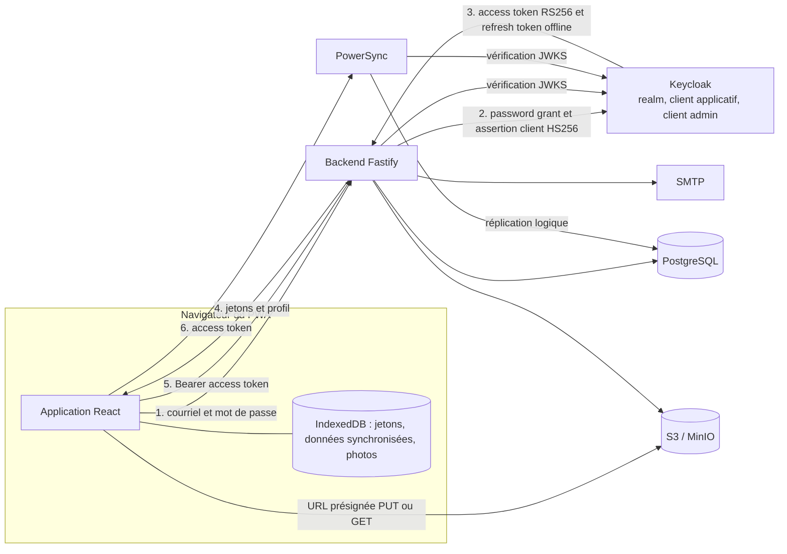
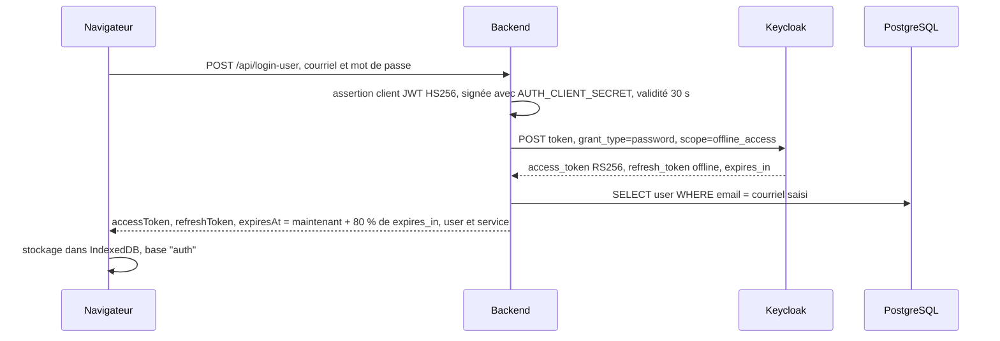

# 05 — Authentification et sécurité

Ce document décrit comment Patrinotes authentifie ses utilisateurs, comment les droits d'accès aux données sont appliqués (backend, PowerSync, stockage S3), quelles données personnelles sont traitées et où, et dresse un bilan orienté **homologation de sécurité** (démarche ANSSI / RGS) : points forts et points de vigilance.

Il s'adresse à l'équipe sécurité (RSSI, SSI du ministère), aux équipes d'exploitation chargées du transfert et aux développeurs. Les constats viennent de la lecture du code ; ce qui n'a pas pu être vérifié (configuration de production, réglages de l'instance Keycloak réelle) est signalé « à confirmer ». Les routes citées sont détaillées dans [04 — Backend et API](04-backend-api.md).

> **Résumé pour un lecteur non technique.** Les agents se connectent avec un courriel et un mot de passe gérés par Keycloak, un logiciel libre de gestion des identités. Seules les adresses inscrites sur une **liste blanche** peuvent créer un compte. Chaque agent ne reçoit sur son appareil que les données de **son service** (UDAP, CRMH…). En revanche, le serveur contrôle peu les **écritures** et l'accès aux **fichiers** : un agent connecté et malveillant pourrait techniquement modifier des données d'autres services ou changer de service librement. Ces points sont à corriger avant une homologation (voir §12).

---

## 1. Vue d'ensemble

Points clés :

- **Un seul fournisseur de jetons : Keycloak.** Le backend ne signe **aucun** jeton applicatif. Les variables `JWT_SECRET`, `JWT_REFRESH_SECRET` et `TOKEN_LIFETIME` sont des restes d'une ancienne authentification maison : elles sont exigées au démarrage mais **jamais utilisées** ([envVars.ts](../packages/backend/src/envVars.ts#L32-L34)). `PS_JWT_SECRET`, transmis à PowerSync dans [docker-compose.yaml](../docker-compose.yaml), n'est pas non plus référencé par la configuration PowerSync.
- **Le même jeton d'accès Keycloak** sert au backend et à PowerSync.
- **Le backend fait office de proxy d'authentification** : le navigateur n'affiche pas la page de connexion Keycloak ; il envoie le mot de passe au backend, qui l'échange auprès de Keycloak (*Resource Owner Password Credentials*).

---

## 2. Keycloak

### 2.1 Rôle et version

Keycloak (image `quay.io/keycloak/keycloak:26.3.5` dans [docker-compose.yaml](../docker-compose.yaml)) stocke les comptes et les mots de passe. Sa base est une base `keycloak` sur le même serveur PostgreSQL que l'application ([db/init/1_create_keycloak.sql](../db/init/1_create_keycloak.sql)).

### 2.2 Modèle de realm (environnement de développement et de test)

Le fichier [tests/realm-template.json](../tests/realm-template.json) est importé au démarrage du conteneur (`start-dev --import-realm`) après substitution des variables d'environnement par [tests/keycloak-entrypoint.sh](../tests/keycloak-entrypoint.sh) (`envsubst`). **Il ne décrit que l'environnement local et de test** ; la configuration du realm de production n'est pas dans le dépôt (*à confirmer et à exporter lors du transfert*).

| Élément | Valeur dans le modèle | Commentaire |
| --- | --- | --- |
| Realm | `master` | Le realm d'administration de Keycloak est utilisé comme realm applicatif. À éviter en production (*le nom réel est donné par `VITE_AUTH_REALM`, à confirmer*) |
| `accessTokenLifespan` | **60 secondes** | Le client rafraîchit donc son jeton environ toutes les 48 s (§3.3) |
| `registrationEmailAsUsername` | `true` | |
| Profil utilisateur déclaratif | `username`, `email`, `firstName`, `lastName` **modifiables par l'utilisateur** | Voir le risque lié au courriel, §4.3 |
| Politique de mot de passe, protection contre la force brute | **Non définies** | Valeurs par défaut de Keycloak : pas de politique, détection de force brute désactivée (*à confirmer en production*) |
| Client applicatif `${AUTH_CLIENT_ID}` | Confidentiel, authentification `client-secret-jwt`, *direct access grants* activé, compte de service activé, `redirectUris` et `webOrigins` = `/*` | Seul le *password grant* et le *refresh* sont utilisés en pratique |
| Client d'administration `${AUTH_ADMIN_CLIENT_ID}` | Compte de service avec les rôles `manage-users`, `view-users`, `query-users`, `manage-authorization` sur `master-realm` et `manage-account` | Utilisé par le backend pour créer des comptes et changer des mots de passe |

Variables d'environnement côté backend : `VITE_AUTH_URL`, `VITE_AUTH_REALM`, `VITE_AUTH_CLIENT_ID`, `AUTH_CLIENT_SECRET`, `AUTH_ADMIN_CLIENT_ID`, `AUTH_ADMIN_CLIENT_SECRET`. Côté frontend : `VITE_AUTH_URL`, `VITE_AUTH_REALM`, `VITE_AUTH_CLIENT_ID` (déclarées mais non utilisées pour la connexion).

### 2.3 Thème DSFR (`keycloak-theme.jar`)

Le fichier [keycloak-theme.jar](../keycloak-theme.jar) à la racine est une archive de thème Keycloak qui déclare :

- un thème **`DSFR`** pour les types `login` et `account` (pages de connexion et espace « mon compte » aux couleurs de l'État) ;
- un thème **`account-v1`** (console de compte « ancienne génération », extension *phasetwo* `keycloak-account-v1`).

Il n'est **monté dans aucun fichier docker-compose** du dépôt : il doit être copié dans `/opt/keycloak/providers/` de l'instance Keycloak et sélectionné dans la configuration du realm. Les variables `DSFR_THEME_HOME_URL`, `DSFR_THEME_SERVICE_TITLE` et `DSFR_THEME_BRAND_TOP` de [.env.dist](../.env.dist) servent vraisemblablement à paramétrer ce thème (*à confirmer*). Le code source du thème n'est pas dans le dépôt (`keycloak-theme/*` est dans `.gitignore`).

Comme la connexion passe par le formulaire de l'application et non par la page Keycloak, le thème `login` n'est visible que si un utilisateur accède directement à Keycloak (par exemple à l'espace « compte »). *À confirmer : usage réel de l'espace compte Keycloak en production.*

### 2.4 Usage du client d'administration

[keycloak.ts](../packages/backend/src/features/auth/keycloak.ts) : avant **chaque** appel à l'API d'administration, le backend obtient un jeton `client_credentials` (pas de cache). Appels effectués :

| Appel | Déclencheur |
| --- | --- |
| `POST /admin/realms/<realm>/users` | Inscription (`/api/create-user`) |
| `GET /users?email=` | Inscription, réinitialisation du mot de passe |
| `PUT /users/<id>/reset-password` | Réinitialisation du mot de passe |
| `DELETE /users/<id>` | Uniquement dans les tests (`deleteUserByEmail`) |

Ce compte de service peut gérer **tous** les utilisateurs du realm : son secret est le plus sensible de l'application.

---

## 3. Flux des jetons

### 3.1 Connexion

Détails ([authService.ts](../packages/backend/src/services/authService.ts#L125-L163)) :

- **Authentification du client** : le backend envoie à la fois `client_secret` et une `client_assertion` (JWT HS256 signé avec `AUTH_CLIENT_SECRET`, `iss`=`sub`=client id, `aud` = URL du realm, `exp` = +30 s, `jti` aléatoire) — méthode `client-secret-jwt` ([authService.ts](../packages/backend/src/services/authService.ts#L275-L287)).
- **`scope=offline_access`** : le jeton de rafraîchissement est un **jeton hors ligne** (*offline token*). Il ne dépend pas de la session SSO et reste valable jusqu'à son expiration d'inactivité hors ligne (30 jours par défaut dans Keycloak, *à confirmer*). C'est ce qui permet l'usage hors ligne prolongé de la PWA.
- `expiresAt` est calculé **côté backend** à 80 % de la durée de vie ([authService.ts](../packages/backend/src/services/authService.ts#L301)).
- Erreurs : le message Keycloak « Invalid user credentials » est traduit en « Courriel ou mot de passe incorrect ».

### 3.2 Utilisation du jeton

- **Backend** : en-tête `Authorization: Bearer <access_token>`. [authMiddleware.ts](../packages/backend/src/routes/authMiddleware.ts) prend la deuxième partie de l'en-tête **sans vérifier le mot « Bearer »**, puis `checkToken` vérifie la signature avec la clé publique du realm (JWKS `…/protocol/openid-connect/certs`, mise en cache), l'algorithme **RS256**, l'émetteur `VITE_AUTH_URL/realms/VITE_AUTH_REALM` et l'audience **`account`**. L'utilisateur est ensuite retrouvé **par son courriel** (§4.3). Tout échec → 403.
- **PowerSync** : [powersync-config.yaml](../powersync/powersync-config.yaml) déclare `client_auth.jwks_uri` (certificats Keycloak), `issuer` et `audience: ["account"]`. Les règles de synchronisation utilisent `auth.parameter('email')`, c'est-à-dire le claim `email` du jeton.

**Piège de configuration** : l'émetteur (`iss`) d'un jeton Keycloak dépend de l'URL par laquelle il a été demandé. Le backend demande les jetons via `VITE_AUTH_URL` et vérifie `iss` avec cette même URL. PowerSync doit donc être configuré avec **le même émetteur** (URL publique), alors que le fichier du dépôt contient `http://keycloak:8080/realms/master`, valable seulement en local. *La configuration PowerSync de production est à récupérer sur le serveur actuel.*

### 3.3 Rafraîchissement

[Connector.ts](../packages/frontend/src/db/Connector.ts#L50-L98) :

- Avant chaque appel d'API et à chaque demande d'identifiants par PowerSync, `getTokenOrRefresh` compare `expiresAt` à l'heure courante. S'il est dépassé, il appelle `POST /api/refresh-token` (non authentifié). Une seule requête de rafraîchissement est lancée à la fois (promesse partagée), car Keycloak peut faire tourner le jeton de rafraîchissement.
- Si le backend renvoie **401**, les jetons sont effacés et une fenêtre « session expirée » invite à se reconnecter.
- Le rafraîchissement se fait **uniquement d'après l'horloge du client** : un 403 du backend (jeton révoqué) ne déclenche pas de rafraîchissement.

### 3.4 Déconnexion

`useLogout` ([AuthContext.tsx](../packages/frontend/src/contexts/AuthContext.tsx#L211-L220)) efface les jetons localement. **Aucun appel à Keycloak** n'est fait : le jeton hors ligne reste valable côté serveur jusqu'à son expiration. Les données synchronisées (base SQLite locale) et les photos en cache **restent sur l'appareil** (*à confirmer : purge éventuelle ailleurs dans le frontend*).

### 3.5 Route `/api/authenticate` (flux par code, inutilisé)

Le backend expose un échange de **code d'autorisation** (`redirect_uri = FRONTEND_URL/auth-callback`) qui **crée automatiquement** un utilisateur local rattaché au service `no-service` **sans vérifier la liste blanche** ([authService.ts](../packages/backend/src/services/authService.ts#L95-L111)). Le frontend actuel ne l'utilise pas (aucune route `/auth-callback`). Cette route reste néanmoins accessible : toute personne disposant d'un compte Keycloak valide dans le realm pourrait obtenir un compte applicatif. À supprimer ou à protéger.

---

## 4. Inscription, liste blanche et rôles

### 4.1 Liste blanche

- Table `whitelist(email, createdAt)`.
- Vérifiée **uniquement** dans `/api/create-user`, par égalité stricte (sensible à la casse) ([authService.ts](../packages/backend/src/services/authService.ts#L336-L348)). Message d'erreur : « Votre courriel n'est pas autorisé… écrire à contact@patrinotes.beta.gouv.fr ».
- **Désactivée si `NODE_ENV=development`** (fonction `assertEmailInWhitelist`, retour immédiat). Attention : sans `NODE_ENV` défini, l'application se comporte comme en production et la liste blanche est active (voir [04 §3.2](04-backend-api.md)).
- Gérée par les administrateurs via `/api/admin/whitelist` (ajout, suppression, export).
- **Retirer une adresse de la liste ne désactive pas le compte** : la connexion, le rafraîchissement et la synchronisation ne consultent pas la liste blanche. Pour bloquer un agent, il faut désactiver son compte dans Keycloak (et attendre l'expiration de son jeton d'accès).
- Contournements possibles : `/api/authenticate` (§3.5) et l'écriture directe dans la table `whitelist` via `/api/upload-data` (§8).

### 4.2 Rôles

| Rôle | Où | Effet |
| --- | --- | --- |
| `user` | `internal_user.role` (valeur posée à l'inscription) | Accès normal |
| `admin` | `internal_user.role = 'admin'` | Accès aux routes `/api/admin/*` et `/api/stats/{admin,udap,crmh,jobs}` |

- Les rôles **ne viennent pas de Keycloak** (aucun rôle ou groupe du jeton n'est lu).
- Aucune route ne permet de nommer un administrateur : il faut modifier la base directement.
- La table `internal_user` est la seule protégée en écriture via la synchronisation, précisément pour empêcher l'auto-promotion (test [sync.spec.ts](../tests/sync.spec.ts)).
- Le contrôle `authenticateAdmin` est fait **à chaque requête** en base (pas de cache).

### 4.3 Identité pivot : le courriel

L'utilisateur applicatif est retrouvé par `user.email = claim email du jeton`. Conséquences pour la sécurité :

- Le profil Keycloak du modèle autorise l'utilisateur à **modifier son propre courriel** (espace compte). La vérification du courriel (`email_verified`) n'est pas contrôlée par le backend. *À confirmer : si l'espace compte est accessible en production, un utilisateur pourrait prendre l'adresse d'un compte applicatif qui n'existe pas (ou plus) dans Keycloak.*
- Un utilisateur peut aussi modifier la colonne `user.email` en base via `/api/upload-data` (§8), ce qui permet, en théorie, de **se substituer à un autre utilisateur**, y compris un administrateur : il suffit de libérer sa propre adresse, puis d'attribuer son adresse à la ligne `user` de la victime. Le contrôle administrateur se fait sur l'`id` de la ligne retrouvée par courriel. **Point critique à corriger.**

### 4.4 Mot de passe

- **Validation** : seulement dans le formulaire d'inscription (8 caractères minimum, majuscule, minuscule, chiffre, caractère spécial). Le backend et le modèle de realm n'imposent **aucune politique**. La route de réinitialisation accepte n'importe quel mot de passe.
- **Réinitialisation** : lien aléatoire (UUID v4, 122 bits), stocké **haché en MD5**, valable **24 h**, à usage unique ([userService.ts](../packages/backend/src/services/userService.ts#L37-L91)). Le MD5 est acceptable ici vu l'entropie du secret, mais un SHA-256 serait préférable pour l'homologation. La fonction intégrée de Keycloak (« mot de passe oublié ») n'est pas utilisée.
- **Énumération de comptes** : `/api/send-reset-password` répond par une erreur 403 si l'adresse est inconnue et par un message de succès sinon. Il est donc possible de tester l'existence d'une adresse.

---

## 5. Cloisonnement des données par service

### 5.1 Principe

Chaque utilisateur appartient à **un** service (`user.service_id`) : UDAP, CRMH, SRA… Les services portent la liste de leurs départements (`service.dept_numbers`). Le cloisonnement est appliqué **en lecture par PowerSync** :

| Flux PowerSync | Données | Filtre |
| --- | --- | --- |
| `global_stream` | `clause_v2` communes, `pictures` | `service_id = 'ALL'` ; `pictures` **sans filtre** |
| `service_stream` | Service, membres du service (id, nom), services instructeurs, clauses, courriels envoyés et suggérés | Service de l'utilisateur |
| `user_stream` | Délégations, `pdf_snapshot`, `user_settings` | Utilisateur |
| `reports_stream` | Comptes-rendus, constats, sections visitées, alertes, état des validations (sans le jeton) | Service de l'utilisateur |
| `state_report_attachments_stream`, `report_attachments_stream` | Pièces jointes | Paramètre `state_report_id` / `report_id` **fourni par le client, sans contrôle de service** |
| `pop_stream` | Monuments et objets POP | Départements de l'utilisateur (`user_dept`) |

Source : [sync-config.yaml](../powersync/sync-config.yaml). Le détail est dans [08 — Synchronisation](08-synchronisation-hors-ligne.md).

### 5.2 Limites du cloisonnement

1. **Le service n'est pas une frontière de sécurité.** `/api/change-service` permet à tout utilisateur connecté de rejoindre **n'importe quel service** existant, sans validation. Il reçoit alors toutes les données de ce service. C'est un choix fonctionnel (agents itinérants, multi-services ?) qui doit être assumé ou encadré (*à confirmer avec le métier*).
2. **Les écritures ne sont pas cloisonnées** : voir §8.
3. **Les fichiers ne sont pas cloisonnés** : voir §7.
4. Les routes PDF (`GET /api/pdf/report`, `GET /api/pdf/state-report`, `POST …`) ne vérifient pas que le document appartient au service de l'utilisateur.
5. Les flux de pièces jointes acceptent n'importe quel identifiant de constat ou de compte-rendu (les identifiants sont des UUID difficiles à deviner, mais il n'y a pas de contrôle).

---

## 6. Validation des entrées et exposition HTTP

| Mesure | État |
| --- | --- |
| Validation des schémas | TypeBox sur la plupart des routes (types simples, pas de format `email`, pas de longueur maximale). Les routes `/api/upload/attachment*` lisent `request.query` sans schéma. `/api/upload-data` accepte `data: Any` |
| Injection SQL | Kysely paramètre les valeurs et échappe les identifiants. Les seules chaînes SQL brutes (`sql\`…\``) des statistiques interpolent des paramètres liés. Pas d'injection SQL identifiée |
| Injection HTML dans les courriels | **Non protégée** : titres, commentaires, préconisations et commentaire du validateur sont insérés tels quels dans le HTML |
| CORS | `origin: "*"` ([router.ts](../packages/backend/src/router.ts#L43-L45)), sans cookies. L'authentification par en-tête limite le risque CSRF, mais n'importe quel site peut appeler l'API avec un jeton volé |
| Limitation de débit | **Aucune** (`@fastify/rate-limit` absent). Les routes publiques (connexion, inscription, réinitialisation, validation, liens courts, statistiques publiques) sont exposées sans limite. La protection contre la force brute dépend de Keycloak |
| En-têtes de sécurité | Aucun (`helmet` absent) côté backend. À traiter au niveau du proxy inverse (*à confirmer*) |
| Taille des requêtes | Limite par défaut de Fastify (1 Mio pour le corps JSON). `maxParamLength` porté à 5000. Le plugin multipart (15 Mo) est enregistré mais aucune route ne l'utilise |
| Messages d'erreur | Message générique en production ; pile d'appel renvoyée en développement uniquement |
| Interface Swagger | Non exposée |

---

## 7. Fichiers (S3 / MinIO)

### 7.1 Organisation

- Un seul bucket (`MINIO_BUCKET`). Les pièces jointes (photos, plans, PDF) sont sous le préfixe `attachment/`. Les PDF suivent le chemin `attachment/<id du document>/compte_rendu_<epoch>.pdf` ou `…/constat_d_etat_<epoch>.pdf`.
- Le bucket est **privé** dans l'environnement local (`minio-init` ne définit pas de politique anonyme). *À confirmer en production.* L'accès se fait par URL présignées (SigV4) ou en relais par le backend.
- Le client S3 utilise des clés d'accès statiques (`MINIO_ACCESS_KEY_ID`, `MINIO_SECRET_KEY`) avec la politique `readwrite` en local.

### 7.2 Mécanismes d'accès

| Mécanisme | Authentification | Durée | Contrôle |
| --- | --- | --- | --- |
| URL PUT présignée (`/api/upload/attachment/presigned-url`, `/api/pdf/*/upload-url`) | Jeton | 1 h | **Aucun** sur le chemin (choisi par le client), la taille ou le type. Un utilisateur peut écraser n'importe quel objet sous `attachment/` |
| Lecture relayée (`/api/upload/attachment?filePath=`) | Jeton | — | **Aucun** contrôle de propriété ; tout objet sous `attachment/` est lisible par tout utilisateur connecté qui connaît son chemin |
| Lien court `/attachment/:id` (courriels) | **Aucune** | **90 jours** | Identifiant base62 d'un entier aléatoire de 48 bits (`crypto.randomInt`). Pas de limitation de débit contre l'énumération. Le fichier est relayé ou une URL présignée (1 h) est renvoyée |
| URL présignée GET dans le courriel d'acceptation de validation | Aucune | 7 jours | — |
| Page de validation `/api/constat-validation/:token` | Jeton de validation (UUID v4) | 7 jours tant qu'en attente, **illimitée ensuite** | — |

Les noms de fichiers sont générés par le client (identifiants UUID) ou par le backend (horodatage). Aucun antivirus ni contrôle du contenu n'est appliqué aux fichiers déposés. Le type des photos d'alerte est forcé à `image/png` dans les courriels.

---

## 8. Écritures via la synchronisation : contrôle d'accès

`POST /api/upload-data` ([syncService.ts](../packages/backend/src/services/syncService.ts)) applique les opérations `PUT`, `PATCH` et `DELETE` envoyées par le client sur **la table nommée par le client**, pour **l'identifiant fourni par le client**, avec **les colonnes fournies par le client**. La seule restriction est la liste noire `["internal_user"]`.

Conséquences (déduites du code, non testées en exploitation) — un utilisateur authentifié peut :

- modifier ou supprimer des comptes-rendus, constats, alertes et pièces jointes **d'autres services** ;
- ajouter des adresses dans `whitelist` ;
- modifier `user` (y compris `email` et `service_id` d'autres utilisateurs → usurpation, §4.3) ;
- modifier `service` (adresses de courriel institutionnelles utilisées pour les alertes) ;
- créer des `attachment_redirection` vers n'importe quel objet S3 ;
- modifier `constat_validation` (statut, destinataires) ;
- effacer ou falsifier le journal `transactions`.

**Recommandation** : remplacer la liste noire par une **liste blanche de tables** (celles du schéma frontend) et, pour chaque table, vérifier que la ligne visée appartient au service de l'utilisateur (`service_id`) et que les colonnes modifiées sont autorisées. Les tables `user`, `service`, `whitelist`, `transactions`, `attachment_redirection`, `constat_validation`, `user_dept`, `pop_*` ne devraient pas être modifiables par ce biais.

Point positif : chaque opération est **tracée** dans `transactions` avec l'identifiant de l'utilisateur avant d'être appliquée, ce qui donne une piste d'audit, mais elle est elle-même modifiable par le même canal.

---

## 9. Gestion des secrets

| Secret | Utilisé par | Sensibilité |
| --- | --- | --- |
| `AUTH_ADMIN_CLIENT_SECRET` | Backend → API d'administration Keycloak | **Très élevée** (gestion de tous les comptes) |
| `AUTH_CLIENT_SECRET` | Backend → Keycloak (secret client et clé HMAC des assertions) | Élevée |
| `DATABASE_URL`, `POSTGRES_PASSWORD` | Backend, migrations, PowerSync (`PS_DATABASE_URL`), Keycloak (`KC_DB_PASSWORD`) | Élevée. Le même compte PostgreSQL sert l'application, PowerSync et Keycloak dans la configuration locale |
| `MINIO_ACCESS_KEY_ID`, `MINIO_SECRET_KEY` | Backend | Élevée (lecture et écriture de tous les fichiers) |
| `EMAIL_USER`, `EMAIL_PASSWORD` | Backend → SMTP | Moyenne (usurpation de l'expéditeur) |
| `SENTRY_DSN`, `VITE_SENTRY_DSN` | Backend, frontend | Faible (le DSN frontend est public par nature) |
| `JWT_SECRET`, `JWT_REFRESH_SECRET` | Aucun | Inutilisés ; à retirer |

- Les secrets sont fournis par **variables d'environnement** (fichier `.env` à la racine en développement, configuration Coolify en production — *à confirmer*). Aucun gestionnaire de secrets n'est intégré au code.
- Aucun secret n'est commité : `.env.dist` ne contient que des noms. Les variables `VITE_*` sont **publiques** par construction : `createEnvFile.ts` écrit toutes les variables `VITE_*` dans `env.js`, servi au navigateur. Il ne faut jamais nommer un secret `VITE_…`.
- Connexions **sans TLS** vers PostgreSQL (`ssl: false` en dur dans [db.ts](../packages/backend/src/db/db.ts#L11) et `drizzle.config.ts`) et entre PowerSync et PostgreSQL (`sslmode: disable`). Acceptable sur un réseau privé de conteneurs, à revoir si la base est distante.
- La télémétrie PowerSync n'est **pas désactivée** (`disable_telemetry_sharing: false`, et la clé est d'ailleurs mal indentée sous `client_auth`). À désactiver pour l'hébergement ministériel.

---

## 10. Données personnelles (RGPD)

### 10.1 Inventaire

| Donnée | Personnes concernées | Où (tables et colonnes) | Copies |
| --- | --- | --- | --- |
| Nom, prénom (concaténés), courriel, fonction | Agents | `user.name`, `user.email`, `user.job` ; Keycloak (`username` = nom, `firstName`, `email`, mot de passe haché) | PowerSync (nom des membres du service), IndexedDB des collègues du service |
| Rôle, date d'inscription, consentement à la lettre d'information, lien de réinitialisation haché | Agents | `internal_user` | — |
| Liste blanche | Agents potentiels | `whitelist.email` | — |
| Courriels des destinataires d'envois | Pétitionnaires, propriétaires, partenaires | `sent_email.sent_to`, `state_report_sent_email.sent_to`, `suggested_email.email`, `attachment_redirection.sent_to`, `constat_validation.recipients` | IndexedDB des agents du service |
| Demandeur d'un compte-rendu | Particuliers | `report.applicantName`, `applicantAddress`, `applicantEmail`, `contacts`, `personnes_presentes`, champs libres | IndexedDB, PDF sur S3, courriels |
| Propriétaire d'un monument et son représentant | Particuliers ou personnes morales | `state_report.proprietaire`, `proprietaire_email`, `proprietaire_representant`, `proprietaire_representant_email`, `personnes_presentes`, champs libres | IndexedDB, PDF, courriels |
| Validateur | Agents | `user_settings.validation_nom`, `validation_prenom`, `validation_email`, `constat_validation.validator_email`, `comment` | — |
| Courriels par défaut | Partenaires | `user_settings.default_emails`, `state_report_alert.mandatory_emails`, `additional_emails`, `service.courriel_*` | — |
| Photos | Personnes éventuellement visibles | S3 `attachment/…` | Cache local, courriels d'alerte |
| Traces d'usage | Agents | `transactions` (copie intégrale de **toutes** les écritures, dont tous les champs ci-dessus), `constat_pdf_download` | — |
| Contacts de services instructeurs | Agents d'autres administrations | `service_instructeurs.email`, `tel` | — |
| Données POP | Personnes historiques (auteurs, personnes liées) | `pop_immeubles`, `pop_objets` | Données publiques en *open data* |

Autres emplacements : la base MongoDB interne de PowerSync (copie des données synchronisées, non persistante d'après le README), la base locale de chaque appareil (SQLite dans IndexedDB, nommée `crvif-sync.db`), le stockage `crvif-attachments` (photos), les journaux applicatifs, Sentry et la boîte d'envoi SMTP.

### 10.2 Constats

- **Conservation** : la [politique de confidentialité](../packages/frontend/src/routes/politique-confidentialite.tsx) annonce 2 ans après la dernière connexion pour les comptes et comptes-rendus, et 1 an pour la traçabilité. **Aucun mécanisme de purge** n'existe dans le code (ni tâche planifiée, ni suppression de compte). La table `transactions` et les liens courts ne sont jamais purgés. La suppression des documents est **logique** (`disabled = true`).
- **Dernière connexion** : elle n'est pas enregistrée dans la base applicative (seulement dans les sessions Keycloak), ce qui empêche d'appliquer la durée annoncée.
- **CGU** : le champ `cgu` est demandé à l'inscription mais **n'est pas enregistré**. `newsletter` est enregistré dans `internal_user`, sans export vers Brevo dans le code (*à confirmer : export manuel ?*).
- **Sous-traitants** : la politique de confidentialité cite OVH et Brevo. Le code utilise aussi **Sentry** (backend et frontend) et Scaleway (stockage objet et SMTP), qui n'y figurent pas. L'hébergement actuel est un VPS privé (Coolify). La liste est à mettre à jour lors du transfert.
- **Droits des personnes** : aucune fonction d'export ou de suppression des données d'un agent. Les données des tiers (propriétaires, demandeurs) sont dans des champs libres et des PDF.

### 10.3 Données personnelles dans les journaux et la supervision

| Source | Contenu | Fichier |
| --- | --- | --- |
| Sentry backend, toute erreur sous `/api` | **Corps complet de la requête** : y compris **mots de passe** en cas d'erreur sur `/api/login-user`, `/api/create-user`, `/api/reset-password`, et données des documents | [router.ts](../packages/backend/src/router.ts#L60) |
| Sentry backend, messages d'information | Destinataires et objet complet du compte-rendu ou du constat (noms et courriels des propriétaires…) à **chaque** envoi | [mail.ts](../packages/backend/src/features/mail.ts#L34) |
| Sentry frontend | `consoleLoggingIntegration` remonte tous les `console.log/info/warn/error`. Or le connecteur écrit `console.log("applying operation", payload)` (toutes les écritures) et `console.log("token expired, refreshing...", {...apiStore})`, qui contient **le jeton d'accès, le jeton de rafraîchissement hors ligne et le profil** | [sentry.ts](../packages/frontend/src/features/sentry.ts), [Connector.ts](../packages/frontend/src/db/Connector.ts#L36) |
| Journaux backend (`debug`, actifs par défaut) | Courriel à la connexion et à l'inscription, destinataires des alertes, URL des requêtes (chemins de fichiers) ; `console.log` du détail des erreurs Keycloak | [authService.ts](../packages/backend/src/services/authService.ts#L126) |

Le **transfert de jetons d'accès et de rafraîchissement vers Sentry** est le point le plus sensible : il permettrait à toute personne ayant accès au projet Sentry de se connecter au nom d'un agent pendant la durée de validité du jeton hors ligne.

---

## 11. Dépendances et chaîne d'approvisionnement

Résultat de `pnpm audit --prod` sur le paquet backend, à la date de rédaction : **88 vulnérabilités connues** (2 critiques, 56 élevées, 27 modérées, 3 faibles), en grande partie transitives. Les plus significatives pour ce service :

| Composant | Version | Problème | Correction |
| --- | --- | --- | --- |
| `fastify` | 4.29.1 | Plusieurs avis « élevés » (contournement de validation, contournement d'authentification sur des URL malformées) ; la branche 4 n'est plus maintenue | Migrer vers Fastify 5 (≥ 5.12.2) |
| `nodemailer` | 6.10.1 | Déni de service dans l'analyse des adresses, injection SMTP | ≥ 10.0.6 |
| `kysely` | 0.27.6 | Injections dans des usages spécifiques (MySQL, chemins JSON) non utilisés ici | ≥ 0.28.17 |
| `@sentry/node` | 7.x | Version majeure ancienne | 8 ou plus |
| `proxy-addr`, `tar`, `fast-uri`, `ws`, `@fastify/busboy`… | transitives | Divers | Mises à jour |
| Image `node:20.11-alpine` | Node 20 | Plus maintenu depuis avril 2026 | Node 22 LTS ou plus |
| `journeyapps/powersync-service:latest` | non épinglée | Mise à jour non maîtrisée | Épingler une version |

La CI ([.github/workflows](../.github/workflows)) construit et publie les images Docker sur `ghcr.io` à chaque push sur `main`, `development` et `compte-rendu-vif`, **sans** tests automatiques (les tests de bout en bout sont déclenchés à la main), sans analyse de dépendances ni d'image. `canvas` (module natif) impose une chaîne de compilation dans l'image.

---

## 12. Synthèse pour l'homologation

### 12.1 Points forts

- Authentification déléguée à **Keycloak**, logiciel libre éprouvé : mots de passe hachés et jamais stockés par l'application, jetons signés **RS256** vérifiés par clé publique (JWKS), avec contrôle de l'émetteur et de l'audience.
- Client Keycloak **confidentiel** avec authentification par assertion signée (`client-secret-jwt`, validité 30 s, `jti` unique).
- Jetons d'accès **courts** (60 s dans le modèle de realm) et rafraîchissement centralisé côté client, sans requêtes concurrentes.
- **Liste blanche** des adresses autorisées à créer un compte, gérée par les administrateurs.
- **Cloisonnement en lecture** par service et par département dans les règles PowerSync ; le jeton de validation n'est pas synchronisé.
- Accès aux fichiers par **URL présignées** à durée limitée ; bucket non public (local).
- Requêtes SQL **paramétrées** (Kysely), schémas d'entrée TypeBox sur la plupart des routes.
- Piste d'audit des écritures (`transactions`) et des téléchargements de PDF.
- Liens de réinitialisation aléatoires, hachés, à usage unique, valables 24 h.
- Aucun secret dans le dépôt ; erreurs génériques en production.
- Interface conforme au DSFR, y compris un thème Keycloak DSFR.

### 12.2 Points de vigilance (par priorité)

| Priorité | Constat | Recommandation |
| --- | --- | --- |
| **Critique** | `/api/upload-data` : écriture sur toute table et toute ligne, sauf `internal_user` (§8) ; usurpation possible d'un compte, y compris administrateur, via `user.email` (§4.3) | Liste blanche de tables et de colonnes, contrôle du `service_id` et de la propriété, interdiction des tables sensibles. Identifier l'utilisateur par le `sub` Keycloak plutôt que par le courriel |
| **Critique** | Jetons d'accès et de rafraîchissement hors ligne, mots de passe et données personnelles envoyés à **Sentry** (§10.3) | Supprimer les `console.log` sensibles, retirer `consoleLoggingIntegration` ou filtrer avec `beforeSend`, ne pas joindre `request.body`, réduire `tracesSampleRate` |
| **Élevée** | Fichiers S3 lisibles et écrasables par tout utilisateur connecté (§7) | Vérifier la propriété (service) avant d'émettre une URL présignée ; imposer le chemin, la taille et le type |
| **Élevée** | `/api/change-service` sans contrôle : n'importe quel agent peut lire les données de n'importe quel service (§5.2) | Valider le rattachement (liste d'affectations, validation par un administrateur) |
| **Élevée** | `/api/authenticate` crée des comptes sans liste blanche (§3.5) | Supprimer la route ou y appliquer la liste blanche |
| **Élevée** | Aucune limitation de débit, pas de protection contre la force brute dans le modèle de realm, pas de politique de mot de passe côté serveur | `@fastify/rate-limit` ou limitation au proxy ; activer la détection de force brute et une politique de mot de passe dans Keycloak |
| **Élevée** | Dépendances vulnérables, Fastify 4 en fin de vie, CI sans tests ni audit (§11) | Plan de montée de version, `pnpm audit` et analyse d'image en CI |
| Moyenne | Liens courts publics de 90 jours (48 bits d'aléa), page de validation consultable sans limite après décision | Raccourcir la durée, augmenter l'aléa, limiter le débit, expirer les jetons de validation traités |
| Moyenne | Contenus utilisateur insérés sans échappement dans les courriels officiels ; un utilisateur peut envoyer des courriels à des destinataires arbitraires depuis l'adresse de l'application | Échapper le HTML ; journaliser et limiter les envois |
| Moyenne | Déconnexion sans révocation du jeton hors ligne ; données locales conservées | Appeler le *logout* / la révocation Keycloak ; purger la base locale à la déconnexion |
| Moyenne | Retrait de la liste blanche sans effet sur les comptes existants | Désactiver le compte Keycloak en même temps |
| Moyenne | Aucune purge RGPD, CGU non enregistrées, sous-traitants incomplets (Sentry, SMTP) | Tâche de purge, enregistrement du consentement, mise à jour de la politique |
| Moyenne | Realm `master` utilisé comme realm applicatif (modèle), compte de service d'administration aux droits larges | Realm dédié, droits minimaux (`manage-users` seulement sur ce realm) |
| Faible | CORS `*`, pas d'en-têtes de sécurité, connexions internes sans TLS, télémétrie PowerSync active | Restreindre l'origine au domaine du frontend, en-têtes au proxy, TLS si réseau non maîtrisé, `disable_telemetry_sharing: true` |
| Faible | Énumération des comptes via la réinitialisation ; MD5 pour le lien | Réponse identique dans tous les cas ; SHA-256 |
| Faible | Variables `JWT_*` inutilisées mais obligatoires ; `.env.dist` désynchronisé | Nettoyage |

### 12.3 Éléments à fournir lors du transfert (non présents dans le dépôt)

- Export du realm Keycloak de production (clients, durées de vie des jetons, durée des jetons hors ligne, politique de mot de passe, force brute, thème actif, SMTP de Keycloak).
- Configuration PowerSync de production (émetteur, JWKS, connexion à la base).
- Politique du bucket S3 de production et configuration CORS du stockage (nécessaire pour les dépôts directs depuis le navigateur).
- Configuration du proxy inverse (TLS, en-têtes, éventuelle limitation de débit).
- Projet Sentry utilisé (hébergeur, rétention, accès).
