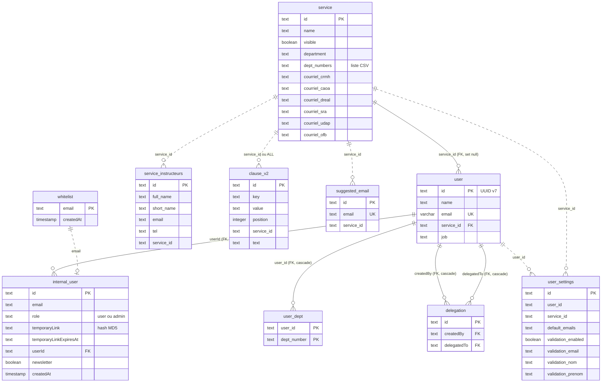
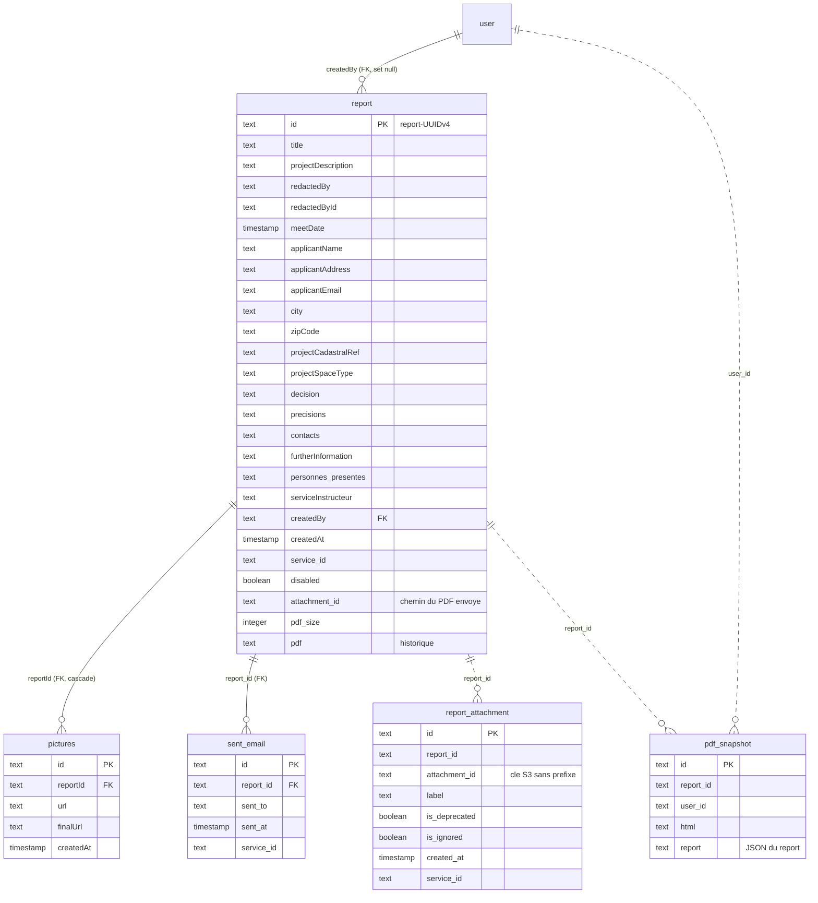
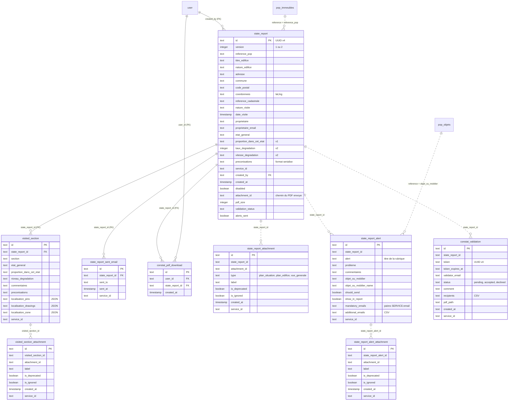
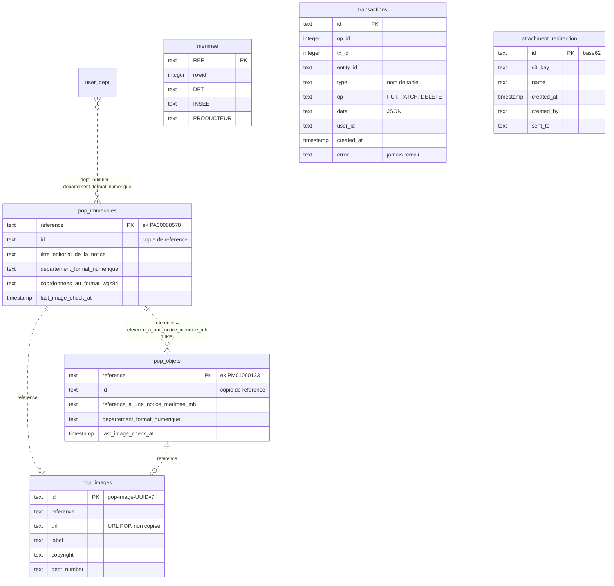
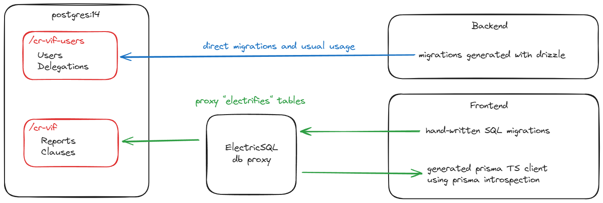

# 06 — Modèle de données

Ce document décrit la base PostgreSQL de Patrinotes : les tables et leurs colonnes, les relations, les conventions (identifiants, dates, suppression logique), les formats sérialisés dans des colonnes texte, les tables envoyées vers les navigateurs par PowerSync, l'historique des migrations et l'outillage (Drizzle, Kysely, scripts).

Source de vérité : [schema.ts](../packages/backend/src/db/schema.ts) (Drizzle). Les types Kysely utilisés à l'exécution sont dérivés de ce fichier dans [db.ts](../packages/backend/src/db/db.ts). Côté navigateur, le schéma SQLite local est déclaré à part dans [AppSchema.ts](../packages/frontend/src/db/AppSchema.ts).

> Toutes les informations ci-dessous viennent de la lecture du code. Les points déduits mais non vérifiés sur une base réelle sont signalés par « *à confirmer* ».

---

## 1. Vue d'ensemble

### 1.1 Les domaines

| Domaine | Tables | Rôle |
| --- | --- | --- |
| **Utilisateurs et services** | `user`, `internal_user`, `whitelist`, `service`, `user_dept`, `delegation`, `user_settings`, `service_instructeurs`, `suggested_email`, `clause_v2` | Comptes, rattachement à un service (UDAP, CRMH, DRAC…), départements couverts, partage entre agents, préférences, carnet d'adresses, textes types. |
| **Compte-rendu de visite (CR)** | `report`, `report_attachment`, `pdf_snapshot`, `sent_email`, `pictures` (historique) | Le compte-rendu (« Compte-rendu VIF » était l'ancien nom du produit), ses photos, son brouillon HTML et les envois par courriel. |
| **Constat d'état (CE)** | `state_report`, `visited_section`, `visited_section_attachment`, `state_report_attachment`, `state_report_alert`, `state_report_alert_attachment`, `state_report_sent_email`, `constat_validation`, `constat_pdf_download` | Le constat d'état d'un monument historique, ses parties visitées, ses photos, ses alertes vers des services tiers, son circuit de validation et le suivi des téléchargements. |
| **Référentiels patrimoniaux (POP)** | `pop_immeubles`, `pop_objets`, `pop_images`, `merimee` (historique) | Copies locales des bases Mérimée (immeubles) et Palissy (objets mobiliers) de la Plateforme ouverte du patrimoine. Voir [07 — Données externes et stockage](07-donnees-externes-et-stockage.md). |
| **Technique** | `transactions`, `attachment_redirection`, `drizzle.__drizzle_migrations` | Journal des écritures reçues des navigateurs, liens courts vers les PDF envoyés par courriel, suivi des migrations. |

La base compte **30 tables applicatives** dans le schéma `public`, plus la table de suivi de Drizzle. Une **deuxième base**, `keycloak`, est créée dans la même instance PostgreSQL pour Keycloak (voir § 8.3). Patrinotes n'y accède pas directement.

### 1.2 Particularités globales à connaître

- **Presque aucune contrainte d'intégrité.** Seules 15 clés étrangères existent (liste au § 3). La plupart des liens (`report_id`, `state_report_id`, `service_id`, `visited_section_id`…) sont **logiques** : rien n'empêche une ligne orpheline. La cohérence repose sur l'application.
- **Aucun index secondaire** sur les tables métier, hormis les clés primaires, les contraintes d'unicité et 3 index sur `merimee`. Les requêtes par `service_id`, `state_report_id` ou `departement_format_numerique` passent par des parcours séquentiels (voir § 9).
- **Toutes les clés primaires sont des `text`**, générées par l'application (UUID v4 ou v7, parfois préfixées), jamais par la base (§ 4.1).
- **Les dates sont des `timestamp without time zone`** lues et écrites en chaîne ISO (`mode: "string"`). Le décalage `Z` envoyé par le client est ignoré par PostgreSQL (§ 4.2).
- **Pas de type `enum` ni de `jsonb`** : les listes de valeurs et les structures sont stockées en `text` (§ 5 et § 6).
- **Noms de colonnes hétérogènes** : `camelCase` (`createdBy`, `meetDate`, `temporaryLink`) dans les tables anciennes, `snake_case` ailleurs. Il faut mettre des guillemets en SQL (`"createdBy"`). Les colonnes de `merimee` sont même en MAJUSCULES, avec parenthèses (`"DMAJ(DATE)"`). `pop_immeubles` contient des colonnes accentuées (`"région"`, `"département"`).

---

## 2. Diagrammes entité-relation

Légende : un trait plein (`--`) est une **clé étrangère réelle**. Un trait pointillé (`..`) est un **lien logique** sans contrainte en base.

### 2.1 Utilisateurs, services et paramétrage

### 2.2 Compte-rendu de visite (CR)

### 2.3 Constat d'état (CE)

### 2.4 Référentiels POP et tables techniques

---

## 3. Clés et contraintes réellement présentes en base

| Contrainte | Table.colonne → cible | `ON DELETE` | Source |
| --- | --- | --- | --- |
| `user_service_id_fkey` | `user.service_id` → `service.id` | `SET NULL` (⚠ colonne `NOT NULL` : la suppression d'un service référencé échoue) | [schema.ts#L24](../packages/backend/src/db/schema.ts#L24) |
| `user_email_key` | `user.email` unique | — | [schema.ts#L29](../packages/backend/src/db/schema.ts#L29) |
| `internal_user_userId_fkey` | `internal_user.userId` → `user.id` | `CASCADE` | [schema.ts#L46](../packages/backend/src/db/schema.ts#L46) |
| `delegation_createdBy_fkey`, `delegation_delegatedTo_fkey` | `delegation` → `user.id` | `CASCADE` | [schema.ts#L62](../packages/backend/src/db/schema.ts#L62) |
| `report_createdBy_fkey` | `report.createdBy` → `user.id` | `SET NULL` (même incohérence : colonne `NOT NULL`) | [schema.ts#L154](../packages/backend/src/db/schema.ts#L154) |
| `pictures_reportId_fkey` | `pictures.reportId` → `report.id` | `CASCADE` | [schema.ts#L229](../packages/backend/src/db/schema.ts#L229) |
| `sent_email_report_id_fkey` | `sent_email.report_id` → `report.id` | aucune action | [schema.ts#L260](../packages/backend/src/db/schema.ts#L260) |
| `state_report_sent_email_state_report_id_fkey` | → `state_report.id` | aucune action | [schema.ts#L278](../packages/backend/src/db/schema.ts#L278) |
| `suggested_email_email_key` | `suggested_email.email` unique **pour toute la base** | — | [schema.ts#L293](../packages/backend/src/db/schema.ts#L293) |
| `state_report_created_by_fkey` | `state_report.created_by` → `user.id` | aucune action | [schema.ts#L690](../packages/backend/src/db/schema.ts#L690) |
| `visited_section_state_report_id_fkey` | → `state_report.id` | aucune action | [schema.ts#L715](../packages/backend/src/db/schema.ts#L715) |
| `user_dept_user_id_fkey` + PK composite `(user_id, dept_number)` | → `user.id` | `CASCADE` | [schema.ts#L740](../packages/backend/src/db/schema.ts#L740) |
| `constat_pdf_download_*_fkey` | → `user.id`, `state_report.id` | aucune action | [schema.ts#L776](../packages/backend/src/db/schema.ts#L776) |

Conséquences pratiques :

- **Supprimer un utilisateur** supprime en cascade son `internal_user`, ses `user_dept` et ses délégations. La suppression **échoue** s'il a créé un constat (`state_report_created_by_fkey`) ou téléchargé un PDF de constat (`constat_pdf_download`).
- **Supprimer un constat** échoue tant qu'il a des `visited_section`, des `state_report_sent_email` ou des `constat_pdf_download`. En pratique les constats ne sont jamais supprimés physiquement : ils sont désactivés (§ 4.3).
- Le fichier [relations.ts](../packages/backend/src/db/relations.ts) (relations Drizzle) importe `tmpPictures`, une table supprimée en migration 0003. Il **ne compile plus** et n'est utilisé nulle part. C'est un vestige.

---

## 4. Conventions transverses

### 4.1 Génération des identifiants

Les identifiants sont générés **par le client** (navigateur, hors ligne) ou par le backend. La base ne génère aucun identifiant. Seule exception : `gen_random_uuid()` dans la reprise de données de la migration 0026.

| Table | Format | Où |
| --- | --- | --- |
| `report` | `"report-" + UUID v4` (préfixe obligatoire par convention) | [routes/index.tsx](../packages/frontend/src/routes/index.tsx#L34), [ReportActions.tsx](../packages/frontend/src/features/report/ReportActions.tsx#L50) |
| `state_report` | UUID v4 | [routes/index.tsx](../packages/frontend/src/routes/index.tsx#L58) |
| `visited_section` | UUID v4 | [ConstatDetaille.tsx](../packages/frontend/src/features/state-report/steps/ConstatDetaille.tsx#L88) |
| `*_attachment` (créées par le navigateur) | UUID v7 | [UploadImage.tsx](../packages/frontend/src/features/upload/UploadImage.tsx#L108) |
| `report_attachment` / `state_report_attachment` du **PDF envoyé** | **l'identifiant est le chemin du PDF** (`<id>/compte_rendu_<epoch>.pdf`) | [pdfRoutes.tsx#L101](../packages/backend/src/routes/pdfRoutes.tsx#L101) |
| `user` | UUID v7 (backend). Le lien avec Keycloak se fait **par l'adresse électronique**, l'identifiant Keycloak n'est pas stocké | [authService.ts](../packages/backend/src/services/authService.ts#L98) |
| `pop_immeubles.id`, `pop_objets.id` | copie de `reference` (ajoutée par l'import, nécessaire à PowerSync) | [KyselyBatchWriter.ts#L31](../packages/backend/src/features/data/KyselyBatchWriter.ts#L31) |
| `pop_images` | `"pop-image-" + UUID v7` | [pop.ts#L210](../packages/backend/src/features/data/pop.ts#L210) |
| `attachment_redirection` | entier aléatoire de 1 à 2⁴⁸ encodé en base62 (environ 8 caractères) | [pdfRoutes.tsx#L36](../packages/backend/src/routes/pdfRoutes.tsx#L36) |
| `sent_email` / `suggested_email` | **le même UUID v4** est réutilisé pour les deux lignes | [pdfRoutes.tsx#L136](../packages/backend/src/routes/pdfRoutes.tsx#L136) |
| `service` | libre (ex. `snum`, `no-service`, identifiants base64 hérités dans [udap.json](../packages/backend/data/udap.json)) | — |

### 4.2 Dates et horodatages

- Type SQL `timestamp without time zone`, mappé en chaîne (`mode: "string"`). Le client envoie `new Date().toISOString()` (UTC, suffixe `Z`). PostgreSQL **ignore le fuseau** : les valeurs stockées sont donc en UTC « naïf ». Tout export ou affichage doit les traiter comme UTC.
- Certaines dates sont du **texte libre** : `constat_validation.created_at`, `constat_validation.token_expires_at` et `internal_user.temporaryLinkExpiresAt`. Ce sont des chaînes ISO, comparées après `new Date(...)` dans le code.
- `date_visite` est enregistrée **à midi** pour éviter les décalages de fuseau ([ContexteVisite.tsx#L225](../packages/frontend/src/features/state-report/steps/ContexteVisite.tsx#L225)).
- Il n'existe **aucune colonne `updated_at`** : on ne peut pas savoir depuis la base quand une ligne a été modifiée. Le seul historique est la table `transactions` (§ 7.1).
- Valeurs par défaut `now()` seulement sur `internal_user.createdAt`, `whitelist.createdAt`, `state_report_attachment.created_at` et `constat_pdf_download.created_at`.

### 4.3 Suppression logique, « obsolète », « ignoré »

| Marqueur | Tables | Sens | Règles cachées |
| --- | --- | --- | --- |
| `disabled` | `report`, `state_report` | Document supprimé par l'utilisateur (corbeille). La ligne reste en base. | Les statistiques filtrent `disabled IS NOT TRUE` ([statsRoutes.ts#L77](../packages/backend/src/routes/statsRoutes.ts#L77)). Les lignes désactivées restent synchronisées vers les navigateurs du service. |
| `is_deprecated` | les 4 tables `*_attachment` | Version remplacée d'une pièce jointe (ex. ancien plan de situation, ancienne image de localisation). | **PowerSync ne synchronise que `is_deprecated = 0`** ([sync-config.yaml](../powersync/sync-config.yaml)). Une ligne à `NULL` n'est **pas** synchronisée, alors que le code front accepte `0 OR NULL`. Les lignes créées par la migration 0026 ont `is_deprecated = NULL` : elles n'arrivent donc pas sur les postes (*à confirmer en production*). |
| `is_ignored` | les 4 tables `*_attachment` | Pièce jointe que l'utilisateur a choisi d'abandonner (envoi impossible, par exemple). | Exclue des files « non synchronisées » et des courriels d'alerte ([pdfRoutes.tsx#L283](../packages/backend/src/routes/pdfRoutes.tsx#L283)). |
| Suppression physique | toutes | Une opération `DELETE` venant du navigateur est appliquée telle quelle par le backend ([syncService.ts#L36](../packages/backend/src/services/syncService.ts#L36)). | Ne fonctionne que sur les tables qui ont une colonne `id` (donc pas sur `user_dept` ni `whitelist`). |

> **« Envoyé » se lit dans `attachment_id`.** Un CR ou un CE est considéré comme envoyé quand `attachment_id IS NOT NULL` (statistiques, verrouillage du formulaire dans [ContexteVisite.tsx](../packages/frontend/src/features/state-report/steps/ContexteVisite.tsx#L296)). Il n'y a pas de colonne de statut dédiée.

### 4.4 Rattachement au service (`service_id`)

`service_id` est dupliqué dans presque toutes les tables, y compris les tables filles (`visited_section`, `*_attachment`, `state_report_alert`). Les règles de synchronisation PowerSync filtrent sur cette colonne. **Une ligne fille dont `service_id` est faux ou vide ne sera pas synchronisée.** La valeur vient du service de l'utilisateur au moment de la création. Elle n'est **pas** recalculée si l'utilisateur change de service : ses anciens documents restent dans l'ancien service.

Valeurs spéciales :

- `no-service` : service technique créé automatiquement au démarrage du backend s'il n'existe pas ([index.ts#L34](../packages/backend/src/index.ts#L34)), avec `visible = false`. Il accueille les utilisateurs créés par le parcours OIDC avant qu'ils choisissent un service.
- `ALL` (dans `clause_v2.service_id` seulement) : clause nationale, visible par tous les services.

---

## 5. Dictionnaire des tables

Colonnes « sensibles » (données personnelles) signalées par 🔒.

### 5.1 `service` — services déconcentrés

Un service est une UDAP (unité départementale de l'architecture et du patrimoine), une CRMH (conservation régionale des monuments historiques) ou une DRAC. Le type est **déduit du nom** : il suffit que le nom contienne « crmh », « drac » ou « udap » ([useServiceType.tsx](../packages/frontend/src/features/useServiceType.tsx)).

| Colonne | Sens |
| --- | --- |
| `id` | Identifiant libre. |
| `visible` | Si `true`, le service est proposé à l'inscription (`GET /api/services`, tri par premier mot du nom puis `dept_numbers`). |
| `name`, `department` (obligatoire, souvent vide), `address`, `zipCode`, `city`, `phone`, `email`, `completeCoords` | Coordonnées imprimées sur les PDF. |
| `marianne_text`, `drac_text`, `service_text` | Textes de l'en-tête « Marianne » des PDF. |
| `dept_numbers` | **Liste de départements séparés par des virgules** (ex. `75` ou `01,38,73`). Recopiée dans `user_dept` quand un utilisateur rejoint le service : elle détermine **quels monuments POP il reçoit**. |
| `courriel_crmh`, `courriel_caoa`, `courriel_dreal`, `courriel_sra`, `courriel_udap`, `courriel_ofb` | Adresses par défaut des services destinataires des **alertes** de constat (§ 6.1). |

### 5.2 `user`, `internal_user`, `whitelist`, `user_dept`

| Table | Colonne | Sens |
| --- | --- | --- |
| `user` | `id`, `name` 🔒, `email` 🔒 (unique), `service_id`, `job` 🔒 (fonction déclarée) | Agent. **L'adresse électronique est la clé de jointure avec Keycloak et avec PowerSync** (`auth.parameter('email')`). |
| `internal_user` | `email` 🔒, `role` (`user` ou `admin`), `temporaryLink` (empreinte MD5 du jeton de réinitialisation), `temporaryLinkExpiresAt` (+1 jour), `newsletter`, `createdAt` | Données de compte. `role = 'admin'` ouvre `/api/admin` ([adminMiddleware.ts](../packages/backend/src/routes/adminMiddleware.ts)). La colonne `password` a été supprimée en 0003 : l'authentification est déléguée à Keycloak. **Il n'y a une ligne `internal_user` que pour les comptes créés par le formulaire d'inscription**, pas pour ceux créés par le parcours OIDC. |
| `whitelist` | `email` 🔒, `createdAt` | Adresses autorisées à s'inscrire. La comparaison est **sensible à la casse**. Le contrôle est **désactivé en développement** ([authService.ts#L336](../packages/backend/src/services/authService.ts#L336)). |
| `user_dept` | `user_id`, `dept_number` | Départements couverts par l'agent. Recalculée par `changeService` : suppression puis réinsertion à partir de `service.dept_numbers`. Si le nouveau service n'a **aucun** département, les anciennes lignes **sont conservées** ([userService.ts#L22](../packages/backend/src/services/userService.ts#L22)). |

### 5.3 `delegation`, `user_settings`, `service_instructeurs`, `suggested_email`, `clause_v2`

- **`delegation`** : `createdBy` autorise `delegatedTo` à agir sur ses documents (partage entre collègues, menu « Partager »). Synchronisée pour les deux parties.
- **`user_settings`** (une ligne par utilisateur et par service) : `default_emails` (destinataires par défaut, CSV 🔒), `validation_enabled`, et l'identité du **valideur** (`validation_email`, `validation_nom`, `validation_prenom` 🔒). Quand la validation est active et demandée, le constat part d'abord au valideur (§ 5.6).
- **`service_instructeurs`** : services instructeurs proposés dans les CR (nom long, nom court, courriel, téléphone). Gérés par les agents du service.
- **`suggested_email`** : carnet d'adresses alimenté automatiquement par les envois. ⚠ Unicité **globale** sur `email` : une adresse déjà suggérée pour un service ne peut pas l'être pour un autre. L'erreur est silencieusement ignorée (`.catch(() => {})`).
- **`clause_v2`** : textes types (« puces ») des CR. `key` est la rubrique (`decision`, `type-espace`, `contacts-utiles`, `bonnes-pratiques`), `value` le libellé court, `text` le contenu (les `\n` littéraux sont convertis en ` `), `position` l'ordre. **Règle de surcharge** : pour un même couple `key`+`value`, la clause du service remplace la clause `ALL` ([useChipOptions.tsx](../packages/frontend/src/features/chips/useChipOptions.tsx)). ⚠ **Aucun script du dépôt ne crée les clauses `ALL`** : elles n'existent qu'en base de production et doivent être reprises lors du transfert.

### 5.4 `report` — compte-rendu (CR)

| Groupe | Colonnes |
| --- | --- |
| Identité | `id` (`report-…`), `title`, `createdBy`, `createdAt`, `service_id`, `disabled` |
| Visite | `meetDate`, `redactedBy` 🔒, `redactedById`, `personnes_presentes` 🔒 (une personne par ligne, séparateur `\n`), `serviceInstructeur` |
| Pétitionnaire | `applicantName` 🔒, `applicantAddress` 🔒, `applicantEmail` 🔒, `city`, `zipCode`, `projectCadastralRef` |
| Contenu | `projectDescription`, `projectSpaceType`, `decision`, `precisions`, `contacts`, `furtherInformation` (texte riche HTML, alimenté par les clauses) |
| Envoi | `attachment_id` (chemin du dernier PDF envoyé), `pdf_size` (octets), `pdf` (colonne historique, *à confirmer* : plus écrite) |

`pdf_snapshot` contient le **brouillon HTML** du PDF modifié par l'utilisateur (`html`) et une copie JSON du CR (`report`). Il y a une ligne par couple (CR, utilisateur), supprimée puis recréée à chaque sauvegarde ([pdf.$reportId.tsx#L168](../packages/frontend/src/routes/pdf.$reportId.tsx#L168)).

`pictures` est l'**ancienne** table des photos de CR, remplacée par `report_attachment`. Elle est toujours synchronisée **en entier vers tous les utilisateurs** (`SELECT * FROM pictures` dans `global_stream`). *À confirmer* : son contenu en production, et sa suppression si elle n'est plus utile.

### 5.5 `state_report` — constat d'état (CE)

Le constat d'état décrit l'état sanitaire d'un monument historique protégé, établi lors d'une visite (veille sanitaire, bilan quinquennal).

| Groupe | Colonnes | Remarques |
| --- | --- | --- |
| Monument | `reference_pop`, `titre_edifice`, `nature_edifice`, `adresse`, `commune`, `code_postal`, `commune_historique`, `coordonnees`, `reference_cadastrale`, `periode_construction`, `nature_protection`, `parties_protegees`, `description`, `observations` | **Copie figée** de la notice POP au moment du choix ([ImmeubleAutocomplete.tsx#L30](../packages/frontend/src/features/ImmeubleAutocomplete.tsx#L30)). Une mise à jour ultérieure de POP ne modifie pas le constat. |
| Visite | `nature_visite` (`complète` ou `partielle (préciser)`, en minuscules), `visite_partielle_details`, `visite_details`, `bilan_quinquennal`, `date_visite`, `redacted_by` 🔒, `redacted_by_name` 🔒, `redacted_by_id`, `personnes_presentes` 🔒 | voir § 6.2 pour `bilan_quinquennal` |
| Propriétaire | `proprietaire` 🔒, `proprietaire_email` 🔒, `proprietaire_representant` 🔒, `proprietaire_representant_email` 🔒 | Peut être une personne physique. |
| Constat général | `etat_general` (`Bon`, `Moyen`, `Mauvais`, `Péril`), `proportion_dans_cet_etat` (`50%`…`100%`, **v1**), `taux_degradation` (entier, **v2**), `vitesse_degradation` (`Stable`, `Lente`, `Moyenne`, `Rapide`, **v2**), `etat_commentaires`, `preconisations`, `preconisations_commentaires`, `notes` | `version` (1 par défaut, ajoutée en 0033) choisit le jeu de champs v1 ou v2. |
| Cycle de vie | `service_id`, `created_by`, `created_at`, `disabled`, `attachment_id`, `pdf_size`, `validation_status` (`NULL`, `pending`, `accepted`, `declined`), `alerts_sent` | Statut affiché : `validation_status`, sinon « brouillon » ou « publié » ([StateReportListItem.tsx#L18](../packages/frontend/src/features/state-report/StateReportListItem.tsx#L18)). |

`visited_section` : une ligne par **partie visitée** (`section`). Libellés par défaut : « Fondations, sols, sous-sols », « Maçonnerie, structure »… ([stateReport.tsx#L335](../packages/pdf/src/stateReport.tsx#L335)). Colonnes : `etat_general`, `proportion_dans_cet_etat` (v1), `niveau_degradation` (`Léger`, `Moyen`, `Important`, `Péril`, v2), `commentaires`, `preconisations`, et la localisation sur carte (`localisation_*`, § 6).

`state_report_attachment.type` : `plan_situation` (capture satellite au 1:5000 générée dans le navigateur), `plan_edifice`, `vue_generale`, ou `NULL` (PDF envoyé, autres).

### 5.6 Alertes, validation, envois

- **`state_report_alert`** : une alerte par rubrique (`alert`) parmi « Édifice en péril », « Abords de l'édifice », « Objets et mobiliers », « Archéologie », « Site classé ou inscrit », « Biodiversité », « Sécurité » ([utils.tsx#L121](../packages/pdf/src/utils.tsx#L121)). `should_send` : envoyer un courriel au service compétent. `show_in_report` : afficher l'alerte dans le PDF. Pour « Objets et mobiliers », `objet_ou_mobilier` contient la référence Palissy et `objet_ou_mobilier_name` le titre. Le code compte aussi une alerte comme « visitée » si `probleme` est rempli.
- **Les alertes ne partent qu'une fois** : `state_report.alerts_sent` passe à `true` après le premier envoi, et les envois suivants du même constat ne renvoient plus d'alerte ([pdfRoutes.tsx#L271](../packages/backend/src/routes/pdfRoutes.tsx#L271)).
- **`constat_validation`** : demande de validation hiérarchique. Le jeton (UUID v4) est **valable 7 jours**. Les routes publiques `/api/constat-validation/:token[/pdf|/accept|/decline]` ne demandent pas d'authentification ([validationRoutes.ts](../packages/backend/src/routes/validationRoutes.ts)). Après acceptation, le PDF part aux `recipients` avec une URL S3 présignée valable **7 jours** (et non un lien court `attachment_redirection`).
- **`sent_email` / `state_report_sent_email`** : une ligne par destinataire et par envoi. L'auteur est **toujours ajouté** aux destinataires. Pour les CE, les adresses sont mises en minuscules, pas pour les CR.
- **`constat_pdf_download`** : trace chaque téléchargement de PDF de constat (via `/api/upload/attachment?stateReportId=` ou `/api/pdf/state-report/log-download`), pour les statistiques.

---

## 6. Formats sérialisés dans des colonnes `text`

| Colonne | Format | Code de référence |
| --- | --- | --- |
| `service.dept_numbers` | `"01,38,73"` (CSV, espaces tolérés) | [userService.ts#L22](../packages/backend/src/services/userService.ts#L22) |
| `report.personnes_presentes`, `state_report.personnes_presentes` | une personne par ligne (`\n`) | [ContexteVisite.tsx#L146](../packages/frontend/src/features/state-report/steps/ContexteVisite.tsx#L146) |
| `state_report.preconisations` | `option[:commentaire]/option[:commentaire]`, chaque partie encodée avec `encodeURIComponent` | [stateReport.tsx#L346](../packages/pdf/src/stateReport.tsx#L346) |
| `state_report_alert.mandatory_emails` | `SERVICE:email;SERVICE:email` (ex. `CAOA:a@x.fr;CRMH:b@y.fr`) | [utils.tsx#L61](../packages/pdf/src/utils.tsx#L61) |
| `state_report_alert.additional_emails`, `user_settings.default_emails`, `constat_validation.recipients` | CSV ; à l'envoi `;` est accepté et converti en `,` | [pdfRoutes.tsx#L117](../packages/backend/src/routes/pdfRoutes.tsx#L117) |
| `state_report.coordonnees` | `"lat,lng"` (latitude d'abord) | [planSituationSnapshot.ts#L66](../packages/frontend/src/features/map/planSituationSnapshot.ts#L66) |
| `visited_section.localisation_pins` | JSON `[{id, lng, lat}]` | [localisationTypes.ts](../packages/frontend/src/features/map/localisationTypes.ts) |
| `visited_section.localisation_drawings` | JSON `[{points:[{lng,lat}], color, width}]` | idem |
| `visited_section.localisation_zone` | JSON `{sw:[lng,lat], ne:[lng,lat]}` | idem |
| `*_attachment.attachment_id` | chemin relatif dans le stockage, **sans** le préfixe `attachment/` (§ 7 du [document 07](07-donnees-externes-et-stockage.md)) ; un ancien format pouvait contenir **plusieurs identifiants séparés par `;`** (encore géré par la file de pièces jointes) | [db.ts#L80](../packages/frontend/src/db/db.ts#L80) |
| `pdf_snapshot.report`, `transactions.data` | JSON | — |
| `pop_immeubles.coordonnees_au_format_wgs84` | texte issu du CSV POP (*format exact à confirmer*) | — |

### 6.1 Correspondance rubrique d'alerte → courriel du service

La table de correspondance est codée en dur dans [stateReport.tsx#L465](../packages/pdf/src/stateReport.tsx#L465). La colonne lue est `courriel_` + nom du service en minuscules ([StateReportAlert.utils.tsx#L15](../packages/frontend/src/features/state-report/alerts/StateReportAlert.utils.tsx#L15)).

| Rubrique | Services | Colonne lue |
| --- | --- | --- |
| Édifice en péril | CRMH | `courriel_crmh` |
| Abords de l'édifice | UDAP | `courriel_udap` |
| Objets et mobiliers | CAOA, CRMH | `courriel_caoa`, `courriel_crmh` |
| Archéologie | SRA | `courriel_sra` |
| Site classé ou inscrit | DREAL | `courriel_dreal` |
| Biodiversité | OFB | `courriel_ofb` |
| Sécurité | Mairie | `courriel_mairie` → **colonne inexistante** : l'adresse est toujours vide et doit être saisie à la main. |

### 6.2 Incohérences de type connues

- `state_report.bilan_quinquennal` est un `boolean` en base (défaut `true`), un `text` dans le schéma navigateur, et le formulaire y écrit `"Oui"` ou `"Non"`. PostgreSQL n'accepte pas `"Oui"` comme booléen. Par ailleurs, la question n'est affichée que si `nature_visite === "Partielle (préciser)"`, alors que la valeur enregistrée est en minuscules : **la question n'apparaît jamais** ([ContexteVisite.tsx#L268](../packages/frontend/src/features/state-report/steps/ContexteVisite.tsx#L268)). La colonne reste donc à sa valeur par défaut.
- Les booléens sont des **entiers 0/1** côté SQLite. Ils arrivent tels quels au backend, qui les transmet à PostgreSQL sous forme de texte (`'1'`, `'0'`). La conversion fonctionne grâce au typage implicite des paramètres du pilote `pg`.

---

## 7. Tables techniques

### 7.1 `transactions` — journal des écritures

Chaque opération envoyée par un navigateur (`POST /api/upload-data`) est **d'abord** insérée dans `transactions` (table visée, opération `PUT`/`PATCH`/`DELETE`, données JSON, utilisateur), **puis** appliquée ([syncService.ts#L20](../packages/backend/src/services/syncService.ts#L20)). Points d'attention :

- La table **grossit sans limite** et contient une copie de toutes les données saisies, donc des données personnelles. Aucune purge n'est prévue.
- La colonne `error` n'est **jamais remplie**. En cas d'échec SQL, le backend répond HTTP 200 avec `{ success: false }`. Le navigateur considère alors le lot comme traité ([Connector.ts](../packages/frontend/src/db/Connector.ts)) : **l'écriture est perdue sans erreur visible**. Seul `transactions.data` permet de la retrouver.
- Seule `internal_user` est interdite en écriture. Toutes les autres tables (y compris `user`, `service`, `whitelist`, `attachment_redirection`) acceptent `PUT`/`PATCH`/`DELETE` de **n'importe quel utilisateur authentifié**, sans contrôle de propriété. Voir le document sécurité.

### 7.2 `attachment_redirection` — liens courts des courriels

Voir [07 — Données externes et stockage](07-donnees-externes-et-stockage.md#5-liens-courts-vers-les-pdf-attachment_redirection). Les lignes ne sont jamais purgées. Elles deviennent inutilisables après 90 jours.

---

## 8. Synchronisation vers les navigateurs (PowerSync)

Une table n'arrive dans le navigateur que si **trois conditions** sont réunies :

1. elle fait partie de la **publication PostgreSQL** `powersync` (réplication logique, `wal_level=logical`) ;
2. une **règle de flux** de [sync-config.yaml](../powersync/sync-config.yaml) la sélectionne ;
3. elle est déclarée dans le **schéma navigateur** [AppSchema.ts](../packages/frontend/src/db/AppSchema.ts).

De plus, PowerSync exige une colonne `id` sur chaque ligne synchronisée.

### 8.1 Matrice de synchronisation

La publication est créée vide par [0_create-publication.sql](../db/init/0_create-publication.sql). Les tables y sont ajoutées **à la main** dans les fichiers de migration (`ALTER PUBLICATION powersync ADD TABLE …`). Drizzle ne le fait pas automatiquement.

| Table | Publication (via migrations) | Flux PowerSync (filtre) | AppSchema | Remarque |
| --- | :-: | --- | :-: | --- |
| `clause_v2` | ✅ 0000 | `global_stream` (`service_id='ALL'`) + `service_stream` | ✅ | |
| `pictures` | ✅ 0000 | `global_stream` (**toutes les lignes**) | ✅ | historique, à purger ? |
| `service` | ✅ 0000 (sous le nom `udap`) | `service_stream` | ✅ | |
| `user` | ✅ 0000 | `service_stream` (**`id, name, service_id` seulement**) | ✅ | `job` est déclaré côté navigateur mais jamais reçu ; `email` n'est pas diffusé. |
| `service_instructeurs`, `sent_email`, `suggested_email` | ✅ 0000 | `service_stream` | ✅ | |
| `delegation`, `pdf_snapshot`, `user_settings` | ✅ 0000 | `user_stream` | ✅ | |
| `report`, `state_report`, `visited_section`, `state_report_alert` | ✅ 0000/0001/0011 | `reports_stream` (par service) | ✅ | lignes `disabled` comprises |
| `report_attachment` | ✅ 0003 | `report_attachments_stream`, **à la demande** (`report_id`) | ✅ | `is_deprecated = 0` |
| `state_report_attachment`, `visited_section_attachment`, `state_report_alert_attachment` | ✅ 0003/0004/0011 | `state_report_attachments_stream`, **à la demande** (`state_report_id`) | ✅ | `is_deprecated = 0` |
| `pop_immeubles`, `pop_objets` | ✅ 0001/0006 | `pop_stream` (départements de l'utilisateur) | ✅ | priorité 3 (la plus basse) |
| `user_dept` | ✅ 0001 | utilisée comme **paramètre** de `pop_stream` | ❌ | |
| `constat_validation` | ❌ **absente des migrations** | `reports_stream` (`id, state_report_id, status, service_id`) | ❌ | Règle sans effet si la table n'est pas publiée (*à confirmer en prod* : ajout manuel ?). |
| `transactions` | ✅ 0000 | — | ✅ | jamais téléchargée |
| `state_report_sent_email`, `pop_images` | ❌ | — | ✅ | toujours vides côté navigateur ; les images POP passent par l'API `/api/state-report/objets-images`. |
| `internal_user`, `whitelist`, `attachment_redirection`, `constat_pdf_download`, `merimee` | ❌ | — | ❌ | serveur uniquement |

Les flux identifient l'utilisateur par **l'adresse électronique contenue dans le jeton Keycloak**. Si l'adresse change dans Keycloak sans être modifiée dans `user.email`, l'agent ne reçoit plus rien.

Un contrôle de typage à la compilation ([AppSchema.ts#L490](../packages/frontend/src/db/AppSchema.ts#L490)) vérifie que chaque colonne déclarée côté navigateur existe côté serveur. Il ne vérifie pas l'inverse : `state_report.redacted_by_name`, `redacted_by_id` et `alerts_sent` existent en base mais ne sont pas déclarés côté navigateur.

### 8.2 Procédure pour ajouter une table synchronisée

1. Ajouter la table dans [schema.ts](../packages/backend/src/db/schema.ts) avec une colonne `id` de type `text`.
2. `pnpm migration:generate`, puis **ajouter à la main** `ALTER PUBLICATION powersync ADD TABLE "<table>";` à la fin du fichier SQL généré.
3. Ajouter la table dans [db.ts](../packages/backend/src/db/db.ts) (type `Database`), dans [AppSchema.ts](../packages/frontend/src/db/AppSchema.ts) et dans `_checkTables`.
4. Ajouter une règle dans [sync-config.yaml](../powersync/sync-config.yaml), filtrée par `service_id` ou `user_id`.
5. Respecter la [procédure PowerSync de déploiement des changements de schéma](https://docs.powersync.com/maintenance-ops/deploying-schema-changes) (rappelée dans le [README](../README.md)).

### 8.3 Scripts d'initialisation (`db/init`)

Montés dans `/docker-entrypoint-initdb.d` du conteneur PostgreSQL ([docker-compose.yaml](../docker-compose.yaml)). Ils ne s'exécutent donc **qu'à la création d'un volume vide**.

| Fichier | Effet |
| --- | --- |
| [0_create-publication.sql](../db/init/0_create-publication.sql) | `CREATE PUBLICATION powersync;` (vide). **Prérequis** des migrations : les `ALTER PUBLICATION` échouent si elle n'existe pas. |
| [1_create_keycloak.sql](../db/init/1_create_keycloak.sql) | `CREATE DATABASE keycloak;` (Keycloak partage l'instance et l'utilisateur PostgreSQL). Le nom est codé en dur, alors que Keycloak lit `KEYCLOAK_DB` : les deux doivent concorder. |

Sur une infrastructure cible avec PostgreSQL managé, il faut reproduire ces deux étapes **avant** la première migration. Il faut aussi `wal_level=logical` et un rôle autorisé à la réplication pour PowerSync (`PS_DATABASE_URL`).

---

## 9. Volumétrie (indications)

Aucune métrique de production n'est présente dans le dépôt. Ordres de grandeur **déduits, à confirmer** :

| Table | Estimation | Moteur de croissance |
| --- | --- | --- |
| `pop_immeubles` | quelques dizaines de milliers de lignes (tout Mérimée importé, sans filtre) | réimport complet |
| `pop_objets` | plusieurs centaines de milliers de lignes (tout Palissy), environ 90 colonnes texte | import initial |
| `pop_images` | au plus une ligne par notice | rattrapage d'images |
| `transactions` | la plus volumineuse à terme : une ligne par champ modifié dans le navigateur | chaque frappe synchronisée |
| `report`, `state_report` et leurs tables filles | proportionnelles à l'activité (milliers) | usage |
| Navigateur | toutes les notices POP des départements de l'agent, téléchargées au premier démarrage | |

Requêtes coûteuses à surveiller : le filtre `pop_objets.reference_a_une_notice_merimee_mh LIKE '%<ref>'` (exécuté dans SQLite côté navigateur), les filtres PowerSync par `service_id` et `departement_format_numerique` (aucun index), et `KyselyBatchWriter`, qui relit le catalogue de la base à chaque lot de 500 lignes.

---

## 10. Migrations

### 10.1 Outillage

| Élément | Détail |
| --- | --- |
| Outil | `drizzle-kit` 0.31 ([drizzle.config.ts](../packages/backend/drizzle.config.ts)) : schéma `src/db/schema.ts`, sortie `../../db` (racine du dépôt), dialecte PostgreSQL, SSL désactivé. |
| Connexion | `POSTGRES_HOST`, `POSTGRES_PORT`, `POSTGRES_USER`, `POSTGRES_PASSWORD`, `POSTGRES_DB`. ⚠ `drizzle.config.ts` importe [envVars.ts](../packages/backend/src/envVars.ts), qui **valide toutes les variables du backend** (SMTP, MinIO, Keycloak…). Une migration échoue donc si l'une d'elles manque, même si elle ne sert pas à la migration. |
| Générer | `pnpm migration:generate` (= `drizzle-kit generate`) après modification de `schema.ts`. |
| Prototyper en local | `pnpm backend drizzle push` (applique le schéma sans créer de migration). Il faut générer la migration avant le commit. |
| Appliquer | `pnpm migration:up` (= `drizzle-kit migrate`) ; `pnpm migration:up-test` avec `NODE_ENV=test` (lit `.env.test`). |
| Suivi | table `drizzle.__drizzle_migrations` (comportement standard de drizzle-kit, *à confirmer*), journal [db/meta/_journal.json](../db/meta/_journal.json) et 37 instantanés `db/meta/00NN_snapshot.json`. |
| En production | Le conteneur backend exécute `pnpm migration:up; pnpm backend start` ([Dockerfile](../Dockerfile)). ⚠ Le `;` lance le serveur **même si la migration a échoué**. |
| Typage | Pas de génération de types. Kysely reçoit `Kyselify<typeof table>` ([db.ts](../packages/backend/src/db/db.ts)) : les noms de colonnes SQL (pas les noms de propriétés Drizzle) servent de clés. Une nouvelle table doit être ajoutée **à la main** au type `Database`. `pictures` n'y figure pas. |

> **Ne pas modifier une migration déjà appliquée.** Plusieurs migrations contiennent du SQL ajouté à la main (publication PowerSync, reprise de données en 0025/0026). Drizzle ne régénère pas ces ajouts.

L'image [db-workflow.png](../images/db-workflow.png) décrit **l'ancienne architecture** : PostgreSQL 14 avec deux bases (`/cr-vif-users` pour les utilisateurs et délégations, `/cr-vif` pour les CR et clauses), un proxy **ElectricSQL** qui « électrifiait » les tables, des migrations SQL écrites à la main côté frontend et un client Prisma généré par introspection. **Elle n'est plus d'actualité** : il y a aujourd'hui une seule base, des migrations Drizzle uniques et PowerSync. Le fichier [.env.dist](../.env.dist) contient encore des restes de cette époque (`ELECTRIC_PORT`, `PG_PROXY_*`, `VITE_ELECTRIC_URL`, `AWS_*`).

### 10.2 Historique des 37 migrations

Le journal commence le 6 novembre 2025. Les migrations 0000 et 0001 forment une **ligne de base** issue de l'ancien système (`@databases/pg-migrations`, dont les tables `atdatabases_migrations_*` sont créées puis supprimées en 0001). La migration 0001 ajoute `user.email NOT NULL` sans valeur par défaut, ce qui échouerait sur une table non vide : la production a probablement été « marquée » comme migrée jusqu'à ce point plutôt que réellement migrée (*à confirmer avant tout rejeu sur une copie de la production*).

| # | Date | Évolution |
| --- | --- | --- |
| 0000 | 2025-11-06 | Ligne de base : `user`, `internal_user` (avec `password`), `delegation`, `whitelist`, `service_instructeurs`, `clause_v2`, `pdf_snapshot`, `tmp_pictures`, `picture_lines`, `pictures`, `transactions`, `report`, `sent_email`, `suggested_email`, **`udap`**, `user_settings` ; publication PowerSync. |
| 0001 | 2025-11-07 | **Renommage `udap` → `service`** et `udap_id` → `service_id` partout ; création de `merimee`, `merimee_to_memoire`, `pop_immeubles`, `state_report`, `visited_section`, `user_dept` ; `user.email` unique. |
| 0002 | 2025-11-07 | Suppression d'un index `pop_immeubles_departement` (*à confirmer : non recréé*). |
| 0003 | 2025-11-08 | Tables `report_attachment` et `state_report_attachment` (nouveau modèle de pièces jointes) ; suppression de `tmp_pictures` et de `internal_user.password`. |
| 0004 | 2025-11-09 | `visited_section_attachment` ; `picture_lines` adaptée au nouveau modèle. |
| 0005 | 2025-11-11 | `state_report_sent_email` ; `state_report.attachment_id`. |
| 0006–0008 | 2025-11-13 → 18 | Référentiel `pop_objets` (Palissy), `pop_images`, `last_image_check_at` (mis à `now()` pour tous les immeubles existants) ; suppression de `merimee_to_memoire`. |
| 0009 | 2025-11-24 | `internal_user.newsletter`. |
| 0010 | 2026-01-15 | Courriels par service destinataire (`courriel_crmh`, `caoa`, `dreal`, `sra`, `udap`, `ofb`). |
| 0011–0018 | 2026-01-19 → 02-05 | **Alertes de constat** : `state_report_alert` et ses pièces jointes, puis itérations sur les destinataires (`email`/`send_email` → `mandatory_emails`/`additional_emails`/`should_send`) ; `state_report.notes` ; `user.job`. |
| 0019–0022 | 2026-03-23 → 26 | **Circuit de validation** : `constat_validation`, `user_settings.validation_*`, `state_report.validation_status`, `alerts_sent`. |
| 0023–0024 | 2026-03-26 → 28 | `is_ignored` sur les 4 tables de pièces jointes ; `createdAt` sur `internal_user` et `whitelist`. |
| 0025 | 2026-03-28 | `bilan_quinquennal` recréé en booléen (défaut `true`, **les anciennes valeurs sont perdues**) ; transfert `visite_partielle_details` → `visite_partielle_parties`. |
| 0026 | 2026-03-31 | **Reprise de données** : les colonnes `plan_situation`, `plan_edifice` et `vue_generale` (liste séparée par `;`) de `state_report` sont converties en lignes typées de `state_report_attachment`, puis supprimées ; suppression de `picture_lines`. |
| 0027 | 2026-04-01 | `report_attachment.label`. |
| 0028–0029 | 2026-04-21 | `attachment_redirection` (liens courts des courriels). |
| 0030 | 2026-04-28 | `visite_partielle_parties` renommée en `visite_details`. |
| 0031–0032 | 2026-05-18 → 06-02 | `report.personnes_presentes`, `state_report.coordonnees`. |
| 0033 | 2026-06-08 | **Constat v2** : `version`, `taux_degradation`, `vitesse_degradation`, `visited_section.niveau_degradation` et `preconisations`. |
| 0034 | 2026-06-17 | `pdf_size` sur `report` et `state_report`. |
| 0035 | 2026-08-05 | Localisation sur carte des parties visitées (`localisation_pins`, `drawings`, `zone`). |
| 0036 | 2026-09-21 | `constat_pdf_download` (suivi des téléchargements). |

---

## 11. Scripts de données locales

| Script | Effet | Précautions |
| --- | --- | --- |
| [scripts/clear-db.sh](../scripts/clear-db.sh) | `docker compose down`, **suppression du volume `compte-rendu-vif_pg_data`**, redémarrage, puis `pnpm migration:up`. | Destructif. Le nom du volume dépend du **nom du dossier** (projet compose `compte-rendu-vif`). Avec un dossier `patrinotes`, le volume s'appelle `patrinotes_pg_data` et le script ne supprime rien. À adapter. |
| [scripts/fill-db.sh](../scripts/fill-db.sh) | Injecte [scripts/db/service.sql](../scripts/db/service.sql) dans le conteneur `compte-rendu-vif-pg-1`, base `patrinotes-dev`. | Mêmes noms codés en dur. |
| [scripts/db/service.sql](../scripts/db/service.sql) | Crée **un seul** service de démonstration : `snum` (« Service du Numérique », département 75, visible). | Pas de clauses, pas de POP, pas d'utilisateur. |
| [packages/backend/data/udap.json](../packages/backend/data/udap.json) | 96 services (un par département, champs vides), avec des identifiants hérités. | **Lu par aucun code** : vestige d'un ancien chargement initial. |
| `pnpm backend import-pop` | Import POP complet (voir [07](07-donnees-externes-et-stockage.md)). | Télécharge plusieurs centaines de Mo (*à confirmer*). |
| [tests/setup.ts](../tests/setup.ts) | Remise à zéro de la base de test et jeux de données fictifs (services, clauses, POP). | Utile comme modèle de **données minimales** pour un nouvel environnement. |

Pour démarrer un environnement vierge et utilisable, il faut au minimum : la publication, les migrations, au moins un service `visible` avec `dept_numbers`, les clauses `ALL`, l'import POP et les adresses autorisées dans `whitelist`.
