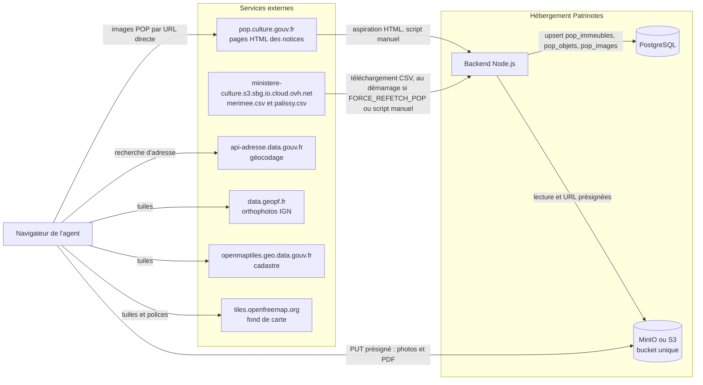
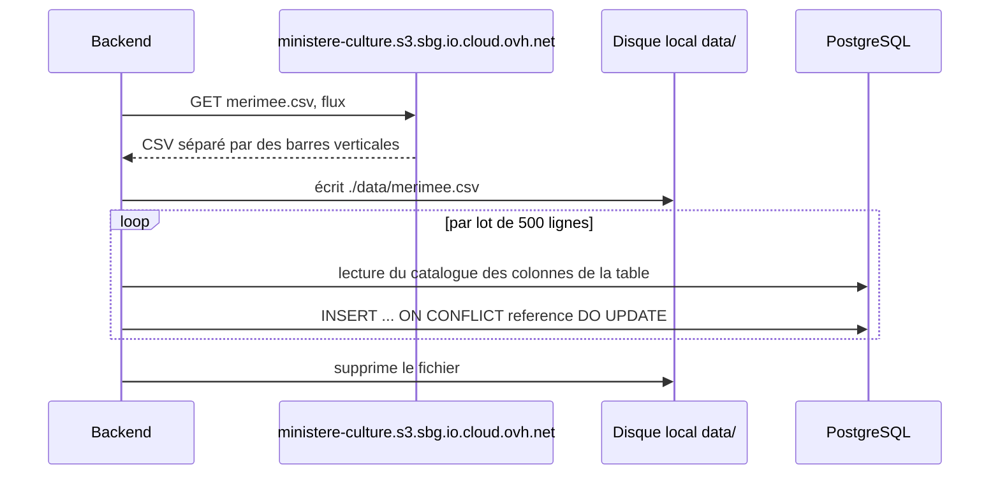
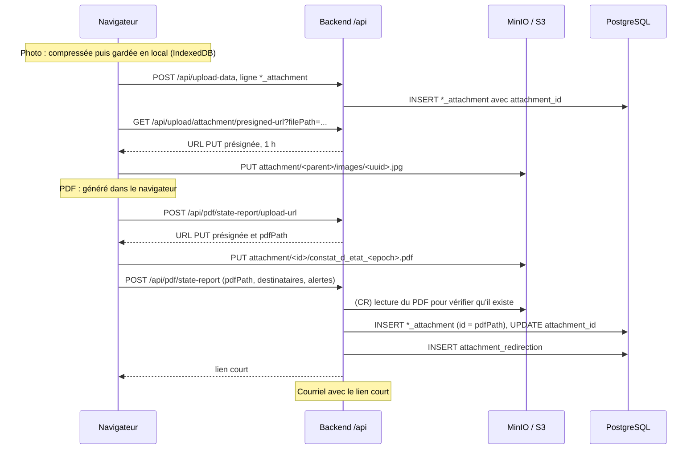
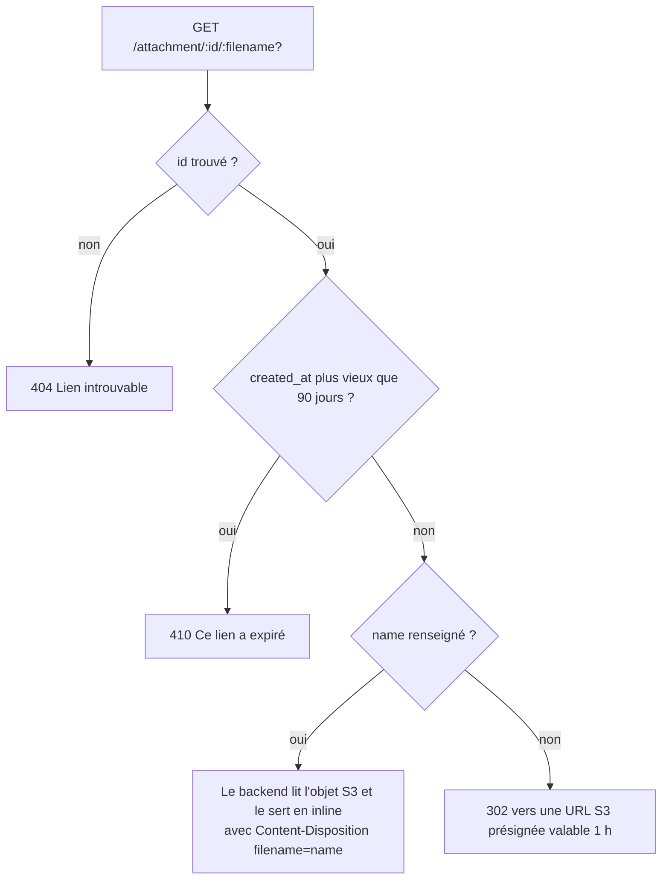

# 07 — Données externes et stockage de fichiers

Ce document décrit les données que Patrinotes **récupère à l'extérieur** (référentiels du patrimoine, géocodage, fonds de carte) et la façon dont il **stocke ses fichiers** (photos, plans, PDF) dans un stockage objet compatible S3 (MinIO). Il couvre aussi les liens courts envoyés par courriel et la redirection de l'ancien domaine « Compte-rendu VIF ».

Voir aussi : [06 — Modèle de données](06-modele-de-donnees.md) pour les tables citées.

> Tout ce qui suit vient de la lecture du code. Les points non vérifiables depuis le dépôt sont signalés « *à confirmer* ».

---

## 1. Vue d'ensemble des flux externes



| Source | Appelée par | Quand | Données | Authentification |
| --- | --- | --- | --- | --- |
| `https://ministere-culture.s3.sbg.io.cloud.ovh.net/POP/merimee.csv` | backend | au démarrage si `FORCE_REFETCH_POP=true`, ou par `pnpm backend import-pop` | notices Mérimée (immeubles protégés) | aucune |
| `https://ministere-culture.s3.sbg.io.cloud.ovh.net/POP/palissy.csv` | backend | idem, **seulement si `pop_objets` est vide** | notices Palissy (objets mobiliers) | aucune |
| `https://pop.culture.gouv.fr/notice/{merimee\|palissy}/{ref}` | backend | `pnpm backend import-pop` seulement (appel désactivé au démarrage) | URL, légende et crédit de la **première** image de chaque notice | aucune |
| `https://api-adresse.data.gouv.fr/search/` | **navigateur** | saisie d'adresse (CR, CE), centrage de carte | adresses de la Base adresse nationale | aucune |
| `https://data.geopf.fr/wmts` (orthophotos IGN), `openmaptiles.geo.data.gouv.fr` (cadastre), `tiles.openfreemap.org` (fond et polices) | **navigateur** | carte du plan de situation et localisation des désordres | tuiles | aucune |

> Le [README](../README.md) parle de fichiers `monuments.csv` et `mobilier.csv` et d'un appel à l'API adresse **par le backend**. Le code est différent : les fichiers s'appellent `merimee.csv` et `palissy.csv`, et l'API adresse est appelée **directement par le navigateur**.

La variable `DATAGOUV_API` est **obligatoire** dans [envVars.ts](../packages/backend/src/envVars.ts#L31) mais **aucun code ne la lit**. Il faut quand même la renseigner, sinon le backend refuse de démarrer.

---

## 2. Import des référentiels POP (Mérimée et Palissy)

Code : [pop.ts](../packages/backend/src/features/data/pop.ts) et [KyselyBatchWriter.ts](../packages/backend/src/features/data/KyselyBatchWriter.ts).

### 2.1 Déclenchement

| Mode | Commande | Ce qui est fait |
| --- | --- | --- |
| Au démarrage du backend | variable `FORCE_REFETCH_POP=true` ([index.ts#L16](../packages/backend/src/index.ts#L16)) | `initPopImmeubles()` puis `initPopObjets()`. **Bloquant** : le serveur HTTP ne démarre qu'à la fin de l'import. Pas d'images. |
| Manuel, complet | `pnpm backend import-pop` (= `vite-node ./src/features/data/pop.ts --standalone`) | immeubles, objets, puis rattrapage des images (`initPopImages`), puis `process.exit(0)`. |
| Planifié | **aucun** | Il n'y a ni cron ni tâche planifiée dans le dépôt. Le rafraîchissement dépend d'une action humaine (*à confirmer* : une tâche planifiée existe-t-elle sur Coolify ?). |

Règles cachées :

- **Les immeubles sont toujours réimportés** (upsert complet). **Les objets ne le sont que si la table `pop_objets` est vide** ([pop.ts#L59](../packages/backend/src/features/data/pop.ts#L59)). Pour rafraîchir Palissy, il faut vider `pop_objets` avant le lancement.
- Si `FORCE_REFETCH_POP` reste à `true`, **chaque redémarrage** retélécharge Mérimée et retarde la mise en service.
- `FORCE_REFETCH_POP` accepte `true` (insensible à la casse) ; toute autre chaîne vaut `false`.

### 2.2 Traitement



1. **Téléchargement en flux** vers `./data/merimee.csv` (ou `palissy.csv`). Le chemin est relatif au répertoire courant, en pratique `packages/backend/data/` ([pop.ts#L253](../packages/backend/src/features/data/pop.ts#L253)). Le conteneur doit donc disposer d'un **disque inscriptible** et de l'espace nécessaire (plusieurs centaines de Mo pour Palissy, *à confirmer*).
2. **Analyse CSV** (`csv-parser`) avec le séparateur `|`. Les en-têtes sont mis en minuscules et débarrassés des espaces. **Les noms de colonnes de la table doivent correspondre exactement aux en-têtes du fichier** (d'où les colonnes `région`, `département`, `emplacement__forme_et_structure_de_l_escalier`, `vocable___pour_les_edifices_cultuels`).
3. **Écriture par lots de 500** ([KyselyBatchWriter.ts](../packages/backend/src/features/data/KyselyBatchWriter.ts)) :
   - les lignes sans `reference` sont ignorées ;
   - `id` reçoit la valeur de `reference` (PowerSync exige une colonne `id`) ;
   - les doublons de `reference` dans un même lot sont éliminés (la première occurrence est gardée) ;
   - **les colonnes du CSV absentes de la table sont ignorées sans avertissement**. Si POP renomme une colonne, elle reste vide chez nous sans erreur ;
   - `INSERT … ON CONFLICT (reference) DO UPDATE` sur toutes les colonnes, sauf `reference` et `id`.
4. **Suppression du fichier** à la fin.

Limites :

- **Aucune suppression** : une notice retirée de POP (déclassement, fusion) **reste** dans la base et sur les postes.
- **Aucun filtre** : toute la France est importée. Le tri par département se fait dans les règles PowerSync (`departement_format_numerique` ∈ départements de l'agent).
- La suppression du fichier utilise `path/win32` ([pop.ts#L6](../packages/backend/src/features/data/pop.ts#L6)), un import probablement accidentel. Sous Linux, `path.win32.resolve("./data/merimee.csv")` produit un chemin avec des barres obliques inverses : l'appel à `unlink` risque d'échouer **après** l'import, ce qui ferait échouer le démarrage (*à confirmer par un essai*).
- `last_image_check_at` n'est **pas** remis à zéro lors d'un réimport.

### 2.3 Lien entre immeubles et objets

Aucune clé ne relie `pop_objets` à `pop_immeubles`. Le navigateur cherche les objets d'un monument avec `reference_a_une_notice_merimee_mh LIKE '%<référence Mérimée>'` ([MonumentHistorique.tsx#L351](../packages/frontend/src/features/state-report/steps/MonumentHistorique.tsx#L351)). Dans le formulaire d'alerte, la recherche porte sur `'%<réf>%'` ([StateReportAlertObjetSectionForm.tsx#L57](../packages/frontend/src/features/state-report/alerts/StateReportAlertObjetSectionForm.tsx#L57)). Ces deux filtres diffèrent et peuvent donner des résultats différents.

Quand l'agent choisit un monument, certains champs POP sont **copiés** dans le constat (correspondance dans [ImmeubleAutocomplete.tsx#L30](../packages/frontend/src/features/ImmeubleAutocomplete.tsx#L30)) :

| POP (`pop_immeubles`) | Constat (`state_report`) |
| --- | --- |
| `reference` | `reference_pop` |
| `titre_editorial_de_la_notice` | `titre_edifice` |
| `denomination_de_l_edifice` | `nature_edifice` |
| `adresse_forme_index` | `adresse` |
| `commune_forme_editoriale` / `commune_forme_index` | `commune` / `commune_historique` |
| `cadastre` | `reference_cadastrale` |
| `siecle_de_la_campagne_principale_de_construction` | `periode_construction` |
| `typologie_de_la_protection` / `precision_de_la_protection` | `nature_protection` / `parties_protegees` |
| `description_de_l_edifice` | `description` |

### 2.4 Code mort lié à POP

- [_merimee.ts](../packages/backend/src/features/data/_merimee.ts) (`@ts-nocheck`) remplissait la table `merimee` depuis la *datasette* de Collectif Objets (`COLLECTIF_OBJETS_DATASETTE_URL`, variable retirée). Il n'est plus appelé. La table `merimee` (environ 130 colonnes au format POP historique) est donc **figée** ou vide (*à confirmer*).
- `initPopDatasette` et `fetchPopDatasetteCSV` (table `merimee_to_memoire`, supprimée en migration 0008) sont commentés ou inutilisés.

---

## 3. Récupération des images POP (« scraping »)

POP ne publie pas les URL des images dans ses CSV. Patrinotes **lit la page HTML publique** de chaque notice pour en extraire la première image ([pop.ts#L233](../packages/backend/src/features/data/pop.ts#L233)).

### 3.1 Algorithme

1. Sélection d'un **lot de 50** notices sans image (`LEFT JOIN pop_images … IS NULL`) dont `last_image_check_at` est **antérieur à hier 00:00 UTC** :
   - pour les immeubles, seulement `last_image_check_at < hier` ;
   - pour les objets, `last_image_check_at < hier` **ou** `NULL`.
2. Pour chaque notice : `GET https://pop.culture.gouv.fr/notice/merimee/<ref>` (ou `palissy`), analyse avec `linkedom`, lecture des éléments `.swiper-slide`. Dans chacun : l'attribut `src` de `` et, dans le `div[style*="margin-top:5px"]`, le 1er enfant (légende) et le 2e (crédit).
3. Insertion de la **première image seulement** (`slice(0, 1)`) dans `pop_images` (`id = pop-image-<UUIDv7>`, `url`, `label`, `copyright`, `dept_number`).
4. **Pause de 100 ms** entre deux notices. Aucun autre limiteur, pas de parallélisme, pas d'en-tête `User-Agent` spécifique.
5. Mise à jour de `last_image_check_at = maintenant` pour tout le lot, **qu'une image ait été trouvée ou non**. Une notice sans image n'est revérifiée que le lendemain.
6. Boucle jusqu'à ce qu'il ne reste plus de notice à traiter.

### 3.2 Règles cachées et risques

- **Les immeubles importés après la migration 0007 ne sont jamais traités.** La migration a fixé `last_image_check_at = now()` pour les immeubles existants. Les nouveaux immeubles ont `NULL`, et la requête des immeubles ne retient pas `NULL` (contrairement à celle des objets) ([pop.ts#L147](../packages/backend/src/features/data/pop.ts#L147)).
- La date de référence « hier 00:00 UTC » est calculée **au chargement du module**. Elle reste figée tant que le processus tourne.
- Une réponse **HTTP 400** fait passer à la notice suivante. **Toute autre erreur** (404, 429, 5xx, délai dépassé) **arrête tout le traitement**. Le lot en cours n'est alors pas marqué comme vérifié.
- La méthode dépend de la **structure HTML** de POP (classe `swiper-slide`, style en ligne `margin-top:5px`). Une refonte du site POP casse l'extraction sans erreur explicite : les images ne sont plus trouvées. Une API ou un export officiel des médias POP serait plus robuste (*à étudier avec le ministère, propriétaire de POP*).
- **Rythme** : environ 10 requêtes par seconde au maximum vers un site du ministère. Il n'y a pas d'accord de service connu ; à valider avec l'équipe POP.
- **Aspect juridique** : seule l'**URL** de l'image est stockée, **pas le fichier**. Les images sont affichées par **lien direct** depuis les serveurs POP ([MonumentHistorique.tsx#L475](../packages/frontend/src/features/state-report/steps/MonumentHistorique.tsx#L475)), avec leur crédit (`copyright`) enregistré mais **pas affiché** dans cette vignette. Les conditions de réutilisation des photographies POP (droits d'auteur des photographes, mentions obligatoires) sont **à confirmer** avec le service juridique avant tout usage plus large (par exemple dans un PDF).
- Le rattrapage d'images est **désactivé au démarrage** (`// await initPopImages();` dans [index.ts#L21](../packages/backend/src/index.ts#L21)). Seul le script manuel le lance.
- Côté navigateur, la table `pop_images` n'est pas synchronisée. Les images des objets sont demandées en ligne via `GET /api/state-report/objets-images?references=a,b,c` ([stateReportRoutes.ts](../packages/backend/src/routes/stateReportRoutes.ts)) : **hors ligne, pas d'image**, et une vignette par défaut `/objet-sans-image.png` s'affiche.

---

## 4. Stockage objet (S3 / MinIO)

Code : [uploadService.ts](../packages/backend/src/services/uploadService.ts), [uploadRoutes.tsx](../packages/backend/src/routes/uploadRoutes.tsx), [pdfRoutes.tsx](../packages/backend/src/routes/pdfRoutes.tsx), file de pièces jointes du navigateur dans [db.ts](../packages/frontend/src/db/db.ts).

### 4.1 Configuration

| Variable | Rôle |
| --- | --- |
| `MINIO_URL` | Point d'accès S3 (ex. `https://s3.exemple.fr`). **Doit être joignable depuis les navigateurs des agents**, car ils y envoient directement les fichiers par URL présignée. |
| `MINIO_BUCKET` | Nom du bucket unique. |
| `MINIO_ACCESS_KEY_ID`, `MINIO_SECRET_KEY` | Identifiants applicatifs (droit `readwrite` en développement). |
| `MINIO_USER`, `MINIO_PASSWORD` | Compte administrateur MinIO (docker-compose seulement). |

Particularités du client S3 ([uploadService.ts#L11](../packages/backend/src/services/uploadService.ts#L11)) : `region: "us-east-1"` en dur, `forcePathStyle: true` et `bucketEndpoint: true`. Le paramètre `Bucket` reçoit l'**URL complète** `${MINIO_URL}/${MINIO_BUCKET}`. Toute solution S3 compatible (MinIO, Scaleway, OVH, Outscale…) doit accepter l'adressage en chemin (*path-style*) et la région `us-east-1` (ou l'ignorer).

**Prérequis hors code** (*à confirmer sur la plateforme actuelle*) :

- une **politique CORS** sur le bucket autorisant `PUT` et `GET` depuis l'origine du frontend. Sans elle, l'envoi des photos et des PDF échoue ;
- le bucket ne doit **pas** être public : tous les accès passent par le backend ou par une URL présignée. Le code ne pose aucune ACL.

### 4.2 Organisation des clés

Bucket unique, **un seul préfixe racine `attachment/`**, puis l'identifiant du document parent :

```text
<bucket>/
└── attachment/
    ├── report-<uuid>/                       ← compte-rendu (CR)
    │   ├── images/<uuidv7>.jpg               photos du CR
    │   └── compte_rendu_<epoch>.pdf          un PDF par envoi
    ├── <uuid constat>/                      ← constat d'état (CE)
    │   ├── images/<uuidv7>.jpg               photos générales, plan de situation, plan, vue générale
    │   └── constat_d_etat_<epoch>.pdf        un PDF par envoi
    ├── <uuid partie visitée>/
    │   ├── images/<uuidv7>.jpg               photos de la partie visitée
    │   └── localisation/<uuidv7>.jpg         carte de localisation des désordres
    └── <uuid alerte>/
        └── images/<uuidv7>.jpg               photos jointes à l'alerte
```

- Les colonnes `attachment_id` des tables `*_attachment`, `report.attachment_id`, `state_report.attachment_id` et `constat_validation.pdf_path` contiennent la clé **sans** le préfixe `attachment/`. Le backend l'ajoute ([uploadService.ts#L21](../packages/backend/src/services/uploadService.ts#L21)). `attachment_redirection.s3_key` contient la clé **avec** le préfixe.
- `<epoch>` est en secondes. Chaque envoi produit un **nouveau PDF**. Les anciens restent dans le stockage, et `attachment_id` du document pointe sur le dernier.
- Le segment `/localisation/` est **porteur de sens** : c'est lui qui identifie une carte de localisation ([localisationAttachment.ts#L7](../packages/frontend/src/features/state-report/localisationAttachment.ts#L7)). Il ne faut pas changer ce format.
- Tout est en `.jpg` (ou `.pdf`) : les photos sont **recompressées dans le navigateur** (1 Mo et 1920 px maximum, **métadonnées EXIF supprimées**, donc pas de coordonnées GPS des photos) ([UploadReportImage.tsx#L266](../packages/frontend/src/features/upload/UploadReportImage.tsx#L266)).
- **Pas d'audio, pas de vidéo** : le code ne stocke que des images et des PDF.
- Fonctions mortes : `getPDFName` (`<id>/compte_rendu.pdf`), `getPictureName`, `uploadAttachment`, `addPDFToReport` (qui construit une URL `https://http…` erronée) ne sont pas appelées.

### 4.3 Flux d'écriture et de lecture



| Route (préfixe `/api`, authentifiée) | Effet |
| --- | --- |
| `GET /upload/attachment/presigned-url?filePath=` | URL `PUT` présignée **1 h** pour `attachment/<filePath>`. |
| `GET /upload/attachment?filePath=[&stateReportId=]` | Le backend lit l'objet et le **renvoie lui-même** (pas de redirection). Si `stateReportId` est fourni, une ligne `constat_pdf_download` est créée. |
| `GET /upload/attachment/size?filePath=` | Taille de l'objet (`HEAD`). |
| `POST /pdf/report/upload-url`, `POST /pdf/state-report/upload-url` | URL présignée et chemin du futur PDF. |
| `POST /pdf/report`, `POST /pdf/state-report` | Enregistre le PDF, envoie les courriels, crée les liens courts. |
| `GET /pdf/report?reportId=`, `GET /pdf/state-report?stateReportId=` | Renvoie le PDF **encodé en base64** dans le JSON. |

Points d'attention :

- **La file de pièces jointes du navigateur** (PowerSync `AttachmentQueue`) surveille les 4 tables `*_attachment` (`is_deprecated = 0`). Elle **téléverse** les fichiers locaux et **télécharge** ceux qui manquent, toutes les 30 secondes ([db.ts#L64](../packages/frontend/src/db/db.ts#L64)). `deleteFile` n'est pas implémenté : **rien n'est jamais supprimé du stockage**.
- **Pas de limite de taille côté serveur** pour les envois présignés. La limite de 15 Mo de `@fastify/multipart` ne s'applique à aucune route existante, puisque les fichiers ne transitent plus par le backend.
- **Aucun contrôle d'appartenance** : tout utilisateur authentifié peut obtenir une URL d'écriture pour **n'importe quelle clé** sous `attachment/` (y compris pour écraser un PDF déjà envoyé) et lire n'importe quel fichier dont il connaît le chemin. Les chemins contiennent des UUID difficiles à deviner, mais ils sont synchronisés vers tous les agents du service. À traiter dans l'analyse de risques.
- `getReportPDF` prend **le premier** `report_attachment` dont `attachment_id` finit par `.pdf`, **sans tri** : après plusieurs envois, il peut renvoyer un ancien PDF ([uploadService.ts#L97](../packages/backend/src/services/uploadService.ts#L97)).
- Pour les CE, le backend ne vérifie pas que le PDF a bien été téléversé avant d'envoyer les courriels. Pour les CR, il le relit (`getAttachment`), ce qui échoue s'il est absent.
- Les URL présignées de lecture (`generatePresignedUrl`) ré-encodent chaque segment du chemin après signature ([uploadService.ts#L125](../packages/backend/src/services/uploadService.ts#L125)) pour gérer les noms avec caractères spéciaux.

### 4.4 Cycle de vie et volumétrie

- **Aucune règle de cycle de vie** dans le code : photos remplacées (`is_deprecated`), PDF successifs, pièces jointes de documents désactivés et anciens plans de situation sont **conservés indéfiniment**. La durée de conservation doit être définie avec le ministère (archivage, RGPD) puis mise en œuvre par une règle de cycle de vie S3 ou un script de purge.
- **Volumétrie estimée** (*à confirmer*) : environ 1 Mo par photo au maximum. Taille des PDF : colonnes `report.pdf_size` et `state_report.pdf_size` (renseignées depuis la migration 0034). Une requête `SUM(pdf_size)` sur ces colonnes donne la taille des derniers PDF. Pour le total réel, utiliser `mc du` sur le bucket.
- **Migration du stockage** : copier le bucket en conservant **exactement les clés** (par exemple `mc mirror` ou `rclone sync`). Les clés sont référencées en base et dans les liens courts déjà envoyés. Seules `MINIO_URL` et `MINIO_BUCKET` changent.

---

## 5. Liens courts vers les PDF (`attachment_redirection`)

Les courriels d'envoi de CR et de CE ne contiennent pas de pièce jointe, mais un **lien court** servi par le backend **à la racine** (hors préfixe `/api`, **sans authentification**) : `GET {BACKEND_URL}/attachment/:id/:filename?` ([attachmentRedirectRoutes.ts](../packages/backend/src/routes/attachmentRedirectRoutes.ts), monté dans [router.ts](../packages/backend/src/router.ts)).

### 5.1 Création

`createAttachmentRedirection` ([pdfRoutes.tsx#L25](../packages/backend/src/routes/pdfRoutes.tsx#L25)) :

- `id` = entier aléatoire cryptographique entre 1 et 2⁴⁸ − 1, encodé en **base62** (environ 8 caractères) ;
- `s3_key` = `attachment/<pdfPath>` ; `created_by` ; `sent_to` (CSV des destinataires 🔒) ;
- `name` = nom de fichier affiché :
  - CR : `CR_<commune>_<nom du pétitionnaire>_<jj-MM-aaaa>.pdf` ([report.tsx#L12](../packages/pdf/src/report.tsx#L12)). ⚠ Le **nom du pétitionnaire** (donnée personnelle) figure donc **dans l'URL** et dans les journaux du serveur ;
  - CE : `constat-d-etat-<titre-normalisé>_<jjMMaaaa>.pdf` ([stateReport.tsx#L449](../packages/pdf/src/stateReport.tsx#L449)).
- URL renvoyée : `{BACKEND_URL}/attachment/<id>/<name>`.

Lors de l'envoi d'un CE, **plusieurs lignes** sont créées pour un même PDF : une pour le courriel, une autre renvoyée à l'interface, une pour le valideur si la validation est demandée.

### 5.2 Résolution



Règles vérifiées par [tests/attachment-redirect.spec.ts](../tests/attachment-redirect.spec.ts) :

- un lien **inconnu** donne **404** ;
- un lien de **91 jours** donne **410** ; un lien d'**exactement 90 jours** est encore valide (`differenceInDays > 90`, en jours entiers) ;
- un lien **sans `name`** donne une **redirection 302** vers une URL contenant `X-Amz-Signature`.

Le cas avec `name` (le seul utilisé en production depuis la migration 0029) n'est pas couvert par ce test. Le segment `:filename` de l'URL est **ignoré** : seul `id` compte, le nom servi est celui de la base.

Conséquences pour le transfert :

- `BACKEND_URL` est inscrit **en dur dans les courriels déjà envoyés**. Si le domaine du backend change, l'ancien domaine doit continuer à répondre (ou rediriger `/attachment/*`) **pendant 90 jours** après la bascule.
- La table n'est jamais purgée. Les lignes expirées peuvent être supprimées sans risque.
- Pour une validation acceptée, le courriel aux destinataires contient au contraire une **URL S3 présignée de 7 jours** ([validationRoutes.ts#L138](../packages/backend/src/routes/validationRoutes.ts#L138)). Elle dépend directement de `MINIO_URL` et expire au bout de 7 jours, sans lien court.

---

## 6. Redirection de l'ancien domaine (`crvif-redirection`)

Le dossier [crvif-redirection](../crvif-redirection) contient un **mini-site statique** à déployer sur l'**ancien domaine** de l'application, lorsqu'elle s'appelait « Compte-rendu VIF » (CR-VIF). Ancien domaine probable : `app.compte-rendu-vif.beta.gouv.fr` et `*.compte-rendu-vif.incubateur.net`, encore listés dans `preview.allowedHosts` de [vite.config.ts](../packages/frontend/vite.config.ts#L74). Ajouté par le commit « feat: redirect users from crvif » (mai 2026).

| Fichier | Rôle |
| --- | --- |
| [index.html](../crvif-redirection/index.html) | Redirection immédiate (`meta refresh` + JavaScript) vers `https://app.patrinotes.beta.gouv.fr`, après désinscription des *service workers* existants. |
| [sw.js](../crvif-redirection/sw.js) | **Remplace le service worker de l'ancienne PWA** (même nom de fichier `sw.js`, généré depuis `src/service-worker/sw.ts`). À son activation, il se désinscrit puis renvoie tous les onglets ouverts vers le nouveau domaine. Sans ce fichier, les PWA installées sur l'ancien domaine continueraient d'afficher l'ancienne application en cache. |

Règle liée côté application : si l'URL d'accueil contient `?from=crvif` et que l'utilisateur n'est pas connecté, il est envoyé vers **/inscription** au lieu de /connexion ([EnsureUser.tsx](../packages/frontend/src/components/EnsureUser.tsx)). Le compte doit être recréé (nouveau Keycloak, *à confirmer*). **Les fichiers du dossier redirigent vers l'URL sans ce paramètre** : soit le paramètre est ajouté par une autre configuration (DNS ou proxy, *à confirmer*), soit cette règle n'est jamais déclenchée.

Les clés de stockage local du navigateur gardent l'ancien préfixe (`crvif/auth`, `crvif-sync.db`, `crvif-attachments`). Il ne faut **pas** les renommer, sinon les données locales non synchronisées des agents seraient perdues.

Pour le transfert : décider si l'ancien domaine reste servi (et par qui), et prévoir le même mécanisme (`index.html` + `sw.js`) pour le domaine **actuel** `app.patrinotes.beta.gouv.fr` si l'application change de domaine sur l'infrastructure du ministère.

---

## 7. Dossier `packages/backend/data`

| Élément | Statut |
| --- | --- |
| `data/` (répertoire) | Répertoire de travail **temporaire** de l'import POP (`merimee.csv`, `palissy.csv`, supprimés après import). Doit être inscriptible. |
| [data/udap.json](../packages/backend/data/udap.json) | 96 entrées (une par département : `id`, `department`, autres champs vides). **Lu par aucun code** : vestige de l'ancien chargement des UDAP. |

---

## 8. Récapitulatif pour la reprise

| Sujet | Action |
| --- | --- |
| Accès sortants du backend | `ministere-culture.s3.sbg.io.cloud.ovh.net` et `pop.culture.gouv.fr` (HTTPS) ; à ouvrir sur le pare-feu de l'hébergement cible. |
| Accès sortants des navigateurs | `api-adresse.data.gouv.fr`, `data.geopf.fr`, `openmaptiles.geo.data.gouv.fr`, `tiles.openfreemap.org`, `pop.culture.gouv.fr` (images), point d'accès S3. À autoriser dans la **politique de sécurité de contenu (CSP)** si elle est durcie. |
| API Adresse | Le service `api-adresse.data.gouv.fr` est en cours de reprise par la Géoplateforme de l'IGN (`data.geopf.fr/geocodage`) : vérifier sa date de fin (*à confirmer*) et migrer [address.tsx](../packages/frontend/src/features/address.tsx) et [MapLibre.tsx](../packages/frontend/src/features/map/MapLibre.tsx#L114). `searchAddress` n'encode pas la requête dans l'URL (`encodeURIComponent` manquant). |
| Rafraîchissement POP | Définir une tâche planifiée (`pnpm backend import-pop`) en dehors des heures ouvrées, vider `pop_objets` si Palissy doit être rafraîchi, et corriger le filtre `NULL` des immeubles. |
| Stockage | Copier le bucket à l'identique, configurer le CORS, définir une durée de conservation, garder le bucket privé. |
| Liens courts | Maintenir l'ancien `BACKEND_URL` au moins 90 jours après la bascule. |
| Ancien domaine | Garder ou retirer `crvif-redirection` en connaissance de cause. |
