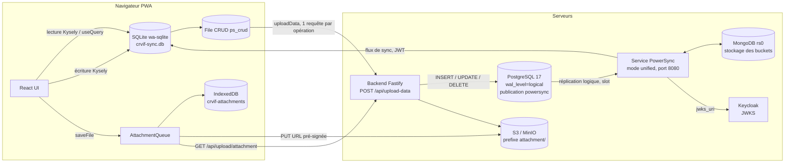
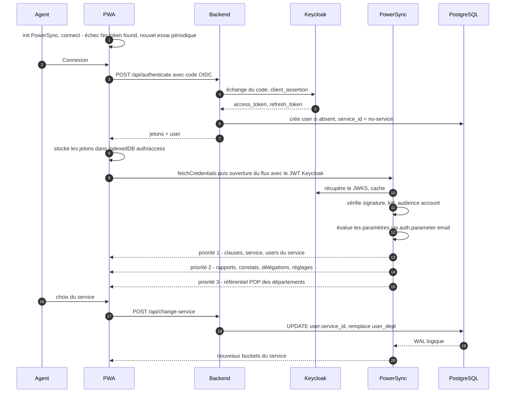
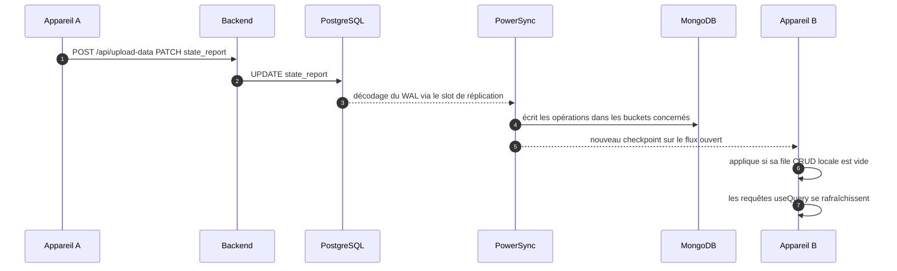
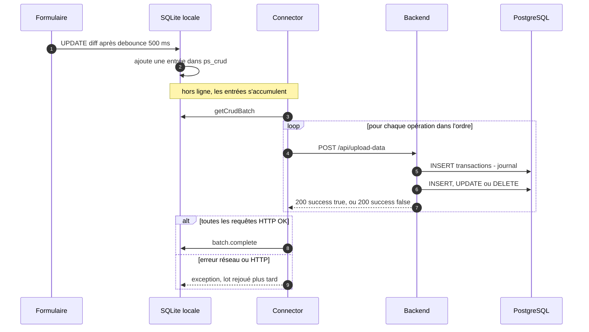
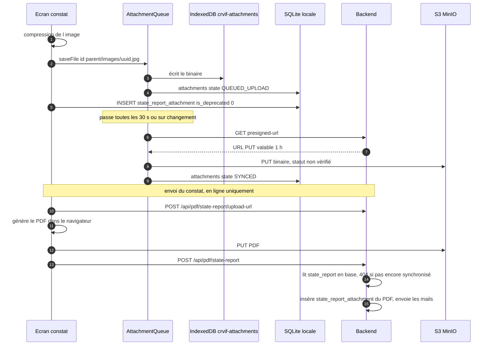

# 08 — Synchronisation et fonctionnement hors ligne

Patrinotes est une application **offline-first** : l'agent sur le terrain (visite d'un monument historique, rédaction
d'un compte-rendu VIF ou d'un constat d'état) lit et écrit dans une **base SQLite locale** embarquée dans le navigateur.
La synchronisation avec le serveur est assurée par **PowerSync** (service open source de JourneyApps) :

- **lecture (descendante)** : PostgreSQL → réplication logique → service PowerSync → WebSocket/HTTP stream → SQLite
  locale ;
- **écriture (montante)** : SQLite locale → file d'attente CRUD locale → `POST /api/upload-data` du backend Node →
  PostgreSQL (puis retour vers tous les clients concernés par la voie descendante) ;
- **fichiers (photos, PDF)** : stockage local IndexedDB → URL pré-signée → stockage objet S3/MinIO, géré par
  l'`AttachmentQueue` du SDK PowerSync.

Ce document décrit ces trois chemins en détail, les règles qui déterminent quelles données chaque utilisateur reçoit,
les règles cachées et pièges, la procédure de changement de schéma et les points d'exploitation à préserver lors de la
migration vers l'infrastructure du ministère.

> Légende : les affirmations non vérifiables dans le code (comportement interne du service PowerSync, configuration de
> production hébergée dans Coolify) sont signalées par **« à confirmer »**.

---

## 1. Vue d'ensemble



Composants et fichiers de référence :

| Élément | Fichier |
| --- | --- |
| Déclaration des services (dev) | [docker-compose.yaml](../docker-compose.yaml) |
| Configuration du service PowerSync | [powersync-config.yaml](../powersync/powersync-config.yaml) |
| Règles de synchronisation (« sync streams ») | [sync-config.yaml](../powersync/sync-config.yaml) |
| Création de la publication PostgreSQL | [0_create-publication.sql](../db/init/0_create-publication.sql) |
| Schéma local client | [AppSchema.ts](../packages/frontend/src/db/AppSchema.ts) |
| Base locale + file des pièces jointes | [db.ts](../packages/frontend/src/db/db.ts) |
| Connecteur (jeton + envoi des écritures) | [Connector.ts](../packages/frontend/src/db/Connector.ts) |
| Endpoint d'application des écritures | [syncRoutes.ts](../packages/backend/src/routes/syncRoutes.ts), [syncService.ts](../packages/backend/src/services/syncService.ts) |
| Schéma serveur (Drizzle) | [schema.ts](../packages/backend/src/db/schema.ts) |

---

## 2. Côté serveur : le service PowerSync

### 2.1 Conteneurs

Dans [docker-compose.yaml](../docker-compose.yaml) (environnement de développement ; la configuration de production
est portée par Coolify et **n'est pas dans le dépôt — à confirmer** qu'elle est identique) :

| Service | Image | Rôle | Particularités |
| --- | --- | --- | --- |
| `pg` | `postgres:17-alpine` | Base principale | lancé avec `-c wal_level=logical` ; monte `db/init/` dans `docker-entrypoint-initdb.d` |
| `mongo` | `mongo:7.0` | Stockage interne PowerSync (buckets, opérations, checkpoints) | `--replSet rs0` ; volume `mongo_storage` ; **port 27017 publié sur l'hôte, sans authentification** |
| `mongo-rs-init` | `mongo:7.0` | Initialise le replica set `rs0` (1 seul membre) | idempotent : quitte si `rs.status().ok` |
| `powersync` | `journeyapps/powersync-service:latest` | Service de synchronisation | commande `start -r unified` ; dépend de `mongo-rs-init` (terminé) et `pg` (healthy) ; port interne 8080 publié sur `${POWERSYNC_PORT}` |

**Mode `unified`** : un seul processus fait à la fois la **réplication** (lecture du WAL PostgreSQL, écriture des
buckets dans MongoDB) et l'**API** (connexions clients). Le service peut aussi être éclaté en `-r sync` (API, scalable
horizontalement) et `-r replication` (exactement une instance). Pour le volume actuel, `unified` suffit.

**Pourquoi un replica set MongoDB ?** Le stockage MongoDB de PowerSync utilise les transactions et les change streams
MongoDB, qui n'existent qu'en replica set ; un replica set à un seul nœud suffit (c'est ce que fait `mongo-rs-init`).

**Persistance de MongoDB** : le README indique que Mongo « n'a pas besoin d'être persistant ». C'est vrai au sens où
MongoDB ne contient **aucune donnée de référence** (tout est reconstructible depuis PostgreSQL), mais la perte de ce
stockage a des conséquences opérationnelles (voir § 9.3). Le compose de dev lui attribue d'ailleurs un volume nommé
`mongo_storage`.

> Le nom de base Mongo est `powersync_demo` (hérité de l'exemple officiel). Sans importance fonctionnelle mais à
> renommer éventuellement lors de la migration (le renommer équivaut à une perte du stockage, cf. § 9.3).

### 2.2 `powersync-config.yaml` ligne à ligne

Fichier : [powersync/powersync-config.yaml](../powersync/powersync-config.yaml)

| Lignes | Clé | Valeur | Explication |
| --- | --- | --- | --- |
| [2-8](../powersync/powersync-config.yaml#L2-L8) | `replication.connections[0]` | `type: postgresql`, `uri: !env PS_DATABASE_URL`, `sslmode: disable` | Connexion de réplication à PostgreSQL. `!env` lit la variable d'environnement. **SSL désactivé** : acceptable sur un réseau Docker interne, à revoir si la base est distante (homologation). L'utilisateur doit avoir l'attribut `REPLICATION` (en dev c'est le superutilisateur `POSTGRES_USER`). |
| [11-13](../powersync/powersync-config.yaml#L11-L13) | `storage` | `type: mongodb`, `uri: mongodb://mongo:27017/powersync_demo` | Stockage des buckets. **URI en dur, sans identifiants.** |
| [16](../powersync/powersync-config.yaml#L16) | `port` | `!env PS_PORT` | Fixé à `8080` dans le compose. |
| [17-18](../powersync/powersync-config.yaml#L17-L18) | `sync_config.path` | `sync-config.yaml` | Chemin relatif au fichier de config (les deux sont montés dans `/config/`). |
| [21-24](../powersync/powersync-config.yaml#L21-L24) | `client_auth` | `jwks_uri`, `issuer`, `audience: ["account"]` | Authentification des clients par **JWT RS256 émis par Keycloak**, vérifiés avec les clés publiques du JWKS (sélection par `kid` de l'en-tête). |
| [26-30](../powersync/powersync-config.yaml#L26-L30) | `telemetry` | `disable_telemetry_sharing: false` | Voir piège ci-dessous. |

**Pièges de ce fichier :**

1. **`issuer` n'est pas une option reconnue** par le service PowerSync (le schéma de configuration de
   `@powersync/service-types` ne connaît sous `client_auth` que `jwks_uri`, `block_local_jwks`,
   `jwks_reject_ip_ranges`, `jwks`, `supabase`, `supabase_jwt_secret`, `audience`). Elle est donc **ignorée** :
   l'émetteur du jeton n'est pas vérifié par PowerSync. Seuls la signature (JWKS) et l'audience `account` le sont.
2. **`telemetry` est indenté sous `client_auth`** au lieu d'être à la racine : il est ignoré. De toute façon la valeur
   `false` signifie « ne pas désactiver » : la télémétrie anonyme vers JourneyApps est **active**. Pour un
   hébergement ministériel, placer `telemetry: { disable_telemetry_sharing: true }` à la racine.
3. **`jwks_uri` pointe vers `http://keycloak:8080/realms/master`** (nom d'hôte Docker interne et realm `master` en
   dur). Le service PowerSync doit pouvoir joindre ce JWKS ; si Keycloak est déplacé, renommé, ou si le realm change
   (`VITE_AUTH_REALM`), ce fichier doit être modifié **en même temps** que les variables du backend, sinon toutes les
   connexions de synchronisation sont refusées (l'application passe « hors ligne » en permanence).
4. **`PS_JWT_SECRET` (alimenté par `JWT_SECRET`) est injecté dans le conteneur mais n'est référencé nulle part** dans
   la configuration (aucun `!env PS_JWT_SECRET`). Il est inutile en l'état (vestige d'une authentification HS256
   antérieure — à confirmer). Ne pas le confondre avec le mécanisme réel (JWKS Keycloak).
5. L'image est en **`:latest`** : un redémarrage peut tirer une version majeure différente. Le format
   `config.edition: 3` / `streams:` (« Sync Streams ») exige une version récente du service. **Épingler la version**
   lors de la migration.

### 2.3 Authentification client → PowerSync

- Le client n'obtient **pas** de jeton spécifique à PowerSync : il réutilise **le jeton d'accès Keycloak** (celui-là
  même qu'il envoie au backend), via `fetchCredentials()` dans
  [Connector.ts](../packages/frontend/src/db/Connector.ts#L11-L18), qui renvoie `{ endpoint: VITE_POWERSYNC_URL,
  token }`.
- Vérifications côté PowerSync : signature RS256 via le JWKS Keycloak (choix de la clé par `kid`), audience `account`
  (audience par défaut des access tokens Keycloak), expiration. La claim `sub` sert d'identifiant utilisateur
  PowerSync.
- Les règles de sync s'appuient sur **`auth.parameter('email')`** : la claim `email` du jeton. **Le jeton doit donc
  contenir l'email** (scope `email` dans Keycloak) et cet email doit correspondre **exactement** (casse comprise) à
  `user.email` en base. Un utilisateur dont l'email Keycloak diffère de celui de la table `user` ne reçoit aucune
  donnée.
- Le rafraîchissement : `getTokenOrRefresh()` ([Connector.ts#L50](../packages/frontend/src/db/Connector.ts#L50))
  considère le jeton expiré à **80 % de sa durée de vie** (`expiresAt` calculé par
  `get80PercentOfTokenLifespan`), appelle `POST /api/refresh-token` et **mutualise** les appels concurrents dans une
  promesse unique (`refreshPromise`) pour éviter que PowerSync et le client API ne consomment deux fois le même
  refresh token (rotation Keycloak → fausse « session expirée »). Un 401 sur le refresh vide le stockage d'auth et
  émet l'événement « session expirée ».

### 2.4 PostgreSQL : réplication logique et publication

- `wal_level=logical` est **obligatoire** (passé en argument de commande dans le compose ; sur un PostgreSQL managé
  ministériel, il faudra le demander explicitement — souvent `rds.logical_replication`/paramètre équivalent).
- La publication est créée **vide** au premier démarrage de la base :
  [0_create-publication.sql](../db/init/0_create-publication.sql) contient `CREATE PUBLICATION powersync;` (pas de
  `FOR ALL TABLES`). Les scripts de `docker-entrypoint-initdb.d` ne s'exécutent **que sur un volume de données vide**.
- Les tables sont ajoutées **à la main dans les migrations Drizzle** par `ALTER PUBLICATION powersync ADD TABLE …` :

| Migration | Tables ajoutées à la publication |
| --- | --- |
| [0000_bright_stone_men.sql#L183](../db/0000_bright_stone_men.sql#L183) | `user`, `delegation`, `service_instructeurs`, `clause_v2`, `pdf_snapshot`, `tmp_pictures`, `picture_lines`, `pictures`, `transactions`, `report`, `sent_email`, `suggested_email`, `udap`, `user_settings` |
| [0001_needy_zemo.sql#L310](../db/0001_needy_zemo.sql#L310) | `state_report`, `pop_immeubles`, `user_dept`, `visited_section` (+ `udap` renommée `service`, l'appartenance à la publication suit le renommage) |
| [0003_low_silvermane.sql#L26](../db/0003_low_silvermane.sql#L26) | `report_attachment`, `state_report_attachment` (et `tmp_pictures` supprimée) |
| [0004_bouncy_master_mold.sql#L18](../db/0004_bouncy_master_mold.sql#L18) | `visited_section_attachment` |
| [0006_calm_night_nurse.sql#L87](../db/0006_calm_night_nurse.sql#L87) | `pop_objets` |
| [0011_petite_zarda.sql#L20-L22](../db/0011_petite_zarda.sql#L20-L22) | `state_report_alert`, `state_report_alert_attachment` |

> **Incohérence détectée :** la table `constat_validation` (migration 0019) est interrogée par
> [sync-config.yaml](../powersync/sync-config.yaml#L59) (`reports_stream`) mais **aucune migration ne l'ajoute à la
> publication**. Soit elle a été ajoutée manuellement en production (**à confirmer** :
> `SELECT * FROM pg_publication_tables WHERE pubname = 'powersync';`), soit cette requête ne renvoie jamais rien. Sans
> conséquence visible aujourd'hui car `constat_validation` n'est pas non plus dans `AppSchema` (cf. § 3.3).
> De même `pop_images` et `state_report_sent_email` sont dans `AppSchema` mais ni dans la publication, ni dans les
> streams : ces tables locales sont toujours vides.

- **Conséquence pour la migration** : sur une nouvelle instance, l'ordre est important : (1) créer la publication
  vide, (2) jouer les migrations (qui l'alimentent), (3) démarrer PowerSync. Si la base est restaurée par `pg_dump` /
  `pg_restore`, la publication est restaurée avec ses tables (objet `PUBLICATION` dans le dump) mais **pas les slots
  de réplication** (cf. § 9).

---

## 3. Règles de synchronisation (`sync-config.yaml`)

Fichier : [powersync/sync-config.yaml](../powersync/sync-config.yaml). Format **Sync Streams, édition 3**
(`config.edition: 3`). Chaque stream liste des requêtes SQL (dialecte restreint PowerSync) ; `with:` définit des
requêtes de paramètres (sortes de CTE réévaluées à chaque changement des tables sources) ; `auto_subscribe: true`
signifie que tout client connecté est abonné d'office ; `priority` ordonne le téléchargement (**plus le nombre est
petit, plus c'est prioritaire** — les données de priorité 1 sont disponibles avant celles de priorité 3).

Le pivot de presque toutes les règles est l'**email du jeton** → ligne `user` → `service_id` (le service / UDAP de
l'agent). **L'unité de partage est le service, pas l'utilisateur** : tous les agents d'un même service voient tous les
comptes-rendus et constats du service.

### 3.1 Streams

| Stream | Lignes | Abonnement | Prio | Paramètre | Données envoyées |
| --- | --- | --- | --- | --- | --- |
| `global_stream` | [6-11](../powersync/sync-config.yaml#L6-L11) | auto | 1 | aucun | `clause_v2` avec `service_id = 'ALL'` (clauses communes à tous les services) ; **toute la table `pictures`** |
| `service_stream` | [13-24](../powersync/sync-config.yaml#L13-L24) | auto | 1 | `current_service` = `service_id` de l'utilisateur (via email) | la ligne `service` ; les `user` du service **limités à `id, name, service_id`** (pas d'email) ; `service_instructeurs`, `clause_v2`, `sent_email`, `suggested_email` du service |
| `user_stream` | [26-34](../powersync/sync-config.yaml#L26-L34) | auto | 2 | `current_user_id` | `delegation` où l'utilisateur est créateur **ou** délégataire ; ses `pdf_snapshot` ; ses `user_settings` |
| `reports_stream` | [49-59](../powersync/sync-config.yaml#L49-L59) | auto | 2 | `current_service` | `report`, `state_report`, `visited_section`, `state_report_alert` du service ; `constat_validation` **limitée à `id, state_report_id, status, service_id`** (le `token` de validation n'est jamais synchronisé) |
| `pop_stream` | [61-70](../powersync/sync-config.yaml#L61-L70) | auto | 3 | `my_depts` = `user_dept.dept_number` de l'utilisateur | `pop_immeubles` et `pop_objets` (référentiel POP — monuments et objets protégés) dont `departement_format_numerique` ∈ départements de l'utilisateur |
| `state_report_attachments_stream` | [36-43](../powersync/sync-config.yaml#L36-L43) | **à la demande** | défaut | `subscription.parameter('state_report_id')` | pièces jointes non dépréciées d'un constat : `state_report_attachment`, `visited_section_attachment` (via `visited_section`), `state_report_alert_attachment` (via `state_report_alert`) |
| `report_attachments_stream` | [45-47](../powersync/sync-config.yaml#L45-L47) | **à la demande** | défaut | `subscription.parameter('report_id')` | `report_attachment` non dépréciées d'un compte-rendu |

Les streams à la demande sont ouverts par le hook `useSyncStream` dans les écrans
[constat.$constatId.tsx](../packages/frontend/src/routes/constat.$constatId.tsx#L45),
[constat_.$constatId.pdf.tsx](../packages/frontend/src/routes/constat_.$constatId.pdf.tsx#L66),
[edit.$reportId.tsx](../packages/frontend/src/routes/edit.$reportId.tsx#L25) et
[pdf.$reportId.tsx](../packages/frontend/src/routes/pdf.$reportId.tsx#L697). Quand `hasSynced` devient vrai, ces
écrans déclenchent `attachmentQueue.syncStorage()` pour télécharger immédiatement les fichiers.

### 3.2 Règles cachées des streams

- **Données référentielles sans filtre** : `SELECT * FROM pictures` envoie **toutes les lignes de `pictures`, de tous
  les services, à tous les utilisateurs**. Table héritée (anciennes photos de compte-rendu) ; à vérifier qu'elle est
  vide ou à filtrer (risque de fuite inter-services + volume).
- **Filtre `is_deprecated = 0`** : la suppression d'une photo est un **soft delete** (`is_deprecated = 1` côté client,
  par ex. [useAttachmentImages.ts#L223](../packages/frontend/src/features/upload/hooks/useAttachmentImages.ts#L223)).
  La ligne disparaît alors des streams, donc des autres appareils. Les booléens PostgreSQL sont convertis par PowerSync
  en entiers `1`/`0` ; **une ligne avec `is_deprecated = NULL` n'est jamais synchronisée** (`NULL = 0` est faux en
  SQL). La colonne n'a pas de valeur par défaut en base ([schema.ts#L164](../packages/backend/src/db/schema.ts#L164)) :
  toute insertion qui omettrait `is_deprecated` rend la pièce jointe invisible. Les insertions côté client et côté
  backend (PDF) le renseignent explicitement.
- **Les photos d'un constat/compte-rendu ne sont disponibles hors ligne que si l'écran a été ouvert en ligne** : les
  métadonnées des pièces jointes passent par des streams à la demande. Après fermeture de l'écran, PowerSync conserve
  l'abonnement pendant une durée de rétention (TTL, 24 h par défaut dans le SDK — **à confirmer** selon la version),
  puis les lignes sont retirées et les fichiers locaux deviennent « archivés » (cf. § 5).
- **Aucun contrôle d'appartenance sur les paramètres d'abonnement** : `state_report_id` / `report_id` sont fournis par
  le client et ne sont pas croisés avec le service de l'utilisateur. Un utilisateur authentifié connaissant l'id
  (UUID) d'un constat d'un autre service peut s'abonner à ses métadonnées de pièces jointes. Correction suggérée :
  ajouter une condition `… AND service_id IN (SELECT service_id FROM "user" WHERE email = auth.parameter('email'))`.
- **Changement de service** : `POST /api/change-service`
  ([userService.ts#L14](../packages/backend/src/services/userService.ts#L14)) met à jour `user.service_id` puis
  remplace les lignes `user_dept` par les départements de `service.dept_numbers` (liste séparée par des virgules).
  PowerSync réévalue les paramètres et bascule les buckets : les données de l'ancien service disparaissent de
  l'appareil, celles du nouveau arrivent. **Si le nouveau service n'a pas de `dept_numbers`, les anciens
  `user_dept` sont conservés** : l'agent continue de recevoir le référentiel POP de son ancien service. Les deux
  écritures ne sont pas dans une même transaction.
- **Nouvel utilisateur** : créé au premier login avec `service_id = 'no-service'`
  ([authService.ts#L95-L111](../packages/backend/src/services/authService.ts#L95-L111)), service technique créé au
  démarrage du backend (`initEmptyService`, invisible, département vide). Tant qu'il n'a pas choisi de service, il ne
  reçoit que `global_stream`, ses propres données utilisateur et le service `no-service`.
- **Départements POP** : le rapprochement `departement_format_numerique IN my_depts` est une égalité de chaînes ; le
  format de `dept_numbers` (ex. `01` vs `1`, `2A`) doit correspondre exactement à celui du CSV POP (**à confirmer** par
  un contrôle de données).
- `user_dept` n'est utilisé qu'en paramètre (pas d'`id`, clé primaire composite) et n'est pas synchronisé vers le
  client.

### 3.3 Écarts entre schéma serveur et schéma client

Le schéma client [AppSchema.ts](../packages/frontend/src/db/AppSchema.ts) est déclaratif : PowerSync stocke chaque
ligne reçue sous forme JSON complète dans des tables internes (`ps_data__<table>`) et expose des **vues SQLite**
limitées aux colonnes déclarées. Toutes les colonnes sont `text` ou `integer` (pas de booléen ni de date : dates en
texte ISO, booléens en `0/1`). Conséquences :

| Cas | Tables / colonnes | Effet |
| --- | --- | --- |
| Synchronisé mais absent d'`AppSchema` | table `constat_validation` ; colonnes `state_report.redacted_by_name`, `redacted_by_id`, `alerts_sent` ; `service.id`… | Données reçues (stockées en JSON / table non typée) mais invisibles des requêtes. Les ajouter à `AppSchema` les rend visibles **sans re-synchronisation** (le JSON contient déjà toutes les colonnes de `SELECT *`). |
| Dans `AppSchema` mais jamais synchronisé | `pop_images`, `state_report_sent_email`, `transactions` (pas de stream) ; `user.job` (le stream ne sélectionne que `id, name, service_id`) | Tables/colonnes toujours vides localement. |
| Locale uniquement | `attachments` (`AttachmentTable` du SDK) | État de la file des pièces jointes ; jamais envoyée au serveur. |
| Dans `AppSchema` sans être dans la publication | `pop_images`, `state_report_sent_email` | Ajouter un stream ne suffirait pas : il faudrait aussi `ALTER PUBLICATION`. |

Un **garde-fou de typage** existe en fin d'`AppSchema.ts`
([L490-L525](../packages/frontend/src/db/AppSchema.ts#L490-L525)) : pour chaque table commune, chaque colonne du
schéma client doit exister dans le type Kysely du backend, sinon la compilation TypeScript échoue. Il ne vérifie
**pas** l'inverse (colonne serveur absente du client), ni la publication, ni les streams.

---

## 4. Côté client : base locale et connecteur

### 4.1 Base locale

Créée dans [db.ts#L31-L40](../packages/frontend/src/db/db.ts#L31-L40) :

- SDK `@powersync/web` (≈ 1.37), `@powersync/common` 1.50.0 (épinglé), `@powersync/react`, `@powersync/kysely-driver`
  (requêtes typées Kysely sur SQLite) ; moteur **wa-sqlite** (SQLite compilé en WebAssembly).
- Fichier `crvif-sync.db`. Aucun VFS n'est précisé : le SDK utilise son VFS par défaut, adossé à **IndexedDB**
  (**à confirmer** selon la version ; l'OPFS n'est pas explicitement activé).
- `useWebWorker` n'est activé que si le navigateur expose OPFS (`navigator.storage.getDirectory`) et
  `crypto.randomUUID` ; `enableMultiTabs` que si `SharedWorker` existe (**donc jamais sur iOS**, où chaque onglet a sa
  propre connexion). Bowser détecte Firefox mais la variable `isFirefox` n'est pas utilisée.
- Initialisation unique au montage de `WithPowersync` ([main.tsx#L121](../packages/frontend/src/main.tsx#L121)),
  placé **sous** `AuthProvider` : `init()` → `connect(connector)` → `attachmentQueue.startSync()` →
  `syncStorage()` immédiat. La connexion est lancée **même si l'utilisateur n'est pas connecté** :
  `fetchCredentials` lève alors « No token found » et le SDK réessaie périodiquement jusqu'au login.
- Les identifiants des lignes sont **générés côté client** (UUID v4/v7), ce qui permet la création hors ligne.

### 4.2 Écriture locale et granularité

Les formulaires (compte-rendu, constat, service) utilisent `useSyncForm`
([SyncForm.tsx](../packages/frontend/src/components/SyncForm.tsx)) : observation du formulaire, **calcul d'un diff**
par rapport à l'objet de base, écriture `UPDATE … SET <champs modifiés>` après un **debounce de 500 ms**, et écriture
forcée au démontage du composant. Chaque écriture locale génère une entrée dans la file CRUD de PowerSync (`ps_crud`)
de type `PUT` (insertion), `PATCH` (mise à jour des seules colonnes modifiées) ou `DELETE`.

L'indicateur d'état (`useAppStatus`, [useAppStatus.tsx](../packages/frontend/src/hooks/useAppStatus.tsx)) affiche
« offline » si PowerSync n'est ni `connected` ni `connecting`, « saving » pendant un téléchargement ou un envoi, sinon
« saved ». Il ne reflète pas la file des pièces jointes.

### 4.3 Envoi des écritures : `uploadData`

[Connector.ts#L22-L41](../packages/frontend/src/db/Connector.ts#L22-L41) :

1. `getCrudBatch()` récupère un lot d'opérations en attente (taille par défaut du SDK, 100 — **à confirmer**).
2. Pour **chaque opération, dans l'ordre**, une requête `POST /api/upload-data` avec le corps
   `{ op_id, tx_id, id, type, op, data }` (`type` = nom de table).
3. Les opérations non-`DELETE` dont `data` est vide sont **ignorées** (avertissement console).
4. Si toutes les requêtes HTTP réussissent, `batch.complete()` retire le lot de la file.
5. Si une requête lève une erreur (réseau, 5xx, 403…), `complete()` n'est pas appelé : le SDK **réessaie tout le lot**
   plus tard (délai par défaut ≈ 5 s — **à confirmer**). Les opérations déjà appliquées sont donc **rejouées** :
   `PATCH` et `DELETE` sont idempotents, un `PUT` rejoué échoue sur la clé primaire et est silencieusement ignoré
   (voir § 6).

**Ordre et transactions** : l'ordre de la file locale est respecté (une requête à la fois), mais il n'y a **pas
d'atomicité serveur** : chaque opération est appliquée dans sa propre requête/transaction ; `tx_id` est enregistré
mais pas exploité.

**Blocage** : tant que la file CRUD locale n'est pas vide, le SDK PowerSync **n'applique pas** les nouveaux
checkpoints serveur (il attend que ses propres écritures soient confirmées). Une opération qui échoue en boucle (par
exemple 500 parce que l'utilisateur n'existe plus en base) **gèle la réception des données** sur cet appareil.

### 4.4 Résolution des conflits

Il n'y a **aucune logique de conflit explicite** : c'est du **« dernier arrivé au serveur gagne », colonne par
colonne** (les `PATCH` ne contiennent que les champs modifiés). Deux agents modifiant des champs différents d'un même
constat ne se gênent pas ; deux agents modifiant le même champ hors ligne : la valeur de celui qui se reconnecte en
dernier écrase l'autre, sans avertissement. Les droits d'édition (créateur, rédacteur, délégation) ne sont vérifiés
que côté interface ([useCanEditReport.tsx](../packages/frontend/src/hooks/useCanEditReport.tsx)).

Lorsqu'une écriture est rejetée par le serveur (erreur SQL), la valeur locale reste affichée jusqu'au prochain
checkpoint, où PowerSync **remplace l'état local par l'état serveur** : la modification disparaît alors sans message.

---

## 5. Pièces jointes (photos, plans, PDF)

### 5.1 Mécanisme

[db.ts#L42-L100](../packages/frontend/src/db/db.ts#L42-L100) utilise l'`AttachmentQueue` du SDK PowerSync :

- **Stockage local** : `IndexDBFileSystemStorageAdapter("crvif-attachments")` (IndexedDB).
- **Table d'état locale** `attachments` (`AttachmentTable`) : `id`, `local_uri`, `state` (`QUEUED_UPLOAD`,
  `QUEUED_DOWNLOAD`, `SYNCED`, `ARCHIVED`…), `has_synced`, etc.
- **Pièces jointes surveillées** (`watchAttachments`) : union des `attachment_id` non dépréciés des tables
  `report_attachment`, `state_report_attachment`, `visited_section_attachment`, `state_report_alert_attachment`.
  Un `attachment_id` peut contenir **plusieurs identifiants séparés par `;`** (découpage dans le watcher).
  L'extension est déduite du suffixe de l'id (`jpg` par défaut) — les PDF générés (`…/constat_d_etat_<ts>.pdf`)
  sont donc aussi téléchargés localement.
- **Envoi** (`uploadFile`) : `GET /api/upload/attachment/presigned-url?filePath=<id>` puis `PUT` direct vers S3/MinIO
  (URL valable 3600 s, clé `attachment/<id>` — [uploadService.ts#L24-L28](../packages/backend/src/services/uploadService.ts#L24-L28)).
- **Téléchargement** (`downloadFile`) : `GET /api/upload/attachment?filePath=<id>` (le backend lit S3 et renvoie le
  binaire).
- **Suppression distante** (`deleteFile`) : **non implémentée** (simple log). Les fichiers ne sont jamais supprimés de
  S3 par la synchronisation.
- Paramètres : `syncIntervalMs: 30000` (passe de synchronisation toutes les 30 s), `downloadAttachments: true`,
  `archivedCacheLimit: 100` (au-delà de 100 fichiers locaux non référencés, les plus anciens sont purgés).

Convention d'identifiant d'une photo : `<parentId>/images/<uuidv7>.jpg` (parentId = id du constat ou du
compte-rendu) ; c'est à la fois l'id local et le suffixe de la clé S3.

### 5.2 Machines à états (XState v5)

- [attachmentUploadMachine.ts](../packages/frontend/src/features/upload/machines/attachmentUploadMachine.ts) :
  `idle → compressing → saving → inserting → idle`, avec `failed` (RETRY / DISMISS). **Ordre délibéré** : le fichier
  est compressé (`processImage`), écrit dans le stockage local via `attachmentQueue.saveFile` **avant** l'insertion de
  la ligne métier, afin que le watcher ne voie jamais une pièce jointe sans fichier local (sinon il la mettrait en
  `QUEUED_DOWNLOAD`).
- [useBatchUpload.ts](../packages/frontend/src/features/upload/hooks/useBatchUpload.ts) : même séquence, en parallèle
  pour plusieurs fichiers, avec annulation logique et nouvel essai sans re-sélection du fichier.
- [pendingUploadsStore.ts](../packages/frontend/src/features/upload/pendingUploadsStore.ts) : registre en mémoire des
  photos en cours de traitement par parent ; **bloque le bouton « Finaliser »** tant qu'une photo est en cours ou en
  échec (seul un DISMISS explicite débloque). Registre non persistant : un rechargement de page le vide.
- [thumbnailMachine.ts](../packages/frontend/src/features/upload/machines/thumbnailMachine.ts) : affichage d'une
  vignette (`init → waitingForUri | loadingBlob → ready | blobError`), attente que `local_uri` soit renseigné,
  nouvel essai après 100 ms puis 5 s.
- [useUnsyncedReportAttachments.ts](../packages/frontend/src/features/upload/hooks/useUnsyncedReportAttachments.ts) :
  liste les photos d'un compte-rendu encore en `QUEUED_DOWNLOAD` (non disponibles localement).

### 5.3 Pièges des pièces jointes

- **`uploadFile` ne vérifie pas le statut HTTP du `PUT`** (`fetch` ne lève pas d'erreur sur 4xx/5xx) : une URL
  expirée ou un refus S3 est considéré comme un succès, la pièce jointe passe `SYNCED` alors que le fichier n'existe
  pas en S3. Le fichier reste en local tant qu'il n'est pas purgé, mais les autres appareils et le PDF serveur ne le
  verront jamais.
- **Ligne et fichier voyagent séparément** : la ligne métier part par la file CRUD (immédiate), le fichier par
  l'AttachmentQueue (toutes les 30 s). Un autre appareil peut recevoir la ligne avant que le fichier soit en S3 →
  téléchargement en 404, retenté à la passe suivante (**à confirmer** : politique de nouvel essai du SDK).
- `getAttachmentUrl` crée un blob typé `image/png` quel que soit le format réel (sans effet pratique pour l'affichage).
- `watchAttachments` ignore le `signal` d'annulation (watcher jamais arrêté — sans conséquence car unique).
- Stores IndexedDB hérités `toSync`, `toUpload`, `uploadStatus`
  ([idb.ts](../packages/frontend/src/features/idb.ts)) : vestiges de l'ancien mécanisme, encore nettoyés mais plus
  alimentés (à confirmer).

---

## 6. Côté backend : application des écritures

Route : `POST /api/upload-data` ([syncRoutes.ts](../packages/backend/src/routes/syncRoutes.ts)), protégée par
`authenticate` (jeton Keycloak vérifié, utilisateur retrouvé par email). Service :
[syncService.ts#L21-L74](../packages/backend/src/services/syncService.ts#L21-L74).

Algorithme `applyCrud(operation, user)` :

1. **Journalise l'opération** dans la table `transactions` (`entity_id`, `type`, `op`, `op_id`, `tx_id`, `data` en
   JSON, `user_id`, `created_at`) — **avant** tout contrôle, y compris pour les tables interdites. La colonne `error`
   existe mais n'est jamais renseignée.
2. Refuse la table `internal_user` (liste noire, [L12](../packages/backend/src/services/syncService.ts#L12)) en
   renvoyant `{ error: "Unauthorized" }` **avec un HTTP 200**.
3. Applique selon `op` :
   - `DELETE` → `DELETE FROM <type> WHERE id = <id>`
   - `PATCH` → `UPDATE <type> SET <data> WHERE id = <id>`
   - `PUT` → `INSERT INTO <type> (id, …data)` (**insertion pure, pas d'upsert**)
4. En cas d'erreur SQL : renvoie `{ success: false, error }` **avec un HTTP 200** → le client considère l'opération
   comme réussie et la retire de sa file. **L'écriture est perdue** (seule trace : la table `transactions` et les logs
   `debug`).

Règles et absences notables :

- **Aucune validation par table ni contrôle d'autorisation par ligne** : tout utilisateur authentifié peut écrire dans
  **n'importe quelle table** du schéma `public` (sauf `internal_user`) et n'importe quelle colonne — y compris
  `user` (changer le `service_id` d'un autre agent), `service`, `whitelist`, `constat_validation`, `transactions`… Le
  nom de table et les noms de colonnes sont échappés par Kysely (pas d'injection SQL), mais la surface d'écriture est
  totale. **Point majeur pour l'homologation.**
- **Conversion de types implicite** : le client envoie des valeurs SQLite (booléens `0/1`, dates en texte) ;
  PostgreSQL les convertit (`'0'`/`'1'` acceptés pour `boolean`, ISO pour `timestamp`).
- **Aucun effet de bord** dans la synchronisation : pas d'envoi de mail, pas de génération de PDF, pas de trigger
  métier. Les effets de bord passent par des **routes API dédiées**, appelées explicitement par le client et
  **nécessitant le réseau** (cf. § 7.4).
- Si l'utilisateur authentifié n'existe pas dans `user`, `request.user` vaut `null` et `applyCrud` plante sur
  `user.id` (500) → le client réessaie indéfiniment et la synchronisation descendante est gelée (cf. § 4.3).
- Les écritures directes du backend en base (routes PDF, validation, changement de service, imports POP) **reviennent
  aux clients** par la réplication comme n'importe quelle modification.

---

## 7. Diagrammes de séquence

### 7.1 Premier login et synchronisation initiale



### 7.2 Chemin de lecture (modification faite par un autre agent)



### 7.3 Chemin d'écriture



### 7.4 Chemin des pièces jointes et envoi du PDF



**Règle cachée — course à l'envoi** : les routes `/api/pdf/report` et `/api/pdf/state-report`
([pdfRoutes.tsx](../packages/backend/src/routes/pdfRoutes.tsx)) lisent le rapport **depuis PostgreSQL**, alors que
le PDF est généré **dans le navigateur** à partir des données locales. Le client n'attend pas que la file CRUD soit
vide avant d'appeler ces routes : si des modifications locales ne sont pas encore remontées, le mail d'envoi
utilise des données serveur plus anciennes que le PDF, et un constat créé juste avant renvoie **404 « Constat d'état
non trouvé »**. Correction possible : attendre `powerSyncDb.getUploadQueueStats()` à zéro / un write checkpoint avant
l'appel.

---

## 8. Cycle de vie de la base locale

| Événement | Comportement constaté dans le code |
| --- | --- |
| **Déconnexion** (`useLogout`, [AuthContext.tsx#L113](../packages/frontend/src/contexts/AuthContext.tsx#L113)) | Efface uniquement les jetons et l'utilisateur. **La base SQLite, la file CRUD et les fichiers locaux sont conservés**, la connexion PowerSync reste ouverte (elle échoue faute de jeton). |
| **Session expirée** (refresh refusé) | Idem, avec la modale « session expirée ». Les écritures en attente sont conservées et repartiront après reconnexion. |
| **Changement d'utilisateur sur le même navigateur** | Les données de l'utilisateur précédent restent présentes jusqu'à ce que PowerSync recalcule les buckets du nouveau. **Les écritures en attente de l'utilisateur précédent sont envoyées avec le jeton du nouvel utilisateur** (et journalisées sous son `user_id`). Risque de confidentialité et d'imputabilité sur poste partagé. |
| **« Supprimer les données locales »** (menu Aide, [HelpMenu.tsx#L17](../packages/frontend/src/features/menu/HelpMenu.tsx#L17)) | `clearDb()` (`disconnectAndClear` + `close`), désinscription des service workers, `localStorage.clear()`, **suppression de toutes les bases IndexedDB** (y compris les jetons et les photos non envoyées !), puis rechargement. **Les écritures non synchronisées sont perdues.** |
| **Montée de version applicative** | Contrôle `localStorage["crvif/version"]` ([AuthContext.tsx#L58](../packages/frontend/src/contexts/AuthContext.tsx#L58)) : s'il est absent, l'ancienne clé `crvif/auth` est supprimée, un popup de mise à jour est programmé, la version `1` est posée et la page rechargée. Ce n'est pas un versionnement de la base locale. |
| **Modification d'`AppSchema`** | Pas de migration locale : PowerSync recrée les vues à partir du nouveau schéma au démarrage. Ajouter une colonne déjà présente dans `SELECT *` la rend visible immédiatement ; supprimer une colonne la masque. Renommer une table ou une colonne côté serveur nécessite que les lignes soient renvoyées sous le nouveau nom (cf. § 9.1). |
| **Modification de `sync-config.yaml`** | Au redémarrage, PowerSync détecte une nouvelle version des règles, retraite toutes les données en parallèle de l'ancienne version, puis bascule ; les clients re-téléchargent les buckets modifiés (**à confirmer** : fenêtre et coût selon le volume POP). |

---

## 9. Procédure de changement de schéma

Le README ([README.md](../README.md), section *Migrations*) prévient : pour toute donnée accessible au frontend, il
faut vérifier la **publication** et le **schéma frontend**, et suivre la documentation PowerSync
[Deploying Schema Changes](https://docs.powersync.com/maintenance-ops/deploying-schema-changes).

### 9.1 Check-list pour une nouvelle table ou colonne synchronisée

1. Modifier [schema.ts](../packages/backend/src/db/schema.ts) puis `pnpm migration:generate`.
2. **Nouvelle table** : ajouter à la main dans la migration SQL générée
   `ALTER PUBLICATION powersync ADD TABLE "<table>";` (Drizzle ne le fait pas).
3. Ajouter la table / colonne à [sync-config.yaml](../powersync/sync-config.yaml) avec un filtre par service ou par
   utilisateur, et une colonne `id` (exigée par PowerSync ; les tables à clé composite comme `user_dept` ne peuvent
   pas être synchronisées telles quelles). Exclure explicitement toute colonne sensible (modèle :
   `constat_validation` sans `token`).
4. Ajouter la table / colonne à [AppSchema.ts](../packages/frontend/src/db/AppSchema.ts) (types `text` / `integer`
   uniquement) et à l'objet `_checkTables`.
5. Si la table porte des pièces jointes : l'ajouter à l'union de `watchAttachments` ([db.ts#L66](../packages/frontend/src/db/db.ts#L66)).
6. Déployer dans l'ordre : migration SQL → redémarrage de PowerSync (rechargement de la config et de la publication)
   → frontend.
7. Vérifier : `SELECT * FROM pg_publication_tables WHERE pubname = 'powersync';` et les logs PowerSync (avertissements
   « table not in publication »).

### 9.2 Ce qui casse si on oublie

| Oubli | Symptôme |
| --- | --- |
| Table absente de la publication | La table n'est jamais répliquée : le stream renvoie vide ; les créations faites hors ligne remontent bien au serveur (via `/api/upload-data`) mais **disparaissent de l'appareil** au checkpoint suivant (PowerSync ne les renvoie pas). Effet « mes données s'effacent ». |
| Table/colonne absente d'`AppSchema` | Données reçues mais invisibles ; écriture impossible (la vue n'existe pas). |
| Table absente des streams | Même effet « données qui s'effacent » après écriture locale. |
| Colonne renommée/supprimée côté serveur sans mise à jour client | Les `PATCH` envoyés avec l'ancien nom échouent en SQL → `success: false` en HTTP 200 → **perte silencieuse**. |
| Contrainte NOT NULL ajoutée côté serveur | Les `PUT` des anciens clients (PWA en cache) échouent → perte silencieuse. Prévoir une valeur par défaut. |
| `wal_level` non logique sur la nouvelle base | PowerSync ne démarre pas la réplication. |
| JWKS / realm non mis à jour | Toutes les connexions de sync refusées ; l'application reste « hors ligne ». |

> Les anciennes versions de la PWA restent en service (cache du service worker, appareils hors ligne pendant des
> jours) : tout changement de schéma serveur doit rester **rétrocompatible** avec les écritures que peuvent encore
> envoyer les clients non mis à jour.

### 9.3 Changements qui provoquent un retraitement complet

- modification de `sync-config.yaml` (nouvelle version de règles) ;
- perte ou réinitialisation du stockage MongoDB ;
- invalidation du slot de réplication ;
- import POP forcé (`FORCE_REFETCH_POP`, [index.ts#L16](../packages/backend/src/index.ts#L16)) : l'upsert
  ([KyselyBatchWriter.ts](../packages/backend/src/features/data/KyselyBatchWriter.ts#L67-L75)) met à jour **toutes**
  les lignes (`ON CONFLICT DO UPDATE` sur toutes les colonnes), donc tout le référentiel transite dans le WAL et chaque
  client re-télécharge son référentiel départemental.

---

## 10. Exploitation et migration d'infrastructure

### 10.1 Ports et flux

| Flux | Port | Remarque |
| --- | --- | --- |
| Navigateur → PowerSync | `POWERSYNC_PORT` (→ 8080 conteneur) | URL publique `VITE_POWERSYNC_URL` (variable injectée à l'exécution via `env.js`), à exposer en HTTPS derrière le reverse proxy, avec support WebSocket/streaming HTTP et timeouts longs. |
| PowerSync → PostgreSQL | 5432 | Connexion de réplication (`PS_DATABASE_URL`), `sslmode: disable`. |
| PowerSync → MongoDB | 27017 | Interne. **Ne pas publier** ce port en production (exposé sans authentification dans le compose de dev). |
| PowerSync → Keycloak | 8080 (interne) | Récupération du JWKS. |
| Sondes | `/probes/liveness` (utilisé dans [docker-compose.test.yaml](../docker-compose.test.yaml)), `/probes/readiness` | À brancher sur la supervision. |

`.env.dist` ne mentionne ni `PS_DATABASE_URL`, ni `POWERSYNC_PORT`, ni `VITE_POWERSYNC_URL` (il référence encore
`ELECTRIC_PORT` / `VITE_ELECTRIC_URL`, vestiges d'ElectricSQL) ; `.env.test` est la référence la plus à jour.

### 10.2 Ressources

Non mesurées dans le dépôt (**à confirmer** sur la production actuelle). Ordres de grandeur PowerSync : ~1 vCPU,
1–2 Go de RAM pour le service ; MongoDB proportionnel au volume répliqué (dominé par le référentiel POP et
l'historique d'opérations, à compacter). Le service limite par défaut à 200 connexions simultanées par processus et
1000 buckets par connexion.

### 10.3 Ce qu'il faut préserver ou recréer lors de la migration

1. **`wal_level=logical`** et `max_replication_slots` ≥ 2 (pendant un redéploiement des règles, deux slots coexistent
   temporairement), `max_wal_senders` suffisant.
2. **La publication `powersync` et sa liste de tables** (vérifier `pg_publication_tables` avant/après, y compris le
   cas `constat_validation`).
3. **Le slot de réplication** : il n'est **pas** inclus dans un `pg_dump`. Après restauration de la base sur la
   nouvelle infrastructure, PowerSync crée un nouveau slot et refait un snapshot initial complet. C'est normal, mais
   cela implique un retraitement total et une re-synchronisation des clients.
4. **Stockage MongoDB** : conserver le volume permet d'éviter un retraitement **si et seulement si** la base
   PostgreSQL et son slot sont les mêmes. En pratique, lors d'un changement de serveur PostgreSQL, **repartir d'un
   Mongo vide** est plus sûr que de copier un Mongo dont le slot/LSN ne correspond plus.
5. **Les clients** : les appareils conservent leurs données locales et leur file d'écritures. Après bascule, ils se
   reconnectent à `VITE_POWERSYNC_URL` ; si l'URL change, l'ancienne PWA en cache doit récupérer le nouvel `env.js`
   (servi en `NetworkFirst` par le service worker). **Avant la bascule, demander aux agents de se connecter en ligne
   pour vider leur file d'écritures**, ou maintenir l'ancien backend joignable le temps de la transition.
6. Garder **la même URL backend** pour `/api/upload-data` ou s'assurer que `apiStore.url` (persisté en IndexedDB au
   premier lancement, [ApiStore.ts](../packages/frontend/src/ApiStore.ts)) est bien mis à jour : l'URL du backend est
   **mémorisée côté client** et n'est relue de `VITE_BACKEND_URL` que si elle est absente (**à confirmer** l'impact
   lors d'un changement de domaine).

### 10.4 Risques d'exploitation

- **Croissance du slot de réplication** : si PowerSync est arrêté (ou bloqué), PostgreSQL **conserve tout le WAL**
  depuis la dernière position confirmée du slot, sans limite par défaut → saturation disque de la base principale.
  Mesures : définir `max_slot_wal_keep_size` (le slot sera invalidé au-delà, PowerSync refera alors un snapshot
  complet) ; **supprimer les slots orphelins** après une perte de Mongo ou une désinstallation de PowerSync
  (`SELECT pg_drop_replication_slot('<nom>')` — les slots PowerSync sont préfixés `powersync_`) ; superviser :

  ```sql
  SELECT slot_name, active,
         pg_size_pretty(pg_wal_lsn_diff(pg_current_wal_lsn(), confirmed_flush_lsn)) AS retard_wal
  FROM pg_replication_slots;
  ```

- **Perte de MongoDB** : reconstruction automatique depuis PostgreSQL (snapshot initial), indisponibilité de la sync
  pendant le retraitement, re-téléchargement par les clients, **et slot précédent laissé orphelin** dans PostgreSQL
  (à supprimer à la main, sinon WAL retenu indéfiniment).
- **Retard de réplication** : exposé par le service via les métriques (option `telemetry.prometheus_port`, non
  configurée aujourd'hui) — voir [Replication Lag](https://docs.powersync.com/maintenance-ops/replication-lag) et
  [Monitoring and Alerting](https://docs.powersync.com/maintenance-ops/monitoring-and-alerting). Le retard du slot
  (requête ci-dessus) est un indicateur équivalent côté PostgreSQL.
- **Compactage** : les buckets accumulent l'historique des opérations ; PowerSync propose un job de compactage
  ([Compacting Buckets](https://docs.powersync.com/maintenance-ops/compacting-buckets)), non configuré dans le dépôt
  (**à confirmer** en production).
- **Table `transactions`** : journal de toutes les écritures (avec le contenu complet `data`, données personnelles
  incluses), sans purge — croissance continue, à intégrer à la politique de rétention RGPD.

---

## 11. Synthèse des règles cachées

1. L'email du jeton Keycloak est la seule clé de rattachement utilisateur ↔ données synchronisées.
2. Le partage se fait au niveau du **service** ; les droits d'édition ne sont contrôlés que dans l'interface.
3. `POST /api/upload-data` accepte n'importe quelle table sauf `internal_user`, sans validation.
4. Les erreurs SQL à l'application d'une écriture renvoient HTTP 200 → l'écriture est abandonnée silencieusement.
5. `PUT` = `INSERT` strict ; un rejeu après coupure réseau échoue sans bruit.
6. Une opération en échec HTTP permanent bloque la file et gèle la réception des données.
7. Conflits : dernier arrivé gagne, par colonne.
8. Photos : fichier écrit localement **avant** la ligne ; soft delete par `is_deprecated` ; `NULL` = invisible ;
   jamais supprimées de S3.
9. Photos disponibles hors ligne uniquement pour les constats/comptes-rendus ouverts récemment en ligne.
10. Statut HTTP du `PUT` S3 non vérifié.
11. La publication n'est pas `FOR ALL TABLES` : chaque nouvelle table doit y être ajoutée dans la migration.
12. `issuer` et `telemetry` de `powersync-config.yaml` sont sans effet ; `PS_JWT_SECRET` inutilisé.
13. La déconnexion ne purge pas la base locale ; la purge (menu Aide) détruit aussi les écritures non envoyées.
14. Les routes d'envoi PDF lisent PostgreSQL alors que le PDF est construit sur les données locales.
15. `pictures` est synchronisée intégralement pour tous les utilisateurs.
16. Un import POP forcé provoque le re-téléchargement du référentiel par tous les clients.
