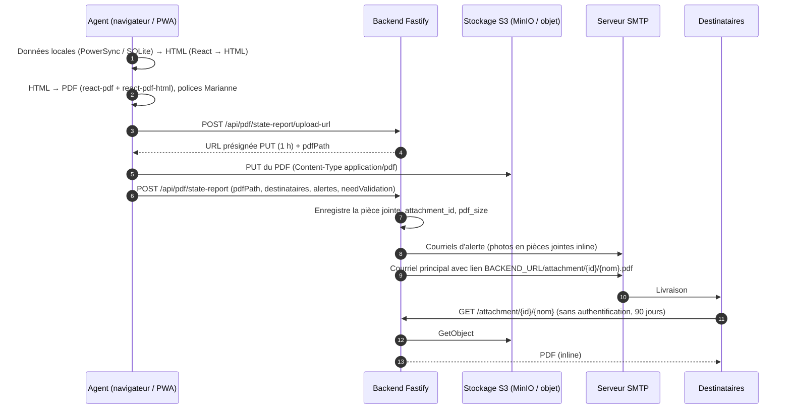
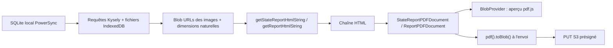
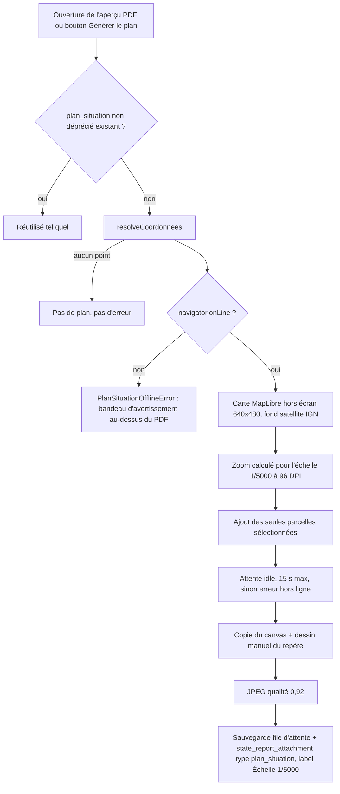
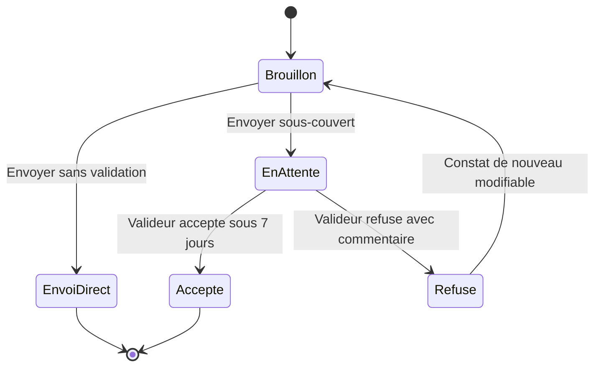

# 09 — Documents PDF, cartes, courriels et services externes

Ce chapitre décrit la chaîne de production des **documents** de Patrinotes (compte-rendu VIF et constat d'état), les **cartes** (plan de situation, localisation par partie d'édifice, sélection cadastrale), les **courriels** envoyés par le backend, la **dictée vocale** et l'inventaire complet des **flux réseau sortants**. Il s'adresse aux développeurs qui reprennent le code, aux équipes d'infrastructure du ministère (ouverture de flux, SMTP, stockage S3) et aux personnes chargées de l'homologation.

> Point clé à retenir : **les PDF sont générés intégralement dans le navigateur** (bibliothèque `@react-pdf/renderer`), puis téléversés directement sur le stockage S3 grâce à une URL présignée. Le backend ne fabrique aucun PDF. Il enregistre la référence du fichier, envoie les courriels avec un **lien** (le PDF n'est pas joint) et sert le fichier via une URL courte.

---

## 1. Vue d'ensemble



| Document | Modèle PDF | Écran front | Route backend d'envoi | Nom du fichier |
|---|---|---|---|---|
| Compte-rendu VIF (« CR », table `report`) | [`ReportPDFDocument`](../packages/pdf/src/report.tsx#L23) | [`pdf.$reportId.tsx`](../packages/frontend/src/routes/pdf.$reportId.tsx) | `POST /api/pdf/report` | `CR_<commune>_<demandeur>_<jj-MM-aaaa>.pdf` ([`getPDFInMailName`](../packages/pdf/src/report.tsx#L12)) |
| Constat d'état (table `state_report`) | [`StateReportPDFDocument`](../packages/pdf/src/stateReport.tsx#L39) | [`constat_.$constatId.pdf.tsx`](../packages/frontend/src/routes/constat_.$constatId.pdf.tsx) | `POST /api/pdf/state-report` | `constat-d-etat-<titre-nettoyé>_<jjMMaaaa>.pdf` ([`getStateReportMailName`](../packages/pdf/src/stateReport.tsx#L449)) |

---

## 2. Le package partagé `packages/pdf`

### 2.1 Contenu

Le package `@patrinotes/pdf` ([package.json](../packages/pdf/package.json)) n'a pas d'étape de build : il exporte directement les sources TypeScript, consommées par Vite côté frontend et par `vite-node` ou `tsup` côté backend.

| Export | Fichier | Rôle |
|---|---|---|
| `@patrinotes/pdf` | [index.ts](../packages/pdf/src/index.ts), [report.tsx](../packages/pdf/src/report.tsx) | Modèle du compte-rendu, génération du HTML du CR (`getReportHtmlString`), nom du fichier, liste `serviceInstructeurs` (JSON statique, [serviceInstructeur.json](../packages/pdf/src/serviceInstructeur.json), aujourd'hui **non utilisée** : l'import est commenté dans [ServiceInstructeurSelect.tsx](../packages/frontend/src/features/ServiceInstructeurSelect.tsx)) |
| `@patrinotes/pdf/constat` | [stateReport.tsx](../packages/pdf/src/stateReport.tsx) | Modèle du constat, génération du HTML du constat, (dé)sérialisation des préconisations, sections par défaut, correspondance alerte → services destinataires |
| `@patrinotes/pdf/utils` | [utils.tsx](../packages/pdf/src/utils.tsx) | Enregistrement des polices, post-traitement du HTML, règles « section visitée » et « alerte renseignée », (dé)sérialisation des courriels obligatoires, constantes des types d'alerte |

Composants :

- [`MarianneHeader`](../packages/pdf/src/components/MarianneHeader.tsx) : petit logo Marianne en position fixe (`top: -36`, `left: 40`), répété sur chaque page.
- [`Pagination`](../packages/pdf/src/components/Pagination.tsx) : « Page X sur Y », en bas à droite.
- [`ImagesTable` / `ImageCell`](../packages/pdf/src/components/images.tsx) : grille de photos avec légendes (voir § 4).
- Sections du constat, dans [state-report/](../packages/pdf/src/state-report/) : `info` (titre, informations, protection), `images` (plan de situation, plan de l'édifice, vues générales), `general`, `details`, `preconisations`, `alerts`.

> ⚠️ **Dépendance croisée** : le package `pdf` importe ses types depuis le frontend (`../../frontend/src/db/AppSchema`), par exemple dans [utils.tsx](../packages/pdf/src/utils.tsx#L2-L9). Le backend importe lui aussi ce fichier ([pdfRoutes.tsx](../packages/backend/src/routes/pdfRoutes.tsx#L7)). Le schéma PowerSync du frontend sert donc de **source de vérité des types** pour les trois packages.

### 2.2 Bibliothèques

| Bibliothèque | Version déclarée / résolue | Usage |
|---|---|---|
| `@react-pdf/renderer` | pdf et frontend `^4.1.5` (résolu 4.3.2) ; backend `^3.4.2` (résolu 3.4.5) | Moteur PDF (`Document`, `Page`, `View`, `Text`, `pdf().toBlob()`, `BlobProvider`) |
| `react-pdf-html` | `^2.0.4`, **résolu 2.1.5** dans [pnpm-lock.yaml](../pnpm-lock.yaml) | Conversion d'un HTML et de sa CSS en éléments react-pdf (`<Html>`) |
| `react-dom/server` | 18 | `renderToStaticMarkup` : les sections du constat sont écrites en JSX puis converties en chaîne HTML |
| `linkify-html` | 4 | Transforme les URL du texte en liens. Une espace de largeur nulle (`\u200B`) est insérée après `/ - . _` pour permettre les retours à la ligne dans le PDF ([`processHtml`](../packages/pdf/src/utils.tsx#L47)) |
| `pastable` | `groupBy` | Regroupe les alertes par type |
| `date-fns` | `format` | Dates des noms de fichiers |
| `@rawwee/react-pdf-html` | déclarée dans pdf et frontend | **Jamais importée** (dépendance morte) |
| `pdfjs-dist` 4.3.136 | frontend | Affichage du PDF généré, page par page ([PDFViewerPaginated](../packages/frontend/src/components/PDFViewerPaginated.tsx)). Le worker est empaqueté avec l'application (`?url`), sans CDN |

### 2.3 Le patch `patches/react-pdf-html@2.0.4.patch`

[Le patch](../patches/react-pdf-html@2.0.4.patch) modifie une seule ligne de `dist/esm/parse.js` de `react-pdf-html` :

```diff
-import * as cssTree from 'css-tree';
+import cssTree from 'css-tree';
 const { generate, parse: cssParse } = cssTree;
```

**Pourquoi** : `css-tree` est un module CommonJS. Avec un import « namespace » (`import * as`), le bundler (Rollup, lors du build Vite) ne trouvait pas `generate` ni `parse` sur l'objet importé. Le message du commit d'origine (`40a7f8e`, mai 2024) est : *« rollup couldnt find csstree in react-pdf-renderer »*. L'import par défaut récupère l'objet `module.exports` complet.

> ⚠️ **Le patch n'est plus appliqué.** Il avait été déclaré dans `pnpm.patchedDependencies` du `package.json` racine en mai 2024, mais cette déclaration a disparu depuis. Le [package.json](../package.json) actuel ne contient plus de `patchedDependencies` et le lockfile résout `react-pdf-html@2.1.5`, alors que le patch cible la 2.0.4. Le fichier est donc **orphelin**. Le build fonctionne vraisemblablement parce que la 2.1.x a corrigé l'import (à confirmer). Les devDependencies `css-tree` et `@types/css-tree` du frontend sont des vestiges de ce contournement. **Recommandation** : supprimer le patch, ou le réenregistrer s'il redevient nécessaire après une montée de version.

### 2.4 Polices

- Famille unique **Marianne** (charte de l'État), en 4 variantes : Regular, Bold, Italic, BoldItalic. Elles sont déclarées par [`initFonts(folder = "")`](../packages/pdf/src/utils.tsx#L16), qui charge `${folder}/fonts/Marianne-*.ttf`.
- Côté frontend, `initFonts()` est appelée au démarrage ([main.tsx](../packages/frontend/src/main.tsx#L108)). Les fichiers sont servis depuis [packages/frontend/public/fonts/](../packages/frontend/public/fonts/), en chemin relatif à l'origine du site.
- ⚠️ Le service worker ne précache que `svg, woff2, js, wasm, css, html, png` ([vite.config.ts](../packages/frontend/vite.config.ts#L55)). **Les `.ttf` ne sont pas précachés.** Hors ligne, la génération du PDF dépend donc du cache HTTP du navigateur pour obtenir les polices (à confirmer par un test hors ligne sur un appareil vierge).
- [packages/backend/public/fonts/](../packages/backend/public/fonts/), `marianne.png` et `marianne_footer.png` côté backend sont des **vestiges** de l'ancienne génération serveur (voir § 3.3). Seuls `Marianne-Light@2x.png` et `Marianne-Dark@2x.png` y sont encore utilisés, par les courriels.

### 2.5 En-tête institutionnel

Les deux modèles construisent un en-tête HTML à partir de trois champs de la table `service` : `marianne_text` (bloc « marque État », à gauche), `drac_text` et `service_text` (à droite). La fonction [`transformHeaderText`](../packages/pdf/src/stateReport.tsx#L246) normalise le texte (NFC, suppression des sauts de ligne et des doubles espaces) puis **insère des `<br/>` selon des règles codées en dur** :

| Le texte commence par (insensible à la casse) | Retour à la ligne après |
|---|---|
| `PRÉFET` / `PRÉFÈTE` | « Préfet », « Préfète », « région » |
| `DIRECTION (RÉGIONALE) DES AFFAIRES CULTURELLES` | « culturelles » |
| `UNITÉ DÉPARTEMENTALE DE` | « DÉPARTEMENTALE DE », « PATRIMOINE » |
| `CONSERVATION RÉGIONALE DES MONUMENTS HISTORIQUES` | « MONUMENTS » |

Un service dont l'intitulé ne suit pas ces formes aura un en-tête sur une seule ligne.

---

## 3. Où et comment le PDF est rendu

### 3.1 Rendu côté client (seul mode actuel)



**Constat d'état** ([constat_.$constatId.pdf.tsx](../packages/frontend/src/routes/constat_.$constatId.pdf.tsx)) :

1. La page attend que le flux PowerSync `state_report_attachments_stream` soit synchronisé, puis force un passage de téléchargement des pièces jointes (`attachmentQueue.syncStorage()`) au lieu d'attendre le cycle automatique de 30 s.
2. Les requêtes de [ConstatPdf.queries.tsx](../packages/frontend/src/features/state-report/pdf/ConstatPdf.queries.tsx) lisent le constat, les sections visitées, les alertes et leurs pièces jointes non dépréciées. Chaque image est lue dans IndexedDB, convertie en `blob:` URL et mesurée (`getImageDimensions`).
3. **Effet de bord** : avant de lire les pièces jointes, la requête du constat appelle `ensurePlanSituationAttachment`, qui **génère et enregistre le plan de situation** s'il n'existe pas encore (voir § 6.3). La simple ouverture de l'aperçu peut donc créer une ligne `state_report_attachment`, synchronisée ensuite vers le serveur.
4. Le HTML est généré **une seule fois** par chargement de page (`isSetRef`), car le rendu est coûteux.
5. L'aperçu passe par `BlobProvider` puis `PDFViewerPaginated`. Le blob et sa taille sont recopiés dans le formulaire (`BlobSync`) pour le bouton « Télécharger le constat (PDF - x Mo) ».
6. À l'envoi, la mutation `send` **régénère** le PDF à partir du HTML (elle ne réutilise pas le blob de l'aperçu), le téléverse, puis appelle le backend.

**Compte-rendu** ([pdf.$reportId.tsx](../packages/frontend/src/routes/pdf.$reportId.tsx)) : il fonctionne en quatre modes, `view`, `edit` (mise en page avec l'éditeur riche), `send` et `sent`. Les photos du CR ne passent pas par le HTML : elles sont ajoutées sur une page dédiée (`PicturesGrid`) par le modèle.

### 3.2 Téléversement et stockage

- Le backend fournit une URL présignée **PUT valable 1 h** ([uploadService.ts](../packages/backend/src/services/uploadService.ts#L24-L28)) :
  - CR : clé `attachment/<reportId>/compte_rendu_<epoch_s>.pdf`
  - constat : clé `attachment/<stateReportId>/constat_d_etat_<epoch_s>.pdf`
- **Le navigateur dépose le fichier directement sur S3.** L'endpoint S3 (`MINIO_URL`) doit donc être joignable **depuis les postes et tablettes des agents**, et pas seulement depuis le backend. C'est un point important pour l'ouverture des flux. La configuration CORS du bucket doit aussi autoriser `PUT` depuis l'origine du frontend (à confirmer : aucune configuration CORS de bucket n'est présente dans le dépôt).
- Le client S3 utilise `forcePathStyle`, `bucketEndpoint: true` et la région `us-east-1` (valeur fictive, compatible MinIO).
- Le backend enregistre ensuite une ligne `report_attachment` / `state_report_attachment` (dont l'`id` est le `pdfPath`), puis met à jour `attachment_id` et `pdf_size` sur le document.
- Chaque nouvel envoi crée un **nouveau fichier**. Les anciens PDF restent dans le bucket : aucune suppression n'est implémentée (`deleteFile` est un *no-op* dans [db.ts](../packages/frontend/src/db/db.ts#L44)).

### 3.3 Rendu côté serveur : supprimé, mais des vestiges subsistent

Jusqu'au commit `fd87550` (« 2 last sprints #69 »), le backend générait les PDF avec `renderToBuffer` de `@react-pdf/renderer` et composait les dessins avec `canvas` (`createCanvas`, `loadImage`). Depuis, il reste plusieurs **vestiges** :

- dépendances backend `@react-pdf/renderer`, `react-pdf-html`, `canvas`, `jsdom`, toutes jamais importées. `linkedom` est importé mais inutilisé dans [pdfRoutes.tsx](../packages/backend/src/routes/pdfRoutes.tsx#L20) ; il n'est réellement utilisé que pour le scraping POP ;
- [tsup.config.ts](../packages/backend/tsup.config.ts), qui déclare `@react-pdf/renderer`, `@react-pdf/font` et `canvas` en `external` ;
- **[Dockerfile](../Dockerfile#L5-L16)** : l'image de base installe `build-base g++ cairo-dev jpeg-dev pango-dev giflib-dev pixman-dev pangomm-dev libjpeg-turbo-dev freetype-dev`. Ces paquets servent **uniquement à compiler le module natif `canvas`** (node-gyp sur Alpine/musl, faute de binaire précompilé). `canvas` figure d'ailleurs dans `onlyBuiltDependencies` du [package.json](../package.json). Comme `canvas` n'est plus utilisé, ces dépendances système alourdissent l'image et la surface d'attaque **sans bénéfice**. Elles peuvent être retirées en même temps que la dépendance (à valider par un build).
- Le plugin multipart (limite 15 Mo) est enregistré dans [uploadRoutes.tsx](../packages/backend/src/routes/uploadRoutes.tsx#L19-L23), mais aucune route n'accepte de fichier en multipart.

### 3.4 Téléchargements ultérieurs

| Action | Appel | Remarque |
|---|---|---|
| Télécharger un constat envoyé | `GET /api/upload/attachment?filePath=…&stateReportId=…` | Le backend journalise le téléchargement dans `constat_pdf_download` |
| Télécharger l'aperçu (non envoyé) | blob local + `POST /api/pdf/state-report/log-download` | Journalisé aussi |
| Export ZIP de tous ses documents ([compte.tsx](../packages/frontend/src/routes/compte.tsx#L626)) | `GET /api/pdf/state-report` / `GET /api/pdf/report` (PDF en base64) | ZIP construit côté client (`jszip`) |

> ⚠️ `getReportPDF` ([uploadService.ts](../packages/backend/src/services/uploadService.ts#L99)) prend le **premier** `report_attachment` dont l'identifiant finit par `.pdf`, sans tri. Après plusieurs envois, l'export ZIP peut donc contenir un ancien PDF du CR (à confirmer).
> ⚠️ Le nom du constat contient la **date du jour du téléchargement** (`format(new Date())`), et non la date d'envoi.

---

## 4. Images dans les PDF

### 4.1 Préparation des images (en amont)

- Les photos sont compressées dans le navigateur par `browser-image-compression` ([`processImage`](../packages/frontend/src/features/upload/UploadReportImage.tsx#L264)) : **`maxSizeMB: 1`, `maxWidthOrHeight: 1920`, `preserveExif: false`**. Les métadonnées EXIF, dont la **géolocalisation GPS**, sont supprimées, ce qui est un point positif pour la protection des données. Les fichiers sont toujours enregistrés avec l'extension `.jpg` et le type `image/jpeg`.
- Clés de stockage : `<parentId>/images/<uuidv7>.jpg`, préfixées par `attachment/` dans S3.
- **Dessins sur photo** ([KonvaDrawingCanvas.tsx](../packages/frontend/src/features/upload/KonvaDrawingCanvas.tsx#L354-L386)) : les traits sont **incrustés de façon définitive** dans une nouvelle image JPEG (qualité 0,9), à la taille naturelle de la photo. Une nouvelle pièce jointe est créée et l'ancienne est marquée `is_deprecated = 1` ([`replaceAttachment`](../packages/frontend/src/features/upload/hooks/useAttachmentImages.ts#L237)). L'original reste stocké. Une image redessinée n'est pas recompressée par `processImage` et peut donc dépasser 1 Mo.
- Fermer la fenêtre de dessin (Échap, clic à l'extérieur) **enregistre** les modifications en attente au lieu de les abandonner.

### 4.2 Mise en page ([images.tsx](../packages/pdf/src/components/images.tsx))

- **Hauteur fixe de 180** (`CELL_HEIGHT`) pour toutes les images. La largeur se calcule à partir du ratio naturel (`width/height × 180`) quand les dimensions sont connues. Ce calage précis contourne une limite de mise en page de `react-pdf-html` : sans largeur explicite, une légende longue décale la cellule suivante au lieu de faire passer la ligne à la suivante.
- Chaque cellule est enveloppée dans une balise personnalisée `<unbreakable>`, rendue en `View wrap={false}`. **Une photo et sa légende ne sont jamais coupées entre deux pages.** De même, dans le constat, chaque `<tr>` est insécable.
- Légende en 8 pt gris, sous l'image. Dans le CR, une photo sans légende est étiquetée `N°<i>`.
- Les images sont des `blob:` URL locales au navigateur. Le HTML d'un constat n'est donc **pas réutilisable hors de la session** qui l'a produit. Ces URL ne sont jamais révoquées (`URL.revokeObjectURL`), ce qui provoque une fuite mémoire mineure si l'on ouvre beaucoup d'aperçus.

### 4.3 Ordre des visuels dans un constat

1. **Plan de situation** (`type = plan_situation`), légende fixe « Échelle 1/5000 » ;
2. **Plan de l'édifice** (`plan_edifice`) ;
3. **Vues générales** (`vue_generale`), triées par `created_at` ;
4. photos de chaque section du constat détaillé, y compris l'image de **localisation** de la section (§ 6.4), qui n'a pas de légende ;
5. photos de chaque alerte.

---

## 5. Contenu métier et règles cachées des modèles

### 5.1 Constat d'état ([`getStateReportHtmlString`](../packages/pdf/src/stateReport.tsx#L282))

Ordre des blocs : titre (« Constat d'état du monument historique » + `titre_edifice` + « Référence POP ») → informations → protection → plans et vues → constat général → constat détaillé → préconisations générales → alertes → « Document créé le … ». Le pied de page contient un texte réglementaire fixe (Code du patrimoine, article R621-63, circulaire du 1er décembre 2009, norme EN 15898) et un lien vers culture.gouv.fr. Ce lien est découpé en segments de mots pour pouvoir passer à la ligne.

Règles :

- **Versions de constat** : `state_report.version` vaut 1 par défaut. La **v1** décrit chaque partie par « *proportion* des parties protégées sont évaluées *état* ». La **v2** utilise `niveau_degradation` (Léger, Moyen, Important, Péril), `taux_degradation` (en %) et `vitesse_degradation`. Les libellés sont codés en dur dans [state-report.general.tsx](../packages/pdf/src/state-report/state-report.general.tsx#L103-L131). En v2, **si `etat_general` est vide, tout le bloc « Constat général » disparaît**.
- **8 sections par défaut**, codées en dur et dupliquées dans `stateReport.tsx` et `state-report.general.tsx` : « Fondations, sols, sous-sols », « Maçonnerie, structure », « Parements, enduits », « Couverture, charpente », « Menuiserie, métallerie, vitraux », « Cloisonnement, revêtements, décors, objets, mobiliers », « Équipements, sécurité, accessibilité », « Environnements, abords, voirie et réseaux ». Le rapprochement avec `visited_section.section` se fait **par libellé exact**. Une section non visitée apparaît comme « sans commentaire » dans le constat général et n'apparaît pas dans le constat détaillé.
- **Section « visitée »** ([`getIsSectionVisited`](../packages/pdf/src/utils.tsx#L100)) : (`etat_general` **et** `proportion_dans_cet_etat`) **ou** `niveau_degradation` **ou** au moins une pièce jointe **ou** au moins un repère de localisation (`localisation_pins` en JSON non vide).
- **Visite partielle** : elle est détectée si `nature_visite` contient « partielle ». Les « Parties visitées » prennent alors la valeur de `visite_partielle_details`, sinon « Visite complète de l'édifice ».
- **Préconisations** : elles sont sérialisées au format `option[:commentaire]/option[:commentaire]`, chaque partie étant encodée en URI ([`serializePreconisations`](../packages/pdf/src/stateReport.tsx#L346-L370)). Ce même format est utilisé au niveau du constat (préconisations générales) et de chaque section.
- Un caractère `` ` `` parasite est rendu après la ligne « Représentant » ([state-report.info.tsx](../packages/pdf/src/state-report/state-report.info.tsx#L94)). C'est un défaut d'affichage mineur.

### 5.2 Compte-rendu ([`getReportHtmlString`](../packages/pdf/src/report.tsx#L247))

- Il s'appuie sur des « chips » (`clause_v2`) repérées par leur `key` : `type-espace`, `decision`, `contacts-utiles` et `bonnes-pratiques`. Les deux dernières sont des listes de valeurs séparées par des virgules.
- La mention **« Ce compte rendu ne remplace pas la demande d'autorisation de travaux. »** est toujours présente.
- Signataire : `redactedBy`, sinon le nom de l'utilisateur.
- **Formatage du téléphone du service** : s'il ne contient pas d'espace, le code suppose 9 chiffres stockés sans le 0 initial. Il préfixe alors `0` et regroupe par 2 chiffres ([`formatPhoneNumber`](../packages/pdf/src/report.tsx#L389)).
- La « Ref cadastrale » vaut « non renseignée » par défaut.

### 5.3 Éditeur riche → HTML → PDF ([features/text-editor](../packages/frontend/src/features/text-editor/))

- L'éditeur repose sur TipTap 2 : StarterKit (sans bloc de code), Underline, Color, TextStyle, FontSize, Image, Link, HardBreak, TableRow/Header/Cell (l'extension `Table` est commentée), HorizontalRule, Columns, ainsi qu'un nœud `customHTML` qui conserve tel quel le HTML des `div.column-block`.
- La barre d'outils propose gras, italique, souligné, listes à puces ou numérotées et couleur du texte ([TextEditorToolbar.tsx](../packages/frontend/src/features/text-editor/TextEditorToolbar.tsx)).
- **Pipeline du CR** : HTML généré → `editor.commands.setContent()` → modifications de l'agent → `editor.getHTML()` → injecté dans `<Html>` de `react-pdf-html`, avec une feuille de style embarquée.
- **Instantané de mise en page (`pdf_snapshot`)** : « Enregistrer » sauvegarde le HTML édité **et** une copie JSON du CR, par utilisateur. La table est synchronisée par PowerSync (`user_id`). À l'ouverture suivante, le HTML sauvegardé n'est réutilisé **que si le CR n'a pas changé depuis** (`getDiff`). La moindre modification du formulaire **réinitialise la mise en page**, comme l'annonce le bandeau de l'écran.
- La CSS prise en charge par `react-pdf-html` est limitée. Les règles `strong em`, `em strong`, etc. sont répétées dans les modèles pour obtenir le gras-italique Marianne. La feuille `stateReportExtraCss` est partagée entre l'éditeur (affichage à l'écran) et le PDF.
- **Constat** : le HTML n'est pas éditable dans le parcours actuel. Le composant `EditConstatPdf` existe, mais la route n'a que les modes `view`, `send` et `sent`. ⚠️ `validateSearch` accepte pourtant `mode=edit`, et `contentMap` n'a pas d'entrée `edit` : une URL `?mode=edit` provoquerait probablement une erreur d'exécution (à confirmer).

---

## 6. Cartes

### 6.1 Bibliothèque et fournisseurs

La cartographie utilise **MapLibre GL JS 5** (`maplibre-gl`), sans surcouche React ([MapLibre.tsx](../packages/frontend/src/features/map/MapLibre.tsx)). Le contexte d'origine est décrit dans [MAP_PLAN.md](../MAP_PLAN.md) : la carte MapLibre a remplacé une iframe OpenStreetMap. **Aucune clé d'API n'est utilisée.**

| Usage | URL | Opérateur |
|---|---|---|
| Fond « Vectoriel » (style par défaut des cartes interactives) | `https://tiles.openfreemap.org/styles/liberty` (le style charge à son tour ses tuiles, sprites et glyphes chez `tiles.openfreemap.org`) | OpenFreeMap (service tiers associatif, **hors administration**) |
| Glyphes du fond satellite (étiquettes des parcelles) | `https://tiles.openfreemap.org/fonts/{fontstack}/{range}.pbf` | OpenFreeMap |
| Fond « Satellite » (orthophotos) | `https://data.geopf.fr/wmts?…LAYER=ORTHOIMAGERY.ORTHOPHOTOS…TILEMATRIXSET=PM` | IGN, Géoplateforme |
| Parcelles cadastrales (tuiles vectorielles) | `https://openmaptiles.geo.data.gouv.fr/data/cadastre.json`, puis les tuiles qu'il référence | Etalab, geo.data.gouv.fr |
| Géocodage d'adresse | `https://api-adresse.data.gouv.fr/search/?q=…&limit=1` (cartes) et `&limit=10` (autocomplétion, [address.tsx](../packages/frontend/src/features/address.tsx)) | Base Adresse Nationale |

Tous ces appels partent **du navigateur de l'agent**, jamais du backend. L'attribution MapLibre est masquée par CSS (`.maplibregl-ctrl-attrib { display: none }`). Il faut vérifier que ce masquage est conforme aux licences OpenFreeMap / OpenStreetMap (ODbL) et IGN (à confirmer). Une alternative commentée vers le style `PLAN.IGN` de la Géoplateforme existe dans le code. Elle permettrait de ne plus dépendre d'OpenFreeMap.

### 6.2 Composants

| Composant | Où | Mode initial | Ce qu'il enregistre |
|---|---|---|---|
| [`MapLibre`](../packages/frontend/src/features/map/MapLibre.tsx) dans [PlanDeSituationModal](../packages/frontend/src/features/state-report/steps/PlanDeSituationModal.tsx) | Constat, étape « Monument historique » | `move` | `coordonnees` (`"lat,lng"`) et `reference_cadastrale` (`"SECTION NUMERO;SECTION NUMERO"`). Toute modification **invalide** le plan de situation |
| `MapLibre` dans [CadastreMapModal](../packages/frontend/src/features/CadastreMapModal.tsx) | Compte-rendu | **`cadastre`**, sélection **unique** | `projectCadastralRef` |
| [`MonumentPickerMap`](../packages/frontend/src/features/map/MonumentPickerMap.tsx) dans [MonumentMapModal](../packages/frontend/src/features/map/MonumentMapModal.tsx) | Recherche de monument | — | Choix d'un immeuble POP sur une carte de marqueurs regroupés (données `pop_immeubles` locales) |
| [`LocalisationMap`](../packages/frontend/src/features/map/LocalisationMap.tsx) dans [SectionLocalisationModal](../packages/frontend/src/features/state-report/steps/SectionLocalisationModal.tsx) | Constat détaillé, par section | fond satellite | Repères numérotés, traits libres, zone d'export, image recadrée |

Le paramètre `initialMode` (commit « add map "initial mode" ») permet d'ouvrir directement la carte en mode sélection cadastrale. Les trois modes sont `move` (navigation), `pin` (placement du point au centre de la carte, avec Valider ou Annuler) et `cadastre` (clic sur les parcelles, visibles à partir du zoom 14 et étiquetées à partir du zoom 16).

> ⚠️ **Formats de coordonnées** : la chaîne stockée est `"lat,lng"`, alors que MapLibre et la BAN utilisent `[lng, lat]`. Les conversions sont faites à la main à chaque endroit. Le centre par défaut est Paris (`[2.3488, 48.8534]`, zoom 13).

**Résolution du point** ([`resolveCoordonnees`](../packages/frontend/src/features/state-report/planSituationAttachment.ts#L15)), dans l'ordre : `coordonnees` saisies → coordonnées WGS84 de l'immeuble POP (sauf si `reference_pop = "CUSTOM"`) → géocodage BAN de l'adresse POP ou de l'adresse saisie → aucun point.

### 6.3 Plan de situation statique pour le PDF ([planSituationSnapshot.ts](../packages/frontend/src/features/map/planSituationSnapshot.ts))



Constantes : `SNAPSHOT_WIDTH = 640`, `SNAPSHOT_HEIGHT = 480`, `SCALE_DENOMINATOR = 5000`, `DPI = 96`, zoom = `log2(156543.034 × cos(lat) / (5000 × 0,0254 / 96))`, délai `TILE_LOAD_TIMEOUT_MS = 15000` ([waitForIdle.ts](../packages/frontend/src/features/map/waitForIdle.ts)).

Règles cachées :

- Le repère MapLibre est un élément DOM et n'apparaît donc pas dans le canvas. Il est **redessiné à la main** en SVG bleu France `#000091`.
- La carte hors écran est créée avec `preserveDrawingBuffer: true` ; sans cette option, la capture serait noire. `waitForIdle` s'appuie sur `map.loaded()` plutôt que sur `areTilesLoaded()`, qui peut renvoyer vrai avant le moindre chargement de tuile.
- La capture est faite **au moment de la génération** : si l'agent déplace ensuite le point, `invalidatePlanSituationAttachment` marque l'ancien plan comme déprécié, et la prochaine ouverture de l'aperçu le régénère.
- **Hors ligne**, le plan n'est pas généré. Un avertissement s'affiche au-dessus de l'aperçu (commit « display error above PDF if any map couldnt be generated », [ConstatPdf.view.tsx](../packages/frontend/src/features/state-report/pdf/ConstatPdf.view.tsx#L65)), et **le constat peut quand même être envoyé sans plan**.
- ⚠️ **Exactitude de l'échelle** : l'image représente bien 1/5000 si elle est affichée à 640×480 px à 96 DPI. Le PDF l'affiche pourtant à une hauteur fixe de 180 unités (§ 4.2). Si `react-pdf` interprète ces unités comme des points (1/72 de pouce), l'échelle imprimée réelle est d'environ **1/10 000**, alors que la légende indique « Échelle 1/5000 » (à vérifier par une mesure sur un PDF imprimé).

### 6.4 Localisation d'une section (constat détaillé)

- L'agent déplace une carte satellite sous un **rectangle d'export fixe** (« Déplacez la carte dans la zone d'export »), pose des repères numérotés et dessine des traits colorés.
- À la validation ([localisationSnapshot.ts](../packages/frontend/src/features/state-report/localisationSnapshot.ts)), le canvas visible est recadré sur le rectangle, en tenant compte du `devicePixelRatio`, et enregistré en JPEG de qualité 0,92. Les repères et les traits sont des couches MapLibre natives et sont donc capturés directement.
- Données enregistrées dans `visited_section` : `localisation_pins`, `localisation_drawings` et `localisation_zone` (JSON).
- L'image devient une `visited_section_attachment` dont la clé contient **`/localisation/`**. Ce segment de chemin est le seul moyen de reconnaître ce type d'image ([localisationAttachment.ts](../packages/frontend/src/features/state-report/localisationAttachment.ts)). Elle a un **label vide** et ne porte donc pas de légende dans le PDF. L'image précédente est dépréciée.
- Si aucun point n'est résolu, la fenêtre demande de renseigner d'abord l'emplacement dans « Contexte de la visite ».

### 6.5 Fonctionnement hors ligne des cartes

- **Aucune tuile n'est mise en cache.** Le service worker ne gère que le précache de l'application, `env.js` et les navigations ([sw.ts](../packages/frontend/src/service-worker/sw.ts)). Les cartes interactives sont donc **inutilisables hors ligne**.
- Les images déjà produites (plan de situation, localisations) sont des pièces jointes ordinaires, stockées dans IndexedDB et synchronisées. Elles restent disponibles hors ligne dans le PDF.
- Dans l'infrastructure du ministère, le **proxy sortant des postes ou des tablettes** doit autoriser les domaines du § 6.1. Sinon, le plan de situation tombera dans le cas « hors ligne », ou dans « erreur » si `navigator.onLine` reste vrai.

---

## 7. Alertes des constats d'état

### 7.1 Types d'alerte et services destinataires

Les types d'alerte sont **identifiés par leur libellé**, enregistré tel quel dans `state_report_alert.alert`. Renommer une constante casserait donc les données existantes ([utils.tsx](../packages/pdf/src/utils.tsx#L121-L127), [`alertSectionStaticData`](../packages/pdf/src/stateReport.tsx#L465)) :

| Alerte | Services destinataires | Colonne `service` utilisée pour préremplir le courriel |
|---|---|---|
| Édifice en péril | CRMH | `courriel_crmh` |
| Abords de l'édifice | UDAP | `courriel_udap` |
| Objets et mobiliers | CAOA, CRMH | `courriel_caoa`, `courriel_crmh` |
| Archéologie | SRA | `courriel_sra` |
| Site classé ou inscrit | DREAL | `courriel_dreal` |
| Biodiversité | OFB | `courriel_ofb` |
| Sécurité | Mairie | `courriel_mairie`, **colonne inexistante** |

Le nom de colonne est calculé dynamiquement : `"courriel_" + service.toLowerCase()` ([`getEmailsForSection`](../packages/frontend/src/features/state-report/alerts/StateReportAlert.utils.tsx#L10)). ⚠️ Pour l'alerte **Sécurité**, le courriel de la mairie est donc **toujours vide** à la création. L'envoi reste bloqué (« Veuillez renseigner un courriel pour ce service. ») tant que l'agent ne l'a pas saisi.

### 7.2 Règles

- Création d'une alerte : `show_in_report = 1`, `should_send = 1`, et courriels obligatoires préremplis à partir du service de l'agent.
- Format de `mandatory_emails` : `SERVICE:email;SERVICE:email`. `additional_emails` est une liste séparée par des virgules. Les saisies sont enregistrées dans le formulaire après un délai de 500 ms (*debounce*).
- Deux bascules **indépendantes** ([SectionCommentaires.tsx](../packages/frontend/src/features/state-report/alerts/SectionCommentaires.tsx)) :
  - « Afficher dans le rapport » (`show_in_report`) : l'alerte apparaît dans le PDF ;
  - « Envoyer par courriel » (`should_send`) : l'alerte est envoyée aux services.
- **Alerte « renseignée »** ([`getIsAlertVisited`](../packages/pdf/src/utils.tsx#L73)) : elle a un commentaire non vide ou une pièce jointe. Pour « Objets et mobiliers », un `probleme` ou un objet choisi suffit aussi. Une alerte vide n'est **ni affichée ni envoyée**.
- Plusieurs alertes « Objets et mobiliers » sont possibles, une par objet. Dans le PDF, chaque objet renvoie à `https://pop.culture.gouv.fr/notice/palissy/<référence>`.
- Validation avant envoi : chaque alerte sélectionnée doit avoir tous ses courriels obligatoires présents et valides. La validité est vérifiée par l'API native `<input type="email">.checkValidity()`. Les courriels additionnels ne sont **pas** validés.
- Dans le PDF, les alertes sont regroupées par type, avec la phrase « Alerte transmise par courriel au CRMH (…) et à la DREAL (…) ». Les articles sont tirés de la table `servicePronoms`. ⚠️ Cette phrase dépend uniquement de `should_send` sur la **première** alerte du groupe. Elle ne garantit pas que le courriel a réellement été envoyé (échec SMTP, alertes déjà envoyées lors d'un envoi précédent).
- L'encart **« N alertes MH signalées »** de l'étape d'envoi ([AlertsReminder.tsx](../packages/frontend/src/features/state-report/pdf/AlertsReminder.tsx)) récapitule les destinataires.

### 7.3 Envoi des alertes (backend, [pdfRoutes.tsx](../packages/backend/src/routes/pdfRoutes.tsx#L271-L316))

- Les courriels d'alerte partent **au moment où le constat est soumis**, **y compris en cas d'« envoi sous-couvert »** (validation), donc **avant** la décision du valideur. Ils partent même si le valideur refuse ensuite.
- Ils ne sont envoyés **qu'une seule fois par constat** : le drapeau `state_report.alerts_sent` est positionné après la boucle. Un renvoi après refus ne renvoie pas les alertes.
- Il y a un courriel par alerte. Les destinataires sont les courriels obligatoires et additionnels, dédoublonnés et mis en minuscules. Une erreur sur une alerte est remontée à Sentry et **ne bloque pas** les autres alertes ni le constat.
- Les `mandatory_emails` éventuellement corrigés sur l'écran d'envoi sont réécrits directement en base par le backend, **uniquement dans le parcours sans validation**.

---

## 8. Validation d'un constat (« envoi sous-couvert »)



- **Activation** : la bascule « Envoi sous-couvert » n'apparaît que si `user_settings.validation_enabled` **et** `validation_email` sont renseignés. Elle est activée par défaut dans ce cas.
- **Soumission** ([pdfRoutes.tsx](../packages/backend/src/routes/pdfRoutes.tsx#L318-L356)) : création d'une ligne `constat_validation` avec un jeton UUID v4, une expiration à **J+7**, le statut `pending`, les destinataires et le `pdf_path`. Le constat passe en `validation_status = pending`, puis le valideur reçoit le lien `FRONTEND_URL/constat-validation/<token>`.
- **Routes publiques, sans authentification** ([validationRoutes.ts](../packages/backend/src/routes/validationRoutes.ts)) : `GET /api/constat-validation/:token` (renvoie une URL S3 présignée d'1 h), `GET …/pdf`, `POST …/accept`, `POST …/decline`. La sécurité repose entièrement sur le secret du jeton.
- **Accepter** : le statut passe à `accepted`, le PDF est envoyé aux destinataires mémorisés (l'auteur fait partie de la liste, puisqu'il y est ajouté d'office), les envois sont tracés dans `state_report_sent_email` et l'auteur reçoit un courriel « Accepté ». ⚠️ Le lien du courriel destinataire est ici une **URL S3 présignée directe valable 7 jours**, et non l'URL courte `/attachment` de 90 jours. Le texte du courriel indique pourtant « lien valable 1 mois ». Le domaine S3 doit donc être joignable depuis Internet par les destinataires.
- **Refuser** : le commentaire est obligatoire, le statut passe à `declined` et l'auteur reçoit le commentaire. Le constat redevient modifiable.
- **Expiration** : elle n'est contrôlée que tant que la demande est `pending`. Une fois la demande acceptée ou refusée, le lien de consultation reste valable **indéfiniment** et donne toujours accès au PDF.
- **Verrouillage** ([utils.ts](../packages/frontend/src/features/state-report/utils.ts#L45-L50)) : un constat est en lecture seule dès qu'il a un `attachment_id` (PDF envoyé ou en attente de validation), **sauf** si `validation_status = declined`. De plus, seul son **créateur** peut le modifier.

---

## 9. Courriels

### 9.1 Configuration SMTP

Le transport est créé une seule fois avec Nodemailer ([mail.ts](../packages/backend/src/features/mail.ts#L14-L21)) :

| Variable | Rôle | Défaut |
|---|---|---|
| `EMAIL_HOST` | Hôte SMTP | — (obligatoire) |
| `EMAIL_PORT` | Port | `465` |
| `EMAIL_USER` / `EMAIL_PASSWORD` | Authentification SMTP | — (obligatoires) |
| `EMAIL_EMITTER` | Adresse `From` de tous les courriels | — (obligatoire) |
| `FRONTEND_URL` / `BACKEND_URL` | Construction des liens | — |

- **Production** : Scaleway Transactional Email (TEM), confirmé par l'équipe. La [politique de confidentialité](../packages/frontend/src/routes/politique-confidentialite.tsx) cite pourtant Brevo et OVH parmi les sous-traitants : elle est à corriger.
- **Développement** : Mailpit ([docker-compose.yaml](../docker-compose.yaml#L159-L170)), port SMTP `${SMTP_PORT}` → 1025 et interface web `${SMTP_WEB_PORT}` → 8025, avec acceptation de toute authentification.
- ⚠️ Aucune option `secure`/`requireTLS` n'est passée à Nodemailer. Le chiffrement dépend de son comportement par défaut, qui varie selon le port (TLS implicite sur 465 ou STARTTLS opportuniste). Il faut **vérifier le chiffrement effectif** avec le relais SMTP du ministère (à confirmer).
- Aucune file d'attente ni nouvelle tentative : un échec SMTP fait échouer la requête HTTP, ou est seulement journalisé pour les alertes.
- La **réputation du domaine d'envoi** (SPF, DKIM, DMARC de l'adresse `EMAIL_EMITTER`) est à reconfigurer lors du transfert (hors code).

### 9.2 Gabarit

Tous les courriels passent par [`wrapWithDsfrMail`](../packages/backend/src/features/mail/dsfrMailWrapper.ts#L150) : un gabarit HTML en tableaux, dans le style DSFR, compatible avec le mode sombre. Il contient le logo Marianne (versions claire et sombre) **en pièces jointes inline** (`cid:marianne-light@patrinotes`, `cid:marianne-dark@patrinotes`, environ 5 Ko chacune, lues dans `process.cwd()/public` puis mises en cache mémoire), le libellé « Ministère de la Culture », un bandeau de titre et le pied de page « Envoi automatique depuis le service numérique Patrinotes ».

- Le titre et le *preheader* sont échappés, mais **le contenu ne l'est pas**. Les champs saisis par les agents y sont injectés bruts : commentaire d'alerte, titre du CR, préconisations, commentaire de refus du valideur. Le risque d'injection HTML dans les courriels est faible, mais il est réel.
- ⚠️ Le backend doit être lancé **depuis `packages/backend`**, car le chemin `public/` est relatif au répertoire courant. Sinon, l'envoi échoue sur `readFileSync`. La variable `ASSETS_DIR` est déclarée mais non utilisée.
- [template-generique.html](../packages/backend/src/features/mail/template-generique.html) (3 252 lignes) et les fichiers du dossier [assets/](../packages/backend/src/features/mail/assets/) ne sont pas référencés : ce sont des modèles de référence ou des doublons.

### 9.3 Inventaire des courriels

| # | Courriel | Déclencheur | Destinataires | Objet | Contenu et pièces jointes |
|---|---|---|---|---|---|
| 1 | Compte-rendu ([`sendReportMail`](../packages/backend/src/features/mail.ts#L47)) | `POST /api/pdf/report` | Liste saisie (préremplie avec `user_settings.default_emails` + courriel du service instructeur + `applicantEmail`) **+ l'agent émetteur**, ajouté d'office | `Compte-rendu UDAP[ : titre]` | Lien `BACKEND_URL/attachment/<id>/<nom>.pdf` (« valable 1 mois ») et liens culture.gouv.fr. **Pas de PDF joint.** Signature `redactedBy`, qui peut afficher « null » si le champ est vide |
| 2 | Constat d'état ([`sendStateReportMail`](../packages/backend/src/features/mail.ts#L23) / [bordereau](../packages/backend/src/features/bordereau.ts)) | `POST /api/pdf/state-report` sans validation, ou acceptation par le valideur | Liste saisie (préremplie avec `proprietaire_email` + `proprietaire_representant_email` + `default_emails`) + l'agent, en minuscules | `Constat d'état [ : titre]` | Lien vers le PDF, texte réglementaire, liste des préconisations, liens Légifrance et culture.gouv.fr |
| 3 | Alerte ([`sendAlertEmail`](../packages/backend/src/features/mail.ts#L178), [alertMail.ts](../packages/backend/src/features/mail/alertMail.ts)) | Soumission du constat (une seule fois) | Courriels obligatoires et additionnels de l'alerte | `Alerte <type> - <monument>` | Phrase propre au type d'alerte, commentaire, **photos de l'alerte en pièces jointes inline** (`cid`, affichées avec une largeur maximale de 600 px), coordonnées de l'agent |
| 4 | Demande de validation ([`sendValidationRequestMail`](../packages/backend/src/features/mail.ts#L112)) | Soumission avec envoi sous-couvert | `user_settings.validation_email` | `[Validation requise] Constat d'état[ : titre]` | Lien `FRONTEND_URL/constat-validation/<token>`, valable 7 jours |
| 5 | Résultat de validation ([`sendValidationResultMail`](../packages/backend/src/features/mail.ts#L144)) | Acceptation ou refus | Créateur du constat | `Constat d'état[ : titre] — Accepté/Refusé par le validateur` | Lien vers le constat dans l'application, commentaire |
| 6 | Réinitialisation du mot de passe ([`sendPasswordResetMail`](../packages/backend/src/features/mail.ts#L97)) | `POST /api/send-reset-password` ([userService.ts](../packages/backend/src/services/userService.ts#L37)) | Utilisateur de `internal_user` | `Patrinotes - Réinitialisation de mot de passe` | Lien `FRONTEND_URL/reset-password/<uuid>`, valable 1 jour (jeton stocké sous forme d'empreinte MD5). Probablement un **vestige d'avant Keycloak** (à confirmer) |

Règles transverses :

- Les destinataires sont séparés par `,` ou `;`, puis nettoyés. L'agent émetteur est **toujours** ajouté. La comparaison avec son adresse est sensible à la casse pour le CR, mais pas pour le constat.
- Chaque destinataire est tracé dans `sent_email` (CR) ou `state_report_sent_email` (constat), puis ajouté à `suggested_email` du service pour l'autocomplétion. Les doublons sont ignorés silencieusement (`.catch(() => {})`).
- **Lien vers le PDF** ([`createAttachmentRedirection`](../packages/backend/src/routes/pdfRoutes.tsx#L25)) : identifiant base62 d'un entier aléatoire compris entre 1 et 2^48, soit environ 48 bits d'entropie. Le lien est **public, sans authentification**, et **expire après 90 jours** ([attachmentRedirectRoutes.ts](../packages/backend/src/routes/attachmentRedirectRoutes.ts#L28)), alors que les courriels indiquent « 1 mois ». Le backend **relaie le fichier** en `Content-Disposition: inline` quand un nom est défini, ce qui est toujours le cas dans le code actuel. Sinon, il redirige vers une URL présignée d'1 h. Pour un constat, deux à trois redirections sont créées par envoi : une pour le courriel, une pour la réponse HTTP (inutilisée par le front) et une pour le valideur.
- **Taille des courriels** : les courriels 1, 2, 4, 5 et 6 ne pèsent qu'environ 10 Ko de logos. Le courriel d'alerte embarque **toutes** les photos non dépréciées et non ignorées de l'alerte, chacune d'environ 1 Mo au plus si elle n'a pas été redessinée, **sans plafond global**. Une alerte riche en photos peut dépasser la taille maximale acceptée par le relais SMTP ou par les messageries des services destinataires. Le type MIME est forcé à `image/png` alors que les fichiers sont des JPEG.
- **Données personnelles envoyées à Sentry** : `sentry.captureMessage` est appelé **à chaque envoi** avec, en données additionnelles, les destinataires et l'**objet `report` / `stateReport` complet** (noms, adresses, courriels des propriétaires). C'est un point à traiter pour l'homologation et le RGPD.

---

## 10. Dictée vocale (`features/audio-record`)

- Elle utilise **l'API Web Speech native du navigateur** (`SpeechRecognition` / `webkitSpeechRecognition`), en `lang = "fr-FR"`, avec résultats intermédiaires activés ([SpeechRecorder.machine.tsx](../packages/frontend/src/features/audio-record/SpeechRecorder.machine.tsx)). Une machine XState gère les permissions micro, l'écoute, la relance automatique à chaque fin de reconnaissance (`RECOGNITION_END` → `restarting`) et l'arrêt.
- Elle sert à dicter dans les champs de notes du CR ([NotesForm](../packages/frontend/src/features/NotesForm.tsx), [InfoForm](../packages/frontend/src/features/InfoForm.tsx)) et dans les commentaires du constat (constat général, constat détaillé, alertes, menu latéral).
- **Aucun fichier audio n'est enregistré ni envoyé au backend Patrinotes.** Seul le texte transcrit est inséré dans le champ.
- ⚠️ **Flux implicite vers un tiers** : dans Chrome/Android (et Edge), l'API Web Speech envoie l'audio aux **serveurs de reconnaissance vocale de Google** (Microsoft pour Edge, Apple pour Safari). Ce flux ne figure pas dans le code, mais il est réel. Il doit être déclaré dans l'analyse de risques et, si nécessaire, autorisé par le proxy (domaines Google, à confirmer selon les navigateurs déployés). Si le navigateur ne prend pas en charge l'API, la fonction est désactivée (état `unsupported`).
- [SpeechRecorder.tsx](../packages/frontend/src/features/audio-record/SpeechRecorder.tsx) est une ancienne implémentation, remplacée par le hook `useSpeechToTextV2` mais encore importée dans `NotesForm`.

---

## 11. Inventaire des flux réseau sortants

Recherche exhaustive des URL `http(s)://`, des appels `fetch` / `ofetch` et des variables d'environnement d'hôtes dans `packages/*/src`.

### 11.1 Depuis le navigateur (frontend)

| Hôte | Protocole | Usage | Fichier |
|---|---|---|---|
| `VITE_BACKEND_URL` | HTTPS | API Patrinotes, liens PDF | [api.ts](../packages/frontend/src/api.ts) |
| `VITE_POWERSYNC_URL` | HTTPS / WebSocket | Synchronisation PowerSync | [Connector.ts](../packages/frontend/src/db/Connector.ts) |
| Keycloak (`VITE_AUTH_URL`) | HTTPS | Authentification OIDC (voir le chapitre consacré) | — |
| **`MINIO_URL`** (bucket S3) | HTTPS `PUT` présigné | Téléversement **direct** des photos et des PDF | [db.ts](../packages/frontend/src/db/db.ts#L53-L58), [ConstatPdf.queries.tsx](../packages/frontend/src/features/state-report/pdf/ConstatPdf.queries.tsx#L249) |
| `api-adresse.data.gouv.fr` | HTTPS | Géocodage et autocomplétion d'adresse | [MapLibre.tsx](../packages/frontend/src/features/map/MapLibre.tsx#L114), [address.tsx](../packages/frontend/src/features/address.tsx) |
| `tiles.openfreemap.org` | HTTPS | Style vectoriel, tuiles, sprites, glyphes | [MapLibre.tsx](../packages/frontend/src/features/map/MapLibre.tsx#L14-L21) |
| `data.geopf.fr` | HTTPS (WMTS) | Orthophotos IGN (fond satellite, plan de situation) | idem |
| `openmaptiles.geo.data.gouv.fr` | HTTPS | Tuiles vectorielles du cadastre | idem |
| Hôte(s) des images POP | HTTPS | Vignettes des objets mobiliers. Les URL ont été extraites des notices POP par le backend et sont chargées telles quelles dans un `` (hôte exact à confirmer) | [MonumentHistorique.tsx](../packages/frontend/src/features/state-report/steps/MonumentHistorique.tsx#L477) |
| `stats.beta.gouv.fr` | HTTPS | Mesure d'audience Matomo (`siteId` 123) | [main.tsx](../packages/frontend/src/main.tsx#L132-L135) |
| Sentry (`VITE_SENTRY_DSN`) | HTTPS | Erreurs et traces (`tracesSampleRate: 1.0`), désactivé en dev | [sentry.ts](../packages/frontend/src/features/sentry.ts) |
| Service de reconnaissance vocale du navigateur (Google, Microsoft ou Apple) | HTTPS (implicite) | Dictée vocale | § 10 |

Simples liens hypertextes, sans appel automatique : `pop.culture.gouv.fr`, `patrinotes.beta.gouv.fr` (aide et FAQ), formulaire Typeform `adtk8x51mbw.eu.typeform.com`, legifrance, service-public, info.gouv.fr, data.gouv.fr, github.com/betagouv/patrinotes, defenseurdesdroits.fr, cnil.fr.

### 11.2 Depuis le backend

| Hôte | Protocole | Usage | Fichier |
|---|---|---|---|
| PostgreSQL (`DATABASE_URL`, `POSTGRES_HOST`) | TCP 5432 | Base de données | — |
| `MINIO_URL` | HTTPS (S3) | GetObject, HeadObject, PutObject, URL présignées | [uploadService.ts](../packages/backend/src/services/uploadService.ts) |
| `EMAIL_HOST`:`EMAIL_PORT` | SMTP(S), 465 par défaut | Tous les courriels | [mail.ts](../packages/backend/src/features/mail.ts) |
| Keycloak `VITE_AUTH_URL/realms/<realm>` et `/admin/realms/<realm>` | HTTPS | Vérification des jetons, API d'administration | [authService.ts](../packages/backend/src/services/authService.ts#L17), [keycloak.ts](../packages/backend/src/features/auth/keycloak.ts) |
| `ministere-culture.s3.sbg.io.cloud.ovh.net` | HTTPS | Téléchargement de `merimee.csv` et `palissy.csv` (POP), **uniquement si `FORCE_REFETCH_POP=true`** au démarrage | [pop.ts](../packages/backend/src/features/data/pop.ts#L254-L261), [index.ts](../packages/backend/src/index.ts#L16) |
| `pop.culture.gouv.fr` | HTTPS | Scraping des images des notices (`initPopImages`, désactivé dans `index.ts`, script `pnpm backend import-pop`) | [pop.ts](../packages/backend/src/features/data/pop.ts#L287) |
| `collectif-objets-datasette.fly.dev` | HTTPS | **Code mort** : la variable `COLLECTIF_OBJETS_DATASETTE_URL` est commentée | [_merimee.ts](../packages/backend/src/features/data/_merimee.ts) |
| Sentry (`SENTRY_DSN`) | HTTPS | Erreurs, traces et messages contenant des données personnelles (§ 9.3) | [sentry.ts](../packages/backend/src/features/sentry.ts) |

`DATAGOUV_API` est **obligatoire** dans [envVars.ts](../packages/backend/src/envVars.ts#L30) mais n'est **utilisée nulle part**.

### 11.3 Flux entrants publics à prévoir

- `GET BACKEND_URL/attachment/:id/:filename` : liens PDF des courriels, sans authentification, pendant 90 jours.
- `GET/POST BACKEND_URL/api/constat-validation/:token[...]` : validation, sans authentification.
- URL S3 présignées (constat accepté, 7 jours) : le **domaine S3 doit être joignable depuis Internet** par les destinataires externes, comme les propriétaires.

---

## 12. Synthèse des points d'attention

| Sujet | Risque | Piste |
|---|---|---|
| `GET /api/upload/attachment` et `GET /api/upload/attachment/presigned-url` acceptent n'importe quel `filePath` pour tout utilisateur authentifié ([uploadRoutes.tsx](../packages/backend/src/routes/uploadRoutes.tsx)) | Lecture ou écrasement d'un fichier d'un autre service (IDOR) | Contrôler l'appartenance du chemin au service de l'utilisateur |
| Liens publics `/attachment` (90 jours) et validation (sans expiration après décision) | Accès au PDF par toute personne qui détient le lien | Durées cohérentes avec le texte des courriels, expiration après décision |
| Données personnelles dans Sentry | RGPD, homologation | Retirer `extra: { report, stateReport, recipients }` |
| Contenu des courriels non échappé | Injection HTML | Échapper les champs saisis |
| Patch `react-pdf-html` orphelin, dépendances mortes (`canvas`, `@rawwee/react-pdf-html`, `jsdom`, backend `@react-pdf/renderer`, `@mikecousins/react-pdf`, `react-pdfobject`) et paquets Cairo/Pango dans le Dockerfile | Dette, image lourde, surface d'attaque | Nettoyage |
| Alertes envoyées avant validation | Alerte transmise pour un constat ensuite refusé | Décaler l'envoi après acceptation |
| Courriel d'alerte sans plafond de taille | Rejet SMTP | Limiter, ou passer par des liens |
| Fournisseur OpenFreeMap hors sphère publique, attribution masquée | Disponibilité, licences | Basculer sur PLAN.IGN (Géoplateforme) |
| Polices `.ttf` non précachées | PDF impossible hors ligne sur un appareil vierge | Ajouter `ttf` à `globPatterns` |
| Légende « Échelle 1/5000 » | Échelle imprimée possiblement fausse | Mesurer, ajuster `CELL_HEIGHT` ou la taille de capture |
| Alerte « Sécurité » : pas de colonne `courriel_mairie` | Saisie manuelle systématique | Ajouter la colonne, ou documenter ce comportement |

---

## 13. Glossaire

| Terme | Définition |
|---|---|
| **CR / compte-rendu VIF** | Compte-rendu de visite ou de rendez-vous rédigé par l'UDAP à destination d'un demandeur (table `report`). |
| **Constat d'état** | Rapport sur l'état sanitaire d'un monument historique, établi dans le cadre du contrôle scientifique et technique (table `state_report`). |
| **Bordereau** | Corps du courriel qui accompagne l'envoi d'un constat (texte réglementaire et préconisations). |
| **Plan de situation** | Vue aérienne au 1/5000 centrée sur le monument, avec les parcelles cadastrales sélectionnées, générée automatiquement pour le PDF. |
| **Plan de l'édifice** | Plan fourni par l'agent (photo ou fichier) et inséré dans le constat. |
| **Vue générale** | Photo d'ensemble du monument insérée en tête du constat. |
| **Localisation (de section)** | Extrait de carte annoté (repères numérotés, traits) qui situe une partie de l'édifice. |
| **Section / partie visitée** | Partie de l'édifice décrite dans le constat détaillé (8 parties par défaut). |
| **Préconisation** | Intervention recommandée (option et commentaire), au niveau général ou au niveau d'une section. |
| **Alerte** | Signalement d'un problème relevant d'un autre service (CRMH, UDAP, CAOA, SRA, DREAL, OFB, mairie), envoyé par courriel et/ou affiché dans le constat. |
| **Courriels obligatoires / additionnels** | Destinataires d'une alerte : services imposés par le type d'alerte, plus d'éventuels destinataires libres. |
| **Envoi sous-couvert** | Envoi d'un constat soumis à l'approbation préalable d'un valideur. |
| **Valideur** | Personne désignée dans les paramètres de l'agent, qui accepte ou refuse un constat. |
| **CRMH** | Conservation régionale des monuments historiques (DRAC). |
| **UDAP** | Unité départementale de l'architecture et du patrimoine. |
| **CAOA** | Conservateur des antiquités et objets d'art. |
| **SRA** | Service régional de l'archéologie. |
| **DREAL** | Direction régionale de l'environnement, de l'aménagement et du logement (sites classés ou inscrits). |
| **OFB** | Office français de la biodiversité. |
| **POP / Mérimée / Palissy** | Plateforme ouverte du patrimoine. Mérimée recense les immeubles et Palissy les objets mobiliers. |
| **Référence POP** | Identifiant d'une notice Mérimée ou Palissy, ou `CUSTOM` pour un monument saisi manuellement. |
| **BAN / API Adresse** | Base Adresse Nationale, service public de géocodage. |
| **Géoplateforme (IGN)** | Infrastructure cartographique publique de l'IGN (`data.geopf.fr`). |
| **WMTS** | Protocole standard de diffusion de tuiles cartographiques raster. |
| **Tuile vectorielle** | Morceau de carte transmis sous forme de géométries, mis en forme côté client. |
| **URL présignée** | URL temporaire signée qui donne accès à un objet S3 sans identifiants. |
| **Instantané de mise en page (`pdf_snapshot`)** | HTML retouché par l'agent dans l'éditeur riche, réutilisé tant que le CR n'est pas modifié. |
| **DSFR** | Système de design de l'État, utilisé pour l'interface et les courriels. |
| **Marianne** | Police et logo officiels de l'État. |
| **Mailpit** | Faux serveur SMTP de développement qui capture les courriels. |
| **Web Speech API** | API du navigateur qui assure la reconnaissance vocale (dictée). |
