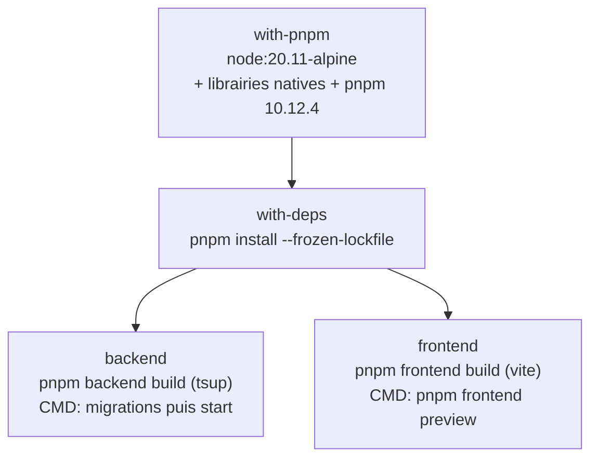
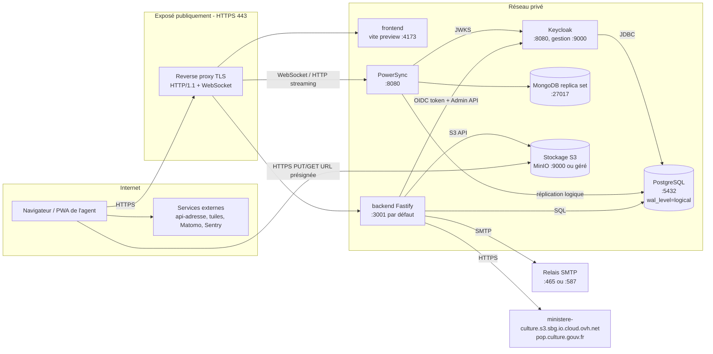
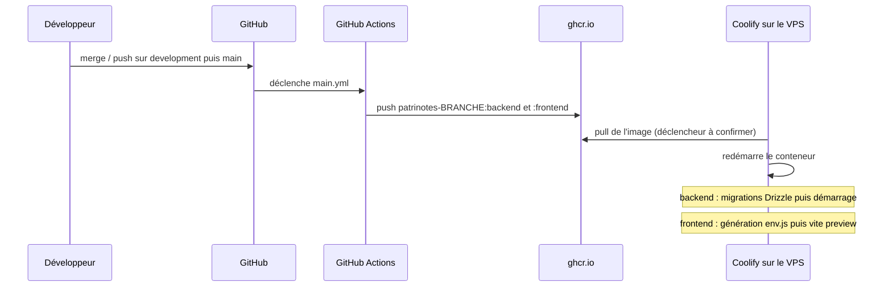

# 10 — Infrastructure et déploiement

Ce document décrit comment Patrinotes est construit, empaqueté et déployé : images Docker, intégration continue (GitHub Actions), fichiers Docker Compose, reliquats d'hébergements antérieurs (Scalingo, ancien domaine « Compte-rendu VIF ») et topologie cible de production.

> [!IMPORTANT]
> L'hébergement actuel est un VPS privé piloté par **Coolify**. La configuration Coolify (services déclarés, variables, volumes, domaines, reverse proxy) **n'est pas versionnée dans le dépôt**. Tout ce qui suit est déduit du code ; les points marqués « à confirmer » doivent être vérifiés dans Coolify avant la migration (voir [14 — Migration vers l'infrastructure du ministère](14-migration-vers-infra-ministere.md)).

La référence de toutes les variables d'environnement se trouve dans [11 — Configuration](11-configuration.md).

## 1. Vue d'ensemble

| Élément | Fichier | Rôle |
| --- | --- | --- |
| Image multi-étapes | [Dockerfile](../Dockerfile) | Construit deux images à partir du monorepo : `backend` et `frontend`. |
| CI de publication | [.github/workflows/main.yml](../.github/workflows/main.yml) | À chaque `push` sur `main`, `development` ou `compte-rendu-vif`, construit et pousse les deux images sur `ghcr.io`. |
| CI de tests E2E | [.github/workflows/tests.yml](../.github/workflows/tests.yml) | Tests Playwright, **déclenchement manuel uniquement**. |
| Dépendances de développement | [docker-compose.yaml](../docker-compose.yaml) | PostgreSQL, MongoDB, PowerSync, Keycloak, MinIO, Mailpit, Adminer pour le poste du développeur. |
| Dépendances de test | [docker-compose.test.yaml](../docker-compose.test.yaml) | Même pile, isolée (projet `patrinotes-test`), pilotée par [playwright.config.ts](../playwright.config.ts). |
| Configuration PowerSync | [powersync/powersync-config.yaml](../powersync/powersync-config.yaml), [powersync/sync-config.yaml](../powersync/sync-config.yaml) | Connexion à PostgreSQL, stockage MongoDB, validation des jetons, règles de synchronisation. |
| Initialisation PostgreSQL | [db/init/](../db/init/) | Crée la publication `powersync` et la base `keycloak` (uniquement au premier démarrage d'un volume vide). |
| Thème Keycloak | [keycloak-theme.jar](../keycloak-theme.jar) | Thème DSFR (Keycloakify) pour les écrans Keycloak. |
| Reliquat Scalingo | [Procfile](../Procfile), [scalingo.json](../scalingo.json) | Ancien hébergement, obsolète. |
| Redirection de l'ancien domaine | [crvif-redirection/](../crvif-redirection/) | Site statique qui renvoie vers `app.patrinotes.beta.gouv.fr` et désinstalle l'ancien service worker. |

## 2. Le Dockerfile

Le [Dockerfile](../Dockerfile) est **unique et multi-étapes**. Il produit deux cibles (`--target backend` et `--target frontend`) qui partagent les mêmes couches de base.



### 2.1 Étape `with-pnpm` (image de base)

- Image : `node:20.11-alpine` ([Dockerfile#L4](../Dockerfile#L4)).
- Paquets Alpine installés ([Dockerfile#L5-L15](../Dockerfile#L5-L15)) : `build-base`, `g++`, `cairo-dev`, `jpeg-dev`, `pango-dev`, `giflib-dev`, `pixman-dev`, `pangomm-dev`, `libjpeg-turbo-dev`, `freetype-dev`. Ce sont les prérequis de compilation du module natif **`canvas`** (node-canvas), déclaré dans les dépendances du backend ([packages/backend/package.json#L58](../packages/backend/package.json#L58)) et autorisé à exécuter son script de build dans `pnpm.onlyBuiltDependencies` ([package.json](../package.json)). Aucun `import "canvas"` direct n'existe dans `packages/backend/src` : il est vraisemblablement chargé indirectement (par `jsdom` ou la chaîne `@react-pdf`, à confirmer). Il est aussi marqué `external` dans [tsup.config.ts](../packages/backend/tsup.config.ts).
- Les paquets `-dev` et la chaîne de compilation restent dans l'image finale (pas d'étape d'exécution allégée) : images lourdes et surface d'attaque plus large que nécessaire.
- pnpm est installé globalement en version **10.12.4** ([Dockerfile#L16](../Dockerfile#L16)).

> [!WARNING]
> **Incohérence des versions de pnpm.** Le [README](../README.md#L6) exige `pnpm = 8.4.0`, le Dockerfile installe `pnpm@10.12.4`, et le [package.json](../package.json) racine **ne déclare pas** de champ `packageManager`. La CI de tests utilise `pnpm/action-setup@v4` sans version explicite ([tests.yml#L19-L22](../.github/workflows/tests.yml#L19-L22)), ce qui échoue normalement en l'absence de `packageManager` (à confirmer). La version de référence de fait est **10.12.4** (celle qui produit les images de production) ; le format du `pnpm-lock.yaml` et la clé `pnpm.onlyBuiltDependencies` (pnpm ≥ 9) le confirment. Il faut ajouter `"packageManager": "pnpm@10.12.4"` et corriger le README.

> [!NOTE]
> **Version de Node.** L'image fige `node:20.11` ; le README demande `node >= 20` ; la CI E2E utilise Node 20. Node 20 n'est plus maintenu depuis avril 2026 : la montée vers Node 22 ou 24 LTS est à faire avant ou pendant le transfert.

### 2.2 Étape `with-deps` (installation)

- Copie des manifestes (`package.json`, `pnpm-lock.yaml`, `pnpm-workspace.yaml`), du dossier [patches/](../patches/) (correctif de `react-pdf-html@2.0.4`) et des `package.json` des trois paquets ([Dockerfile#L24-L33](../Dockerfile#L24-L33)).
- Pour le frontend, copie aussi `public/`, `scripts/` et `vite.config.ts` **avant** l'installation : ils sont nécessaires aux scripts de cycle de vie.
- `pnpm install --frozen-lockfile` installe **toutes** les dépendances, y compris de développement : `drizzle-kit`, `vite`, `vite-node` et `tsup` sont nécessaires à l'exécution (migrations au démarrage, `vite preview`, génération de `env.js`).
- [.dockerignore](../.dockerignore) n'exclut que `dsfr/*` et `node_modules` : le contexte de build envoyé au démon Docker contient notamment le `.git`, le jar Keycloak (6,7 Mo) et un éventuel `.env` local. Le `.env` racine n'est pas copié dans l'image (seuls des sous-dossiers ciblés le sont), mais un `packages/*/.env` le serait. À durcir (ajouter `.git`, `.env*`, `*.jar`).

### 2.3 Cible `backend`

```dockerfile
RUN pnpm backend build
CMD pnpm migration:up;pnpm backend start
```

([Dockerfile#L41-L52](../Dockerfile#L41-L52))

- Copie `packages/backend`, `packages/pdf` et le dossier [db/](../db/) (migrations SQL Drizzle).
- `pnpm backend build` lance `tsup --publicDir` : bundle ESM unique `packages/backend/dist/index.js`, plus copie du dossier `public/` (polices Marianne, logos utilisés dans les courriels).
- **Au démarrage, le conteneur exécute d'abord les migrations** (`pnpm migration:up` → `drizzle-kit migrate`), puis `pnpm backend start` (`cross-env NODE_ENV=production node ./dist/index.js`).

Points d'attention (règles cachées) :

1. **Le séparateur est `;` et non `&&`** : si les migrations échouent, le serveur démarre quand même sur un schéma non migré. L'échec n'apparaît que dans les logs.
2. **Les migrations n'utilisent pas `DATABASE_URL`** mais `POSTGRES_HOST`, `POSTGRES_PORT`, `POSTGRES_USER`, `POSTGRES_PASSWORD`, `POSTGRES_DB`, avec **`ssl: false` codé en dur** ([drizzle.config.ts](../packages/backend/drizzle.config.ts#L4-L16)). Les deux jeux de variables doivent pointer sur la même base.
3. `drizzle.config.ts` importe [envVars.ts](../packages/backend/src/envVars.ts) : **toute la validation Zod du backend s'applique aussi aux migrations**. Une variable obligatoire manquante (même sans rapport avec la base, par exemple `EMAIL_EMITTER`) fait échouer la migration… puis, à cause du point 1, le démarrage échoue de la même façon.
4. Le démarrage en mode forme CMD *shell* (`CMD pnpm …`) : le processus PID 1 est `/bin/sh`, les signaux (`SIGTERM`) ne sont pas relayés proprement à Node ; les arrêts se font par `SIGKILL` après le délai de grâce.
5. Plusieurs répliques du backend lanceraient les migrations en parallèle au démarrage. Drizzle n'utilise pas de verrou consultatif (à confirmer) : **garder une seule réplique**, ou sortir les migrations dans une tâche dédiée.
6. Les migrations Drizzle exécutent `ALTER PUBLICATION powersync ADD TABLE …` ([db/0000_bright_stone_men.sql#L183](../db/0000_bright_stone_men.sql#L183)) : la publication `powersync` doit exister **avant** la première migration (voir § 4.2).
7. Au démarrage, le backend insère le service technique `no-service` s'il n'existe pas ([index.ts](../packages/backend/src/index.ts#L34-L39)) ; si `FORCE_REFETCH_POP=true`, il télécharge et importe les CSV POP (Mérimée, Palissy) depuis `ministere-culture.s3.sbg.io.cloud.ovh.net` avant d'ouvrir le port, ce qui retarde fortement le démarrage et écrit des fichiers temporaires dans `packages/backend/data/` (système de fichiers inscriptible requis).
8. Le serveur écoute sur `0.0.0.0:${PORT}` (3001 par défaut). L'image ne déclare pas `EXPOSE`. Sonde de santé : `GET /health` → `{"status":"ok"}` (ne teste ni la base ni S3).

### 2.4 Cible `frontend`

```dockerfile
RUN pnpm frontend build
CMD ["pnpm", "frontend", "preview"]
```

([Dockerfile#L58-L64](../Dockerfile#L58-L64))

- `pnpm frontend build` = `react-dsfr update-icons` (prébuild) puis `vite build`, puis `setVersion.ts` qui écrit `dist/version.js` avec `window.APP_VERSION = "<version package>.<horodatage hexadécimal>"` ([setVersion.ts](../packages/frontend/scripts/setVersion.ts)).
- Au démarrage, le script `preview` exécute **`pnpm env:gen && vite preview --host`** ([packages/frontend/package.json#L10](../packages/frontend/package.json#L10)) :
  - `env:gen` lance [createEnvFile.ts](../packages/frontend/scripts/createEnvFile.ts), qui lit **toutes les variables d'environnement préfixées `VITE_`** du conteneur et écrit `dist/env.js` (`window.ENV = {…}`) et `dist/swEnv.js` (`self.ENV = {…}`). C'est l'**injection de configuration à l'exécution** : la même image sert tous les environnements.
  - `vite preview --host` sert ensuite `dist/` sur le port **4173** (port par défaut de `vite preview`, non surchargé).

Implications pour la production :

- **`vite preview` n'est pas un serveur de production** (la documentation Vite le déconseille explicitement) : mono-processus Node, pas de maîtrise fine des en-têtes de cache, de compression ni de sécurité (CSP, HSTS…). Un serveur statique (nginx, Caddy) ou le reverse proxy du ministère serait plus adapté — à condition de reproduire la génération de `env.js` au démarrage.
- **Liste blanche d'hôtes codée en dur.** `vite preview` rejette (HTTP 403 « Blocked request ») tout en-tête `Host` absent de `preview.allowedHosts` ([vite.config.ts#L73-L82](../packages/frontend/vite.config.ts#L73-L82)) : `app.patrinotes.beta.gouv.fr`, `app.patrinotes.incubateur.net`, `app.compte-rendu-vif.beta.gouv.fr`, `compte-rendu-vif.incubateur.net`, `.compte-rendu-vif.incubateur.net`, `patrinotes.incubateur.net`. **Tout nouveau nom de domaine (y compris un nom de recette du ministère) impose une modification du code et une reconstruction de l'image.**
- Le système de fichiers du conteneur doit être **inscriptible** (`dist/env.js` est réécrit à chaque démarrage).
- **Toute variable `VITE_*` présente dans l'environnement du conteneur est publiée** dans `env.js`, lisible par n'importe qui. Ne jamais donner un préfixe `VITE_` à un secret. Les valeurs sont insérées entre guillemets sans échappement : une valeur contenant `"` casse `env.js`.
- `env.js` est exclu du précache du service worker et servi en *network-first* ([sw.ts#L20](../packages/frontend/src/service-worker/sw.ts#L20)) : un changement de configuration est pris en compte au prochain chargement en ligne. Les pages de navigation sont aussi en *network-first* en production.
- `swEnv.js` est généré mais n'est importé nulle part (le service worker n'a pas besoin de la configuration en pratique) : reliquat.

## 3. Intégration continue (GitHub Actions)

### 3.1 Publication des images — `main.yml`

[.github/workflows/main.yml](../.github/workflows/main.yml) :

- Déclencheur : `push` sur les branches **`main`**, **`development`**, **`compte-rendu-vif`**.
- Deux jobs parallèles (`build-and-push-backend`, `build-and-push-frontend`), même `Dockerfile`, cibles différentes.
- Registre : `ghcr.io` (GitHub Container Registry), authentification par `GITHUB_TOKEN` (permission `packages: write`).
- Nom d'image : `${{ github.repository }}-${{ github.ref_name }}`, soit pour le dépôt `betagouv/patrinotes` :

| Branche | Image backend | Image frontend |
| --- | --- | --- |
| `main` | `ghcr.io/betagouv/patrinotes-main:backend` | `ghcr.io/betagouv/patrinotes-main:frontend` |
| `development` | `ghcr.io/betagouv/patrinotes-development:backend` | `ghcr.io/betagouv/patrinotes-development:frontend` |
| `compte-rendu-vif` | `ghcr.io/betagouv/patrinotes-compte-rendu-vif:backend` | `ghcr.io/betagouv/patrinotes-compte-rendu-vif:frontend` |

Règles cachées :

- **Le tag est le nom du composant (`backend` / `frontend`) et non une version.** Chaque `push` écrase le tag précédent : il n'existe **aucun tag immuable** (SHA de commit, numéro de version). Revenir en arrière suppose de connaître le *digest* de l'image précédente ou de reconstruire un ancien commit (voir § 8).
- Aucun test, *lint* ni contrôle de type n'est exécuté avant la publication : un commit qui casse le build échoue la CI, mais un commit qui compile et casse le fonctionnement est publié.
- Aucun scan de vulnérabilités ni signature d'image.
- La CI ne déclenche pas elle-même le déploiement. Le redéploiement est vraisemblablement déclenché par Coolify (webhook ou surveillance du registre) — **à confirmer dans Coolify**.
- La branche `compte-rendu-vif` porte l'ancien nom du produit. Son usage actuel (ancienne production ? environnement oublié ?) est **à confirmer**.

### 3.2 Tests de bout en bout — `tests.yml`

[.github/workflows/tests.yml](../.github/workflows/tests.yml) : déclenchement **manuel** (`workflow_dispatch`) uniquement. Node 20, `pnpm install`, Chromium Playwright, puis `pnpm e2e`. Playwright démarre lui-même :

1. la pile `docker-compose.test.yaml` (`up --wait`), attendue via le conteneur `healthcheck` sur `HEALTHCHECK_PORT` ;
2. `pnpm migration:up && pnpm backend dev` (attendu sur `/health`) ;
3. `pnpm frontend dev --mode test`.

Variables lues dans [.env.test](../.env.test) (ports 3010 à 3019). Le rapport HTML est publié comme artefact pendant 7 jours. En CI (`CI=true`), la pile est détruite avec ses volumes à la fin ([tests/teardown.ts](../tests/teardown.ts)).

## 4. Docker Compose

### 4.1 `docker-compose.yaml` (développement local)

| Service | Image | Ports exposés sur l'hôte | Rôle | En production ? |
| --- | --- | --- | --- | --- |
| `pg` | `postgres:17-alpine` | `${POSTGRES_PORT}:5432` | Base principale **et** base Keycloak. Lancée avec `wal_level=logical` (réplication logique pour PowerSync). Monte `db/init/` en scripts d'initialisation. | **Oui** (service géré ou conteneur). |
| `mongo` | `mongo:7.0` | `27017:27017` (fixe) | Stockage interne de PowerSync (*buckets*). Lancé en *replica set* `rs0` (exigé par PowerSync). | **Oui**, interne uniquement. |
| `mongo-rs-init` | `mongo:7.0` | — | Tâche ponctuelle : `rs.initiate()` du *replica set*. | Équivalent requis. |
| `powersync` | `journeyapps/powersync-service:latest` | `${POWERSYNC_PORT}:8080` | Service de synchronisation (HTTP + WebSocket). Mode `start -r unified` (API et réplication dans le même processus). | **Oui**, public. |
| `adminer` | `adminer` | `${ADMINER_PORT}:8080` | Interface web d'administration SQL. | **Non** (outil de développement ; ne jamais l'exposer). |
| `minio` | `minio/minio` | `${MINIO_SERVER_PORT}:9000`, `${MINIO_CONSOLE_PORT}:9001` | Stockage objet compatible S3 (pièces jointes, PDF). | Oui **ou** S3 géré. |
| `minio-init` | `minio/mc` | — | Crée le bucket, un utilisateur applicatif et lui attache la politique `readwrite`. | Équivalent requis. |
| `keycloak` | `quay.io/keycloak/keycloak:26.3.5` | `${KEYCLOAK_PORT}:8080` | Fournisseur d'identité. Lancé en **`start-dev --import-realm`**, realm importé depuis [tests/realm-template.json](../tests/realm-template.json) via [tests/keycloak-entrypoint.sh](../tests/keycloak-entrypoint.sh) (`envsubst`). | **Oui**, mais en mode `start` (production). |
| `mailpit` | `axllent/mailpit` | `${SMTP_PORT}:1025`, `${SMTP_WEB_PORT}:8025` | Faux serveur SMTP qui capture les courriels. | **Non** : remplacé par un relais SMTP réel. |

Le backend et le frontend **ne sont pas** dans ce fichier : en développement ils tournent sur le poste (`pnpm backend dev`, `pnpm frontend dev`).

Remarques :

- `version: "3.1"` est obsolète (ignoré par Compose v2).
- **`powersync-service:latest` n'est pas épinglé** : un redémarrage peut changer de version majeure. À figer en production.
- `minio-init` utilise `$MINIO_ACCESS_KEY_ID` dans sa commande alors que l'environnement du conteneur ne définit que `MINIO_ACCESS_KEY`. Cela fonctionne uniquement parce que Compose interpole `$VAR` dans tout le fichier à partir du `.env` de l'hôte : il faut donc que `.env` contienne `MINIO_ACCESS_KEY_ID`. Fragile.
- Le volume `mongo_storage` est déclaré mais le [README](../README.md#L88) indique que Mongo « n'a pas besoin d'être persistant » : sa perte force PowerSync à tout re-répliquer (voir [14](14-migration-vers-infra-ministere.md)).
- **Le thème `keycloak-theme.jar` n'est monté par aucun fichier Compose.** C'est un jar Keycloakify (thèmes `DSFR` pour `login` et `account`, plus l'extension `account-v1` de Phase Two). Il doit être copié dans `/opt/keycloak/providers/` du Keycloak de production, puis le thème `DSFR` sélectionné dans le realm. Il lit les variables `DSFR_THEME_HOME_URL`, `DSFR_THEME_SERVICE_TITLE`, `DSFR_THEME_BRAND_TOP` (via `${env.…}` dans ses `theme.properties`). Le mode de montage actuel en production est **à confirmer**. Note : les utilisateurs finaux ne voient en pratique jamais les écrans Keycloak (voir § 6.3).

### 4.2 Scripts d'initialisation PostgreSQL — `db/init/`

| Fichier | Contenu | Effet |
| --- | --- | --- |
| [0_create-publication.sql](../db/init/0_create-publication.sql) | `CREATE PUBLICATION powersync;` | Publication vide ; les migrations y ajoutent les tables. |
| [1_create_keycloak.sql](../db/init/1_create_keycloak.sql) | `CREATE DATABASE keycloak;` | Base de Keycloak dans **la même instance** PostgreSQL, avec le **même utilisateur** (`KC_DB_USERNAME: ${POSTGRES_USER}`). |

Ces scripts ne s'exécutent **qu'au premier démarrage d'un volume vide** (mécanisme `docker-entrypoint-initdb.d`). Sur une base gérée ou restaurée, ils doivent être rejoués à la main.

> [!WARNING]
> **Tables synchronisées absentes de la publication.** Les migrations ajoutent à la publication `powersync` : `user`, `delegation`, `service_instructeurs`, `clause_v2`, `pdf_snapshot`, `tmp_pictures`, `picture_lines`, `pictures`, `transactions`, `report`, `sent_email`, `suggested_email`, `udap` (renommée ensuite `service`, ce qui conserve l'appartenance), `user_settings`, `state_report`, `pop_immeubles`, `user_dept`, `visited_section`, `report_attachment`, `state_report_attachment`, `visited_section_attachment`, `pop_objets`, `state_report_alert`, `state_report_alert_attachment`. **`constat_validation`, lue par les règles de synchronisation ([sync-config.yaml#L59](../powersync/sync-config.yaml#L59)), n'est ajoutée par aucune migration** ([db/0019_bouncy_falcon.sql](../db/0019_bouncy_falcon.sql) crée la table sans `ALTER PUBLICATION`). L'équipe confirme qu'elle **n'est pas non plus dans la publication de production**. C'est sans effet aujourd'hui, car le frontend ne déclare ni n'utilise cette table. Vérifier tout de même le contenu de la publication avant et après migration avec `SELECT * FROM pg_publication_tables WHERE pubname = 'powersync';`.

### 4.3 `docker-compose.test.yaml` (tests E2E)

Même pile que le développement, avec les différences suivantes ([docker-compose.test.yaml](../docker-compose.test.yaml)) :

- nom de projet `patrinotes-test`, ports 3010–3019 issus de [.env.test](../.env.test) ;
- **PostgreSQL 14** (contre 17 en développement) : l'application est donc testée sur PG 14 ;
- aucun volume persistant pour `pg` et `minio` ;
- *healthchecks* sur Mongo (`rs.status().ok`) et PowerSync (`GET /probes/liveness`) ;
- un conteneur `nginx:alpine` nommé `healthcheck` qui ne devient sain que lorsque toutes les dépendances le sont (point d'attente pour Playwright) ;
- `minio-init` crée le bucket en dur `my-bucket` ;
- pas d'Adminer.

### 4.4 Configuration PowerSync versionnée

[powersync/powersync-config.yaml](../powersync/powersync-config.yaml) contient des valeurs **codées en dur** qui ne conviennent qu'à un réseau Docker où les services s'appellent `mongo` et `keycloak` :

| Clé | Valeur | Commentaire |
| --- | --- | --- |
| `replication.connections[0].uri` | `!env PS_DATABASE_URL` | Variable. |
| `replication.connections[0].sslmode` | `disable` | **Pas de TLS vers PostgreSQL.** À changer si la base du ministère impose TLS. |
| `storage.uri` | `mongodb://mongo:27017/powersync_demo` | En dur, sans authentification. |
| `port` | `!env PS_PORT` | 8080 dans Compose. |
| `client_auth.jwks_uri` | `http://keycloak:8080/realms/master/protocol/openid-connect/certs` | En dur : nom d'hôte interne **et** realm `master`. |
| `client_auth.issuer` | `http://keycloak:8080/realms/master` | En dur. Doit être identique à l'`iss` des jetons émis par Keycloak. |
| `client_auth.audience` | `["account"]` | Audience par défaut des jetons d'accès Keycloak. |
| `telemetry.disable_telemetry_sharing` | `false` | **La télémétrie anonyme vers JourneyApps est active** (flux sortant). |

Le fichier monté en production par Coolify est-il celui du dépôt ? **À confirmer.** Si oui, cela implique que le backend appelle Keycloak par l'URL interne `http://keycloak:8080` (`VITE_AUTH_URL`) et que l'émetteur des jetons est `http://keycloak:8080/realms/master` (déduction, voir [11](11-configuration.md)).

## 5. Reliquats d'hébergements antérieurs

### 5.1 Scalingo — `Procfile` et `scalingo.json`

- [Procfile](../Procfile) déclare **deux fois** le type de processus `web` (`pnpm frontend dev`, puis `pnpm backend dev`) : seul l'un des deux serait retenu, et il s'agit de serveurs de **développement**.
- [scalingo.json](../scalingo.json) référence un buildpack pnpm tiers, un `repository` invalide (`"h"`) et un add-on PostgreSQL *sandbox*. Le nom affiché est « Compte-rendu VIF ».

**Conclusion : obsolète**, non utilisé par la chaîne actuelle (Docker + Coolify). À supprimer pour éviter toute confusion lors de la revue.

### 5.2 Redirection de l'ancien domaine — `crvif-redirection/`

Le produit s'appelait « Compte-rendu VIF » (CR VIF) avant de devenir Patrinotes. Le dossier [crvif-redirection/](../crvif-redirection/) est un **site statique** destiné à être servi sur l'ancien domaine (vraisemblablement `app.compte-rendu-vif.beta.gouv.fr`, à confirmer) :

- [index.html](../crvif-redirection/index.html) : redirection immédiate (meta refresh + JavaScript) vers `https://app.patrinotes.beta.gouv.fr`, après avoir désinscrit tous les service workers du domaine ;
- [sw.js](../crvif-redirection/sw.js) : un service worker de remplacement. Les navigateurs vérifient périodiquement le script `/sw.js` du service worker installé ; ils récupèrent celui-ci, qui s'active (`skipWaiting`), **se désinscrit**, puis redirige tous les onglets ouverts vers le nouveau domaine. Sans lui, l'ancienne PWA mise en cache continuerait de s'afficher indéfiniment sur l'ancien domaine.

> [!IMPORTANT]
> Ce mécanisme rappelle une contrainte forte : **la base locale (IndexedDB / SQLite) et l'installation PWA sont liées à l'origine (domaine)**. Changer de domaine fait perdre aux utilisateurs leurs données locales non synchronisées. Lors de la migration, **conserver le domaine `app.patrinotes.beta.gouv.fr`** est fortement recommandé (voir [14](14-migration-vers-infra-ministere.md)).

## 6. Topologie de production cible

### 6.1 Schéma



### 6.2 Composants, ports et exposition

| Composant | Port interne | Protocole | Exposé publiquement ? | Remarques |
| --- | --- | --- | --- | --- |
| Frontend | 4173 | HTTP | **Oui** (`app.patrinotes.beta.gouv.fr`) | Le nom d'hôte doit figurer dans `preview.allowedHosts`. |
| Backend | `PORT` (3001 par défaut ; valeur de production à confirmer) | HTTP (REST JSON, multipart) | **Oui** (URL = `VITE_BACKEND_URL` = `BACKEND_URL`) | CORS `origin: "*"` ([router.ts#L43-L45](../packages/backend/src/router.ts#L43-L45)). Liens de courriel `BACKEND_URL/attachment/:id` valables 90 jours. |
| PowerSync | 8080 (`PS_PORT`) | HTTP + **WebSocket** | **Oui** (URL = `VITE_POWERSYNC_URL`) | Le proxy doit accepter l'*upgrade* WebSocket et des connexions longues (pas de coupure à 60 s). |
| Stockage S3 | 9000 (MinIO) | HTTP(S) S3 | **Oui**, au moins en lecture/écriture par URL présignée | Le navigateur envoie les pièces jointes et PDF **directement** sur `MINIO_URL` (PUT présigné) et y est redirigé en lecture. CORS du bucket à configurer. |
| Keycloak | 8080 (HTTP), 9000 (santé, métriques) | HTTP (OIDC) | **Non requis** pour les utilisateurs (déduction : le navigateur n'appelle jamais Keycloak) | Doit être joignable par le backend et PowerSync. Console d'administration à restreindre. |
| PostgreSQL | 5432 | PostgreSQL | **Non** | Réplication logique requise. |
| MongoDB | 27017 | MongoDB | **Non** | *Replica set* obligatoire. |
| Console MinIO | 9001 | HTTP | **Non** | Administration uniquement. |
| Adminer, Mailpit | — | — | **Absents en production** | Outils de développement. |

### 6.3 Ce que le navigateur appelle réellement

Déduit du code frontend :

- `VITE_BACKEND_URL` (API, rafraîchissement de jeton, *upload-data*, PDF, statistiques) ;
- `VITE_POWERSYNC_URL` (flux de synchronisation) ;
- l'URL S3 contenue dans les URL présignées (`MINIO_URL`) ;
- des services tiers : `api-adresse.data.gouv.fr`, `tiles.openfreemap.org`, `openmaptiles.geo.data.gouv.fr`, `data.geopf.fr`, `stats.beta.gouv.fr` (Matomo), Sentry (si `VITE_SENTRY_DSN`).

**Le navigateur n'appelle jamais Keycloak** : la connexion passe par un formulaire de l'application, et c'est le backend qui échange identifiant et mot de passe contre des jetons (*Resource Owner Password Credentials*) et crée les comptes via l'API d'administration Keycloak. `VITE_AUTH_URL`, `VITE_AUTH_REALM` et `VITE_AUTH_CLIENT_ID` sont validés par le schéma frontend ([envVars.ts](../packages/frontend/src/envVars.ts#L15-L22)) mais pas utilisés pour des appels.

## 7. Environnements

| Branche Git | Images | Usage supposé | Domaine(s) |
| --- | --- | --- | --- |
| `main` | `patrinotes-main:*` | Production | `app.patrinotes.beta.gouv.fr` (certain pour le frontend) ; domaines du backend, de PowerSync et de S3 **à confirmer** |
| `development` | `patrinotes-development:*` | Recette / préproduction (à confirmer) | Probablement `*.incubateur.net` (à confirmer) |
| `compte-rendu-vif` | `patrinotes-compte-rendu-vif:*` | Ancien environnement (à confirmer) | `app.compte-rendu-vif.beta.gouv.fr`, `*.compte-rendu-vif.incubateur.net` (déduits de `allowedHosts`) |

Les autres branches distantes (`e2e`, `feat/*`, `backup/*`, Dependabot) ne produisent pas d'image.

Différences de comportement selon `NODE_ENV` (backend) :

| Comportement | `development` | `test` | autre (dont `production`) |
| --- | --- | --- | --- |
| Liste blanche des adresses à l'inscription ([authService.ts#L336-L348](../packages/backend/src/services/authService.ts#L336-L348)) | **Désactivée** | Active | Active |
| Sentry | Désactivé | Actif si DSN | Actif si DSN |
| Pile d'erreur renvoyée au client | Oui | Non | Non |
| Fichier `.env` chargé | `../../.env` | `../../.env.test` | `../../.env` (s'il existe) |

`pnpm backend start` force `NODE_ENV=production`. Un `NODE_ENV` absent équivaut à la production (`isProd = !isDev && !isTest`).

## 8. Processus de livraison et retour arrière

### 8.1 Livraison (état actuel, déduit)



- Il n'y a ni numéro de version publié, ni changelog, ni étiquette Git de version. La version visible côté client est `window.APP_VERSION` (version de `packages/frontend/package.json` + horodatage du build).
- Les clients PWA récupèrent la nouvelle version au chargement suivant en ligne (service worker en `autoUpdate`, navigation *network-first*, rechargement forcé si un *chunk* JS ancien est introuvable — commits `a58df3d`, `50d14ce`).
- Avant de livrer une migration touchant des tables synchronisées : vérifier la publication `powersync`, le schéma client [AppSchema.ts](../packages/frontend/src/db/AppSchema.ts) et les règles [sync-config.yaml](../powersync/sync-config.yaml) ([README](../README.md#L107-L113)).

### 8.2 Retour arrière

| Élément | Possible ? | Procédure |
| --- | --- | --- |
| Image applicative | Difficile | Pas de tag immuable. Redéployer le *digest* précédent (`docker pull ghcr.io/…@sha256:…`, visible dans l'historique du paquet GHCR) ou faire un `git revert` sur la branche, ce qui republie l'image. |
| Migration de base | **Non automatisé** | Drizzle ne génère pas de migration descendante. Restaurer une sauvegarde ou écrire une migration corrective. Une migration de schéma incompatible avec l'ancienne image rend le retour arrière de l'image impossible sans restauration. |
| Configuration frontend | Oui | Modifier les variables `VITE_*` et redémarrer le conteneur (pas de rebuild). |
| Clients PWA | Partiel | Les clients ayant déjà chargé la nouvelle version la gardent jusqu'au prochain chargement en ligne. |

**Recommandations** : publier aussi un tag par SHA de commit (`:backend-<sha>`), découpler les migrations du démarrage, sauvegarder la base avant chaque livraison comportant une migration.
