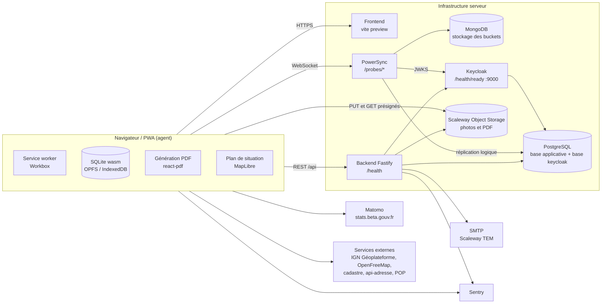
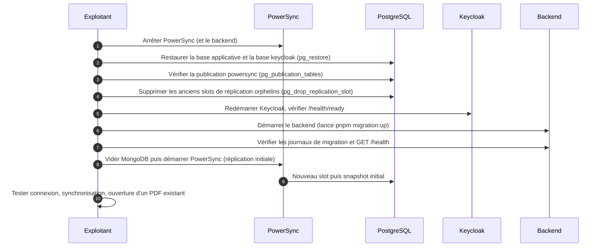
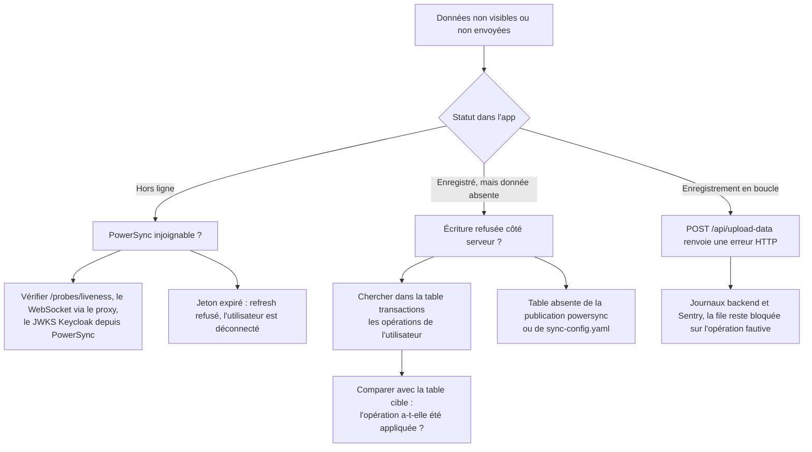
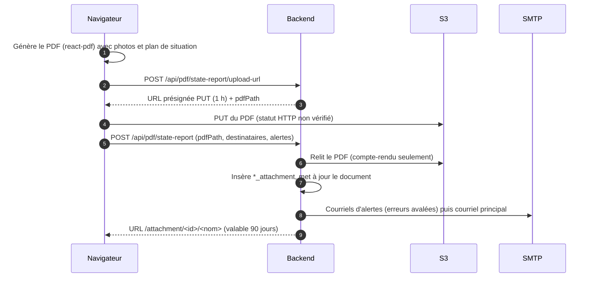

# 12 — Exploitation et supervision

Ce chapitre décrit ce qu'il faut savoir pour **faire tourner Patrinotes en production** : où sont les journaux, ce que
capte Sentry, quels points de contrôle de santé existent, ce qu'il faut superviser, sauvegarder et restaurer, les tâches
d'administration récurrentes et un **runbook** des incidents connus.

Tout ce qui suit est tiré du code du dépôt. L'infrastructure actuelle (VPS privé piloté par Coolify) n'est pas décrite
dans le dépôt : les éléments qui en dépendent sont marqués « à confirmer ». Les durées RPO/RTO sont des
**propositions** à valider avec le ministère.

> [!IMPORTANT]
> Point clé pour l'exploitation : l'application est **offline-first**. Une partie importante du travail (saisie,
> génération du PDF, génération des cartes, file d'envoi des photos) se fait **dans le navigateur de l'agent**. Une
> panne côté serveur ne se voit donc pas toujours tout de suite. À l'inverse, certaines erreurs côté client ne laissent
> **aucune trace** côté serveur (voir § 9).

---

## 1. Vue d'ensemble des composants à exploiter



| Composant | Image / runtime | Point de santé disponible | Données persistantes ? |
| --- | --- | --- | --- |
| Backend | `node:20.11-alpine`, cible `backend` du [Dockerfile](../Dockerfile#L41-L52) | `GET /health` (statique, voir § 3) | Non (sans état) |
| Frontend | cible `frontend` du [Dockerfile](../Dockerfile#L55-L64), sert via `vite preview` | Aucun dédié (`GET /`) | Non |
| PostgreSQL | `postgres:17-alpine` en dev ([docker-compose.yaml](../docker-compose.yaml#L10)), `postgres:14-alpine` en test | `pg_isready` | **Oui, critique** |
| PowerSync | `journeyapps/powersync-service:latest` (**non épinglé**) | `GET /probes/liveness` (utilisé par [docker-compose.test.yaml](../docker-compose.test.yaml#L90-L101)) | Non (reconstructible), voir § 6 |
| MongoDB | `mongo:7.0`, replica set `rs0` | `rs.status().ok` | Non (reconstructible) |
| Keycloak | `quay.io/keycloak/keycloak:26.3.5` | `GET /health/ready` sur le port de management 9000, `KC_METRICS_ENABLED=true` | Oui (base `keycloak` dans le même Postgres) |
| S3 (Scaleway en production, MinIO en dev) | `minio/minio` | `/minio/health/live` | **Oui, critique** |
| SMTP | externe | — | — |

---

## 2. Journalisation (logs)

### 2.1 Backend

Le backend **n'utilise pas le logger intégré de Fastify** : l'instance est créée sans option `logger`
([router.ts](../packages/backend/src/router.ts#L27)), donc Fastify ne journalise rien par lui-même (ni accès, ni temps de
réponse, ni code HTTP).

Les journaux viennent de deux sources :

1. **La bibliothèque `debug`** : [features/debug.ts](../packages/backend/src/features/debug.ts) active les espaces de noms
   donnés par la variable `DEBUG` (par défaut `cr-vif:*`, voir [envVars.ts](../packages/backend/src/envVars.ts#L37)).
   Chaque module crée un sous-espace : `cr-vif:index`, `cr-vif:fastify`, `cr-vif:admin`, `cr-vif:sync-service`,
   `cr-vif:upload`, `cr-vif:pdf-plugin`, `cr-vif:sync-pop`, `cr-vif:batch-writer`, etc.
2. **`console.log` / `console.error`** ponctuels, notamment `console.error(error)` dans le gestionnaire d'erreurs global
   ([router.ts](../packages/backend/src/router.ts#L58-L60)) et dans l'envoi des alertes
   ([pdfRoutes.tsx](../packages/backend/src/routes/pdfRoutes.tsx#L309-L311)).

Caractéristiques :

| Aspect | Constat |
| --- | --- |
| Format | Texte libre, **non structuré** (pas de JSON). Avec `debug`, hors TTY, chaque ligne est préfixée d'un horodatage ISO puis de l'espace de noms (comportement standard de `debug`, à confirmer sur l'image de production). |
| Niveaux | **Aucun niveau** (pas de info / warn / error). Le seul levier est le filtre `DEBUG` (ex. `DEBUG=cr-vif:pdf-plugin,cr-vif:sync-service`). |
| Destination | `debug` écrit sur **stderr**, `console.log` sur **stdout**. En conteneur, tout part donc dans les journaux du conteneur (Docker ou Coolify). Aucun fichier, aucune rotation propre à l'application. |
| Journal des requêtes | Un hook `onRequest` journalise `METHODE URL` pour **chaque requête** ([router.ts](../packages/backend/src/router.ts#L47-L48)), sans code retour ni durée. |
| Démarrage | `Running in <NODE_ENV> mode` puis `Server listening on <PORT>`. |

> [!WARNING]
> **Données personnelles dans les journaux.** Avec la valeur par défaut `DEBUG=cr-vif:*`, les journaux contiennent des
> courriels (`logging in user <email>`, `creating user <email>`), le contenu complet de l'objet utilisateur Keycloak
> (`fetched keycloak user …`), les destinataires des alertes, et les URL complètes des requêtes (avec leurs paramètres,
> par exemple `filePath`, le jeton de validation dans `/api/constat-validation/<token>`, ou l'identifiant
> `/attachment/<id>` qui suffit à télécharger un PDF pendant 90 jours). La conservation et l'accès à ces journaux doivent
> donc suivre les règles RGPD du ministère. **Proposition** : réduire `DEBUG` en production et fixer une durée de
> conservation.

### 2.2 Frontend

Dans le navigateur, les traces sont des `console.*` (y compris celles de PowerSync via `js-logger`). Elles ne remontent
au serveur que par Sentry (§ 2.3), si `VITE_SENTRY_DSN` est défini.

La version de l'application déployée est affichée en pied de page (« Version x.y.z.<horodatage hexadécimal> ») : elle
est écrite dans `dist/version.js` au build par [setVersion.ts](../packages/frontend/scripts/setVersion.ts). C'est
**l'information à demander en premier à un utilisateur** qui signale un problème (voir § 9.1).

### 2.3 Sentry

#### Backend — `SENTRY_DSN`

Initialisé dans [features/sentry.ts](../packages/backend/src/features/sentry.ts) avec `@sentry/node` **v7** :

- Actif **seulement si** `NODE_ENV !== "development"` **et** `SENTRY_DSN` défini. Attention : il est donc **aussi actif
  en `NODE_ENV=test`** si un DSN traîne dans l'environnement.
- `tracesSampleRate: 1.0` : 100 % des transactions sont échantillonnées (coût et volume à surveiller).
- Pas de `environment`, pas de `release`, pas de `beforeSend` : **aucune purge des données personnelles**, et pas de
  distinction entre préproduction et production (sauf DSN différents).

Ce qui est envoyé :

| Où | Quoi | Remarque |
| --- | --- | --- |
| Gestionnaire d'erreurs `/api/*` ([router.ts](../packages/backend/src/router.ts#L58-L70)) | `captureException(error, { data: { request: request.body, params } })` | **Toutes** les erreurs, y compris les `AppError` attendues (401/403/404/409). Le **corps de la requête** est joint : données métier, et **mots de passe en clair** pour `/api/login-user`, `/api/create-user` et `/api/reset-password` en cas d'erreur. |
| Envoi des courriels ([mail.ts](../packages/backend/src/features/mail.ts#L34)) | `captureMessage("Sending state report mail", { extra: { recipients, stateReport } })`, idem pour les comptes-rendus et les alertes | Un événement Sentry **à chaque envoi réussi**, avec le constat complet et les destinataires. C'est un usage de Sentry comme journal d'audit, qui fait du bruit et expose des données personnelles. |
| Envoi S3 ([uploadService.ts](../packages/backend/src/services/uploadService.ts#L40)) | Exceptions S3 avec `filePath` / `reportId` | — |
| Alertes ([pdfRoutes.tsx](../packages/backend/src/routes/pdfRoutes.tsx#L310)) | Exception par alerte en échec | L'erreur est **avalée** : la requête réussit quand même (§ 9.5). |

> [!NOTE]
> `AppError` n'hérite pas de `Error` ([errors.ts](../packages/backend/src/features/errors.ts)). Sentry reçoit donc un
> objet sans pile d'appel (« Non-Error exception captured »), ce qui gêne le tri.
>
> Les routes hors `/api` (`/attachment/:id`, `/health`) ne passent **pas** par ce gestionnaire.

#### Frontend — `VITE_SENTRY_DSN`

Initialisé dans [features/sentry.ts](../packages/frontend/src/features/sentry.ts) avec `@sentry/react` **v10** :

- Actif hors mode dev si `VITE_SENTRY_DSN` est présent dans `window.ENV` (injecté au démarrage du conteneur, voir
  [createEnvFile.ts](../packages/frontend/scripts/createEnvFile.ts)).
- `tracesSampleRate: 1.0`.
- `enableLogs: true` + `consoleLoggingIntegration({ levels: ["log", "info", "warn", "error"] })` : **tous les
  `console.log` du navigateur deviennent des logs Sentry** (commit `8010c6a misc: enable sentry logs`).
- L'`ErrorBoundary` racine envoie les plantages React avec la pile des composants
  ([main.tsx](../packages/frontend/src/main.tsx#L142-L145)).

> [!CAUTION]
> **Fuite de jetons et de données vers Sentry.** À cause de la capture de `console.log` :
>
> - [Connector.ts](../packages/frontend/src/db/Connector.ts#L68) journalise `{ ...apiStore }` au rafraîchissement du
>   jeton : **jeton d'accès, jeton de rafraîchissement et profil utilisateur** partent dans Sentry Logs.
> - [Connector.ts](../packages/frontend/src/db/Connector.ts#L36) journalise **chaque opération de synchronisation**
>   (`applying operation`) avec son contenu complet (constats, courriels de propriétaires, commentaires…).
>
> À corriger avant ou pendant le transfert (filtrer les niveaux `log` et `info`, ajouter un `beforeSendLog` /
> `beforeSend`, retirer ces `console.log`), et à signaler à l'équipe sécurité et au DPO.

### 2.4 Mesure d'audience

Matomo est câblé en dur : `https://stats.beta.gouv.fr/`, `siteId: 123` ([main.tsx](../packages/frontend/src/main.tsx#L132-L136)).
Lors du transfert, le ministère devra décider s'il garde l'instance beta.gouv.fr ou la sienne (à confirmer). Changer
d'instance demande une modification du code.

---

## 3. Points de santé (health checks)

| Composant | Point d'accès | Ce qu'il vérifie vraiment |
| --- | --- | --- |
| Backend | `GET /health` → `{"status":"ok"}` ([router.ts](../packages/backend/src/router.ts#L52-L54)) | **Seulement que le processus répond.** Ni Postgres, ni S3, ni Keycloak, ni SMTP ne sont testés. |
| PowerSync | `GET /probes/liveness` (et `/probes/startup`, `/probes/readiness` d'après la documentation PowerSync, à confirmer pour la version déployée) | État du service PowerSync |
| Keycloak | `GET /health/ready` sur le port **9000** (management), `/metrics` si `KC_METRICS_ENABLED` | Base Keycloak joignable |
| MinIO | `GET /minio/health/live` | Service S3 vivant |
| Postgres | `pg_isready` | Instance acceptant des connexions |
| Frontend | aucun, utiliser `GET /` | — |

> [!WARNING]
> Le backend démarre avec `CMD pnpm migration:up;pnpm backend start` ([Dockerfile](../Dockerfile#L52)). Le `;` fait que
> **le serveur démarre même si les migrations ont échoué**, et `/health` répondra OK. Après chaque déploiement, il faut
> contrôler dans les journaux que la migration s'est bien terminée.

**Proposition** : ajouter une route `/ready` qui teste Postgres (`select 1`) et S3 (`HeadBucket`), et s'en servir pour
la sonde de disponibilité de l'orchestrateur.

---

## 4. Supervision recommandée

Rien n'est fourni dans le dépôt (ni Prometheus, ni alerte). Voici ce qu'il est recommandé de surveiller, par ordre de
criticité.

### 4.1 PostgreSQL et slot de réplication logique (critique)

PowerSync lit Postgres par **réplication logique** (`wal_level=logical`, publication `powersync` créée par
[db/init/0_create-publication.sql](../db/init/0_create-publication.sql)). PowerSync crée et maintient un **slot de
réplication**. Si PowerSync est arrêté ou bloqué, Postgres **garde tous les WAL** depuis la dernière position confirmée :
le disque peut se remplir et **arrêter toute la base** (backend et Keycloak compris).

À surveiller :

```sql
-- Retard et volume de WAL retenu par slot
SELECT slot_name, active,
       pg_size_pretty(pg_wal_lsn_diff(pg_current_wal_lsn(), restart_lsn)) AS wal_retenu
FROM pg_replication_slots;

-- La publication couvre-t-elle bien les tables synchronisées ?
SELECT * FROM pg_publication_tables WHERE pubname = 'powersync';
```

Seuils proposés : alerte si `active = false` plus de 15 min, ou si le WAL retenu dépasse 1 à 2 Go (à ajuster selon le
disque). **Proposition** : régler `max_slot_wal_keep_size` pour éviter de saturer le disque. En contrepartie, PowerSync
devra refaire une réplication complète si le slot est invalidé.

> [!NOTE]
> La publication `powersync` est créée par le script d'initialisation **sans `FOR ALL TABLES`**
> (`CREATE PUBLICATION powersync;`). Les tables y sont ajoutées par les migrations (`ALTER PUBLICATION powersync ADD TABLE
> …`, par exemple [0000_bright_stone_men.sql](../db/0000_bright_stone_men.sql) ou
> [0011_petite_zarda.sql](../db/0011_petite_zarda.sql)). Une table oubliée **ne se synchronise pas**, sans aucune erreur
> (voir l'avertissement du [README](../README.md)).
>
> **Règle cachée pour une nouvelle infrastructure** : les scripts de [db/init/](../db/init/) ne sont exécutés que par
> l'image Docker Postgres, au **premier** démarrage d'un volume vide. Sur un Postgres managé, il faut d'abord exécuter
> à la main `CREATE PUBLICATION powersync;` et `CREATE DATABASE keycloak;`, et activer `wal_level=logical`. Sinon, les
> migrations qui modifient la publication échouent, et le backend démarre quand même (voir § 3).

Autres indicateurs Postgres : espace disque, nombre de connexions (le pool `pg` du backend utilise les valeurs par
défaut, soit 10 connexions), requêtes lentes (les routes de statistiques font de gros agrégats).

Croissance des tables à suivre :

- `transactions` : **une ligne par opération de synchronisation** envoyée par un client
  ([syncService.ts](../packages/backend/src/services/syncService.ts#L22-L35)), y compris les opérations refusées. Elle
  n'est **jamais purgée**. Elle sert de journal d'audit et de secours (§ 9.2).
- `attachment_redirection`, `constat_pdf_download`, `sent_email`, `state_report_sent_email`, `suggested_email`.
- `pop_immeubles`, `pop_objets`, `pop_images` (référentiels, voir § 7.1).

### 4.2 PowerSync et MongoDB

- Disponibilité de `/probes/liveness` et du WebSocket vu depuis l'extérieur.
- Journaux PowerSync : erreurs de réplication, erreurs JWKS (Keycloak injoignable depuis PowerSync, voir `jwks_uri` dans
  [powersync-config.yaml](../powersync/powersync-config.yaml#L21-L24), qui pointe en dur sur `http://keycloak:8080` et le
  realm `master`).
- Volume MongoDB (base `powersync_demo`, [powersync-config.yaml](../powersync/powersync-config.yaml#L13)).

> [!NOTE]
> Le bloc `telemetry` de [powersync-config.yaml](../powersync/powersync-config.yaml#L26-L30) est **indenté sous
> `client_auth`**, et `disable_telemetry_sharing` vaut `false`. La télémétrie anonyme vers JourneyApps est donc très
> probablement **active** (à confirmer). Pour le ministère, il faudra sans doute la désactiver, au bon niveau du YAML.

### 4.3 S3

- Disponibilité du point d'accès **depuis les navigateurs**. Les clients envoient les photos et les PDF directement sur
  S3 par URL présignée (`PUT`, [db.ts](../packages/frontend/src/db/db.ts#L52-L58),
  [ConstatPdf.queries.tsx](../packages/frontend/src/features/state-report/pdf/ConstatPdf.queries.tsx#L237-L249)). Le
  bucket doit donc être joignable publiquement, avec une configuration **CORS** qui autorise l'origine du frontend (à
  confirmer, rien dans le dépôt ne la configure).
- Taux d'erreurs 4xx/5xx et volume du bucket.
- Horloge des serveurs : les URL présignées sont signées par le backend, valables 1 h. Un décalage d'horloge les rend
  invalides.

### 4.4 SMTP

Aucune file d'attente : `nodemailer` envoie **de façon synchrone dans la requête HTTP**. Une panne SMTP fait échouer
l'envoi (erreur 500 et événement Sentry) ou, pour les alertes, est avalée silencieusement. À surveiller : délivrabilité
(SPF, DKIM et DMARC du domaine `EMAIL_EMITTER`), rebonds, et quotas du fournisseur.

### 4.5 Keycloak

- `/health/ready` et `/metrics` (port 9000).
- Échecs de connexion, comptes bloqués.
- Le backend appelle l'API d'administration de Keycloak (création de compte, mot de passe) en redemandant **un jeton
  `client_credentials` à chaque appel** ([keycloak.ts](../packages/backend/src/features/auth/keycloak.ts#L5-L28)) : une
  panne Keycloak bloque l'inscription, la connexion et le rafraîchissement des jetons, donc à terme la synchronisation.

### 4.6 Dépendances externes appelées par le navigateur

Le plan de situation et les cartes dépendent de services tiers, sans aucune solution de repli côté serveur :

| Service | Utilisation |
| --- | --- |
| `data.geopf.fr` (IGN Géoplateforme, WMTS et style PLAN.IGN) | Fond satellite et plan, snapshot 1:5000 du plan de situation |
| `tiles.openfreemap.org` | Style vectoriel « liberty » et polices |
| `openmaptiles.geo.data.gouv.fr/data/cadastre.json` | Couche cadastre |
| `api-adresse.data.gouv.fr` | Géocodage |
| `pop.culture.gouv.fr` | Liens vers les notices, récupération des images POP (côté backend) |
| `ministere-culture.s3.sbg.io.cloud.ovh.net/POP/*.csv` | Import des référentiels (côté backend) |

Si le ministère applique une politique CSP ou un proxy sortant, ces domaines doivent être autorisés.

---

## 5. Sauvegardes

### 5.0 Existant

D'après l'équipe, une **sauvegarde quotidienne** est en place et stockée sur S3. Le dépôt ne la décrit pas (elle est probablement planifiée dans Coolify). Restent à préciser, avant la bascule : le périmètre (base applicative, base `keycloak`, bucket de fichiers ?), l'outil, la rétention, l'emplacement (le même compte Scaleway que les données, ce qui ne protège pas d'une perte du compte) et la date du dernier test de restauration. Voir [18](18-questions-ouvertes.md), question P12.

### 5.1 Ce qu'il faut sauvegarder

| Élément | Criticité | Contenu | Remarque |
| --- | --- | --- | --- |
| Base Postgres applicative (`POSTGRES_DB`) | **Critique** | Utilisateurs, liste blanche, constats, comptes-rendus, alertes, validations, journal `transactions`, référentiels POP | Seule source de vérité des données métier |
| Base Postgres `keycloak` | **Critique** | Comptes, **mots de passe** (hachés), clients OIDC, configuration du realm | Créée par [db/init/1_create_keycloak.sql](../db/init/1_create_keycloak.sql) **dans la même instance** Postgres |
| Bucket S3 (`MINIO_BUCKET`) | **Critique** | Préfixe `attachment/` : photos, PDF des constats et comptes-rendus | Les liens envoyés par courriel pointent sur ces objets (90 jours) |
| Variables d'environnement / secrets | **Critique** | `JWT_SECRET`, secrets des clients Keycloak, identifiants S3 et SMTP, DSN Sentry | À stocker dans un coffre (Vault ou équivalent), **jamais** dans le dépôt |
| Configuration PowerSync | Moyenne | [powersync-config.yaml](../powersync/powersync-config.yaml), [sync-config.yaml](../powersync/sync-config.yaml) | Versionnée dans le dépôt |
| MongoDB (PowerSync) | **Non nécessaire** | Buckets calculés | Le README indique qu'elle « n'a pas besoin d'être persistante ». Une perte entraîne une **réplication initiale complète** de Postgres par PowerSync, puis une resynchronisation des clients. C'est acceptable, mais coûteux pendant quelques minutes (durée à mesurer). |
| Mailpit, Adminer | Aucune | Outils de dev | Ne pas déployer en production |

> [!WARNING]
> **Données non encore synchronisées.** Les modifications faites hors ligne ne vivent que dans le navigateur de l'agent
> jusqu'à leur envoi. Aucune sauvegarde serveur ne les couvre. Le bouton « Réinitialiser les données locales » (§ 9.2)
> **les efface définitivement**.

### 5.2 Méthode proposée

- **Postgres** : `pg_dump -Fc` quotidien **des deux bases** (applicative et `keycloak`), plus archivage continu des WAL
  (PITR) si l'infrastructure du ministère le permet. Rétention proposée : 30 jours glissants + 1 mensuelle sur 12 mois (à
  aligner sur la politique du ministère).
- **S3** : versioning du bucket + réplication vers un autre site, ou `mc mirror` / `rclone sync` quotidien.
- **Cohérence** : les lignes `*_attachment` et `attachment_redirection` référencent des clés S3. Restaurer une base plus
  récente que le bucket donne des liens cassés (404 ou `NoSuchKey`). Sauvegarder le bucket **après** la base, ou garder le
  versioning, limite ce risque.

### 5.3 Procédure de restauration (proposition)



Points d'attention :

- Après une restauration **dans le passé**, les clients ont des données locales plus récentes que le serveur. La
  synchronisation PowerSync renverra l'état du serveur, mais les opérations encore en file côté client seront rejouées
  (en « dernier écrit gagnant »). Les données perdues entre la sauvegarde et l'incident peuvent être **partiellement
  reconstruites depuis la table `transactions`** si elle a été sauvegardée séparément ou plus récemment (à étudier au cas
  par cas).
- La base `keycloak` et la table `user` de la base applicative sont liées par le **courriel**
  (`auth.parameter('email')` dans [sync-config.yaml](../powersync/sync-config.yaml)). Les deux doivent être restaurées au
  même point.

### 5.4 RPO / RTO (propositions)

| Indicateur | Proposition | Justification |
| --- | --- | --- |
| RPO base de données | 24 h avec `pg_dump` quotidien, ≤ 15 min avec archivage WAL | Les constats sont des actes administratifs. Une partie des saisies reste aussi en local chez les agents tant qu'elles ne sont pas synchronisées. |
| RPO S3 | 24 h (sync quotidienne), ~0 avec réplication et versioning | Photos et PDF ne sont pas reconstructibles côté serveur |
| RTO | 4 h ouvrées | Mode hors ligne : les agents peuvent continuer à saisir pendant la panne, mais ni envoyer, ni générer de PDF avec plan de situation, ni se connecter |
| RTO PowerSync seul | < 1 h | Sans état : redémarrage puis réplication initiale |

---

## 6. Déploiement et redémarrage : règles à connaître

- **Images** : le workflow [main.yml](../.github/workflows/main.yml) construit et pousse
  `ghcr.io/<owner>/<repo>-<branche>:backend` et `:frontend` à chaque push sur `main`, `development` et
  `compte-rendu-vif`. Les tags sont **mobiles** (pas de SHA) : impossible de revenir à une version précise sans
  reconstruire. **Proposition** : ajouter un tag par SHA de commit.
- **Migrations** : jouées automatiquement au démarrage du backend (voir § 3, le `;`). Si elles touchent des tables
  synchronisées, suivre la procédure PowerSync citée dans le [README](../README.md) : publication, schéma frontend
  [AppSchema.ts](../packages/frontend/src/db/AppSchema.ts), puis redéploiement de la configuration de synchronisation.
- **Variables du frontend à l'exécution** : `vite preview` lance d'abord `env:gen`, qui écrit `dist/env.js` et
  `dist/swEnv.js` à partir des variables `VITE_*` **présentes dans le conteneur au démarrage**. Les variables `VITE_*`
  sont donc des variables **d'exécution**, et non de build, pour le frontend de production.
  `env.js` est exclu du précache et servi en `NetworkFirst` par le service worker
  ([sw.ts](../packages/frontend/src/service-worker/sw.ts#L20), [vite.config.ts](../packages/frontend/vite.config.ts#L56)).
- **Noms d'hôte** : `vite preview` n'accepte que les hôtes listés dans `preview.allowedHosts`
  ([vite.config.ts](../packages/frontend/vite.config.ts#L73-L82)). **Un nouveau domaine ministériel doit y être
  ajouté**, sinon le frontend renvoie une erreur « Blocked request ».
- **Import POP au démarrage** : si `FORCE_REFETCH_POP=true`, le backend télécharge et importe les référentiels **avant**
  d'ouvrir son port ([index.ts](../packages/backend/src/index.ts#L16-L19)). Le démarrage peut alors prendre plusieurs
  minutes, et une sonde de santé trop stricte tuera le conteneur en boucle. Remettre la variable à `false` après usage.
- **Service par défaut** : au démarrage, le backend crée si besoin le service technique `no-service` (invisible)
  ([index.ts](../packages/backend/src/index.ts#L35-L40)). Ne pas le supprimer.
- **SSL Postgres** : le pool est créé avec `ssl: false` en dur ([db.ts](../packages/backend/src/db/db.ts#L11)). La
  variable `DATABASE_REQUIRE_SSL` présente dans `.env.test` **n'est lue nulle part**. PowerSync est aussi en
  `sslmode: disable`. Si le ministère impose TLS vers Postgres, il faudra modifier le code.
- **Fichier `.env`** : le backend charge `../../.env` **relativement au répertoire courant**
  ([envVars.ts](../packages/backend/src/envVars.ts#L7-L12)), ce qui suppose un lancement depuis `packages/backend` (c'est
  le cas avec `pnpm backend …`). En conteneur, les variables viennent de l'environnement. Le schéma zod fait **planter le
  démarrage** si une variable obligatoire manque.
- `NODE_ENV` absent ou différent de `development` et `test` = **mode production** (`isProd = !isDev && !isTest`).

---

## 7. Tâches d'administration et tâches récurrentes

> Il n'existe **aucune tâche planifiée** (pas de cron, pas de file de jobs) dans le code. Les seuls traitements
> périodiques tournent **dans le navigateur** (file des pièces jointes PowerSync toutes les 30 s,
> [db.ts](../packages/frontend/src/db/db.ts#L100)).

### 7.1 Import des référentiels Monuments historiques (POP)

Source : [features/data/pop.ts](../packages/backend/src/features/data/pop.ts).

| Étape | Source | Table | Comportement |
| --- | --- | --- | --- |
| Immeubles (Mérimée) | `https://ministere-culture.s3.sbg.io.cloud.ovh.net/POP/merimee.csv` | `pop_immeubles` | Téléchargement dans `./data/merimee.csv`, puis upsert par lots de 500 sur `reference` |
| Objets (Palissy) | `…/POP/palissy.csv` | `pop_objets` | **Ignoré si la table n'est pas vide.** Une mise à jour demande de vider la table au préalable. |
| Images | scraping de `https://pop.culture.gouv.fr/notice/{merimee,palissy}/<ref>` | `pop_images` | Lots de 50 avec pause, reprise selon `last_image_check_at` |

Lancement :

```bash
# En tâche ponctuelle (depuis la racine du dépôt, avec .env)
pnpm backend import-pop        # = vite-node ./src/features/data/pop.ts --standalone
# Ou au démarrage du backend
FORCE_REFETCH_POP=true          # immeubles + objets (sans les images)
```

Règles cachées :

- Le CSV est écrit dans `./data/` relatif au répertoire courant (`packages/backend/data/`), qui doit être accessible en
  écriture. Le fichier est supprimé après l'import, sauf en cas d'échec en cours de route.
- `import-pop` passe par `vite-node`, une **dépendance de développement**. L'image de production contient bien les
  `devDependencies` (`pnpm install` sans `--prod`), mais c'est fragile.
- Les lignes sans `reference` sont ignorées, les doublons dans un lot sont dédupliqués (le premier gagne).
- Aucune suppression : un monument retiré de POP reste en base.
- **Fréquence proposée** : mensuelle, ou à chaque mise à jour du jeu de données sur data.gouv.fr. Aucun automatisme
  n'existe.
- [scripts/fill-db.sh](../scripts/fill-db.sh) charge [scripts/db/service.sql](../scripts/db/service.sql) (liste des
  services / UDAP) dans un conteneur de dev nommé `compte-rendu-vif-pg-1`. C'est un outil de dev, pas une procédure de
  production.

### 7.2 Liste blanche (« liste d'utilisateurs autorisés »)

- L'inscription n'est possible que si le courriel figure dans la table `whitelist`
  ([authService.ts](../packages/backend/src/services/authService.ts#L336-L349)), **sauf en `NODE_ENV=development`**, où
  la vérification est désactivée.
- La comparaison est **exacte et sensible à la casse** (`=` SQL). `Jean.Dupont@culture.gouv.fr` et
  `jean.dupont@culture.gouv.fr` sont donc deux courriels différents.
- Retirer un courriel de la liste blanche **ne désactive pas** un compte existant. Ce retrait ne fait que bloquer une
  nouvelle inscription. Pour couper l'accès, il faut désactiver l'utilisateur dans **Keycloak**.
- Message de refus : renvoie vers `contact@patrinotes.beta.gouv.fr` (en dur). Adresse à changer lors du transfert.

### 7.3 Pages d'administration

Route frontend `/admin` ([admin.lazy.tsx](../packages/frontend/src/routes/admin.lazy.tsx)), réservée aux comptes dont
`internal_user.role = 'admin'` (contrôle serveur dans [adminMiddleware.ts](../packages/backend/src/routes/adminMiddleware.ts)) :

| Onglet | Fonctions | API |
| --- | --- | --- |
| Whitelist | Liste paginée, triable et filtrable (courriel, date, compte créé ?, dernier constat créé ou finalisé), ajout, suppression, export CSV | `GET/POST/DELETE /api/admin/whitelist`, `GET /api/admin/whitelist/export` |
| Utilisateurs | Liste paginée et filtrable (nom, courriel, fonction, service, département, rôle, date), export CSV | `GET /api/admin/users`, `GET /api/admin/users/export` |

Page `/stats` : statistiques publiques (sans authentification, `GET /api/stats/public`) et section admin
(`GET /api/stats/admin`).

> [!IMPORTANT]
> **Aucune interface ne permet de nommer un administrateur.** Il faut le faire en SQL (c'est aussi ce que font les tests,
> [admin.spec.ts](../tests/admin.spec.ts#L28)) :
>
> ```sql
> UPDATE internal_user SET role = 'admin' WHERE email = '<courriel>';
> ```
>
> La table `internal_user` est la seule table **interdite d'écriture** par la synchronisation
> ([syncService.ts](../packages/backend/src/services/syncService.ts#L12)), ce qui empêche un utilisateur de s'attribuer
> ce rôle lui-même.

### 7.4 Autres opérations manuelles courantes

| Besoin | Procédure |
| --- | --- |
| Désactiver un agent | Keycloak : désactiver l'utilisateur. Optionnel : le retirer de la liste blanche. |
| Changer le service d'un agent | L'agent le fait lui-même (`POST /api/change-service`). Sinon, `UPDATE "user" SET service_id = …` (le changement se propage par PowerSync). |
| Ajouter ou modifier un service (UDAP / CRMH…) | SQL sur la table `service` (pas d'interface). Les colonnes `department` et `dept_numbers` (liste séparée par des virgules) pilotent les départements. |
| Clauses et textes types | Table `clause_v2` (`service_id = 'ALL'` pour les clauses globales) |
| Lien de PDF expiré (> 90 jours) | Pas de prolongation possible dans l'interface : l'agent renvoie le document, ou un exploitant met à jour `attachment_redirection.created_at` (à éviter). |

---

## 8. Capacité et performance

- **Le backend est sans état** et peut être répliqué derrière un répartiteur, avec deux limites :
  - aucun partage n'est nécessaire, puisqu'il n'y a ni cache ni session en mémoire ;
  - le pool Postgres (10 connexions par instance) se multiplie avec le nombre d'instances.
- **Taille des envois** : 15 Mo par fichier en multipart ([uploadRoutes.tsx](../packages/backend/src/routes/uploadRoutes.tsx#L19-L22)).
  En pratique, les photos et les PDF passent directement par S3 (URL présignée), donc par le backend seulement en lecture
  (`GET /api/upload/attachment` charge l'objet **entier en mémoire** avant de le renvoyer).
- **Génération PDF** : faite **dans le navigateur** (react-pdf), donc sans charge serveur, mais lourde sur les tablettes
  et téléphones bas de gamme (constats avec beaucoup de photos).
- **Synchronisation montante** : une requête `POST /api/upload-data` **par opération**, chacune précédée d'une insertion
  dans `transactions` ([Connector.ts](../packages/frontend/src/db/Connector.ts#L25-L40)). Un agent qui revient d'une
  journée hors ligne peut envoyer des centaines de requêtes d'affilée.
- **PowerSync** : chaque client reçoit les données de son service (`service_stream`), les siennes (`user_stream`), et
  les pièces jointes des documents ouverts. Le volume côté MongoDB croît avec le nombre de services et de documents.
- **Statistiques** : [statsRoutes.ts](../packages/backend/src/routes/statsRoutes.ts) fait des agrégats sans cache.
  `/api/stats/public` est **public et sans limite de débit**, donc à protéger au niveau du reverse proxy (rate limiting).
- **Pas de limitation de débit** sur `/api/login-user`, `/api/create-user` ou `/api/send-reset-password`. Elle est à
  ajouter au niveau du reverse proxy ou de Keycloak (brute force detection).
- CORS backend : `origin: "*"` ([router.ts](../packages/backend/src/router.ts#L42-L44)).

---

## 9. Runbook des incidents courants

### 9.1 Un utilisateur reste bloqué sur une ancienne version (écran blanc, « Une erreur s'est produite »)

**Cause** : après un déploiement, une page ouverte ou un `index.html` précaché référence des fragments JS hachés qui
n'existent plus sur le serveur.

**Mécanismes en place** (commits `a58df3d` et `50d14ce`) :

1. Le service worker est en `registerType: "autoUpdate"`, avec `skipWaiting()` et `clients.claim()`. `onNeedRefresh`
   recharge la page automatiquement ([main.tsx](../packages/frontend/src/main.tsx#L23-L33)).
2. Les navigations sont servies en **NetworkFirst** : un `index.html` frais est servi dès que l'appareil est en ligne,
   avec repli sur le précache hors ligne ([sw.ts](../packages/frontend/src/service-worker/sw.ts#L22-L40)).
3. En cas d'échec de chargement d'un fragment (`vite:preloadError`, ou rejet non géré « dynamically imported module »),
   [main.tsx](../packages/frontend/src/main.tsx#L40-L103) suit une escalade mémorisée dans `sessionStorage`
   (`chunk-reload-attempt`) :
   - 1re tentative : simple rechargement ;
   - 2e tentative : désinscription de tous les service workers, vidage de **tous** les caches, rechargement ;
   - ensuite : abandon (pas de boucle de rechargement), message en console seulement.

   Le compteur est remis à zéro 5 s après un chargement réussi.

**Diagnostic** : demander la version affichée en pied de page, la comparer au dernier déploiement, puis regarder dans
Sentry les erreurs « Failed to fetch dynamically imported module ».

**Résolution manuelle** (si l'escalade a échoué) :

1. Fermer **tous** les onglets Patrinotes, puis rouvrir.
2. Si le problème persiste, et **seulement après avoir vérifié que tout est synchronisé** (indicateur « Enregistré »,
   [useAppStatus.tsx](../packages/frontend/src/hooks/useAppStatus.tsx)) : menu Aide, « Réinitialiser les données
   locales ».
3. En dernier recours : effacer les données du site dans le navigateur (mêmes risques).

**Prévention côté exploitation** : pendant quelques jours après un déploiement, garder les fragments de la version
précédente sur le serveur (impossible avec `vite preview` tel quel : à prévoir si le frontend passe derrière un serveur
statique ou un CDN).

### 9.2 La synchronisation ne se fait pas (« Hors ligne », données absentes chez un collègue)



Règles cachées à connaître :

- **Échec silencieux des écritures** : si l'écriture SQL échoue (contrainte, colonne inconnue…), le backend répond
  **HTTP 200** avec `{ success: false, error }` ([syncService.ts](../packages/backend/src/services/syncService.ts#L67-L71)).
  Le client considère l'opération comme envoyée (`batchTransactions.complete()`) : **la modification est perdue côté
  serveur, sans erreur visible ni Sentry**. Seule trace : la ligne dans `transactions` (colonne `error` jamais remplie)
  et la ligne `Error on applyCrud` dans les journaux `cr-vif:sync-service`.
- À l'inverse, une erreur **HTTP** (401/403/500, réseau) **bloque toute la file** côté client : PowerSync relance
  indéfiniment la même opération, et les suivantes attendent.
- Écriture vers `internal_user` : refusée avec 200 `{ error: "Unauthorized" }`.
- Conflits : **dernier écrit gagnant**, sans détection (testé dans [sync.spec.ts](../tests/sync.spec.ts#L64)).
- Les opérations `PUT`/`PATCH` sans données sont ignorées côté client (`skipping empty operation`).
- Accès aux données : un utilisateur ne reçoit que les données de **son service**. Après un changement de service, les
  documents de l'ancien service disparaissent de son appareil (comportement attendu).

**Reconstitution d'une modification perdue** :

```sql
SELECT created_at, op, type, entity_id, data
FROM transactions
WHERE user_id = '<id utilisateur>' AND created_at > now() - interval '2 days'
ORDER BY created_at;
```

**Bouton « Réinitialiser les données locales »** ([HelpMenu.tsx](../packages/frontend/src/features/menu/HelpMenu.tsx#L17-L29)) :
il appelle `disconnectAndClear()`, désinscrit les service workers, vide `localStorage` et **supprime toutes les bases
IndexedDB**, puis recharge. Les opérations non envoyées et les photos non téléversées sont **définitivement perdues**,
**sans avertissement ni confirmation**. C'est aussi une déconnexion. Ne le conseiller qu'après avoir vérifié que tout est
synchronisé.

### 9.3 Échec de génération ou d'envoi du PDF

Déroulé réel (constat d'état ; c'est équivalent pour le compte-rendu) :



| Symptôme | Causes probables | Vérifications |
| --- | --- | --- |
| Spinner infini ou erreur dans l'aperçu | Génération côté client : mémoire de l'appareil, photo corrompue, police non chargée | Sentry frontend ; essayer sur un poste fixe |
| « Une erreur s'est produite » à l'envoi | Le `PUT` vers S3 a échoué (CORS, horloge, droits) **sans être détecté**, puis le backend ne trouve pas l'objet (`NoSuchKey`) | Le code ne vérifie pas `response.ok` après `fetch(uploadUrl, …)` ([pdf.$reportId.tsx](../packages/frontend/src/routes/pdf.$reportId.tsx#L67)). Regarder les journaux S3 et la console réseau du navigateur. |
| PDF enregistré mais aucun courriel reçu | Panne SMTP après l'enregistrement en base | Le document est marqué envoyé (`attachment_id` renseigné) même si le courriel a échoué : l'envoi n'est **pas transactionnel**. Le renvoi depuis l'interface recrée un PDF (nouveau `pdfPath` horodaté). |
| Le lien du courriel répond « Ce lien a expiré » (410) | Lien de plus de 90 jours ([attachmentRedirectRoutes.ts](../packages/backend/src/routes/attachmentRedirectRoutes.ts#L27)) | Le texte du courriel de compte-rendu annonce « lien valable 1 mois » ([mail.ts](../packages/backend/src/features/mail.ts#L71)) alors que le code accepte 90 jours. Incohérence à arbitrer. |
| Le lien répond « Lien introuvable » (404) | Ligne `attachment_redirection` absente (restauration ?) | Table `attachment_redirection` |

### 9.4 Échec de génération du plan de situation (carte)

Le plan de situation est un **instantané satellite au 1:5000 rendu dans le navigateur**, avec MapLibre sur un canvas
hors écran ([planSituationSnapshot.ts](../packages/frontend/src/features/map/planSituationSnapshot.ts)).

- **Hors ligne** : `PlanSituationOfflineError`. Depuis le commit `c9896b2`, un bandeau au-dessus du PDF l'indique
  (« Reconnectez-vous à internet puis rouvrez ce constat pour l'inclure au PDF »). Le PDF est produit sans le plan.
- **En ligne mais en échec** : tuiles IGN (`data.geopf.fr`) ou cadastre injoignables (proxy ou CSP ministériels,
  indisponibilité IGN), coordonnées invalides (« Coordonnées invalides »), WebGL indisponible (vieux navigateurs, certains
  postes virtualisés).
- **Vérifications** : ouvrir la carte depuis le constat (« Choisir sur la carte »). Si elle ne s'affiche pas, c'est un
  problème réseau ou WebGL côté poste. Tester l'accès à `https://data.geopf.fr/wmts?SERVICE=WMTS&REQUEST=GetCapabilities`
  depuis le poste.

### 9.5 Courriel non reçu

1. **Vérifier l'envoi côté serveur** : tables `state_report_sent_email` / `sent_email` (une ligne par destinataire,
   écrite **après** l'envoi du courriel principal). Sentry : événements « Sending … mail » (un par envoi).
2. **Alertes** : les échecs d'envoi d'alerte sont **avalés**, et `state_report.alerts_sent` passe à `true` **même en cas
   d'échec** ([pdfRoutes.tsx](../packages/backend/src/routes/pdfRoutes.tsx#L271-L316)). Les alertes **ne seront jamais
   renvoyées** automatiquement (c'est voulu pour éviter les doublons après un refus du validateur, voir
   [constat-with-alerts.spec.ts](../tests/constat-with-alerts.spec.ts#L259)). Il faut chercher l'exception Sentry
   « alertId ».
3. **Validation hiérarchique** : si l'agent a activé la validation (`user_settings.validation_enabled`), le constat
   part **d'abord au validateur** (`constat_validation`, jeton valable **7 jours**), et les destinataires ne le reçoivent
   qu'après acceptation. Ce n'est pas une panne. Vérifier `constat_validation.status`.
4. **Délivrabilité** : spam, SPF, DKIM, rejet par la passerelle de messagerie ministérielle (pièces jointes images
   Marianne en ligne, liens vers le domaine du backend).
5. **Réinitialisation de mot de passe** : lien temporaire stocké côté backend avec date d'expiration
   ([userService.ts](../packages/backend/src/services/userService.ts#L102-L118)). Un lien expiré doit être redemandé.

### 9.6 Connexion impossible / déconnexions intempestives

- Keycloak indisponible : `/health/ready`.
- Jeton de rafraîchissement refusé (401) : l'application vide la session et émet un événement « session expirée »
  ([Connector.ts](../packages/frontend/src/db/Connector.ts#L72-L84)). C'est normal après la durée de vie de session
  Keycloak.
- Durée de vie des jetons : celle de Keycloak (`expires_in`). Le client rafraîchit à **80 %** de la durée de vie
  ([authService.ts](../packages/backend/src/services/authService.ts#L301)). En test, le realm fixe
  `accessTokenLifespan: 60` s ([realm-template.json](../tests/realm-template.json#L4)).
- « Votre courriel n'est pas autorisé » : liste blanche (§ 7.2, attention à la casse).

### 9.7 Le backend ne démarre pas

| Message | Cause |
| --- | --- |
| Erreur zod au démarrage (`invalid_type`, `Required`) | Variable obligatoire manquante dans [envVars.ts](../packages/backend/src/envVars.ts#L24-L61) |
| `ECONNREFUSED` Postgres | `DATABASE_URL` / réseau |
| Démarrage très long | `FORCE_REFETCH_POP=true` (§ 6) |
| Démarre, mais erreurs SQL sur des colonnes | Migration échouée et masquée par `;` (§ 3) |

---

## 10. Synthèse des actions recommandées avant ou pendant le transfert

1. Purger les données personnelles et les jetons dans Sentry (backend `beforeSend`, frontend sans capture de
   `console.log`/`info`, retrait des `console.log` sensibles), et ajouter `environment` et `release`.
2. Ajouter une sonde de disponibilité réelle (Postgres + S3) et faire échouer le démarrage si la migration échoue.
3. Superviser le slot de réplication et régler `max_slot_wal_keep_size`.
4. Faire remonter les échecs de `applyCrud` (statut HTTP d'erreur ou au minimum Sentry) et vérifier `response.ok`
   après les `PUT` S3.
5. Sauvegarder les **deux** bases Postgres et le bucket S3, et tester la restauration.
6. Épingler la version de l'image PowerSync, désactiver sa télémétrie, et taguer les images par SHA.
7. Mettre à jour `preview.allowedHosts`, l'adresse de contact, l'instance Matomo et les URL Keycloak (`jwks_uri`, realm
   `master`).
8. Ajouter une confirmation, avec contrôle des données non synchronisées, au bouton « Réinitialiser les données
   locales ».
