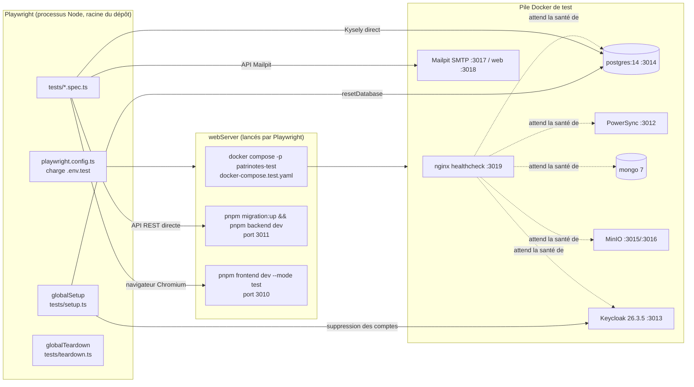
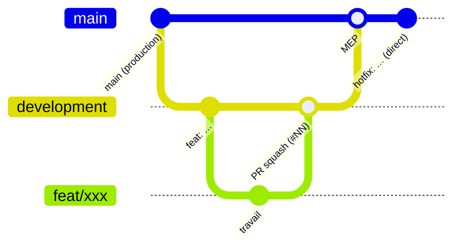

# 13 — Tests, qualité et prise en main développeur

Ce chapitre décrit la **stratégie de test** (suite Playwright de bout en bout), les **outils de qualité** (TypeScript,
formatage, lint), les **conventions** observées dans le code et l'historique Git, puis une **procédure de prise en main**
pas à pas pour un nouveau développeur. Il termine par les **zones non couvertes** par les tests.

En résumé : la qualité repose aujourd'hui **presque entièrement sur une suite e2e Playwright** (17 fichiers de specs,
environ 3 300 lignes avec les utilitaires) qui démarre une pile complète en Docker. Il n'y a **aucun test unitaire**, et
la CI de test est **manuelle**.

---

## 1. Vue d'ensemble



---

## 2. Suite e2e Playwright

### 2.1 Configuration — [playwright.config.ts](../playwright.config.ts)

| Paramètre | Valeur | Conséquence |
| --- | --- | --- |
| Variables | `expand(dotenv.config({ path: "./.env.test" }))` puis `NODE_ENV = "test"` ([L5-L6](../playwright.config.ts#L5-L6)) | Le processus de test a toutes les variables de [.env.test](../.env.test). |
| `globalSetup` / `globalTeardown` | [tests/setup.ts](../tests/setup.ts) / [tests/teardown.ts](../tests/teardown.ts) | Remise à zéro de la base / arrêt de la pile (en CI seulement) |
| `fullyParallel: true` mais `workers: 1` | [L16-L23](../playwright.config.ts#L16-L23) | **Exécution en série de fait.** Les specs partagent la même base, le même Keycloak et la même boîte Mailpit : ne pas augmenter `workers` sans isoler les données. |
| `retries` | 2 en CI, 0 en local | — |
| `timeout` | 30 s par test (plusieurs tests le portent à 60 s, 90 s ou 120 s) | — |
| `forbidOnly` | en CI | Un `test.only` oublié fait échouer la CI. |
| `trace` | `on-first-retry` | Les traces ne sont produites qu'en CI (seul endroit avec des relances). |
| Rapporteurs | `html` (sans ouverture) + `list` | Rapport dans `playwright-report/` |
| Projets | **Chromium desktop uniquement** ; Firefox, WebKit et mobiles en commentaire | Safari iOS et Android, cibles réelles des agents sur le terrain, ne sont **pas testés**. |
| `baseURL` | `http://localhost:${FRONTEND_PORT}` (3010) | — |

`webServer` lance trois serveurs ([L76-L102](../playwright.config.ts#L76-L102)) :

1. `docker compose -p patrinotes-test -f docker-compose.test.yaml --env-file ./.env.test up --wait`. Playwright attend
   que `http://localhost:${HEALTHCHECK_PORT}` (3019) réponde. `reuseExistingServer: !CI` : **en local, une pile déjà
   lancée est réutilisée**.
2. `pnpm migration:up && pnpm backend dev`, qui attend `GET /health` sur le port 3011. Jamais réutilisé.
3. `pnpm frontend dev --mode test --port 3010`. Vite charge `.env` **puis** `.env.test` depuis la racine (`envDir: "../.."`
   dans [vite.config.ts](../packages/frontend/vite.config.ts)). Un `VITE_*` présent dans le `.env` d'un développeur et
   **absent** de `.env.test` (par exemple `VITE_SENTRY_DSN`) s'appliquera donc aussi aux tests.

### 2.2 Pile Docker de test — [docker-compose.test.yaml](../docker-compose.test.yaml)

- Projet Docker `patrinotes-test`, **sans volume nommé** : les données disparaissent avec `down --volumes`.
- `healthcheck` : un nginx factice dont le seul rôle est de dépendre de `pg`, `powersync`, `mongo`, `minio` et `keycloak`
  en `service_healthy`. C'est l'astuce qui permet à `up --wait` et à Playwright d'attendre toute la pile.
- Postgres **14** (contre **17** dans [docker-compose.yaml](../docker-compose.yaml) de dev). `wal_level=logical`, et
  [db/init/](../db/init/) crée la publication `powersync` et la base `keycloak`.
- MinIO : le bucket `my-bucket` est **codé en dur** dans `minio-init` (il doit correspondre à `MINIO_BUCKET` de
  `.env.test`).
- Keycloak `26.3.5` en `start-dev --import-realm`. Le point d'entrée [tests/keycloak-entrypoint.sh](../tests/keycloak-entrypoint.sh)
  applique `envsubst` à [tests/realm-template.json](../tests/realm-template.json) pour produire `realm-export.json` avant
  de lancer `kc.sh`.
- Mailpit capte tous les courriels (500 messages au plus, authentification SMTP acceptée quelle qu'elle soit). Les tests
  lisent `http://localhost:3018/api/v1/messages`.
- PowerSync `journeyapps/powersync-service:latest` : **non épinglé**, donc les tests peuvent casser du jour au lendemain
  à la sortie d'une nouvelle version.

### 2.3 Realm Keycloak de test — [realm-template.json](../tests/realm-template.json)

- Realm **`master`** (le même nom que celui que PowerSync attend en dur, voir
  [powersync-config.yaml](../powersync/powersync-config.yaml)).
- `accessTokenLifespan: 60` s : le **rafraîchissement des jetons est donc exercé en permanence** pendant les tests
  (rafraîchissement à 80 % de la durée de vie, soit environ toutes les 48 s).
- `registrationEmailAsUsername: true`.
- Deux clients :
  - `${AUTH_CLIENT_ID}` : authentification `client-secret-jwt`, grant mot de passe direct (`directAccessGrantsEnabled`),
    JWKS sur `localhost:${KC_HOSTNAME_PORT}` ;
  - `${AUTH_ADMIN_CLIENT_ID}` : compte de service avec les rôles `manage-users`, `view-users` et `query-users`, utilisé
    par le backend pour créer des comptes et réinitialiser des mots de passe.
- Profil utilisateur déclaratif (username, email, firstName, lastName).
- `redirectUris` / `webOrigins` : `/*`, **valeurs de test, à ne pas reprendre en production**.

> [!NOTE]
> Le [docker-compose.yaml](../docker-compose.yaml) **de développement** monte **le même** `realm-template.json` et le même
> point d'entrée. L'environnement de dev local tourne donc avec le realm de test (jetons de 60 s).

### 2.4 Données de test — [tests/utils.ts](../tests/utils.ts) et [tests/setup.ts](../tests/setup.ts)

- `mockUsers` : 3 comptes `testrunner{1,2,3}@yopmail.com` (mot de passe de test dans `utils.ts`, fonction « Autre… »
  saisie librement).
- `mockServices` : `service-1` (département `00`) et `service-multi-dept` (`01,02,03`).
- `mockServiceInstructeur`, `mockClauses` (4 clauses du `service-1`), un monument fictif `TEST00001` « Château de Test »
  et deux objets mobiliers `OBJ00001` / `OBJ00002`.
- `resetDatabase()` ([setup.ts](../tests/setup.ts#L6-L85)) :
  - **supprime** dans l'ordre des clés étrangères `whitelist`, `visited_section*`, `state_report*`,
    `constat_validation`, `attachment_redirection`, `user_settings`, `report*`, `sent_email`, `internal_user`, `user` ;
  - **supprime les comptes Keycloak** des `mockUsers` ;
  - réinsère les données fictives et **met les 3 courriels en liste blanche**.

  Elle est appelée par le `globalSetup` **et** dans le `beforeAll` / `beforeEach` de la plupart des specs.
- Utilitaires d'interface : `signup`, `login`, `waitForLoggedIn` (attend le texte « Déconnexion »),
  `fillMinimalConstat`, `finalizeConstat`, `cleanupDb`.

> [!CAUTION]
> `resetDatabase()` **vide des tables entières** (`user`, `report`, `state_report`…) de la base pointée par
> `DATABASE_URL`, et supprime des comptes dans le Keycloak pointé par `VITE_AUTH_URL`. Les deux valeurs viennent de
> `.env.test`. **Ne jamais lancer les tests avec un `.env.test` qui pointe vers une base ou un Keycloak réels.**

Règle cachée sur les variables : les specs importent directement `packages/backend/src/db/db.ts`, donc
[envVars.ts](../packages/backend/src/envVars.ts). Celui-ci cherche `../../.env.test` **relativement au répertoire
courant**, c'est-à-dire hors du dépôt quand Playwright tourne depuis la racine. Ça fonctionne uniquement parce que
`playwright.config.ts` a **déjà** chargé `.env.test` dans `process.env`.

### 2.5 Ce que couvre chaque spec

| Spec | Type | Couverture |
| --- | --- | --- |
| [user.spec.ts](../tests/user.spec.ts) | UI | Redirection vers la connexion, page d'inscription, création de compte, connexion. Création de toutes les lignes `user_dept` quand le service a plusieurs départements. |
| [auth-errors.spec.ts](../tests/auth-errors.spec.ts) | UI + Mailpit | Inscription refusée hors liste blanche ou avec un courriel déjà inscrit, mot de passe faible bloqué côté client, mauvais mot de passe. Parcours complet de réinitialisation du mot de passe par courriel, avec vérification que le compte **ne devient pas admin**. |
| [compte-rendu.spec.ts](../tests/compte-rendu.spec.ts) | UI + Mailpit | Parcours complet d'un compte-rendu (création, saisie, PDF, envoi, réception du courriel) |
| [constat.spec.ts](../tests/constat.spec.ts) | UI + Mailpit | Parcours complet d'un constat d'état, envoi à plusieurs destinataires, caractères spéciaux et textes très longs |
| [constat-validation.spec.ts](../tests/constat-validation.spec.ts) | UI + API + Mailpit | Validation hiérarchique : courriel au validateur, acceptation, refus. Jeton déjà utilisé rejeté (404), jeton inconnu (404). |
| [constat-with-alerts.spec.ts](../tests/constat-with-alerts.spec.ts) | UI + Mailpit | Alertes (objets, sections) et courriels d'alerte. Alertes envoyées au premier envoi et **non renvoyées** après un refus du validateur. |
| [image-upload-constat.spec.ts](../tests/image-upload-constat.spec.ts) | UI | Photos à tous les emplacements d'un constat, puis génération du PDF |
| [image-upload-compte-rendu.spec.ts](../tests/image-upload-compte-rendu.spec.ts) | UI | Photos dans `UploadReportImage` (NotesForm), puis PDF |
| [image-drawing-legend.spec.ts](../tests/image-drawing-legend.spec.ts) | UI | Dessin sur une photo (Konva), légende, présence de la légende dans le PDF |
| [upload-errors.spec.ts](../tests/upload-errors.spec.ts) | UI + API | Fichier non image rejeté avec une erreur visible, suppression d'une photo, aller-retour `/api/upload/attachment` et `/size`, 404 sur un chemin inconnu, authentification obligatoire. Crée `fixtures/not-an-image.txt` à la volée. |
| [attachment-redirect.spec.ts](../tests/attachment-redirect.spec.ts) | API | `/attachment/:id` : redirection vers une URL S3 présignée, 404, **410 après 90 jours**, toujours valide au 90e jour |
| [sync.spec.ts](../tests/sync.spec.ts) | API | `/api/upload-data` : authentification obligatoire (**403**, et non 401, par convention de l'application). Écriture refusée sur `internal_user`. Dernier écrit gagnant entre deux écritures concurrentes. |
| [admin.spec.ts](../tests/admin.spec.ts) | API + UI | Liste blanche (pagination, ajout, 409 si doublon, suppression, 404), `/api/admin/me`, exports, recherche utilisateurs, 403 pour un non-admin. Page `/admin` : ajout et suppression, pagination des deux tableaux. Le rôle admin est attribué **en SQL**. |
| [stats.spec.ts](../tests/stats.spec.ts) | API + UI | `/api/stats/public` (forme, comptages, utilisateurs actifs, exclusion des documents désactivés), `/api/stats/admin` (403, constats abandonnés, envois par service), page `/stats` publique et admin, changement de période |
| [map-smoke.spec.ts](../tests/map-smoke.spec.ts) | UI | Ouverture et fermeture de la carte MapLibre « Choisir sur la carte » **sans erreur JS**. Test de fumée volontaire : cliquer un marqueur sur un canvas WebGL serait instable. **Dépend d'Internet** (tuiles). |

Fixtures : [tests/fixtures/](../tests/fixtures/) contient `test-image.jpg`, `test-image.png` et `not-an-image.txt`.

### 2.6 Dépendances réseau des tests

Les tests ne sont **pas hermétiques**. Ils ont besoin d'Internet pour :

- les tuiles et styles de carte (IGN, OpenFreeMap, cadastre) : `map-smoke`, et plus généralement les écrans qui
  affichent une carte ;
- `DATAGOUV_API` (`data.culture.gouv.fr`), déclaré dans `.env.test` ;
- les images Docker, si elles ne sont pas en cache.

Le monument utilisé est inséré directement en base (`TEST00001`) : aucun import POP n'est nécessaire.

---

## 3. Exécuter les tests

### 3.1 En local

Prérequis : Docker avec Compose v2, Node 20, pnpm, ports **3010 à 3019 libres**.

```bash
pnpm install
pnpm exec playwright install --with-deps chromium   # une fois
pnpm e2e                                            # = playwright test
pnpm e2e tests/constat.spec.ts                      # une seule spec
pnpm e2e --ui                                       # mode interactif
pnpm exec playwright show-report                    # rapport HTML
```

Comportements à connaître :

- En local, la pile Docker **reste démarrée** après les tests (le teardown ne s'exécute qu'avec `CI`), ce qui accélère
  les relances. Pour repartir de zéro :
  `docker compose -p patrinotes-test -f docker-compose.test.yaml --env-file ./.env.test down --volumes --remove-orphans`.
- Keycloak met jusqu'à environ 60 s à être prêt (`start_period: 60s`, sonde toutes les 30 s) : le premier lancement est
  lent.
- Le backend de test tourne en `vite-node --watch` : modifier le code backend pendant les tests le redémarre.
- `pnpm migration:up-test` (`NODE_ENV=test pnpm backend drizzle migrate`) applique les migrations sur la base de test à
  la main.

### 3.2 En CI — [.github/workflows/tests.yml](../.github/workflows/tests.yml)

- Déclenchement **manuel uniquement** (`workflow_dispatch`). Aucun test ne tourne automatiquement sur les PR ni sur les
  push.
- `ubuntu-latest`, Node 20, `pnpm/action-setup@v4`, `pnpm install` (sans `--frozen-lockfile`),
  `playwright install --with-deps chromium`, puis `pnpm e2e` avec `CI=true`.
- Timeout de 30 min. Rapport `playwright-report/` publié en artefact, conservé 7 jours.
- Le workflow de build [main.yml](../.github/workflows/main.yml) (images GHCR sur `main`, `development` et
  `compte-rendu-vif`) **ne dépend pas** des tests : une image cassée peut être publiée.

> [!NOTE]
> `pnpm/action-setup@v4` sans version explicite lit le champ `packageManager` du `package.json`, et ce champ **n'existe
> pas** ici. La version de pnpm utilisée en CI est donc à confirmer (l'étape peut échouer selon la version de l'action).

**Proposition** : déclencher `tests.yml` sur `pull_request` vers `main` et `development`, ajouter un job `tsc --noEmit`
(scripts `check` du backend et du frontend), et conditionner `main.yml` au succès des tests.

---

## 4. Tests unitaires

**Il n'y en a pas.** `vitest` (`^2.1.5`) est déclaré dans [packages/backend/package.json](../packages/backend/package.json)
avec un script `"test": "vitest"`, mais aucun fichier `*.test.ts` ou `*.spec.ts` n'existe dans `packages/`, et il n'y a
pas de configuration vitest. Le package `pdf` a le script npm par défaut (`echo "Error: no test specified" && exit 1`).
Le frontend exclut `src/**/*.test.ts(x)` dans son `tsconfig`, mais il n'en contient aucun.

Bons candidats pour de premiers tests unitaires : `syncService.applyCrud` (liste noire, erreurs), `KyselyBatchWriter`
(déduplication, upsert), le calcul d'échelle et de zoom de `planSituationSnapshot.ts`, la sérialisation des courriels
obligatoires des alertes, et la composition des PDF du package `pdf` (rendu sans navigateur).

---

## 5. Qualité de code : outils

| Outil | Configuration | État réel |
| --- | --- | --- |
| **TypeScript** (backend) | [packages/backend/tsconfig.json](../packages/backend/tsconfig.json) : `strict`, `noUncheckedIndexedAccess`, `module: ESNext`, `moduleResolution: bundler`, décorateurs, `jsx: react-jsx` (PDF côté serveur) | `pnpm backend check` (`tsc --noEmit`), **jamais lancé en CI**. Le build `tsup` ne vérifie pas les types. |
| **TypeScript** (frontend) | [packages/frontend/tsconfig.json](../packages/frontend/tsconfig.json) : `strict`, `noUnusedParameters`, `allowImportingTsExtensions`, alias `#components/*`, types `vite-plugin-pwa/client`, plus [tsconfig.node.json](../packages/frontend/tsconfig.node.json) pour `vite.config.ts` et `scripts/` | `pnpm frontend check`, jamais lancé en CI. Vite ne vérifie pas les types. Il existe des `// @ts-ignore` et un `// @ts-nocheck -- temporary` ([_merimee.ts](../packages/backend/src/features/data/_merimee.ts)). |
| **TypeScript** (pdf) | [packages/pdf/tsconfig.json](../packages/pdf/tsconfig.json) : `strict`, `noUncheckedIndexedAccess` | Pas de script `check` |
| **Prettier** 3 | [.prettierrc](../.prettierrc) : guillemets doubles, `printWidth: 120`, `trailingComma: "all"`, `semi`, 2 espaces, `proseWrap: "always"` (Markdown replié à 120 colonnes) | Pas de script `format` ni de contrôle en CI. À appliquer via l'éditeur. |
| **Biome** 1.6.4 | Déclaré en devDependency racine, **sans fichier `biome.json`** (configuration par défaut). `pnpm.ignoredBuiltDependencies` contient `@biomejs/biome`. | Aucun script ne l'appelle. Il fait doublon avec Prettier et ESLint : choix à arbitrer. |
| **ESLint** 8 (frontend) | [packages/frontend/.eslintrc.cjs](../packages/frontend/.eslintrc.cjs) : `eslint:recommended`, `@typescript-eslint/recommended`, `react-hooks`, `react-refresh` | Script `pnpm frontend lint` (`--max-warnings 0`), **jamais lancé en CI**. Son état actuel (nombre d'avertissements) est à confirmer. |
| Hooks Git (husky, lint-staged) | — | Absents |

Fichiers **générés et versionnés** (ne pas modifier à la main) :

- [packages/frontend/src/api.gen.ts](../packages/frontend/src/api.gen.ts) : client typé, produit par
  `pnpm client:generate` (démarre le backend en mode `--create-only` pour écrire [openapi.json](../packages/backend/openapi.json),
  puis lance `typed-openapi`) ;
- [packages/frontend/src/routeTree.gen.ts](../packages/frontend/src/routeTree.gen.ts) : arbre des routes TanStack
  Router, régénéré par le plugin Vite ;
- [db/*.sql](../db/) et [db/meta/](../db/meta/) : migrations drizzle-kit (`pnpm migration:generate` après modification de
  [schema.ts](../packages/backend/src/db/schema.ts)).

Patch de dépendance : [patches/react-pdf-html@2.0.4.patch](../patches/react-pdf-html@2.0.4.patch). Le Dockerfile copie
`patches/` avant `pnpm install`. Override : `restructure` figé en `3.0.0`.

---

## 6. Conventions observées

### 6.1 Organisation du code

```text
packages/
  backend/src/
    index.ts, router.ts, envVars.ts      # démarrage, Fastify, variables (zod)
    routes/*Routes.ts(x)                 # plugins Fastify : un fichier par domaine (xxxPlugin), schémas TypeBox
    services/*Service.ts                 # logique métier, injectée par request.services (services.ts)
    features/                            # transverse : mail, sentry, debug, auth/keycloak, data (imports POP)
    db/schema.ts, db/db.ts               # schéma drizzle (source des migrations) + client Kysely typé
  frontend/src/
    routes/                              # routes TanStack Router par fichier (x.lazy.tsx = chargement différé, $param)
    features/                            # écrans et logique par domaine (state-report, report, map, upload, menu…)
    components/                          # composants génériques (alias #components/*)
    db/                                  # PowerSync : AppSchema.ts, Connector.ts, db.ts
    hooks/, contexts/, service-worker/
  pdf/src/                               # composants react-pdf partagés (compte-rendu, constat)
tests/                                   # e2e Playwright
db/                                      # migrations SQL (sortie de drizzle-kit) + init Docker
powersync/                               # configuration du service et règles de synchronisation
```

### 6.2 Nommage et style

- Fichiers en camelCase côté backend (`stateReportRoutes.ts`), en PascalCase pour les composants React
  (`MonumentPickerMap.tsx`), et suffixes `.hook.tsx`, `.queries.tsx`, `.view.tsx`, `.machine.tsx` (xstate) côté frontend.
- Tables SQL en snake_case. Quelques colonnes historiques en camelCase entre guillemets (`"createdBy"`, `"userId"`,
  `"createdAt"` sur `whitelist`) : **attention aux guillemets** en SQL brut.
- Langue : code en anglais. Messages d'erreur, libellés et courriels en **français**. Vocabulaire métier mélangé :
  `state_report` = constat d'état, `report` = compte-rendu, `udap`/`service`.
- Identifiants : UUID v4 et v7 générés côté client (PowerSync) ou serveur. base62 pour les liens courts
  `/attachment/<id>`.
- Erreurs HTTP : `throw new AppError(status, message)`. L'absence ou l'invalidité d'un jeton renvoie **403** (et non
  401), par convention.
- Préfixe des espaces de noms `debug` : `cr-vif:` (ancien nom du produit). La base locale du navigateur s'appelle
  `crvif-sync.db`, le stockage des pièces jointes `crvif-attachments`.

### 6.3 Messages de commit

D'après `git log` (683 commits, quasi tous du même auteur) : style **Conventional Commits simplifié, sans portée**.

| Préfixe | Part (sur les 300 derniers commits) | Exemple |
| --- | --- | --- |
| `fix:` | ~55 % | `fix: browser stuck to invalid version` |
| `feat:` | ~30 % | `feat: add maps  (#77)` |
| `wip`, `misc:`, `refactor:`, `hotfix:`, `chore:`, `typo` | le reste | `misc: enable sentry logs`, `hotfix: password reset` |

Messages en anglais, à l'impératif ou au présent, souvent sans corps. Les fonctionnalités importantes arrivent par
**squash de PR** (`(#75)`, `(#77)`). Les fusions vers la production portent des noms de branches `mep*` (« mise en
production », par exemple `Merge pull request #32 from betagouv/mep`).

### 6.4 Branches et flux de contribution

Dépôt : `github.com/betagouv/patrinotes`.



| Branche | Rôle observé |
| --- | --- |
| `main` | Production. Image GHCR `…-main:{backend,frontend}`. Reçoit aussi des **correctifs directs** : à la date de lecture, `main` a 2 commits absents de `development` (`c9896b2`, `36aa251`). |
| `development` | Intégration et préproduction (image `…-development:*`). À la date de lecture, elle a **11 commits d'avance** sur `main`. |
| `compte-rendu-vif` | Ancien nom du produit. Toujours dans `main.yml`, dernier commit en **novembre 2025** : branche probablement abandonnée (à confirmer), dont on peut retirer le déclencheur. |
| `feat/*`, `fix/*`, `refactor/*` | Branches de fonctionnalité |
| `poc/*` (`electricsql`, `replicache`, `triplit`, `watermelon`, `automerge`, `hocuspocus`), `save/*`, `backup/*` | Essais de moteurs de synchronisation et sauvegardes historiques, **à archiver** |
| `mep*`, `sprint6`, `scalingo`, `gh-pages`, `e2e` | Historiques (anciennes mises en production, ancien hébergement Scalingo : voir [scalingo.json](../scalingo.json) et [Procfile](../Procfile), obsolètes) |

Il n'y a ni protection de branche ni revue obligatoire visible dans le dépôt (pas de `CODEOWNERS`, pas de modèle de PR).
**Proposition** pour l'équipe ministérielle : PR obligatoire vers `development` avec tests e2e et `tsc`, puis une PR
`development → main` par mise en production, et des correctifs urgents rapportés aussitôt dans `development`.

---

## 7. Prise en main développeur (pas à pas)

Le [README](../README.md) donne la trame, mais il est **incomplet et en partie faux**. Écarts relevés :

| Le README dit | Réalité |
| --- | --- |
| `pnpm = 8.4.0` | Le lockfile est en `lockfileVersion: '9.0'` (pnpm ≥ 9). Le [Dockerfile](../Dockerfile#L16) utilise **pnpm 10.12.4**, et `pnpm.onlyBuiltDependencies` est une option de pnpm 10. **Utiliser pnpm 10.** |
| « Copy `.env.dist` to `.env` » | [.env.dist](../.env.dist) est **obsolète** : il contient des variables ElectricSQL et AWS inutilisées et **il manque** `DATAGOUV_API`, `JWT_REFRESH_SECRET`, `BACKEND_URL`, `EMAIL_EMITTER`, `AUTH_CLIENT_ID`, `AUTH_CLIENT_SECRET`, `AUTH_ADMIN_CLIENT_ID`, `AUTH_ADMIN_CLIENT_SECRET`, `KEYCLOAK_*`, `PS_DATABASE_URL`, `POWERSYNC_PORT`, `KEYCLOAK_PORT`, `SMTP_PORT`, `SMTP_WEB_PORT`, `MINIO_SERVER_PORT`, `MINIO_CONSOLE_PORT`, `VITE_POWERSYNC_URL`. **Partir de [.env.test](../.env.test)** est bien plus fiable. |
| « La whitelist n'est pas active en dev » | Vrai seulement si `process.env.NODE_ENV === "development"` : `isDev` lit la variable **brute**, et le `default("development")` du schéma zod ne s'applique qu'à `ENV.NODE_ENV`. `pnpm backend dev` passe par `vite-node`, et Vite fixe `NODE_ENV=development` quand il est absent (comportement de Vite 5, à confirmer). Un lancement par `node` ou `pnpm backend start` sans `NODE_ENV` est traité **comme la production** (liste blanche active, Sentry actif si un DSN est défini). |
| `clearDb.sh` | Le fichier s'appelle [scripts/clear-db.sh](../scripts/clear-db.sh) et vise le volume `compte-rendu-vif_pg_data` (ancien nom de projet Compose). |

### 7.1 Étapes

```bash
# 1. Outils : Node 20 (l'image utilise 20.11), pnpm 10, Docker + Compose v2
corepack enable && corepack prepare pnpm@10.12.4 --activate

# 2. Dépendances (canvas, utilisé côté backend, compile du natif : paquets cairo, pango,
#    libjpeg, giflib… requis, voir la liste apk du Dockerfile)
pnpm install

# 3. Fichier d'environnement : partir de .env.test, puis ajuster
cp .env.test .env
#   - (facultatif) NODE_ENV=development pour être explicite (désactive la liste blanche et Sentry)
#   - POSTGRES_DB, PS_DATABASE_URL (il pointe en dur sur la base patrinotes-test, à renommer)
#   - ADMINER_PORT (utilisé par docker-compose.yaml)
#   - garder des ports cohérents entre backend, frontend, Keycloak et PowerSync

# 4. Infrastructure locale (Postgres 17, Mongo, PowerSync, MinIO, Keycloak, Mailpit, Adminer)
docker compose up -d
#    Keycloak met environ 1 min à démarrer ; le realm "master" est importé depuis tests/realm-template.json

# 5. Base de données
pnpm migration:up
#    Facultatif : services / UDAP de référence (le nom du conteneur est en dur, à adapter)
#    sh scripts/fill-db.sh
#    Facultatif : référentiel des monuments (long, nécessite Internet)
#    pnpm backend import-pop

# 6. Lancer
pnpm backend dev     # vite-node --watch, rechargement à chaud (hmr.ts)
pnpm frontend dev    # Vite, sur 127.0.0.1:5173 par défaut

# 7. Courriels : interface Mailpit sur http://localhost:${SMTP_WEB_PORT}
# 8. Documentation de l'API : http://localhost:${PORT}/documentation (@fastify/swagger)
```

Points d'attention :

- **Monuments** : sans `import-pop` ni données de test, l'autocomplétion « Nom ou référence du monument » est vide. Le
  plus rapide est d'insérer le monument fictif de [tests/utils.ts](../tests/utils.ts), ou de lancer les tests une fois
  sur la base de test.
- **Services** : l'inscription exige un `service_id`. Sans [scripts/db/service.sql](../scripts/db/service.sql), seul le
  service invisible `no-service` existe.
- **Devenir admin en local** : `UPDATE internal_user SET role='admin' WHERE email='…';`
- **Après une modification du schéma** : `pnpm migration:generate`. Si la table est synchronisée, ajouter dans la
  migration un `ALTER PUBLICATION powersync ADD TABLE …`, mettre à jour [sync-config.yaml](../powersync/sync-config.yaml)
  et [AppSchema.ts](../packages/frontend/src/db/AppSchema.ts), puis redémarrer PowerSync. `pnpm backend drizzle push`
  sert au prototypage, sans migration.
- **Après une modification d'une route** : `pnpm client:generate` pour régénérer `openapi.json` et `api.gen.ts`.
- Le service worker est **actif aussi en dev** (`devOptions.enabled: true`) : en cas de comportement étrange, vider le
  stockage du site ou utiliser « Réinitialiser les données locales ».
- `predev` et `prebuild` du frontend lancent `react-dsfr update-icons` (`.npmrc` : `enable-pre-post-scripts=true`).

### 7.2 Tester sur un vrai mobile Android (adb)

```bash
pnpm adb:forward-ports
# = adb reverse tcp:5173 tcp:5173 && adb reverse tcp:3002 tcp:3002 && adb reverse tcp:8080 tcp:8080
```

Le téléphone branché en USB (débogage USB activé) voit alors `localhost:5173` (frontend), `localhost:3002` et
`localhost:8080` comme le poste. Comme l'adresse reste `localhost`, le contexte reste **sécurisé** (service worker, OPFS
et `crypto.randomUUID` disponibles sans HTTPS), et l'émetteur des jetons Keycloak (`localhost`) reste cohérent.

Règles cachées : la commande suppose un `.env` avec le backend sur **3002** (le défaut du code est 3001) et **un seul**
des deux services Keycloak / PowerSync sur **8080**. L'autre doit être redirigé à la main (`adb reverse tcp:<port>
tcp:<port>`). Le choix exact des ports du développeur d'origine est à confirmer. Pour iOS, il n'existe pas d'équivalent :
passer par un tunnel HTTPS.

### 7.3 Dépôts de référence — [reference-repos.md](../reference-repos.md)

Ce fichier liste des dépôts à cloner dans `.references/` (ignoré par Git) pour s'en inspirer :

- `demarche.numerique.gouv.fr` : exemple de formulaires complexes dans un service public ;
- `dsfr-chart` : version **patchée** (support d'un tableau `unitTooltip` par série dans `BarChart`). Une copie est
  embarquée dans [packages/frontend/dsfr-chart/](../packages/frontend/dsfr-chart/), à conserver lors des mises à jour.

Le `.gitignore` exclut aussi `.claude` et `.playwright-mcp` : le développement s'est appuyé sur des assistants IA.

---

## 8. Zones non couvertes par les tests (écarts)

| Domaine | Écart | Risque |
| --- | --- | --- |
| **Hors ligne** | Aucun test ne coupe le réseau (`context.setOffline`) pour vérifier la saisie hors ligne puis la resynchronisation, alors que c'est la promesse centrale du produit. | Élevé |
| Navigateurs | Chromium desktop uniquement. Pas de WebKit/Safari iOS (pas de SharedWorker, OPFS partiel), ni de Firefox, ni de viewport mobile. | Élevé |
| Synchronisation descendante | Pas de test multi-utilisateurs vérifiant qu'un collègue du même service reçoit les données et qu'un autre service **ne les reçoit pas** (règles `sync-config.yaml`). | Élevé (cloisonnement des données) |
| Échecs silencieux de `applyCrud` | `sync.spec.ts` teste la liste noire et le dernier écrit gagnant, mais pas une écriture SQL invalide (réponse 200 `success:false`). | Moyen |
| Sécurité de `/api/upload-data` | Pas de test d'écriture vers une **autre** table sensible (`whitelist`, `user` d'un autre service, `service`…). Seule `internal_user` est sur liste noire. | Élevé (voir le chapitre sécurité) |
| Mise à jour de version (service worker) | Pas de test du mécanisme anti-version périmée (`vite:preloadError`, NetworkFirst). | Moyen |
| Plan de situation | Aucun test de `generatePlanSituationSnapshot` ni du bandeau hors ligne. Le test de fumée ne fait qu'ouvrir la carte. | Moyen |
| Contenu du PDF | Les tests vérifient la présence d'éléments (légende…), pas le rendu visuel (pas de comparaison d'images). | Faible à moyen |
| Pannes de dépendances | Pas de test SMTP ou S3 indisponible, ni Keycloak lent. | Moyen |
| Import POP | Aucun test de `pop.ts` ni de `KyselyBatchWriter`. | Moyen |
| Expiration des jetons de validation (7 jours) et des liens de réinitialisation | Testés indirectement au mieux. | Faible |
| Statuts HTTP des routes de validation | Les routes lèvent des objets bruts `{ statusCode, message }` ([validationRoutes.ts](../packages/backend/src/routes/validationRoutes.ts#L28)) que le gestionnaire d'erreurs global traite en **500**, alors que les tests attendent **404** et **410**. Soit Fastify conserve le `statusCode`, soit ces tests échouent : **à confirmer en exécutant la suite**. | À vérifier |
| Accessibilité (RGAA) | Aucun test automatisé (axe…), bien qu'une page « Accessibilité » existe. | Moyen (obligation légale) |
| Performance / charge | Aucun | Moyen |
| Unitaires | Aucun (§ 4) | — |
