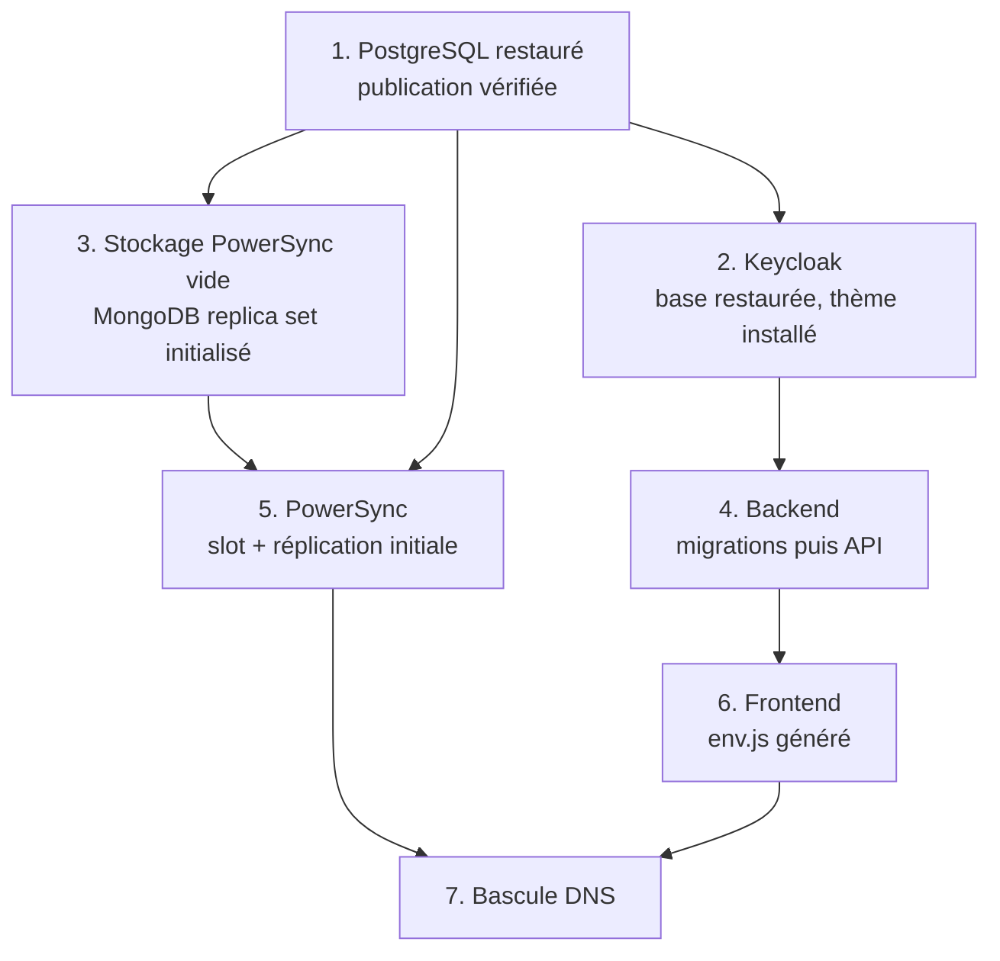

# 14 — Plan de migration vers l'infrastructure du ministère

Ce document est le plan de transfert de Patrinotes depuis le VPS actuel (piloté par Coolify) vers l'infrastructure du ministère de la Culture. Il couvre l'inventaire des composants, les exigences envers les services fournis par le ministère, les flux réseau, la migration des données, la bascule, le retour arrière et les vérifications. Il s'appuie sur [10 — Infrastructure et déploiement](10-infrastructure-et-deploiement.md) et [11 — Configuration](11-configuration.md).

> [!IMPORTANT]
> La configuration Coolify actuelle n'est pas versionnée. **Première action du chantier** : exporter depuis Coolify, pour chaque service, l'image et le tag, les variables d'environnement, les volumes, les domaines, les fichiers montés (notamment la configuration PowerSync et le thème Keycloak) et les options du reverse proxy. Tous les points « à confirmer » de ce document en dépendent.

## 1. Synthèse des exigences critiques

| # | Exigence | Pourquoi | Risque si absente |
| --- | --- | --- | --- |
| 1 | **PostgreSQL avec réplication logique** (`wal_level=logical`), un rôle avec l'attribut `REPLICATION`, le droit de créer une **publication** et un **slot de réplication**. | PowerSync lit les changements par réplication logique. | **Bloquant** : pas de synchronisation, application inutilisable. Exigence souvent refusée sur les offres de bases mutualisées. |
| 2 | **WebSocket** et connexions longues de bout en bout (reverse proxy, WAF, pare-feu). | Flux PowerSync temps réel. | Synchronisation dégradée ou impossible. |
| 3 | **Stockage S3 joignable depuis les navigateurs** (URL présignées), CORS configurable, adressage par chemin. | Les photos et PDF sont envoyés directement du navigateur vers S3. | Envoi des pièces jointes et des PDF impossible. |
| 4 | **Conserver le domaine `app.patrinotes.beta.gouv.fr`** (ou prévoir une redirection et accepter une perte de données locales). | La base locale hors ligne et l'installation PWA sont liées à l'origine. | Perte des saisies hors ligne non synchronisées. |
| 5 | **Fournisseur d'identité acceptant l'échange identifiant / mot de passe côté serveur et la création de comptes par API** (Keycloak aujourd'hui). | Le code repose sur ces deux mécanismes. | Remplacer Keycloak par ProConnect impose un chantier de développement (§ 4.4). |
| 6 | Relais **SMTP** authentifié avec un expéditeur autorisé. | Envoi des comptes-rendus, constats, validations, réinitialisations de mot de passe. | Fonctions métier d'envoi indisponibles. |
| 7 | Sorties HTTPS vers quelques services publics (§ 6). | Données POP, géocodage, cartes, mesure d'audience, supervision. | Fonctions dégradées (cartes, adresses, import POP). |

## 2. Inventaire des composants à déployer

### 2.1 Liste

| Composant | Image actuelle | Rôle | Persistance | Exposition |
| --- | --- | --- | --- | --- |
| Frontend | `ghcr.io/betagouv/patrinotes-main:frontend` | Sert la PWA (`vite preview`, port 4173) et génère `env.js` au démarrage. | Aucune (FS inscriptible requis) | Publique |
| Backend | `ghcr.io/betagouv/patrinotes-main:backend` | API Fastify, migrations au démarrage, envoi de courriels, import POP. | Aucune (FS inscriptible pour l'import POP) | Publique |
| PowerSync | `journeyapps/powersync-service:latest` (**à épingler**) | Synchronisation PostgreSQL → clients. | Via MongoDB | Publique (WebSocket) |
| MongoDB 7 en *replica set* | `mongo:7.0` | Stockage des *buckets* PowerSync. | Volume (reconstructible) | Interne |
| PostgreSQL | `postgres:17-alpine` en dev (version de production **à confirmer**) | Base applicative + base Keycloak. | **Critique** | Interne |
| Keycloak 26.3.5 | `quay.io/keycloak/keycloak:26.3.5` (+ [keycloak-theme.jar](../keycloak-theme.jar)) | Comptes et mots de passe, émission des jetons. | Dans PostgreSQL (base `keycloak`) | Interne (déduction : le navigateur ne l'appelle pas) ; console d'administration à protéger |
| Stockage objet S3 | **Scaleway Object Storage** en production (confirmé), MinIO en dev | Pièces jointes, photos, PDF. | **Critique** | Publique (URL présignées) |
| Relais SMTP | Externe : **Scaleway Transactional Email** (confirmé) | Courriels sortants. | — | Sortant |
| Site de redirection CR VIF | Fichiers statiques [crvif-redirection/](../crvif-redirection/) | Redirection de l'ancien domaine. | — | Publique (ancien domaine) |

Ne **pas** déployer : Adminer, Mailpit, `mongo-rs-init`/`minio-init` en tant que services permanents (ce sont des tâches ponctuelles), [Procfile](../Procfile) et [scalingo.json](../scalingo.json) (obsolètes).

### 2.2 Estimation des ressources

> [!NOTE]
> **Estimations** déduites de la nature des composants et des volumes de données publics (bases Mérimée et Palissy), sans mesure sur la production. À recaler avec les métriques du VPS (`docker stats`, taille des volumes, `pg_database_size`) avant dimensionnement définitif.

| Composant | vCPU | RAM | Disque | Commentaire |
| --- | --- | --- | --- | --- |
| Frontend | 0,25–0,5 | 256–512 Mo | < 1 Go (image ~1–2 Go à cause des dépendances) | Fichiers statiques ; Node sert les requêtes. |
| Backend | 0,5–1 | 512 Mo–1 Go (pic plus élevé pendant un import POP) | 1–2 Go temporaires pour les CSV POP | Une seule réplique recommandée (migrations au démarrage). |
| PowerSync | 1 | 1–2 Go | — | Plus pendant la réplication initiale. |
| MongoDB | 0,5–1 | 1–2 Go | 5–20 Go | Les *buckets* contiennent notamment les objets et immeubles POP filtrés par département de chaque utilisateur : volume proportionnel au nombre d'utilisateurs et de départements. |
| PostgreSQL | 1–2 | 2–4 Go | 10–30 Go + marge WAL | Tables POP (centaines de milliers de lignes) + données métier. **Prévoir de la marge pour la rétention de WAL** liée au slot de réplication. |
| Keycloak | 0,5–1 | 1–1,5 Go (JVM) | — | Base dans PostgreSQL. |
| S3 | — | — | **À mesurer** (photos de terrain, PDF) | Croissance continue ; aucune purge automatique dans le code. |

## 3. Services gérés : exigences détaillées

### 3.1 PostgreSQL

| Exigence | Valeur | Source |
| --- | --- | --- |
| Version | ≥ 14 (testée en 14 par la CI E2E, développée en 17). Version de production à confirmer et à **conserver ou monter**, jamais descendre (un dump d'une version supérieure peut ne pas se restaurer sur une version inférieure). | [docker-compose.test.yaml](../docker-compose.test.yaml), [docker-compose.yaml](../docker-compose.yaml) |
| `wal_level` | `logical` | Compose, [README](../README.md#L84-L97) |
| `max_replication_slots`, `max_wal_senders` | ≥ 1 libre pour PowerSync (≥ 2 conseillé : migration et bascule) | Exigence PowerSync |
| Rôle de réplication | Attribut `REPLICATION` + `SELECT` sur les tables publiées (utilisé par `PS_DATABASE_URL`) | Exigence PowerSync |
| Publication | `powersync` doit exister **avant** les migrations ; le rôle des migrations doit pouvoir faire `ALTER PUBLICATION powersync ADD TABLE` (propriétaire des tables et de la publication) | [db/init/0_create-publication.sql](../db/init/0_create-publication.sql), migrations dans [db/](../db/) |
| Extensions | Aucune (`gen_random_uuid()` est natif depuis PG 13) | migrations |
| TLS | **Le code désactive TLS** (`ssl: false` dans le backend et les migrations, `sslmode: disable` dans PowerSync). Si le ministère impose TLS vers la base, une modification du code et de la configuration PowerSync est nécessaire. | [db.ts](../packages/backend/src/db/db.ts), [drizzle.config.ts](../packages/backend/drizzle.config.ts), [powersync-config.yaml](../powersync/powersync-config.yaml) |
| Base Keycloak | Base `keycloak` séparée sur la même instance (ou une autre) ; compte dédié recommandé | [db/init/1_create_keycloak.sql](../db/init/1_create_keycloak.sql) |
| Supervision | **Alerter sur la taille du WAL retenu par le slot** (`pg_replication_slots`, `pg_wal_lsn_diff`). Si PowerSync est arrêté longtemps, le slot empêche le recyclage du WAL et **peut remplir le disque de la base**. | Comportement PostgreSQL |

> [!CAUTION]
> Beaucoup d'offres PostgreSQL mutualisées n'autorisent ni `wal_level=logical`, ni l'attribut `REPLICATION`, ni `CREATE PUBLICATION` hors superutilisateur. **Faire valider ce point par écrit par l'équipe d'hébergement du ministère avant toute autre action.** Sans lui, il faut une instance PostgreSQL dédiée (VM ou conteneur) administrée par l'équipe.

### 3.2 Stockage de PowerSync : MongoDB ou PostgreSQL

PowerSync a besoin d'un stockage pour ses *buckets* (données pré-calculées par utilisateur), distinct de la base source :

- **Option A — MongoDB (actuel)** : MongoDB ≥ 6 en *replica set* (même à un seul nœud), sans authentification dans la configuration actuelle (URI en dur `mongodb://mongo:27017/powersync_demo`). À adapter si le ministère fournit un MongoDB géré avec authentification et TLS.
- **Option B — PostgreSQL** : les versions récentes du service PowerSync proposent un stockage PostgreSQL pour les *buckets* (`storage.type: postgresql`), ce qui supprimerait MongoDB de la pile. Compatibilité, maturité et version minimale **à vérifier dans la documentation PowerSync** pour la version épinglée ; utiliser une base (voire une instance) **séparée** de la base source.

Dans les deux cas, ce stockage est **reconstructible** : il n'est pas nécessaire de le migrer (§ 7.3).

### 3.3 Stockage objet S3

| Exigence | Détail |
| --- | --- |
| API | Compatible S3 avec **signature V4**, **adressage par chemin** (`forcePathStyle: true`), région quelconque (le code envoie `us-east-1`). |
| Accès navigateur | Le point d'accès `MINIO_URL` doit être **public en HTTPS** : le navigateur fait un `PUT` sur une URL présignée (photos, PDF) et est redirigé vers une URL présignée en lecture (`/attachment/:id`). Les mêmes URL sont utilisées par le backend : **un nom interne différent du nom public n'est pas possible** sans modification du code. |
| CORS du bucket | Autoriser l'origine du frontend pour `PUT` et `GET` (en-têtes `Content-Type`). Configuration CORS actuelle du bucket Scaleway **à relever** (`aws s3api get-bucket-cors`). |
| Compte | Une clé d'accès dédiée avec droits lecture/écriture sur le bucket uniquement. |
| Taille des objets | Fichiers jusqu'à plusieurs dizaines de Mo (PDF avec photos). Le passage par le backend est limité à 15 Mo, le PUT présigné ne l'est pas. |
| Sauvegarde | Versionnage ou réplication du bucket recommandés : les photos de terrain n'existent nulle part ailleurs une fois synchronisées. |
| Transfert depuis Scaleway | Copie de bucket à bucket avec `rclone sync` ou `aws s3 sync` (voir §7.4). Les URL pré-signées déjà envoyées (7 jours) pointent sur l'hôte Scaleway : conserver l'ancien bucket en lecture au moins 7 jours, et 90 jours si l'hôte du backend change aussi. |

### 3.4 Relais SMTP

- Actuellement **Scaleway Transactional Email** (confirmé). Si le ministère impose son relais, le domaine d'envoi doit être reconfiguré (SPF, DKIM, DMARC).
- Authentification par identifiant/mot de passe (toujours envoyée par le code).
- Port : 465 (défaut du code) ou 587. Le mode TLS de Nodemailer n'est pas forcé : **tester** sur le relais cible.
- Adresse `EMAIL_EMITTER` autorisée (SPF, DKIM, DMARC du domaine expéditeur).
- Volume : quelques courriels par compte-rendu ou constat envoyé (pièces jointes PDF possibles en lien plutôt qu'en pièce jointe).

### 3.5 Fournisseur d'identité

Voir § 4.

## 4. Identité : Keycloak ou SSO du ministère ?

### 4.1 Ce que le code attend du fournisseur d'identité

Déduit de [authService.ts](../packages/backend/src/services/authService.ts), [keycloak.ts](../packages/backend/src/features/auth/keycloak.ts), [userService.ts](../packages/backend/src/services/userService.ts) et [powersync-config.yaml](../powersync/powersync-config.yaml) :

| Besoin | Mécanisme utilisé | Spécifique à Keycloak ? |
| --- | --- | --- |
| Connexion | **Formulaire de l'application** ; le backend appelle `/protocol/openid-connect/token` avec `grant_type=password` (*Resource Owner Password Credentials*), `scope=offline_access`, et une assertion client `client-secret-jwt` signée HS256. | Grant standard OAuth 2.0 mais **déprécié** (OAuth 2.1) et **non proposé par ProConnect**. |
| Rafraîchissement | `grant_type=refresh_token` (jetons *offline*). | Standard. |
| Inscription | Le backend crée l'utilisateur via l'**API d'administration Keycloak** (`POST /admin/realms/{realm}/users`) avec son mot de passe, après contrôle d'une **liste blanche d'adresses** en base (`whitelist`). | **Oui** (API propriétaire). |
| Mot de passe oublié | Lien envoyé par l'application (jeton en base, 24 h), puis `PUT /admin/realms/{realm}/users/{id}/reset-password`. | **Oui**. |
| Validation des jetons | JWT RS256, clés par JWKS, émetteur `${VITE_AUTH_URL}/realms/${VITE_AUTH_REALM}`, audience **`account`**. | L'audience `account` est une convention Keycloak. |
| Revendications utilisées | `email` (**clé de rattachement** à la table `user`, et filtre de toutes les règles PowerSync via `auth.parameter('email')`), `name` ou `preferred_username` (nom affiché à la création). Aucun rôle ni groupe : le rôle administrateur est en base (`internal_user.role`). | Revendications standard OIDC. |
| PowerSync | Accepte **le même jeton d'accès** que le backend, vérifié par JWKS. | Nécessite un JWT signé avec JWKS publié. |

Le flux *authorization code* (`/api/authenticate`, redirection vers `${FRONTEND_URL}/auth-callback`) existe côté backend mais **aucune route `auth-callback` n'existe dans le frontend** : il n'est pas utilisé.

### 4.2 Conséquence : Keycloak peut rester interne

Le navigateur n'appelle jamais Keycloak (déduction à confirmer en relevant les journaux d'accès). Keycloak peut donc être déployé **sans exposition publique**, joignable uniquement par le backend et PowerSync. La console d'administration doit rester accessible aux administrateurs (VPN ou réseau d'administration).

### 4.3 Scénario 1 (recommandé pour la migration) — Keycloak transféré tel quel

- Déployer Keycloak 26.3.5 en mode **`start`** (et non `start-dev` comme en Compose), derrière TLS ou sur réseau interne, avec `KC_HOSTNAME` fixé.
- Restaurer la base `keycloak` (comptes, hachés de mots de passe, clés de signature du realm, sessions *offline*).
- Copier [keycloak-theme.jar](../keycloak-theme.jar) dans `/opt/keycloak/providers/`, renseigner `DSFR_THEME_*`.
- Avantage : aucune modification de code, mots de passe conservés.
- Point dur : l'**émetteur** (`iss`). Si l'URL par laquelle backend et PowerSync joignent Keycloak change (par exemple de `http://keycloak:8080` à une autre URL), l'`iss` des jetons change : tous les jetons en circulation deviennent invalides (reconnexion de tous les utilisateurs) et `VITE_AUTH_URL` **et** `client_auth.issuer`/`jwks_uri` de PowerSync doivent être mis à jour ensemble. Fixer `KC_HOSTNAME` à la valeur actuelle de l'émetteur permet de l'éviter.
- À vérifier : quel realm est utilisé en production (`VITE_AUTH_REALM`). Les tests et la configuration PowerSync versionnée utilisent **`master`**, ce qui est déconseillé (le realm d'administration sert aussi aux utilisateurs finaux). À corriger éventuellement **après** la migration, pas pendant.

### 4.4 Scénario 2 — SSO du ministère (ProConnect, Cerbère, autre)

ProConnect (ex-AgentConnect) est une fédération OIDC pour les agents publics ; Cerbère est l'annuaire/SSO de certains ministères (périmètre Culture à confirmer). Les deux reposent sur le flux *authorization code* avec redirection navigateur. **Ce scénario n'est pas réalisable sans développement** :

| Changement nécessaire | Détail |
| --- | --- |
| Connexion | Remplacer le formulaire et le *password grant* par une redirection OIDC (*authorization code* + PKCE) et une route `auth-callback` côté frontend. Le squelette backend `/api/authenticate` existe déjà. |
| Inscription / mot de passe oublié | Supprimés (gérés par le fournisseur). Conserver la **liste blanche** et le rattachement au service à la première connexion. |
| Jeton pour PowerSync | Les jetons ProConnect ne sont pas émis pour l'audience `account` ni forcément vérifiables par PowerSync. Solution usuelle : le backend émet **son propre JWT** (clé RS256 avec JWKS publié par le backend, ou HS256 partagé avec PowerSync — `PS_JWT_SECRET` est un reliquat de cette approche) contenant `email`, et PowerSync le valide. |
| Fonctionnement hors ligne | La session doit survivre à des jours hors réseau : vérifier la durée des jetons de rafraîchissement accordés par le fournisseur. |
| Comptes existants | Rattachement par adresse électronique : les agents doivent se connecter avec la **même adresse** que celle enregistrée dans `user.email`. |
| Utilisateurs non agents | Les signataires externes (validation de constat par lien) n'utilisent pas d'authentification ; à vérifier qu'aucun utilisateur connecté n'est extérieur à l'administration (ProConnect est réservé aux agents et à certains professionnels). |

Recommandation : **migrer d'abord à iso-fonctionnalité avec Keycloak**, puis traiter l'intégration du SSO ministériel comme un projet distinct.

## 5. DNS, TLS et reverse proxy

| Exigence | Détail |
| --- | --- |
| Noms de domaine | `app.patrinotes.beta.gouv.fr` (frontend) **à conserver**. Les noms actuels du backend, de PowerSync et de S3 sont **à relever dans Coolify** et idéalement à conserver aussi (les liens envoyés par courriel pointent sur `BACKEND_URL`, valables 90 jours). Le domaine `beta.gouv.fr` est géré par la DINUM / beta.gouv : délégation ou enregistrements à demander. |
| Ancien domaine | `app.compte-rendu-vif.beta.gouv.fr` (et variantes `incubateur.net`) : continuer à servir [crvif-redirection/](../crvif-redirection/) (y compris `/sw.js`) tant que des clients anciens peuvent exister. |
| Nouveau nom de domaine éventuel (recette ministère) | Doit être ajouté à `preview.allowedHosts` dans [vite.config.ts](../packages/frontend/vite.config.ts#L73-L82) **et l'image reconstruite**, sinon le frontend répond 403. |
| TLS | Terminé par le reverse proxy ; certificats valides (pas de certificat interne non reconnu par les terminaux mobiles des agents). |
| WebSocket | *Upgrade* `Connection`/`Upgrade` vers PowerSync, délai d'inactivité ≥ 5 min (ou désactivé), pas de mise en mémoire tampon des réponses en flux continu (le client PowerSync peut aussi utiliser du HTTP en *streaming*). |
| Taille des requêtes | ≥ 20 Mo vers le backend (multipart limité à 15 Mo par le code) ; vers S3, autoriser les PDF volumineux. |
| En-têtes | `X-Forwarded-*` transmis. CORS : l'API répond `Access-Control-Allow-Origin: *` ; ne pas ajouter de politique contradictoire au proxy. |
| Cache | Ne pas mettre en cache `env.js`, `version.js`, `sw.js`, `index.html` au niveau du proxy ou d'un CDN. |
| Sécurité | Ajouter au proxy les en-têtes absents de `vite preview` (HSTS, `X-Content-Type-Options`, CSP à construire en tenant compte des domaines du § 6). |

## 6. Matrice des flux réseau

### 6.1 Flux entrants (depuis les terminaux des agents)

| Source | Destination | Port / protocole | Objet |
| --- | --- | --- | --- |
| Navigateur / PWA | Frontend | 443 HTTPS | Application, `env.js`, service worker |
| Navigateur / PWA | Backend | 443 HTTPS | API REST (`/api/*`), liens `/attachment/:id` |
| Navigateur / PWA | PowerSync | 443 HTTPS + WSS | Synchronisation |
| Navigateur / PWA | S3 | 443 HTTPS | `PUT` / `GET` présignés |
| Destinataires des courriels (y compris externes) | Backend | 443 HTTPS | Liens `/attachment/:id` ; page de validation de constat (frontend) |
| Administrateurs | Keycloak (console), S3 (console) | 443 HTTPS, réseau d'administration | Administration |

### 6.2 Flux internes

| Source | Destination | Port | Objet |
| --- | --- | --- | --- |
| Backend | PostgreSQL | 5432 | Requêtes, migrations |
| Backend | S3 | 443 / 9000 | Lecture/écriture d'objets, présignature |
| Backend | Keycloak | 8080 (ou 443) | Jetons, JWKS, API d'administration |
| PowerSync | PostgreSQL | 5432 | Réplication logique + requêtes initiales |
| PowerSync | MongoDB | 27017 | Stockage des *buckets* |
| PowerSync | Keycloak | 8080 (ou 443) | JWKS |
| Keycloak | PostgreSQL | 5432 | Base `keycloak` |

### 6.3 Flux sortants depuis les serveurs

| Source | Destination | Port | Quand | Obligatoire ? |
| --- | --- | --- | --- | --- |
| Backend | Relais SMTP | 465 / 587 | Chaque envoi | Oui |
| Backend | `ministere-culture.s3.sbg.io.cloud.ovh.net` | 443 | Import POP (`FORCE_REFETCH_POP=true` ou `pnpm backend import-pop`) | Ponctuel |
| Backend | `pop.culture.gouv.fr` | 443 | Récupération des images POP (`import-pop` uniquement ; désactivé au démarrage) | Ponctuel |
| Backend | Sentry (instance à confirmer) | 443 | Si `SENTRY_DSN` | Optionnel |
| PowerSync | Télémétrie JourneyApps | 443 | `disable_telemetry_sharing: false` | **À désactiver** |
| Hôtes d'exécution | Registre d'images (`ghcr.io` aujourd'hui) | 443 | Déploiement | Oui (ou registre du ministère) |

### 6.4 Flux sortants depuis les navigateurs (à autoriser sur le réseau des agents et dans la CSP)

| Destination | Usage | Source dans le code |
| --- | --- | --- |
| `api-adresse.data.gouv.fr` | Autocomplétion et géocodage d'adresses | [address.tsx](../packages/frontend/src/features/address.tsx), [MapLibre.tsx](../packages/frontend/src/features/map/MapLibre.tsx) |
| `tiles.openfreemap.org` | Fond de carte vectoriel et polices | [MapLibre.tsx#L14-L21](../packages/frontend/src/features/map/MapLibre.tsx#L14-L21) |
| `openmaptiles.geo.data.gouv.fr` | Parcelles cadastrales | [MapLibre.tsx#L17](../packages/frontend/src/features/map/MapLibre.tsx#L17) |
| `data.geopf.fr` | Orthophotos IGN (WMTS) | [MapLibre.tsx#L26](../packages/frontend/src/features/map/MapLibre.tsx#L26) |
| `stats.beta.gouv.fr` | Matomo (site 123) | [main.tsx#L132-L136](../packages/frontend/src/main.tsx#L132-L136) |
| Sentry | Erreurs et journaux du navigateur, si `VITE_SENTRY_DSN` | [sentry.ts](../packages/frontend/src/features/sentry.ts) |
| Hôtes des images POP | URL stockées dans `pop_images.url` (domaine à relever en base) | [pop.ts](../packages/backend/src/features/data/pop.ts) |

Liens simples (navigation, pas d'appel automatique) : `patrinotes.beta.gouv.fr` (FAQ), `pop.culture.gouv.fr`, `culture.gouv.fr`, `legifrance.gouv.fr`, Typeform (questionnaire).

## 7. Procédure de migration des données

### 7.1 Préparation (sans interruption)

1. Exporter la configuration Coolify (voir l'encadré en tête).
2. Mesurer : `pg_database_size` des deux bases, taille du bucket, nombre d'objets, version PostgreSQL, version effective de PowerSync (journal de démarrage).
3. Relever l'état de la publication : `SELECT * FROM pg_publication_tables WHERE pubname = 'powersync';` et des slots : `SELECT * FROM pg_replication_slots;`.
4. Relever l'émetteur réel des jetons (décoder un jeton d'accès, champ `iss`) et le realm.
5. Rechercher d'éventuelles URL absolues de l'ancien hébergement stockées en base, par exemple `SELECT count(*) FROM pictures WHERE url LIKE '%<ancien hôte S3>%' OR "finalUrl" LIKE '%<ancien hôte S3>%';` (table historique synchronisée à tous les utilisateurs) et le domaine des `pop_images.url`.
6. Monter l'environnement cible complet avec une **copie** des données (§ 7.2 à 7.5) et dérouler la vérification (§ 10) : répétition générale.
7. Préparer les images dans le registre cible (§ 12) et **épingler** la version de PowerSync.
8. Abaisser le TTL DNS des noms concernés (par exemple 300 s) au moins 48 h avant la bascule.
9. Prévenir les utilisateurs : **synchroniser avant la date**, et ne pas vider le cache du navigateur pendant la bascule.

### 7.2 PostgreSQL

Deux bases à transférer : la base applicative (`POSTGRES_DB`) et `keycloak`.

```bash
# Sur l'ancien hôte, après arrêt du backend, de PowerSync et de Keycloak
pg_dumpall --globals-only > globals.sql          # rôles (à adapter, mots de passe à régénérer)
pg_dump -Fc -d "$POSTGRES_DB" -f app.dump
pg_dump -Fc -d keycloak -f keycloak.dump

# Sur la cible
createdb patrinotes ; createdb keycloak
pg_restore --no-owner --role=<proprietaire_app> -d patrinotes app.dump
pg_restore --no-owner --role=<proprietaire_kc>  -d keycloak  keycloak.dump
```

Points d'attention :

- `pg_dump` **inclut la publication `powersync`** et ses tables. Si le rôle de restauration n'a pas le droit de la créer, restaurer avec `--no-publications`, puis recréer la publication manuellement **avec la liste relevée au § 7.1 point 3**.
- **`constat_validation` n'est pas dans la publication de production** (confirmé par l'équipe). Ce n'est pas bloquant : le frontend n'utilise pas cette table et ne la déclare pas dans son schéma local. La requête correspondante de [sync-config.yaml](../powersync/sync-config.yaml) est donc inutile : la supprimer, ou bien ajouter la table à la publication par une migration si le frontend doit un jour l'utiliser.
- Les **slots de réplication ne sont pas transférés** : PowerSync en créera un nouveau sur la cible. Sur l'ancienne base, le slot de PowerSync doit être supprimé (`pg_drop_replication_slot`) après la bascule définitive, sinon l'ancien serveur accumule du WAL.
- Le schéma `drizzle` (table `__drizzle_migrations`) fait partie du dump : au premier démarrage, le backend ne rejouera que les migrations postérieures. **Ne pas** recréer la base vide puis lancer les migrations pour ensuite charger les données.
- Comparer le nombre de lignes des principales tables (`user`, `report`, `state_report`, `*_attachment`, `pop_immeubles`, `pop_objets`) entre source et cible.
- Les tables POP peuvent aussi être reconstruites depuis data.gouv.fr, mais `pop_images` (récupérée lentement par *scraping*) doit être transférée.

### 7.3 MongoDB (stockage PowerSync)

**Ne pas migrer.** Les *buckets* sont dérivés de PostgreSQL et liés à la position dans le WAL de l'ancienne base : ils n'ont pas de sens sur la nouvelle. Démarrer PowerSync sur un stockage vide :

- PowerSync crée son slot et fait une **réplication initiale** complète (durée proportionnelle à la taille des tables publiées, notamment `pop_objets`) ; le service n'est pleinement opérationnel qu'à la fin de cette étape (suivre les journaux).
- Les clients détectent un état serveur différent et **re-téléchargent leurs données** (y compris les objets POP de leurs départements) : pic de trafic et de charge au premier jour, temps de synchronisation initial sur mobile. Les modifications locales en attente sont conservées dans la file d'envoi du client et rejouées vers le backend (comportement attendu du SDK PowerSync, à valider pendant la répétition).

### 7.4 Stockage S3

```bash
# Exemple avec le client MinIO (rclone sync convient aussi)
mc alias set old https://<ancien-s3> <cle> <secret>
mc alias set new https://<nouveau-s3> <cle> <secret>
mc mirror --preserve old/<bucket> new/<bucket>      # pré-copie à chaud, puis passe finale pendant la bascule
```

- Les clés d'objets (`attachment/…`) sont relatives : le nom du bucket et l'hôte peuvent changer sans modifier la base (`attachment_redirection.s3_key` ne contient pas l'hôte).
- Reporter la configuration **CORS** du bucket.
- Comparer le nombre d'objets et le volume total.

### 7.5 Keycloak

- Méthode recommandée : **restauration de la base `keycloak`** (§ 7.2) sur une version identique (26.3.5). Elle conserve comptes, hachés de mots de passe, clients et secrets, clés de signature et sessions *offline* : les utilisateurs restent connectés si l'émetteur est inchangé.
- Alternative : `kc.sh export --realm <realm> --users realm_file` puis `kc.sh import`. Elle conserve les comptes et hachés, mais **pas les sessions *offline*** : tous les utilisateurs devront se reconnecter.
- Ne pas recréer le realm depuis [tests/realm-template.json](../tests/realm-template.json) : il est destiné aux tests.
- Vérifier les secrets des clients (`AUTH_CLIENT_SECRET`, `AUTH_ADMIN_CLIENT_SECRET`) côté backend.

### 7.6 Ordre de démarrage sur la cible



## 8. Liste de contrôle de la bascule

**J-7 à J-1**

- [ ] Répétition générale réussie sur l'environnement cible (§ 10 complet).
- [ ] Validation écrite des prérequis PostgreSQL (§ 3.1), S3 (§ 3.3), SMTP, WebSocket.
- [ ] Images publiées dans le registre cible, PowerSync épinglé, télémétrie désactivée.
- [ ] Variables de production saisies dans le coffre de la cible ([11 § 9](11-configuration.md#9-gabarit-minimal-de-production-noms-seulement)), en conservant `FRONTEND_URL`, `BACKEND_URL`, `VITE_*_URL` si les domaines sont conservés.
- [ ] TTL DNS abaissé ; message d'information envoyé aux utilisateurs.
- [ ] Pré-copie S3 effectuée.

**Jour J**

1. [ ] Annoncer le début de l'interruption.
2. [ ] Arrêter, sur l'ancien hôte, **le backend puis PowerSync** (les clients passent en mode hors ligne et conservent leurs modifications en file d'attente), puis Keycloak. Laisser le frontend en place.
3. [ ] Sauvegarde complète de l'ancien hôte (dumps + copie du bucket) conservée pour le retour arrière.
4. [ ] Dumps PostgreSQL (§ 7.2) et restauration sur la cible.
5. [ ] Passe finale `mc mirror`.
6. [ ] Vérifier/compléter la publication `powersync`.
7. [ ] Démarrer Keycloak, puis le backend (contrôler les journaux de migration : le `;` du `CMD` masque les échecs), puis PowerSync ; attendre la fin de la réplication initiale.
8. [ ] Démarrer le frontend ; contrôler `https://<frontend>/env.js`.
9. [ ] Tests de fumée sur la cible en forçant la résolution DNS (fichier `hosts`) : connexion, synchronisation, création d'un constat avec photo, génération et envoi de PDF.
10. [ ] Basculer les enregistrements DNS (frontend, backend, PowerSync, S3).
11. [ ] Surveiller : journaux backend et PowerSync, Sentry, arrivée des écritures en attente (`/api/upload-data`), retard du slot de réplication.
12. [ ] Annoncer la fin de l'interruption.

**J+1 à J+30**

- [ ] Garder l'ancien hôte arrêté mais intact (retour arrière possible).
- [ ] Après la période de garantie : supprimer le slot de réplication et les données de l'ancien hôte, révoquer les anciens secrets (S3, SMTP, clients Keycloak).

## 9. Plan de retour arrière

| Moment | Action | Perte de données |
| --- | --- | --- |
| Avant la bascule DNS (étapes 1 à 9) | Redémarrer les services de l'ancien hôte, abandonner la cible. | Aucune (l'ancien hôte n'a pas reçu d'écriture depuis l'arrêt). |
| Après la bascule DNS, avant toute écriture significative | Remettre les anciens enregistrements DNS, redémarrer l'ancien hôte. | Écritures reçues par la cible perdues ; les clients qui les ont envoyées ne les renverront pas. |
| Après la bascule avec écritures | Retour arrière **avec reprise des données** : arrêter la cible, dumper sa base, la restaurer sur l'ancien hôte, recopier le bucket en sens inverse, redémarrer l'ancien PowerSync **sur un stockage MongoDB vidé** (son slot et ses *buckets* ne correspondent plus à la base restaurée), puis rebasculer le DNS. | Aucune si la procédure est suivie ; nouvelle resynchronisation complète des clients. |

Critères de décision du retour arrière (à valider) : impossibilité de se connecter, synchronisation bloquée plus de 2 h, échec des envois de pièces jointes, erreurs de migration du schéma.

## 10. Vérifications après migration

**Infrastructure**

- [ ] `GET <backend>/health` → `{"status":"ok"}`.
- [ ] PowerSync : `GET <powersync>/probes/liveness` en succès ; réplication initiale terminée dans les journaux.
- [ ] `SELECT slot_name, active FROM pg_replication_slots;` → slot PowerSync actif.
- [ ] `pg_publication_tables` identique à la source (+ `constat_validation`).
- [ ] Keycloak `/health/ready` (port 9000) `UP`.
- [ ] `env.js` contient les bonnes URL ; aucune erreur `Error parsing env vars` dans la console.
- [ ] Certificats valides sur tous les noms ; WebSocket établi (outils de développement du navigateur).

**Fonctionnel**

- [ ] Connexion d'un compte existant (mot de passe inchangé).
- [ ] Inscription d'une adresse de la liste blanche ; refus d'une adresse hors liste.
- [ ] Mot de passe oublié : courriel reçu, lien vers le bon domaine, changement effectif.
- [ ] Données du service et objets POP visibles après synchronisation.
- [ ] Création et modification d'un compte-rendu hors ligne puis en ligne ; visible sur un second terminal.
- [ ] Ajout d'une photo (PUT présigné vers S3) ; affichage sur un autre terminal.
- [ ] Génération et envoi d'un PDF de compte-rendu et de constat d'état ; lien `/attachment/...` du courriel fonctionnel ; un **ancien** lien envoyé avant la migration fonctionne encore.
- [ ] Parcours de validation d'un constat par lien externe.
- [ ] Pages statistiques et administration (compte administrateur).
- [ ] Cartes (fond, cadastre, orthophoto) et autocomplétion d'adresse depuis le réseau des agents.
- [ ] Ancien domaine CR VIF : redirection effective.
- [ ] Sentry et Matomo reçoivent des événements (si conservés).

## 11. Points à décider avec le ministère

| Sujet | Options | Recommandation |
| --- | --- | --- |
| PostgreSQL | Service géré (si réplication logique autorisée) / instance dédiée | Valider la réplication logique avant tout. |
| Stockage PowerSync | MongoDB / PostgreSQL (selon version PowerSync) | MongoDB à court terme (iso), étudier PostgreSQL ensuite. |
| Stockage objet | S3 du ministère / MinIO auto-hébergé | S3 géré avec versionnage. |
| Identité | Keycloak transféré / Keycloak du ministère / ProConnect | Keycloak transféré, SSO en projet séparé (§ 4.4). |
| Domaines | Conserver `*.patrinotes.beta.gouv.fr` / domaine `culture.gouv.fr` | Conserver le domaine du frontend (données locales liées à l'origine). |
| Serveur du frontend | `vite preview` (actuel) / nginx ou proxy du ministère | Remplacer à terme ; garder l'existant pour la bascule. |
| Forge et registre | GitHub + `ghcr.io` / forge et registre du ministère | Voir § 12. |
| Supervision | Sentry (instance ?), journaux, métriques | Préciser l'instance Sentry et la rétention ; envoi des corps de requêtes à examiner (RGPD). |
| Mesure d'audience | Matomo `stats.beta.gouv.fr` / Matomo du ministère | Changer impose une modification de code (`siteId` en dur). |
| SMTP | Relais du ministère / prestataire actuel | Relais du ministère avec expéditeur autorisé. |
| Sauvegardes | Fréquence, rétention, tests de restauration | PostgreSQL quotidien + PITR, S3 versionné. |
| Environnements | Production + recette (branche `development`) | Deux environnements isolés ; statut de `compte-rendu-vif` à trancher. |
| Télémétrie PowerSync | Active / désactivée | Désactiver. |
| Homologation de sécurité | Exigences RGS, durcissement | À planifier ; points relevés : CORS `*`, TLS base désactivé, `vite preview`, images avec chaîne de compilation, tags non immuables. |

## 12. Chaîne de livraison : forge et registre

La CI actuelle ([main.yml](../.github/workflows/main.yml)) publie sur **`ghcr.io/betagouv/patrinotes-<branche>:backend|frontend`**, avec des tags mutables. Pour l'infrastructure du ministère :

- si l'hébergement peut tirer depuis `ghcr.io` : prévoir l'ouverture du flux sortant, un jeton de lecture si les paquets sont privés, et **ajouter un tag immuable** (SHA du commit) pour déployer une version précise ;
- sinon : ajouter une étape de publication vers le registre du ministère (Harbor, GitLab Registry…) avec ses identifiants en secrets GitHub, ou migrer la CI sur la forge du ministère ;
- dans les deux cas, la CI ne déclenche aucun déploiement : définir le mécanisme côté ministère (manuel, webhook, GitOps) et **sortir les migrations du démarrage du conteneur** pour qu'un échec de migration bloque le déploiement au lieu d'être ignoré.
