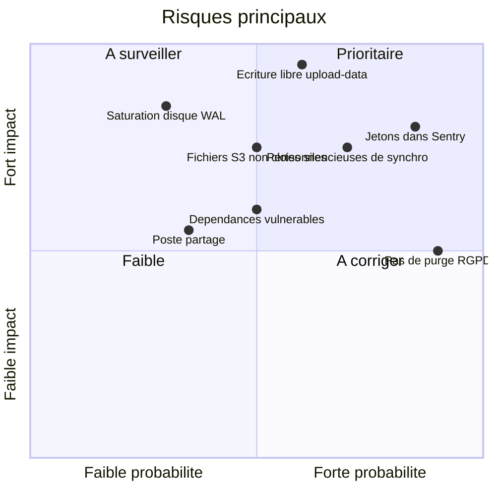

# 16 — Risques et dette technique

Ce document consolide les risques relevés pendant l'analyse du code : sécurité, perte de données, données personnelles, exploitation et dette technique. Il sert de base à l'analyse de risques de l'homologation et au plan d'action avant ou pendant le transfert vers l'infrastructure du ministère.

**Méthode.** Les constats viennent d'une lecture du code à date. Ils n'ont pas été vérifiés sur l'environnement de production, dont la configuration (Coolify, realm Keycloak, publication PostgreSQL, CORS S3) n'est pas dans le dépôt. Ce qui dépend de la production est marqué « à confirmer ».

**Niveaux.** Critique : exploitable par un agent connecté ou perte de données avérée, à traiter avant homologation. Élevé : à traiter avant ou pendant le transfert. Moyen : à planifier. Faible : nettoyage.

## 1. Synthèse

| ID | Risque | Niveau | Détail |
| --- | --- | --- | --- |
| SEC-01 | Écriture libre dans la base par `/api/upload-data` | **Critique** | §2 |
| SEC-02 | Mots de passe, jetons et données personnelles envoyés à Sentry | **Critique** | §2 |
| DAT-01 | Pertes silencieuses d'écritures de synchronisation | **Critique** | §3 |
| SEC-03 | Fichiers S3 non cloisonnés (lecture et écrasement) | Élevé | §2 |
| SEC-04 | Rattachement libre à un service | Élevé | §2 |
| SEC-05 | Contournement de la liste blanche par `/api/authenticate` | Élevé | §2 |
| SEC-06 | Aucune limitation de débit, pas de protection force brute dans le realm de référence | Élevé | §2 |
| SEC-07 | Dépendances vulnérables ou plus maintenues | Élevé | §2 |
| OPS-01 | Saturation du disque PostgreSQL par le slot de réplication | Élevé | §5 |
| OPS-02 | Démarrage malgré une migration en échec | Élevé | §5 |
| RGPD-01 | Aucune durée de conservation appliquée | Élevé | §4 |
| RGPD-02 | Sous-traitants non déclarés | Moyen | §4 |
| SEC-08 | Liens publics de 90 jours et jetons de validation lisibles indéfiniment | Moyen | §2 |
| SEC-09 | Injection HTML dans les e-mails officiels | Moyen | §2 |
| SEC-10 | Confidentialité sur poste partagé | Moyen | §2 |
| SEC-11 | Transport non chiffré vers PostgreSQL, MongoDB sans authentification | Moyen | §2 |
| OPS-03 | `vite preview` en production | Moyen | §5 |

## 2. Sécurité

### SEC-01 — Écriture libre dans la base (critique)

La route `POST /api/upload-data` applique les opérations envoyées par PowerSync **sur n'importe quelle table** sauf `internal_user`, sans vérifier ni le service, ni le propriétaire, ni les colonnes. Un agent connecté peut donc, avec un simple outil HTTP :

- modifier ou supprimer les documents d'**autres services** ;
- modifier la liste blanche, les adresses d'alerte d'un service, `attachment_redirection`, `constat_validation` ;
- **usurper un compte**, y compris administrateur : l'identité est résolue par l'e-mail, et `user.email` est modifiable.

**Recommandation.** Liste blanche de tables et de colonnes, contrôle d'appartenance par service et par auteur sur chaque opération, validation de schéma, transaction par lot. Voir [04](04-backend-api.md) et [08](08-synchronisation-hors-ligne.md).

### SEC-02 — Fuites vers Sentry (critique)

- Backend : le gestionnaire d'erreurs envoie `request.body` ; en cas d'erreur sur la connexion, l'inscription ou la réinitialisation, **le mot de passe en clair** part dans Sentry. Chaque envoi d'e-mail produit un événement avec le document complet et ses destinataires. Échantillonnage des traces à 100 %, aucun filtrage (`beforeSend`).
- Frontend : `consoleLoggingIntegration` transmet les `console.log`, or le connecteur journalise `{...apiStore}` (**jeton d'accès et jeton hors ligne**) et le contenu de chaque opération de synchro.

**Recommandation.** Retirer ces journaux, ajouter `beforeSend` pour filtrer, baisser l'échantillonnage, faire **révoquer les jetons** concernés et purger les événements Sentry existants. Héberger Sentry sur une instance acceptée par le ministère. Voir [12](12-exploitation-et-supervision.md).

### SEC-03 — Fichiers non cloisonnés (élevé)

`/api/upload/presigned-url` et `/api/upload/attachment` acceptent **n'importe quel chemin** sous `attachment/` : un agent peut lire ou **écraser** un PDF déjà envoyé d'un autre service. Aucune limite de taille côté serveur. Les flux PowerSync de pièces jointes acceptent un identifiant de document sans vérifier le service. Les routes PDF ne vérifient pas l'appartenance.

### SEC-04 et SEC-05 — Cloisonnement par service contournable (élevé)

`/api/change-service` permet de rejoindre n'importe quel service. `/api/authenticate`, inutilisée par le frontend, crée des comptes sans liste blanche. **Recommandation** : valider le changement de service (administrateur ou liste blanche par service) et supprimer la route inutilisée.

### SEC-06 — Pas de limitation de débit (élevé)

Aucune limitation sur l'API, y compris `/api/login-user`, `/api/create-user`, la réinitialisation de mot de passe (qui permet de savoir si un compte existe) et les routes publiques. Le realm de référence n'active pas la protection force brute ni de politique de mot de passe. À vérifier sur le realm de production.

### SEC-07 — Dépendances (élevé)

`pnpm audit` sur le backend : 88 vulnérabilités dont 2 critiques et 56 élevées (relevé au moment de l'analyse). Fastify 4 n'est plus maintenu, Node 20 non plus depuis avril 2026, Sentry v7, image PowerSync `:latest` non épinglée. La CI publie les images **sans test ni audit**. Voir [05](05-authentification-securite.md) §11.

### Autres points de sécurité

| ID | Constat | Recommandation |
| --- | --- | --- |
| SEC-08 | Liens `/attachment/:id` publics pendant 90 jours ; nom du fichier de CR contenant le nom du demandeur. Jeton de validation lisible sans limite après décision. Lien S3 pré-signé de 7 jours après validation. | Durée alignée sur le texte (1 mois), nom de fichier neutre, expiration après décision. |
| SEC-09 | Textes saisis (commentaires, titres, préconisations, motif de refus) insérés **sans échappement** dans le HTML des e-mails ; tout agent peut envoyer un e-mail officiel à n'importe quelle adresse. | Échapper, limiter le nombre de destinataires, journaliser. |
| SEC-10 | La déconnexion ne vide pas la base locale ni la file d'écritures et ne révoque pas le jeton hors ligne. Jetons stockés en IndexedDB, lisibles par un script injecté. | Purge locale à la déconnexion (après envoi des écritures), révocation, CSP. |
| SEC-11 | `ssl:false` en dur vers PostgreSQL, `sslmode: disable` pour PowerSync, MongoDB sans authentification et port publié dans le Compose de développement. | Paramétrer TLS, authentifier MongoDB, ne rien publier hors réseau interne. |
| SEC-12 | CORS `*`, pas d'en-têtes de sécurité, pas de CSP. | Restreindre l'origine, ajouter les en-têtes au reverse proxy. |
| SEC-13 | Jeton de réinitialisation haché en MD5 ; pas de politique de mot de passe côté serveur. | Utiliser le parcours Keycloak natif ou un hachage moderne. |
| SEC-14 | Télémétrie PowerSync active (bloc `telemetry` mal indenté). | Corriger l'indentation, `disable_telemetry_sharing: true`. |
| SEC-15 | Dictée vocale par Web Speech API : sur Chrome, l'audio part chez Google. | À valider par le ministère ou à désactiver. |
| SEC-16 | Contexte de build Docker non filtré (`.git`, `.env*`, jar). | Compléter [.dockerignore](../.dockerignore). |

## 3. Intégrité et perte de données

| ID | Constat | Effet | Recommandation |
| --- | --- | --- | --- |
| DAT-01 | Sur erreur SQL, `/api/upload-data` répond **HTTP 200** `success:false` ; le client considère l'opération envoyée. | **Écriture perdue sans message.** Seule trace : `transactions`. | Répondre en erreur, distinguer erreurs récupérables et définitives, remonter l'erreur dans l'interface. |
| DAT-02 | Le dépôt S3 par URL pré-signée ne vérifie pas `response.ok`. | Photo ou PDF marqué envoyé mais absent ; erreur `NoSuchKey` plus tard. | Vérifier le statut et réessayer. |
| DAT-03 | Un `PUT` rejoué est appliqué en `INSERT`, donc échoue. | Combiné à DAT-01 : perte des modifications suivantes du même lot (à confirmer). | `INSERT … ON CONFLICT DO UPDATE`. |
| DAT-04 | Utilisateur absent de la table `user` : erreur 500 répétée. | La file locale se bloque, plus aucune synchro descendante sur l'appareil. | Gérer le cas explicitement. |
| DAT-05 | L'envoi du PDF lit PostgreSQL alors que le PDF est construit depuis la base locale, sans attendre la file d'écritures. | Courriel avec données obsolètes, ou 404. | Attendre la fin de l'envoi des écritures. |
| DAT-06 | « Réinitialiser les données locales » efface les écritures non envoyées sans confirmation. | Perte de travail terrain. | Confirmation, envoi préalable. |
| DAT-07 | Lignes avec `is_deprecated` NULL jamais synchronisées. (`constat_validation` est absente de la publication de production, ce qui est confirmé, mais sans effet car le frontend ne l'utilise pas.) | Photos invisibles côté client. | Migration corrective ; retirer la requête inutile de `sync-config.yaml`. |
| DAT-08 | Alertes marquées envoyées même en cas d'échec SMTP ; aucun réessai ni file d'envoi. | Alerte patrimoniale jamais reçue. | File d'envoi avec réessais. |
| DAT-09 | `ON DELETE SET NULL` sur des colonnes `NOT NULL` (`user.service_id`, `report.createdBy`). | Suppressions en échec. | Revoir les contraintes. |

## 4. Données personnelles (RGPD)

Inventaire détaillé dans [05](05-authentification-securite.md) et [06](06-modele-de-donnees.md). Données concernées : agents (nom, e-mail, fonction), demandeurs et propriétaires (nom, adresse, e-mail, référence cadastrale), personnes présentes, validateurs, destinataires, photos.

| ID | Constat | Recommandation |
| --- | --- | --- |
| RGPD-01 | La politique de confidentialité annonce des durées (2 ans, 1 an) mais **aucune purge n'existe** : ni en base, ni dans `transactions` (copie intégrale de toutes les écritures), ni sur S3, ni dans Sentry. | Tâches planifiées de purge, durée de vie sur le bucket. |
| RGPD-02 | La page de confidentialité cite OVH et Brevo. Le code utilise aussi Sentry, un stockage S3, Scaleway (stockage objet et SMTP), Matomo (`stats.beta.gouv.fr`), OpenFreeMap, l'IGN, `openmaptiles.geo.data.gouv.fr`, l'API Adresse et, via le navigateur, la reconnaissance vocale de Google. | Mettre à jour la liste des sous-traitants et destinataires selon l'hébergement cible. |
| RGPD-03 | Journaux applicatifs non structurés, avec e-mails, objets utilisateur Keycloak et URL contenant jetons et identifiants de liens. | Niveaux de journalisation, masquage. |
| RGPD-04 | L'acceptation des CGU est envoyée à l'inscription mais **pas enregistrée**. | Stocker la date d'acceptation. |
| RGPD-05 | `constat_pdf_download` trace les téléchargements par agent. | Déclarer la finalité ou supprimer. |

## 5. Exploitation

| ID | Constat | Recommandation |
| --- | --- | --- |
| OPS-01 | Si PowerSync est arrêté, le slot de réplication retient le WAL **sans limite** (`max_slot_wal_keep_size` non défini) : le disque PostgreSQL peut se remplir et arrêter **toute** l'application. Perdre MongoDB laisse un slot orphelin. | Définir `max_slot_wal_keep_size`, superviser `pg_replication_slots`, procédure de nettoyage. Voir [12](12-exploitation-et-supervision.md) §4.1. |
| OPS-02 | `CMD pnpm migration:up;pnpm backend start` démarre même si la migration échoue ; forme *shell* qui ne relaie pas les signaux ; migrations concurrentes avec plusieurs réplicas. | Tâche de migration séparée, `&&`, forme *exec*. |
| OPS-03 | Frontend servi par `vite preview`, domaines autorisés codés en dur. | Serveur statique (nginx, Caddy) avec génération de `env.js` au démarrage. |
| OPS-04 | `/health` statique : ne vérifie ni la base ni S3. | Ajouter un point de *readiness*. |
| OPS-05 | Images de production avec chaîne de compilation, dépendances de développement et bibliothèques natives inutiles (`canvas`). | Étape d'exécution allégée. |
| OPS-06 | Étiquettes d'images mutables (`:backend`, `:frontend`) sans SHA : retour arrière difficile. | Étiqueter par commit. |
| OPS-07 | Aucune tâche planifiée : imports POP, purge, compaction PowerSync manuels ou absents. | Planificateur (cron, tâche Kubernetes). |
| OPS-08 | Import des photos POP par *scraping* HTML de `pop.culture.gouv.fr` (jusqu'à environ 10 requêtes/s), fragile et sans accord formalisé. | Accord avec l'équipe POP ou API officielle. |
| OPS-09 | Rechargement silencieux à la mise à jour, possible pendant une saisie. | Inviter l'utilisateur à recharger. |

## 6. Dette technique

| Sujet | Constat |
| --- | --- |
| Code mort | `/api/authenticate`, `relations.ts` (ne compile pas), `_merimee.ts` et la table `merimee`, la table `pictures` (pourtant synchronisée en entier à tous), `udap.json`, `addPDFToReport` (construit `https://https://…`), `SpeechRecorder.tsx`, `template-generique.html`, plugin *multipart* sans route, `swEnv.js` jamais chargé, `public/pdfjs`, `wa-sqlite-async`. |
| Dépendances inutiles | Backend : `@react-pdf/renderer`, `react-pdf-html`, `canvas`, `jsdom`, `fastify-multer`, `@aws-sdk/lib-storage`, `jose`, `postgres`, `ws`, `@keycloak/keycloak-admin-client`, `@fastify/swagger-ui`. Frontend : `npm`, `install`, `@rawwee/react-pdf-html`. |
| Correctif orphelin | [patches/react-pdf-html@2.0.4.patch](../patches/react-pdf-html@2.0.4.patch) n'est plus appliqué (pas de `patchedDependencies`, version résolue 2.1.5). |
| Configuration | `.env.dist` obsolète (variables ElectricSQL, AWS, proxy PG) et incomplet (une quinzaine de variables obligatoires manquantes) ; variables obligatoires inutilisées. `.env.test` est la vraie référence. |
| Documentation | README : pnpm 8.4.0 au lieu de 10.12.4, noms de fichiers CSV erronés, `clearDb.sh` au lieu de `clear-db.sh`. [db-workflow.png](../images/db-workflow.png) montre l'ancienne architecture ElectricSQL/Prisma. Pas de champ `packageManager`. |
| Hébergement historique | [Procfile](../Procfile) et [scalingo.json](../scalingo.json) obsolètes ; branche `compte-rendu-vif` inactive mais encore construite par la CI. |
| Erreurs HTTP | Erreurs de validation TypeBox renvoyées en 500 ; objets `{statusCode}` lancés dans les routes de validation, probablement transformés en 500 (à confirmer). |
| Modèle de données | Peu de clés étrangères et d'index ; formats sérialisés sans échappement ; type Kysely `Database` maintenu à la main. |
| Tests | Aucun test unitaire ; e2e manuels, Chromium seul, pas de test hors ligne, iOS ou cloisonnement. PostgreSQL 14 en test, 17 en développement. Biome, Prettier, ESLint et `tsc` jamais lancés en CI. Voir [13](13-tests-et-qualite.md). |
| Bugs fonctionnels | Question « bilan quinquennal » jamais affichée ; alerte Sécurité sans adresse ; duplication d'un CR envoyé ; `?mode=edit` sans écran ; onglet par défaut `"all"` ; CR PDF non trié ; statistiques « abandonné » calculées différemment pour CR et constats. |
| Valeurs codées en dur | Statistiques publiques (1 102 agents, « 2026 », 46 000), Matomo `siteId` 123, codes région, centre de carte par défaut, région S3. |

## 7. Plan d'action proposé

| Priorité | Action | Risques traités |
| --- | --- | --- |
| Avant homologation | Contrôle d'accès sur `/api/upload-data`, S3, `change-service` ; suppression de `/api/authenticate` | SEC-01, 03, 04, 05 |
| Avant homologation | Nettoyage Sentry, révocation des jetons, filtrage | SEC-02 |
| Avant homologation | Correction des erreurs silencieuses de synchro et de dépôt S3 | DAT-01 à 03 |
| Pendant le transfert | `max_slot_wal_keep_size`, supervision du slot, TLS PostgreSQL, MongoDB authentifié, versions épinglées | OPS-01, SEC-11 |
| Pendant le transfert | Serveur statique pour le frontend, migration séparée du démarrage, images allégées et étiquetées par commit | OPS-02, 03, 05, 06 |
| Pendant le transfert | Montée Node, Fastify, Sentry ; audit en CI | SEC-07 |
| Après le transfert | Purges RGPD, mise à jour des mentions, limitation de débit, CSP | RGPD-01 à 05, SEC-06, 12 |
| Continu | Nettoyage du code mort, tests de cloisonnement et hors ligne | §6 |
